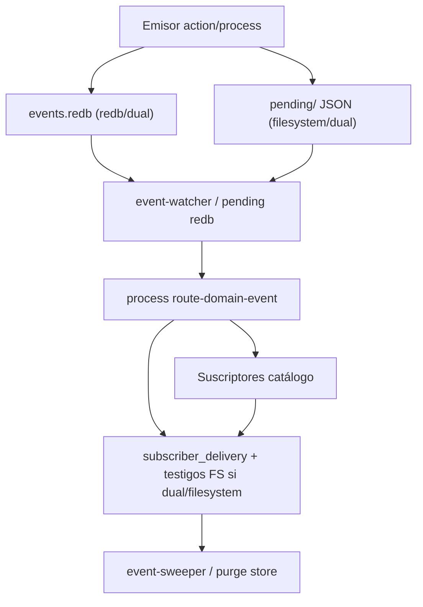

# Contrato de Eventos (S+ Grade)

Este documento rige la familia **Event** (Clases de Evento) y el envelope **ECST** (Event Contract Standard Type) de sus instancias runtime en el bus local.

## 1. Identidad atómica de la Clase (innegociable)

Toda Clase de Evento debe definirse mediante un archivo `{name}.md` bajo `directories.events/{event_family}/` con cabecera YAML obligatoria:

| Campo | Obligatorio | Descripción |
|-------|:-----------:|-------------|
| `uuid` | Sí | UUID v4 inmutable |
| `name` | Sí | Identificador kebab-case (nombre del archivo sin extensión) |
| `version` | Sí | SemVer |
| `contract` | Sí | `events-contract v{contract_version}` |
| `event_family` | Sí | `telemetry` \| `orchestration` \| `domain` — debe coincidir con la subcarpeta física |
| `event_type` | Sí | Identificador ECST en PascalCase_Snake (p. ej. `PullRequest_Merged`) |
| `context` | Sí | Política RBAC Cerbero (`execution-contexts.md`) |
| `hash_signature` | Sí | Cicatriz Digital del **archivo Clase** (`sha256:…`); no confundir con ancla Git ni con sellos de instancia |
| `capabilities` | Sí | Array de strings para enrutamiento semántico |

El cuerpo Markdown debe incluir, como mínimo:

- **Payload ECST** — tablas `REQUIRED`, `OPTIONAL`, `FORBIDDEN`
- **Emisores autorizados** — acciones/procesos indexados
- **Suscripciones** — referencia a `eda_bus.subscriptions` / `event-subscriptions.json`

## 2. Clase vs instancia (distinción ontológica)

| Plano | Ubicación SSOT | Naturaleza | Versionado |
|-------|----------------|------------|------------|
| **Clase de Evento** | `SddIA/events/{event_family}/{name}.md` | Contrato funcional, genoma | Sí (Git) |
| **Instancia ECST** | Modo `filesystem`: `.events/{pending,processing,processed,dead-letter}/` + testigos en `{estado}/subscribers/`. Modo **`redb`** (default): `.SddIA/runtime/events.redb` (tablas `events`, `subscriber_delivery`, …). Modo **`dual`**: store + espejo FS transitorio. La ruta lógica `.events/pending/{event_id}.json` sigue siendo el identificador que reciben suscriptores; en `redb` el fichero puede no existir. | JSON volátil, runtime | No (`/.events/` en `.gitignore`; DB fuera de Git) |
| **Personalización** | `.SddIA/events/` (`eda_instance.customization`) | Overrides Vía C | No |

Toda ruta operativa se resuelve vía `cumulo.paths.json`. Prohibido hardcodear literales fuera del SSOT inyectado.

## 3. Envelope ECST (instancia runtime)

Toda instancia persistida en el bus debe ser JSON UTF-8 con la forma:

```json
{
  "event_id": "<uuid-v4>",
  "event_type": "<PascalCase_Snake>",
  "timestamp": "<ISO-8601 UTC>",
  "emitter_agent": "<string>",
  "correlation_id": "<uuid-v4|null omitido>",
  "payload": { }
}
```

| Campo raíz | Obligatorio | Regla |
|------------|:-----------:|-------|
| `event_id` | Sí | UUID v4; minteado en emisión |
| `event_type` | Sí | Debe existir Clase catalogada en el Códice de su familia (`events/{family}/index.md`) |
| `timestamp` | Sí | ISO-8601 UTC |
| `emitter_agent` | Sí | Identificador del emisor indexado |
| `correlation_id` | No | UUID v4; solo si aplica saga causal |
| `payload` | Sí | Objeto; forma gobernada por la Clase |
| `delivery_state` | No | **Legacy Ola A** — prohibido mutar tras emisión en V3; trazabilidad vía testigos de suscriptor |

## 4. Ciclo de vida del bus (Ola C V3+)

Resolución vía `event_bus` / `eda_bus` en `cumulo.paths.json`. Modo de almacenamiento: variable de entorno `SDDIA_EVENT_STORE` → `filesystem` | `dual` | **`redb`** (default si ausente o desconocido; ver `sddia-event-store/src/gate.rs`).

| Modo | Padre ECST | Estado de entrega por suscriptor | Testigos FS |
|------|------------|----------------------------------|-------------|
| `redb` | Tabla `events` en `.SddIA/runtime/events.redb` | SSOT: tabla `subscriber_delivery` | No (salvo sidechannels) |
| `filesystem` | JSON inmutable en `eda_bus.pending` | Testigos bajo `processing/processed/dead-letter/subscribers/` | Sí |
| `dual` | Store + JSON pending | Store **y** testigos FS durante transición | Sí |



1. Emisores registran el ECST con `record_ecst` / `materialize_pending_domain_event`: en **`redb`** solo store; en **`filesystem`** JSON en `eda_bus.pending`; en **`dual`** ambos.
2. `event-watcher` reclama entregas **`Pending`** en store y/o detecta JSON en `pending/`; invoca `route-domain-event` con `event_file_path` lógico (`.events/pending/{event_id}.json`) aunque el fichero no exista en `redb`.
3. `route-domain-event` carga el ECST desde fichero si existe; si no, desde store (`load_dispatched_event`). Valida contra la Clase catalogada.
4. Fan-out asíncrono a suscriptores (`event-subscriptions.json`). Cada intento actualiza `subscriber_delivery` cuando el store está activo; en `filesystem`/`dual` también materializa testigos JSON bajo `processing/subscribers/`.
5. Resultado por suscriptor: `success`, `failed` o `skipped-<motivo>` en la respuesta del router; en store se persisten como `DeliveryStatus` (`success`, `failed`, `skipped`). **Prohibido** registrar `success` cuando el handler no produjo efecto (laudo AUT-20).
6. Idempotencia ante re-enrutado: `terminal_witness_exists` consulta entrega terminal en **`subscriber_delivery`** (modo store) **y/o** testigo en `processed_subscribers` / `dead_letter_subscribers` (modo FS).
7. Dead-letter: índice `dead_letter_index` en store y/o cabecera en `dead-letter/`; replay vía `EventStore::replay` / CLI `--replay-dead-letter`. Reintentos del watcher: hasta 3 intentos por clave de ruta.
8. `event-sweeper` sigue siendo recolector de artefactos FS stale en modos con fichero; en **`redb`** puro la purga del padre y filas terminales es responsabilidad del store y de `try_sweep_event` / `purge_store_event`.
9. **`PullRequest_Presented` → `pull-request-review`:** antes del subprocess, `resolve_pull_request_lifecycle` (gh → rama remota → ref `pull/N/head`) activa `merge_already_done` si el PR ya está mergeado; evita dead-letter por checkout cuando la rama fue podada post-merge.

## 5. Aseguramiento forense de payload (laudo Ola C)

### 5.1 Eventos Git — `PullRequest_Merged`

| Campo en `payload` | Estatus | Regla |
|--------------------|---------|-------|
| `merge_commit_hash` | **REQUIRED** | 40 caracteres hex minúsculas; OID del commit en `main` post-merge (`git rev-parse HEAD`); ancla DLT IOTA |
| `hash_signature` | **FORBIDDEN** | Prohibido en payload de eventos Git (evitar contaminación semántica con sello de entidad) |
| `source_branch` | REQUIRED | — |
| `target_branch` | REQUIRED | Fijado a `"main"` en emisor canónico |
| `author` | REQUIRED | — |
| `security_clearance` | REQUIRED | Bloque auditoría |
| `participating_agents` | OPTIONAL | Agentes que intervinieron. Cada elemento declara `uuid`, `name`, `version`, `role`. Ausente: el ancla sigue. Presente: entra en el digest. |
| `authorizer` | OPTIONAL | Autorizador del merge. Ausente: el ancla sigue. Presente: entra en el digest. |

### 5.2 Mutaciones genómicas — `Domain_Entity_Created`

| Campo en `payload` | Estatus | Regla |
|--------------------|---------|-------|
| `hash_signature_new` | **REQUIRED** | Formato `sha256:` + hex; sello del artefacto naciente |
| `hash_signature_old` | **FORBIDDEN** en create | Debe ser `null` |
| `payload_schema_hash` | **OPTIONAL** | Transición Ola A; huella del esquema normativo cuando el emisor la calcule |
| `entity_uuid` | REQUIRED | UUID v4 |
| `entity_class` | REQUIRED | Enum genoma |
| `entity_name` | REQUIRED | kebab-case |
| `version` | REQUIRED | SemVer resultante |
| `lifecycle_operation` | REQUIRED | `"create"` |
| `changes_summary` | REQUIRED | ≤ 2048 UTF-8 |

Variantes **Updated** y **Deleted** se documentan en sus Clases; heredan la distinción entre sello de artefacto y `payload_schema_hash` opcional.

## 6. Trinidad de Estímulos (`event_family`)

| Familia | Naturaleza | Emisor autorizado | Destino runtime (Fase 3+) |
|---------|------------|-------------------|---------------------------|
| `telemetry` | Ruido físico — infraestructura | CLI (Peaje Termodinámico) **y** centinelas catalogados en la Clase (`Daemon_Heartbeat`, `CI_Job_Failed`) | `./.events/telemetry/` |
| `orchestration` | Comunicación entre ED | CLI (éxito) o auditores | `./.events/orchestration/` |
| `domain` | Verdad ontológica | Cúmulo, Cerbero, Radamanto | `./.events/domain/` + V3+ `pending/` (coexistencia) |

**Regla de oro:** prohibido mezclar telemetría cruda con orquestación u ontología en la misma ruta de consumo.

**Auditoría Argos:** Clase sin `event_family` válido o con discordancia carpeta/cabecera → incumplimiento contractual.

**Instancia ECST:** el envelope JSON no incluye `event_family` en v1.1.0; la familia se infiere de la Clase al enrutar (Fase 3).

## 6.1 Frontera de auditoría DLT

`dlt_audit_scope` es un enum de la Clase: `local_only` | `external_public_interest`.

Una Clase que no declara el enum es `local_only`. Solo `external_public_interest` invoca `iota-immutable-publisher` y, con el store activo (`dual` o `redb`), deja `tx_hash` en `dlt_audit_seals`. En filesystem el recibo sigue en el testigo del evento y el store no se abre.

`PullRequest_Merged` y `System_Immunity_Certified` son `external_public_interest`. El resto del bus, incluida `Domain_Entity_Telemetry_Captured`, permanece `local_only`: la telemetría conserva su prueba local y no llama al publisher.

## 7. Índice y trazabilidad

- **`events/index.md`:** índice de familias; catálogo ECST en `events/{family}/index.md` (columna **Capabilities** obligatoria).
- Toda forja de Clase debe sincronizar el Códice de la familia vía `event-creator`.
- Mutaciones de Clase emiten `Domain_Entity_*` vía `emit-domain-mutation` cuando el flujo pase por `entity-manager`.

## 8. Límites

- Las Clases **no** enrutan el bus ni anclan DLT directamente.
- Los emisores (`emit-pr-merged-event`, `emit-domain-mutation`, …) **no** sustituyen la definición de Clase; deben conformarse a ella.
- Argos puede rechazar instancias cuyo `payload` viole las tablas REQUIRED/FORBIDDEN de la Clase vigente.
- **Validación en runtime (Ola C V3+):** el proceso `route-domain-event` compara cada instancia contra la Clase catalogada; violaciones → testigo `ecst-gate` en `dead-letter/subscribers/`; el padre permanece en `pending/` hasta consenso del sweeper.