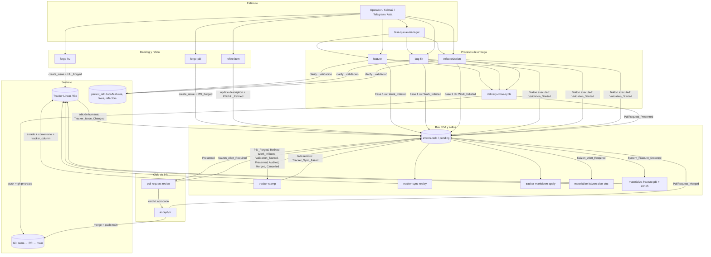
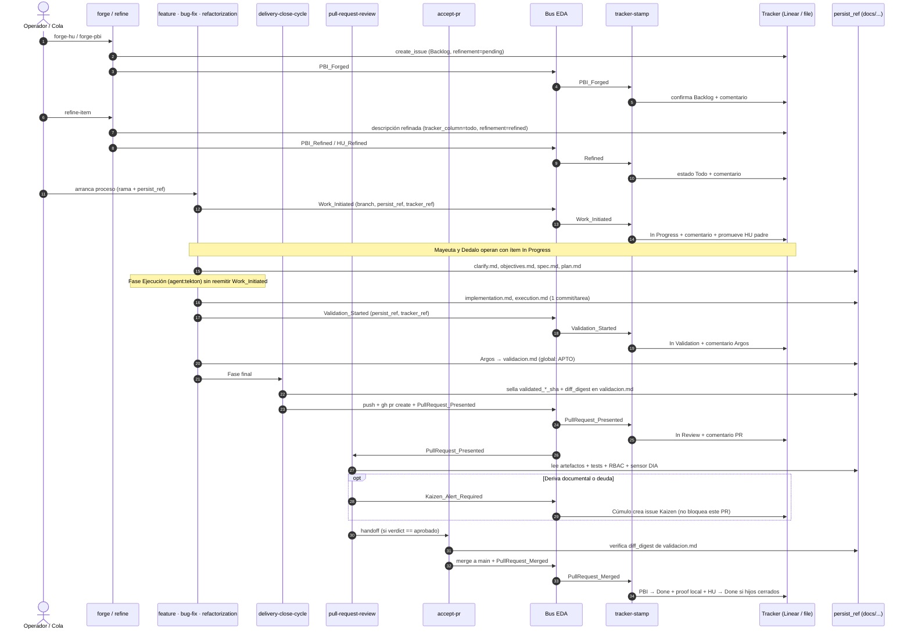
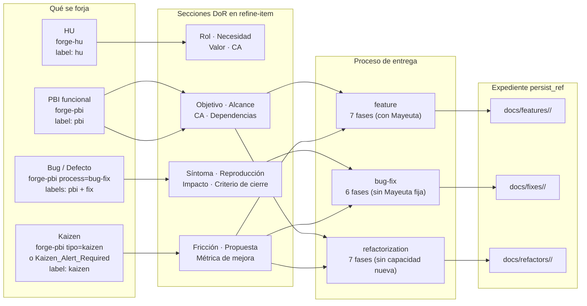

# Ciclo de vida de software en SddIA

Informe de visibilidad para operadores, agentes y revisión humana.  
Fecha de corte del cuerpo narrativo: 2026-11-02. Instancia de referencia: Core-self (`.SddIA/project.md`).  
Versión **1.2.0** (esta). La **1.0.0** queda congelada en `docs/audits/ciclo-vida-software-sddia-v1.0.0.md`. La **1.1.0** quedó superseded por esta revisión (AUT-63 merge).

Este documento describe **qué existe**, **quién lo mueve**, **cómo se conectan las piezas** y **qué le ocurre al documento** (fichero Markdown o issue de tracker). No sustituye los contratos: si hay conflicto, mandan el proceso `.md`, el motor `execute-process` y el manifiesto del proyecto.

## Control de versión

| Versión | Qué cambia |
| --- | --- |
| 1.0.0 | Corte inicial. §9 lista cinco límites, cuatro de ellos asimetrías genoma/código. |
| 1.1.0 | Misma fotografía del código. §9 numera hallazgos A1–A5, liga A1–A4 al fix AUT-63 y declara el estado objetivo sin afirmar que el genoma ya está alineado. |
| 1.2.0 | Tras merge AUT-63 (rama `Fix_Events_Multiple_02`): §9 marca A1–A4 **alineados** en genoma/código; A5 sin cambio. |

---

## 1. Dos planos que no hay que mezclar

| Plano | Qué es | Dónde vive | Quién lo lee para saber «en qué estado está» |
| --- | --- | --- | --- |
| **Ítem de backlog** | HU, PBI, fix, kaizen, deuda, spike | Issue del tracker **o** fichero bajo `docs/todos/` | Columna del tracker (`tracker_column` / workflow) |
| **Carpeta de entrega** | Cascada de la tarea en curso | Siempre ficheros bajo `persist_ref` | Contenido de `objectives.md` … `validacion.md` |

Un PBI en **In Progress** no se muda de carpeta. En modo fichero sigue en `docs/todos/pending/` hasta **done** o **cancelled**. La carpeta `docs/features/`, `docs/fixes/` o `docs/refactors/` es el expediente de la entrega, no la columna del tablero.

En Core-self hoy:

- `tracker.provider: linear` (equipo `AUT`)
- `done_gate: linear`
- `state_map`: Backlog, Todo, In Progress, In Review, Done, Cancelled
- Etiquetas: `hu`, `pbi`, `fix`, `kaizen`, `deuda`, `spike`, `editable` (`sddia-editable`)

Con **Linear**, el alta y el refino **no** crean ficheros nuevos en `docs/todos/pending/` ni en `docs/todos/done/`. El cuerpo canónico del ítem va en la **descripción del issue** (YAML). Los ficheros históricos en `docs/todos/` siguen siendo archivo, no la cola viva.

Con **`provider: file`** (u otro proyecto sin tracker remoto), el ítem es un `.md` y la columna es el campo `tracker_column` del frontmatter. La carpeta solo cambia en done/cancelled.

---

## 2. Vista de interacción entre elementos



### Quién habla con quién

El proceso de entrega (`feature`, `bug-fix`, `refactorization`) **no habla con Linear**. No tiene el contexto `tracker-operations`. Solo escribe en git, en `persist_ref` y en el bus (`Work_Initiated`, `Validation_Started` y, a través de `delivery-close-cycle`, `PullRequest_Presented`). Todo el trato con el tracker en el camino de ida pasa por **` forge-hu`**, **`forge-pbi`**, **`refine-item`** y **`tracker-stamp`**.



---

## 3. Elementos

### 3.1 Tipos de ítem

| Tipo | Qué representa | Cómo se distingue | Proceso que **ejecuta** el cambio de código |
| --- | --- | --- | --- |
| **HU** | Historia raíz. No tiene padre. | Etiqueta `hu`. Alta: `forge-hu`. | No ejecuta código. Agrupa PBI. |
| **PBI** | Unidad de entrega bajo una HU (o suelta). | Etiqueta `pbi`. Alta: `forge-pbi`. | `feature`, `bug-fix` o `refactorization` según el campo `process` del alta. |
| **fix** (bug) | PBI de defecto. No existe un proceso llamado `bug`. | Etiqueta `fix`. `forge-pbi` con `process: bug-fix` (o `tipo: fix`). | **`bug-fix`**. |
| **kaizen** | PBI de mejora. No existe un proceso llamado `kaizen`. | Etiqueta `kaizen`. `forge-pbi` con `tipo: kaizen`, o cicatriz automática. | El que se elija al ejecutar: `feature`, `bug-fix` o `refactorization`. |
| **deuda** / **spike** | Variantes de PBI. | Etiquetas homónimas. | Igual: el proceso de entrega es uno de los tres. |

`forge-pbi` siempre pone la etiqueta `pbi` y, además, una etiqueta de tipo si aplica (`fix`, `kaizen`, `deuda`, `spike`). Un bug es un PBI con etiqueta `fix`. Un kaizen es un PBI con etiqueta `kaizen`.

### 3.2 Procesos (códex `codex-software-engineering` + cola Core)

**Antes de codificar**

| Proceso | Efecto |
| --- | --- |
| `forge-hu` | Crea la HU en **Backlog**. Emite `HU_Forged`. |
| `forge-pbi` | Crea el PBI en **Backlog**, hijo de la HU si hay `historia_ref` / `parent_ref`. Emite `PBI_Forged`. |
| `refine-item` | Preparación → Mayeuta → DoR → registro `tracker_ref` → sellado Argos (`update_issue_description`) + `PBI_Refined` o `HU_Refined`. El sello pasa el ítem a **Todo**. |

**Entrega (rama + PR)**

| Proceso | Cadena | Carpeta de expediente habitual |
| --- | --- | --- |
| `feature` | Init git → Mayeuta → Dedalo → Tekton → Argos → cierre documental → `delivery-close-cycle` | `docs/features/<nombre>/` |
| `bug-fix` | Init git → Dedalo → Tekton → Argos → cierre documental → `delivery-close-cycle` | `docs/fixes/<nombre>/` |
| `refactorization` | Igual que `feature` (estabilización de alcance, sin capacidad nueva) | `docs/refactors/<nombre>/` |

Mayeuta en `bug-fix` es opcional y solo si el defecto es ambiguo.

**Después del PR**

| Proceso | Fases reales | Efecto |
| --- | --- | --- |
| `delivery-close-cycle` | Snapshot final → Impacto SddIA → Aduana evolution → Aduana EDA → Integridad índices → Gate pre-PR QA → Sello diff `validacion.md` → Push → Apertura en forja (`gh`) → `PullRequest_Presented` → Higiene local | Abre el PR y emite el evento. No hace merge. |
| `pull-request-review` | Preparación de rama → Triaje documental (Argos) → Triaje técnico + sensor DIA → Certificación RBAC (Cerbero) → Veredicto y bloqueo → Cosecha Kaizen (Cúmulo) → Handoff a `accept-pr` | Aduana. Si `verdict: aprobado`, invoca `accept-pr`. No hace `git merge` por sí mismo. |
| `accept-pr` | Auditoría Genómica (Argos) → Fusión Soberana (verifica `diff_digest` + `merge --no-ff` en `main`) → `PullRequest_Merged` → Push de `main` y borrado de rama local y remota | Único proceso que fusiona en `main`. |

**Entrada por cola o estímulo**

| Proceso / evento | Rol |
| --- | --- |
| `Manual_Task_Requested` (Kalma2 / Telegram) o `Aiua_Process_Requested` | Disparan `task-queue-manager` (`automatic_task`). |
| `task-queue-manager` | Triaje → Activación → Despacho (`feature` \| `bug-fix` \| `refactorization`) → Finalización. |

### 3.3 Agentes y qué toca cada uno

| Agente | En backlog / refino | En entrega (`persist_ref`) | En PR y bus |
| --- | --- | --- | --- |
| **Mayeuta** | Expande idea en `forge-pbi`; refina cuerpo en `refine-item` | `clarify.md`, `objectives.md` (`feature`, `refactorization`, `bug-fix` ambiguo) | Enriquece PBI de fractura (`enrich-fracture-pbi-kaizen`) |
| **Dedalo** | — | `spec.md`, `plan.md` (lee `objectives.md` o `bug_summary`) | `fix-tool-process` si una tool/skill se degrada |
| **Tekton** | Ejecuta `tracker-stamp`, `tracker-sync-replay`, `tracker-markdown-apply`, `task-queue-manager` | Código + `implementation.md` + `execution.md` (lee `clarify`, `spec`, `plan`) | — |
| **Argos** | Sella `tracker_ref` en `forge-pbi` y descripción en `refine-item` | `validacion.md` (lee `objectives` + `spec` / `bug_summary`); aduanas de `delivery-close-cycle` | `pull-request-review`, auditoría de `accept-pr`, avisos Telegram |
| **Cerbero** | — | — | Fase RBAC de `pull-request-review` |
| **Cúmulo** | — | Resuelve rutas (`cumulo.paths.json`) | Cicatriz `materialize-kaizen-alert-doc`, fracturas, índices, IOTA |

### 3.4 Columnas del tracker y orden de precedencia

Claves canónicas (`tracker.state_map`). En Linear Core-self el nombre visible es el de la columna derecha.

| Rango | Canónico | Linear (Core-self) | Significado operativo |
| --- | --- | --- | --- |
| 0 | `backlog` | Backlog | Ítem creado, aún no listo para coger. |
| 1 | `todo` | Todo | Refinado (DoR). Listo para arrancar la entrega. |
| 2 | `in_progress` | In Progress | Tras Fase 1: `Work_Initiated`. Tekton codifica. |
| 3 | `in_validation` | In Validation | Tras fase Tekton ejecutada: `Validation_Started`. Argos valida. |
| 4 | `in_review` | In Review | Hay PR presentado. |
| 5 | `done` | Done | Entrega fusionada (o commit en tronco directo). |
| 100 | `cancelled` | Cancelled | Ítem anulado. El markdown, si existe, se archiva. |

**Regla anti-retroceso:** `tracker-stamp` y `tracker-sync-replay` usan ese rango para no atrasar un issue si un evento llega tarde. Si el ítem ya está en `in_progress`, un `todo` rezagado se descarta. Si está en `in_validation`, un `in_progress` rezagado se descarta. Si está en `in_review`, un `in_validation` o `in_progress` rezagado se descarta.

`refinement` es otro eje y no es una columna: `pending` al forjar, `refined` al pasar el DoR. No usar `status: pending` como sustituto de columna.

### 3.5 Dos documentos por entrega

1. **Ítem** (issue o `docs/todos/…/*.md`): identidad, tipo, columna, cuerpo de historia / síntoma / fricción.
2. **Expediente** (`persist_ref`): norma `features-documentation-pattern` v1.3.1.

| Archivo | Quién lo escribe | Quién lo lee después | Obligatorio |
| --- | --- | --- | --- |
| `clarify.md` | Mayeuta | Tekton | `feature` y `refactorization`. En `bug-fix`, solo si intervino Mayeuta. |
| `objectives.md` | Mayeuta (en lab, `workspace-init` crea uno mínimo en fase 1) | Dedalo (como `refined_requirements`), Argos | Igual. |
| `spec.md` | Dedalo | Tekton, Argos, `pull-request-review` | Los tres procesos. |
| `plan.md` | Dedalo | Tekton (1 commit por tarea), `pull-request-review` | Si hay blueprint de tareas. |
| `implementation.md` | Tekton | Argos, `pull-request-review` | Los tres. |
| `execution.md` | Tekton | Argos | Los tres. |
| `validacion.md` | Argos → sellado diff por `delivery-close-cycle` → verificado por `accept-pr` | Gate pre-PR y gate de merge | Los tres. Una sola vez, en la rama, antes del merge. `global: APTO` es gate. |

Frontmatter de expediente: `feature_name`, `process` (`feature` | `bug-fix` | `refactorization`), `created` (ISO). En un fix, `feature_name` lleva el identificador del defecto o el nombre de rama: el campo se llama así por contrato del índice, no porque el trabajo sea una feature. Prohibido mantener `.json` paralelos (`spec.json`, `validacion.json`, etc.).

---

## 4. Comportamiento: de la idea al merge

### 4.1 Alta

**HU (`forge-hu`)**

- Entrada: `raw_idea`, `project_slug`.
- Crea issue con etiqueta `hu`, sin padre, estado **Backlog**.
- Descripción inicial con `type: hu`.
- Evento `HU_Forged`. El catálogo de suscripciones de dominio no engancha `tracker-stamp` a ese evento: el estado Backlog lo pone el propio `create_issue`.

**PBI (`forge-pbi`)**

- Entradas: `raw_idea`, `project_slug`, `process` (`feature` | `bug-fix` | `refactorization`), `historia_ref` opcional, `tipo` opcional.
- Etiqueta de tipo:

| Señal | Etiqueta extra |
| --- | --- |
| `process: bug-fix`, o `tipo: fix` | `fix` |
| `tipo: kaizen` (o «mejora») | `kaizen` |
| `tipo: deuda` | `deuda` |
| `tipo: spike` | `spike` |
| `tipo` operativo / feature / refactorization | solo `pbi` |

- Estado inicial **Backlog**. Frontmatter de alta: `tracker_column: backlog`, `refinement: pending`.
- Evento `PBI_Forged` → `tracker-stamp` confirma Backlog y comenta el `document_id`.

### 4.2 Refino (`refine-item`) — el paso a Todo

No abre rama ni escribe el expediente de `persist_ref`. Trabaja en `.SddIA/workspaces/refine-item/{execution_id}/`.

Sus 5 fases internas y sus salidas posibles:

1. **Preparación:** `fetch_issue`, normaliza el markdown (acepta tanto frontmatter `---` como bloque ```` ```yaml ```` de Linear) y escribe `brief.json`.
2. **Refinamiento Mayeuta:** produce `verdict.json` e `item.refined.md`. Si Mayeuta deja preguntas abiertas, el proceso termina con `status: needs_clarification` (no sella Todo). Si no hay runtime de agentes configurado, queda en `awaiting_agents`. Si Mayeuta falla, emite `System_Fracture_Detected`.
3. **Validación DoR:** comprueba que existan los encabezados `#` con cuerpo no vacío según `item_type`:

| `item_type` | Secciones exigidas |
| --- | --- |
| `hu` | Rol, Necesidad, Valor, Criterios de aceptación |
| `pbi` (defecto) | Objetivo, Alcance, Criterios de aceptación, Dependencias |
| `fix` | Síntoma, Reproducción, Impacto, Criterio de cierre |
| `kaizen` | Fricción, Propuesta, Métrica de mejora |
| `deuda` | Origen, Coste de mantenerla, Propuesta |
| `spike` | Pregunta, Timebox, Entregable |

El tipo se deduce en este orden: campo `type` del frontmatter → etiquetas del issue (`hu`, `fix`, `kaizen`, `deuda`, `spike`, `pbi`) → `pbi`.

4. **Registro en Tracker:** toma `tracker_ref` del issue leído si faltaba en el frontmatter; si el frontmatter contradice al issue remoto, devuelve `status: conflict` (no crea otro issue).
5. **Sellado Argos:** actualiza la descripción con `tracker_column: todo`, `refinement: refined`, `refined: "<fecha>"` (y elimina cualquier `status: pending` legado) y emite `PBI_Refined` o `HU_Refined`.
6. `tracker-stamp` recibe el evento, mueve el estado de Linear a **Todo** y añade comentario.

Hasta aquí el ítem está «en el todo» del tablero. **Arrancar el proceso de entrega no lo saca de Todo.**

### 4.3 Ejecución — el paso a In Progress

Solo `feature`, `bug-fix` y `refactorization` emiten `Work_Initiated`.

El motor lo emite **una sola vez**, al **entrar en la primera fase que delega en `agent:tekton`** (fase Ejecución), no al crear la rama.

| Proceso | Sigue en Todo durante | Pasa a In Progress cuando |
| --- | --- | --- |
| `feature` | Fase 1 (git), Fase 2 (Mayeuta), Fase 3 (Dedalo) | Entra en Fase 4 (Tekton) |
| `refactorization` | Fase 1 (git), Fase 2 (alcance), Fase 3 (diseño) | Entra en Fase 4 (Tekton) |
| `bug-fix` | Fase 1 (git), Fase 2 (Dedalo) | Entra en Fase 3 (Tekton) |

Cómo resuelve `tracker-stamp` qué ítem mover:

1. Mira `payload.tracker_ref`.
2. Si no viene, mira `payload.pbi_ref` y extrae `tracker_ref` del frontmatter de ese fichero.
3. En modo `file`, si tampoco viene, intenta resolver el PBI desde `persist_ref`.
4. **Si no puede resolver la referencia, devuelve no-op (`sin tracker_ref`)**: la entrega sigue, pero el tablero no se mueve.

Efectos de `Work_Initiated` cuando sí hay referencia:

- Issue PBI → **In Progress** (si no lo estaba ya).
- Comentario `Work iniciado — rama … · persist …`.
- Descripción del issue: `tracker_column: in_progress`.
- **Promoción de la HU padre:** si el PBI tiene `parent` y esa HU está en `backlog` o `todo`, `tracker-stamp` pasa la HU a **In Progress** en ese mismo acto.
- Modo fichero: parchea `tracker_column: in_progress` en el `.md` sin moverlo de `docs/todos/pending/`.

Lab: `SDDIA_LAB_SKIP_WORK_INITIATED` suprime el evento.

### 4.3bis Validación — el paso a In Validation (AUT-66)

Tras cerrar la fase `agent:tekton` con `status: executed` (no `failed` ni `simulated` de laboratorio que no ejecutó código), el motor emite **una sola vez** `Validation_Started` (fail-soft).

Efectos cuando hay `tracker_ref` resoluble (misma cadena que `Work_Initiated`):

- Issue PBI → **In Validation**.
- Comentario `Validación Argos iniciada — persist …`.
- Descripción: `tracker_column: in_validation`.
- Modo fichero: parchea `tracker_column: in_validation` en el `.md` en `docs/todos/pending/`.

`PullRequest_Presented` sigue pudiendo avanzar desde `in_validation` a `in_review`.

### 4.4 Verificación, sello de diff y cierre documental (antes del PR)

1. **Fase 5 (`feature` / `refactorization`) o Fase 4 (`bug-fix`) — Argos:** escribe `validacion.md` con `global`, `branch`, `checks`, `git_changes`.
2. **Fase 6 (`feature` / `refactorization`) o Fase 5 (`bug-fix`) — Cierre documental en rama (`feature-pbi-archive`):**

| Configuración | Qué hace esta fase |
| --- | --- |
| `provider: file` (o `done_gate: git`) | Exige `validacion.md` APTO + `pbi_archived: true` y mueve el PBI de `docs/todos/pending/` a `docs/todos/done/` en la misma rama del PR. |
| `done_gate: linear` (Core-self) | Comprueba el estado en Linear (`fetch_issue`); no exige `pbi_archived` ni fichero en `done/`. |
| `done_gate: both` | Consulta Linear; si Linear cae, hace fallback fail-soft a `git` con `warn` y emite `Tracker_Sync_Failed`. |

Prohibido un segundo PR `docs/cerrar-pbi-*` solo para cerrar el papeleo.

3. **Fase final → `delivery-close-cycle`:** antes de hacer push pasa cinco controles seguidos:
   - **Impacto SddIA condicional:** evalúa caminos tocados bajo `SddIA/`.
   - **Aduana evolution:** `sddia-qa gate-evolution --json --range --sync-base`. Bloquea si hay cambio material en el Core sin registro en `SddIA/evolution/`.
   - **Aduana EDA genómica:** `sddia-qa audit-eda-coverage --scan --json`. Bloquea si hay entidades indexadas huérfanas de evento `Domain_Entity_Created` (salvo `backfill-manifest.json` activo, que degrada a `warn`).
   - **Aduana integridad índices:** `verify-process-integrity` y `verify-tools-index`.
   - **Gate pre-PR QA + Sello diff `validacion.md`:** exige árbol limpio y atestación QA para el `tree_sha` de `HEAD`; exige `global: APTO` en `validacion.md`; escribe en ese mismo `validacion.md` los campos `validated_base_sha`, `validated_head_sha`, `validated_tree_sha` y `diff_digest` (sha256 del diff `merge-base..HEAD` excluyendo el propio `validacion.md`) y lo commitea antes del push.

### 4.5 PR, revisión y merge soberano

1. **Apertura:** `delivery-close-cycle` hace push, abre o resuelve el PR con `gh` (`skill:shell-executor`, nunca `git-manager`) y emite `PullRequest_Presented`.
2. **Paso a In Review:** `tracker-stamp` recibe `PullRequest_Presented`, pasa el issue a **In Review**, escribe `tracker_column: in_review` en la descripción y comenta la URL del PR.
3. **Aduana (`pull-request-review`):** otro suscriptor de `PullRequest_Presented`.
   - Argos revisa la presencia y frontmatter de `spec.md`, `plan.md`, `implementation.md` y `objectives.md` en `persist_ref`. No reescribe el sello de diff de `validacion.md`.
   - Ejecuta tests/SAST y el sensor DIA (`audit-doc-parity`). Si DIA detecta deriva documental, emite `Kaizen_Alert_Required` (fricción suave, no bloquea el PR).
   - Cerbero certifica RBAC del firmante.
   - Si el veredicto es `aprobado`, la última fase hace handoff e invoca **`accept-pr`**. (`accept_pr_handoff` solo vale `true` si `accept-pr` llegó a consumarse).
4. **Fusión (`accept-pr`):**
   - Argos audita la rama.
   - Recalcula el `diff_digest` de `validacion.md`; si alguien tocó la rama después del sello sin resellar, aborta con `diff_seal_mismatch`. (Si hubo un resellado legítimo en rama, existe el evento `PullRequest_Resealed`).
   - Hace `checkout main`, `merge --no-ff`, emite **`PullRequest_Merged`**, hace push de `main` y borra la rama local y remota (si falla el borrado, deja `hygiene_failure` explícito sin ocultar el merge).
   - `gh pr merge` está prohibido como sustituto de este flujo.
5. **Paso a Done:** `tracker-stamp` recibe `PullRequest_Merged`:
   - Pasa el PBI a **Done**, actualiza `tracker_column: done` y comenta el SHA.
   - Escribe la prueba local `.SddIA/proofs/tracker-done/{tracker_ref}.json` (la que lee el hook pre-push sin necesitar red).
   - **Roll-up de la HU:** consulta los hijos de la HU padre; si todos están en `done` o `cancelled` y al menos uno está en `done`, pasa la HU a **Done**.

En modo tronco directo (`trunk_direct`) no hay PR: el evento equivalente es `Delivery_Committed` y produce el mismo sello Done y roll-up.

### 4.6 Cancelación

`PBI_Cancelled` → `tracker-stamp` pasa el issue a **Cancelled** (respetando la regla anti-retroceso), comenta el motivo y, si existe fichero local (`pbi_ref` + `project_slug`), sella `tracker_column: cancelled` y lo mueve de `pending/` a `docs/todos/done/`.

---

## 5. Flujos por tipo



### 5.1 HU

```text
forge-hu → Backlog (type: hu)
refine-item (DoR: Rol, Necesidad, Valor, Criterios de aceptación)
         → Todo
primer hijo Work_Initiated → In Progress
todos los hijos cerrados   → Done
```

La HU no tiene `persist_ref` propio ni cascada `spec.md`. El expediente vive en cada PBI.

### 5.2 PBI de feature

```text
forge-pbi process=feature          → Backlog, etiqueta pbi
refine-item item_type=pbi          → Todo
./sddia-run.sh --process feature   → rama + docs/features/<nombre>/
Tekton                             → In Progress
PR                                 → In Review
merge                              → Done
```

Orden del expediente: `clarify.md` → `objectives.md` → `spec.md` → `plan.md` → `implementation.md` → `execution.md` → `validacion.md`.

### 5.3 Bug (fix)

No hay `--process bug` ni `--process fix`. El nombre ejecutable es **`bug-fix`**.

```text
forge-pbi process=bug-fix          → Backlog, etiquetas pbi + fix
refine-item item_type=fix          → Todo
   cuerpo mínimo: Síntoma, Reproducción, Impacto, Criterio de cierre
./sddia-run.sh --process bug-fix   → rama + docs/fixes/<nombre>/
```

Diferencias respecto a feature:

- Tiene **6 fases**, no 7: carece de la fase «Estabilización de Requisitos» (Mayeuta) por defecto. El diseño lo hace Dedalo directamente desde `bug_summary` (si el triaje detecta ambigüedad severa, Mayeuta puede entrar de forma opcional y dejar `clarify.md` y `objectives.md`).
- Expediente obligatorio: `spec.md`, `implementation.md`, `execution.md`, `validacion.md` (`plan.md` solo si Dedalo requiere blueprint).
- `workspace-init` en `bug-fix` acepta `branch_name` + `persist_ref` + (`bug_summary` o `fix_name`); no exige `feature_name` como input aunque luego lo rellene en el frontmatter de los `.md` para cumplir el contrato del índice.
- En el frontmatter del expediente, `process: bug-fix`.
- El sello de columna es idéntico: Todo al refinar, In Progress al entrar Tekton, In Review al presentar el PR, Done al fusionar.

### 5.4 Kaizen

Cuatro vías de entrada. Todas acaban en un **ítem de backlog**, no en un cuarto proceso de entrega.

**A. Alta deliberada**

```text
forge-pbi process=<feature|bug-fix|refactorization> tipo=kaizen
  → Backlog, etiquetas pbi + kaizen
refine-item
  → DoR: Fricción, Propuesta, Métrica de mejora
  → Todo
ejecución con el process elegido en el alta
```

**B. Cicatriz automática de aduana (`Kaizen_Alert_Required`)**

La emiten `pull-request-review` (sensor DIA de paridad documental) o `event-bus-audit` (anomalías accionables del bus; el volumen histórico de dead-letter no dispara Kaizen).  
Único suscriptor: Cúmulo, acción `materialize-kaizen-alert-doc`.

- Si el proyecto **tiene tracker** (Core-self): crea un **issue** titulado `Kaizen {hash8}`, etiqueta `kaizen`. Si ese hash ya existe en los títulos del proyecto, es idempotente y no duplica. `hash8` sale de `review_id` + ficheros implicados ordenados.
- Si **no** hay tracker: materializa `PENDING_AUDIT_DOC_{hash8}.md` en `docs/todos/pending/` (también deduplica por huella `alert_kind` + ficheros implicados si sigue abierto).

Esa cicatriz **no** arranca sola `feature` / `bug-fix` / `refactorization`. Hay que refinarla y lanzar el proceso de entrega que corresponda.

**C. Fractura sistémica y fallo crónico de CI**

- `System_Fracture_Detected` (colapso de proceso — protocolo Kintsugi): el operador detiene la ejecución; Cúmulo ejecuta `materialize-fracture-pbi` (crea el PBI en Backlog con etiquetas `pbi` + `fix` y emite `Fracture_Pbi_Materialized`); Mayeuta suscribe ese evento y ejecuta `enrich-fracture-pbi-kaizen` sobre ese mismo sumidero. Si una fractura se recupera sola, existe el proceso de poda `phagocyte-recovered-fracture-pbis`.
- `CI_Chronic_Failure_Detected`: Cúmulo ejecuta `materialize-ci-chronic-failure-pbi`.

**D. Idea rápida por Telegram**

`telegram-gateway` puede clasificar un mensaje entrante como `Kaizen_Idea_Captured` (actualmente registrado en el catálogo sin suscriptor automático de forja; sirve como traza en el store de eventos).

**Implementar el kaizen:** cuando se ejecuta, el expediente cae en `docs/features/`, `docs/fixes/` o `docs/refactors/` según el proceso con el que se corra. El prefijo `kaizen-` en el nombre de carpeta es convención humana, no una regla del motor.

---

## 6. Qué cambia en el documento, y cuándo

### 6.1 Issue (Linear, Core-self)

| Momento | Estado workflow | Qué cambia en la descripción (YAML) | Comentarios / pruebas |
| --- | --- | --- | --- |
| `forge-hu` | Backlog | `process: feature`, `type: hu`, `created`, `project_slug` | — |
| `forge-pbi` + `PBI_Forged` | Backlog | `tracker_column: backlog`, `refinement: pending` | `PBI forjado: <document_id>` |
| `refine-item` + `PBI/HU_Refined` | Todo | `tracker_column: todo`, `refinement: refined`, `refined: "<fecha>"` + cuerpo con secciones DoR | `PBI/HU refinado: <doc> v<ver>` |
| `Work_Initiated` | In Progress (y HU padre → In Progress) | `tracker_column: in_progress` | `Work iniciado — rama … · persist …` |
| `Validation_Started` | In Validation | `tracker_column: in_validation` | `Validación Argos iniciada — persist …` |
| `PullRequest_Presented` | In Review | `tracker_column: in_review` | `PR presentado: <pr_url>` |
| `PullRequest_Audited` | (sin cambio) | (sin cambio) | `Auditoría PR: <resolution>` |
| `PullRequest_Merged` / `Delivery_Committed` | Done (y roll-up HU → Done si procede) | `tracker_column: done` | Comentario merge + `.SddIA/proofs/tracker-done/{tracker_ref}.json` |
| `PBI_Cancelled` | Cancelled | — | `PBI cancelado: <reason>` |

El expediente bajo `docs/features|fixes|refactors/` **no es** la descripción del issue. La descripción del issue nunca recibe el contenido de `spec.md` ni de `validacion.md`.

**Camino inverso (Linear → repo):**

1. `linear-bridge-watcher` (polling o webhook de laboratorio) detecta cambios en issues con etiqueta `hu` o `pbi` y emite `Tracker_Issue_Changed`.
2. **Anti-eco:** las llamadas que hace el propio SddIA (`tracker-stamp`, `forge-pbi`, `refine-item`) dejan rastro en `.SddIA/state/tracker-outbound/{tracker_ref}.jsonl` (o marcador `sddia-sync-id`). El watcher las ignora para no crear un bucle infinito.
3. `tracker-markdown-apply` aplica el cambio sobre el markdown local si existe, pero **nunca en `main`**: commitea en una rama `tracker-sync/{project_slug}`.
   - Si el cambio en Linear fue de `description`, **solo** se vuelca al cuerpo del `.md` si el issue tiene la etiqueta `sddia-editable` (`tracker.labels.editable`). Sin esa etiqueta, es `warn` no-op.
   - Si el `.md` local se modificó después de `linear_updated_at`, gana el repositorio y se emite `Tracker_Sync_Failed` (`TRACKER_STATE_DIVERGED`).

**Fallos de red o de GraphQL (`Tracker_Sync_Failed`):**

Si `tracker-stamp` falla al hablar con Linear, no rompe el proceso de entrega ni declara fractura: emite `Tracker_Sync_Failed` y el suscriptor `tracker-sync-replay` hace `fetch_issue` y reintenta la transición (siempre que el rango del estado siga siendo un avance).

### 6.2 Fichero de ítem (`provider: file`)

| Evento | `tracker_column` | Carpeta |
| --- | --- | --- |
| `PBI_Forged` | `backlog` | `docs/todos/pending/` |
| `PBI_Refined` / `HU_Refined` | `todo` | sigue en `pending/` |
| `Work_Initiated` | `in_progress` | sigue en `pending/` |
| `Validation_Started` | `in_validation` | sigue en `pending/` |
| `PullRequest_Presented` | `in_review` | sigue en `pending/` |
| `PullRequest_Merged` / `Delivery_Committed` | `done` | pasa a `docs/todos/done/` (en Fase 6 del proceso, dentro de la rama del PR) |
| `PBI_Cancelled` | `cancelled` | pasa a `docs/todos/done/` |

No existe carpeta `in_progress/` ni `in_review/`.

### 6.3 Expediente (`persist_ref`) — siempre fichero

| Momento del ciclo | Ficheros en `persist_ref` | Qué se sella dentro | Columna del ítem |
| --- | --- | --- | --- |
| Fase 1 — Init (git) | En lab: `objectives.md` mínimo con `execution_id` | `feature_name`, `process`, `created`, `branch_name`, `persist_ref` | Todo (o Backlog si no se refinó) |
| Fase 2 — Mayeuta (`feature` / `refactorization`) | `clarify.md`, `objectives.md` | Requisitos estabilizados | Todo |
| Fase 3 / 2 — Dedalo | `spec.md`, `plan.md` | Blueprint técnico y lista de tareas | Todo |
| Fase 4 / 3 — Tekton | `implementation.md`, `execution.md` | Touchpoints y 1 commit por tarea del `plan.md` | **In Progress** (al entrar en la fase) |
| Fase 5 / 4 — Argos | `validacion.md` | `global: APTO \| NO_APTO`, `branch`, `checks`, `git_changes` | In Progress |
| Fase 6 / 5 — Cierre doc | `validacion.md` (`pbi_archived` si `file`) | En `file`, mueve PBI a `done/` | In Progress |
| `delivery-close-cycle` | `validacion.md` (sello criptográfico del diff) | Añade `validated_base_sha`, `validated_head_sha`, `validated_tree_sha`, `diff_digest` y hace commit antes del push | Pasa a **In Review** al salir `PullRequest_Presented` |
| `pull-request-review` | (lectura) | Verifica presencia de `spec`, `plan`, `implementation`, `objectives`; no toca el sello de `validacion.md` | In Review |
| `accept-pr` | (lectura) | Verifica que `diff_digest` coincida con el árbol real antes de hacer `merge --no-ff` | Pasa a **Done** al salir `PullRequest_Merged` |

Definición de Done vigente:

```text
Done = un único PR mergeado en main
     + validacion.md con global APTO y diff_digest íntegro dentro de ese PR
     + cierre del tracker:
         file   → pbi_archived true y PBI en docs/todos/done/ en esa rama
         linear → issue en Done; sin fichero nuevo en pending/ ni done/
```

Un check de CI no puede contarse como APTO sin `run_id` o URL de run verde. Si falta, el valor es `PENDIENTE-CI` y `global` no es APTO.

---

## 7. Mapa completo evento → emisor → suscriptor → efecto documental

| Evento | Emisor | Suscriptor(es) en catálogo | Efecto sobre issue / fichero |
| --- | --- | --- | --- |
| `HU_Forged` | `forge-hu` | `tekton.tracker-stamp` | Sello backlog + comentario idempotente (paridad `PBI_Forged`). |
| `PBI_Forged` | `forge-pbi` | `tekton.tracker-stamp` | Backlog + `tracker_column: backlog` + comentario `document_id`. |
| `HU_Refined` | `refine-item` | `tekton.tracker-stamp` | Todo + `tracker_column: todo` + comentario versión. |
| `PBI_Refined` | `refine-item` | `tekton.tracker-stamp` | Todo + `tracker_column: todo` + comentario versión. |
| `Work_Initiated` | Motor (cierre Fase 1 / `workspace-init`) | `tekton.tracker-stamp` | PBI → In Progress (`tracker_column: in_progress`) + comentario rama/`persist_ref` + HU padre → In Progress. |
| `Validation_Started` | Motor (cierre fase Tekton `executed`) | `tekton.tracker-stamp` | PBI → In Validation (`tracker_column: in_validation`) + comentario inicio validación Argos. |
| `PullRequest_Presented` | `delivery-close-cycle` | `argos.pull-request-review`, `tekton.tracker-stamp`, `argos.send-telegram-notification` | PBI → In Review (`tracker_column: in_review`) + comentario URL; arranca la aduana del PR. |
| `PullRequest_Resealed` | Resellado de rama | *(ninguno)* | Actualiza la correlación del sello de diff en el store para `accept-pr`. |
| `PullRequest_Audited` | Aduana PR | `tekton.tracker-stamp` | Comentario con la resolución; no cambia columna. |
| `PullRequest_Merged` | `accept-pr` | `tekton.tracker-stamp`, `cumulo.iota-immutable-publisher`, `argos.notify-humanized-pr-merged` | PBI → Done (`tracker_column: done`) + proof local + roll-up HU → Done. |
| `Delivery_Committed` | Tronco directo | `tekton.tracker-stamp` | Igual que `PullRequest_Merged` para entregas sin PR. |
| `PBI_Cancelled` | Cancelación / réplica inversa | `tekton.tracker-stamp` | Cancelled + comentario + archiva `.md` local en `done/` si existía. |
| `Kaizen_Alert_Required` | `pull-request-review` (DIA) / `event-bus-audit` | `cumulo.materialize-kaizen-alert-doc` | Crea un issue `Kaizen {hash8}` (o `PENDING_AUDIT_DOC_{hash8}.md` sin tracker). No altera el PBI en curso. |
| `System_Fracture_Detected` | Cualquier proceso colapsado | `cumulo.materialize-fracture-pbi`, `argos.send-telegram-notification` | Crea PBI de fractura (`pbi` + `fix`) en Backlog y dispara `Fracture_Pbi_Materialized`. |
| `Fracture_Pbi_Materialized` | `materialize-fracture-pbi` | `mayeuta.enrich-fracture-pbi-kaizen` | Enriquece el cuerpo del PBI de fractura con diagnóstico Kaizen. |
| `CI_Chronic_Failure_Detected` | Vigilancia CI | `cumulo.materialize-ci-chronic-failure-pbi` | Crea PBI Kaizen de fallo crónico. |
| `Tracker_Sync_Failed` | `tracker-stamp` / `tracker-markdown-apply` | `tekton.tracker-sync-replay` | Reintenta la transición o comentario en Linear si no supone retroceso. |
| `Tracker_Issue_Changed` | `linear-bridge-watcher` | `tekton.tracker-markdown-apply` | Réplica Linear → markdown en rama `tracker-sync/{project_slug}`. |

---

## 8. Qué mirar cuando alguien pregunta «¿dónde está?»

| Pregunta | Dónde mirar en Core-self |
| --- | --- |
| ¿La historia existe? | Issue con etiqueta `hu`. |
| ¿Está lista para coger? | Columna **Todo** y `refinement: refined` en la descripción. |
| ¿Por qué `refine-item` no la pasó a Todo? | Mirar `status` del envelope: `needs_clarification` (preguntas de Mayeuta), `conflict` (`tracker_ref` divergente) o huecos de secciones DoR. |
| ¿Alguien está codificando? | Columna **In Progress**. Comentario `Work iniciado — rama … · persist …`. |
| ¿Argos está validando? | Columna **In Validation**. Comentario `Validación Argos iniciada — persist …`. |
| ¿Dónde está el diseño y la validación? | Carpeta citada en ese comentario (`docs/features/`, `docs/fixes/` o `docs/refactors/`). |
| ¿Hay PR? | Columna **In Review** y comentario con URL. |
| ¿Ha tenido efecto real el sello en Linear? | Existe rastro en `.SddIA/state/tracker-outbound/{tracker_ref}.jsonl`. |
| ¿Está cerrada? | Columna **Done**, PR mergeado en `main`, `validacion.md` con `global: APTO` en ese PR y `.SddIA/proofs/tracker-done/{tracker_ref}.json`. |
| ¿Es un bug? | Etiqueta `fix` y `process: bug-fix` en el alta. Expediente bajo `docs/fixes/`. |
| ¿Es un kaizen? | Etiqueta `kaizen`. El expediente depende del proceso con el que se ejecute, no del nombre kaizen. |
| ¿Por qué el tablero no se movió al lanzar el proceso? | 1) Fase 1 falló o faltan `branch_name`/`persist_ref` en inputs. 2) `SDDIA_LAB_SKIP_WORK_INITIATED` activo. 3) Sin `tracker_ref` ni `pbi_ref` resoluble, `tracker-stamp` hace no-op. |

---

## 9. Límites y asimetrías (post AUT-63, v1.2.0)

Fotografía **vigente** tras olas A1–A4 (genoma + handlers al corte de esta versión). A5 sigue siendo límite de lectura del laboratorio.

| ID | Hallazgo histórico (v1.0.0) | Estado v1.2.0 |
| --- | --- | --- |
| A1 | Prosa de solo `docs/todos/pending/` vs dual tracker/file en Rust. | **Alineado:** catálogo, acción y Cúmulo describen issue `Kaizen {hash8}` o `PENDING_AUDIT_DOC_{hash8}.md`. |
| A2 | Fase «Cierre documental en rama» solo redactada para provider `file`. | **Alineado:** intents + prosa ramifican `tracker.provider` según `features-documentation-pattern` v1.3.1; `hash_signature` refrescado. |
| A3 | `HU_Forged` sin suscriptor `tracker-stamp`. | **Alineado:** suscripción + handler espejo `PBI_Forged` + códice `hu-forged.md`. |
| A4 | `Kaizen_Idea_Captured` con `[]` sin contrato explícito. | **Alineado:** sumidero documentado + test route `L-A4-SINK`. |
| A5 | `success: true` de laboratorio ≠ agentes ejecutados. | **Sin cambio.** Inspeccionar `execution_report.phases[].status`. |

Notas de implementación (referencia rápida):

1. **`Kaizen_Alert_Required`:** `materialize_kaizen_alert_doc.rs` elige tracker vs fichero; el genoma ya no contradice ese dual.
2. **Cierre documental:** Core-self (`done_gate: linear`) no exige mover PBI a `docs/todos/done/`; la fase 6 del códice SE lo declara explícitamente.
3. **`HU_Forged`:** `forge-hu` emite sello; `tracker-stamp` confirma backlog y comentario idempotente.
4. **`Kaizen_Idea_Captured`:** suscriptores vacíos intencionales; sweep OK; no auto-forja.
5. **Laboratorio vs ejecución real:** un envelope con `success: true` en laboratorio no implica que Mayeuta, Dedalo, Tekton o Argos hayan ejecutado lógica de agente; hay que inspeccionar `execution_report.phases[].status` (`simulated` vs `executed`).
