# Eventos en SddIA — documentación axiomática

Corte de lectura: **2026-11-06**. Instancia de referencia: Core-self.

Este documento fija **qué es un evento**, **dónde vive**, **quién lo emite**, **quién lo consume** y **quién vigila el bus**. Sirve de mapa para operadores y agentes. Si entra en conflicto con un contrato, el contrato manda: `events-contract.md` (v1.2.1), `cumulo.paths.json` (v1.11.1) y los tres registros de suscripción vivos. Los cuerpos Markdown de una Clase y el fichero residual `event-subscriptions.json` pueden ir por detrás del registro.

## 1. Dos planos

| Plano | Qué es | Dónde vive | Versionado |
| --- | --- | --- | --- |
| **Clase de Evento** | Contrato funcional: payload, emisores, capabilities | `SddIA/events/{telemetry\|orchestration\|domain}/{name}.md` y, en packing de códice, `events_domain_roots` | Sí (Git). Frontmatter YAML obligatorio |
| **Instancia ECST** | Hecho ocurrido, JSON volátil | Modo `redb` (default): `.SddIA/runtime/events.redb`. Modo `filesystem`: `.events/`. Modo `dual`: ambos | No. Fuera de Git |
| **Personalización de instancia** | Overrides Vía C | `.SddIA/events/` (`eda_instance.customization`) | No |

La ruta lógica que reciben los suscriptores sigue siendo `.events/pending/{event_id}.json`. En `redb` ese fichero puede no existir: el enrutador carga el ECST desde la tabla `events`.

Identidad de Clase (innegociable): `uuid`, `name`, `version`, `contract`, `event_family`, `event_type` (PascalCase_Snake), `context`, `hash_signature`, `capabilities`. El cuerpo declara tablas `REQUIRED` / `OPTIONAL` / `FORBIDDEN`, emisores y suscripciones.

## 2. Axiomas

1. **Trinidad.** Toda Clase pertenece a una sola familia: `telemetry` (ruido físico), `orchestration` (relevo entre procesos), `domain` (verdad ontológica). La carpeta física coincide con `event_family`. El envelope de instancia **no** lleva `event_family`; el enrutador la infiere de la Clase.
2. **Separación de consumo.** Telemetría, orquestación y dominio no comparten la misma ruta de consumo. Cada familia tiene su registro y su proceso `route-*`.
3. **La Clase no enruta.** El fan-out lo deciden los JSON de suscripción y el plan de `sddia-eda-catalog`. Una Clase sin fila de suscriptores es un hecho registrable, no un disparador.
4. **El emisor no redefine la Clase.** `emit-*`, centinelas y el CLI escriben instancias que deben caber en el contrato vigente.
5. **SSOT topológico.** Rutas de bus, tablas y registros salen de `cumulo.paths.json`. El crate `sddia-event-store` no lee el Cúmulo: el llamador le inyecta el repo y la base queda en `.SddIA/runtime/events.redb`.
6. **Entrega por suscriptor.** El estado vivo de entrega es la fila `subscriber_delivery` (store) o el testigo `{estado}/subscribers/` (filesystem). `delivery_state` dentro del ECST es foto del alta; no se muta después como fuente de verdad.
7. **Éxito con efecto.** Un suscriptor se sella `success` cuando el handler produjo efecto. Sin efecto, el resultado es `skipped-<motivo>` o `failed`.
8. **Idempotencia.** Un re-enrutado no repite una entrega ya terminal (`success`, `failed`, `skipped`) en store o en testigo de `processed` / `dead-letter`.
9. **DLT acotado.** Solo `dlt_audit_scope: external_public_interest` llama a `iota-immutable-publisher`. Una Clase que no declara el enum es `local_only`. Hoy lo declaran en externo `PullRequest_Merged` y `System_Immunity_Certified`.
10. **Centinela de control único.** `event-watcher` es el único daemon siempre obligatorio en `start-sddia.sh` (`REQUIRED_DAEMONS`). El resto de centinelas inyectan estímulos; no drenan el bus.
11. **Ceguera del centinela.** Un daemon intercepta un hecho físico e inyecta un ECST. No interpreta PBI, no muta genoma y no sustituye al orquestador. La excepción de control es `event-watcher`: su contrato le autoriza a **delegar** `route-*` sobre lo ya inyectado.
12. **Residuo en `redb`.** Con store `redb`, un JSON nuevo bajo `.events/` no se reinyecta. El watcher emite `System_Fracture_Detected` con `F-EDA-RESIDUAL-FILESYSTEM` (pending) o `F-EDA-RESIDUAL-FRACTAL` (familia).

## 3. Tecnologías

| Pieza | Tecnología | Papel |
| --- | --- | --- |
| Clases y contratos | Markdown + frontmatter YAML | Genoma versionado |
| Instancia | JSON UTF-8 (ECST) | Envelope de runtime |
| Store | Crate Rust `sddia-event-store` sobre **redb 2.6.4** | ACID, una write-tx por mutación. Fichero `.SddIA/runtime/events.redb` |
| Plan de entrega | Crate Rust `sddia-eda-catalog` | Lee registros fijos del Core y, con autoridad de códice, el `subscriptions.json` del códice |
| Orquestación | Binario Rust `execute-process` | Procesos `route-domain-event`, `route-domain`, `route-telemetry`, `route-orchestration` y los suscriptores `process` / `action` |
| Centinela de control | Binario Rust `event-watcher` + launcher `SddIA/daemons/event-watcher.sh` | Poll, claim, delegación |
| Aduana del bus | Crate `event-bus-audit` | Cruce Clase ↔ registro ↔ familia |
| Arranque | `start-sddia.sh`; jurisdicción `systemd` o `script` | Compila release, sella cápsulas, exige el centinela de control |
| Ancla pública | Tool `iota-immutable-publisher` + daemon `iota-publish-relay` (HTTP loopback, hijo Node) | Solo clases `external_public_interest` |
| Memoria evolutiva | Proceso `memory-evolution-ingest` | Suscriptor de `Domain_Entity_Telemetry_Captured`; índice LanceDB en el vector store de evolución |
| Aviso humano | Tool `send-telegram-notification` | Suscriptor de presentación, fractura, triaje de correo y cierre de orquestación |

Modo de store: variable `SDDIA_EVENT_STORE`.

| Valor | Escritura | Lectura de entrega |
| --- | --- | --- |
| ausente, vacío o desconocido | **`redb`** | Tabla `subscriber_delivery` |
| `redb` | Solo store | Store |
| `filesystem` | Solo JSON bajo `.events/` | Testigos de directorio |
| `dual` | Store y JSON | Store y testigos |

Apertura del fichero `redb`: lock exclusivo. Ante `Database already open`, `EventStore::open` reintenta con backoff y jitter hasta `SDDIA_EVENT_STORE_OPEN_BUDGET_MS`. El fallback del código es **10 000 ms**.

Tablas del store (nombres en Cúmulo `eda_bus` / `eda_fractal`, mismo fichero):

| Tabla | Contenido |
| --- | --- |
| `events` | ECST por `event_id` |
| `family_index` | Orden por familia y `created_at` |
| `subscriber_delivery` | Estado por `(event_id, subscriber_id)` |
| `dead_letter_index` | Causa y suscriptor fallido |
| `progress_traces` | Trazas monótonas por `correlation_id` |
| `dlt_audit_seals` | `tx_hash` cuando el store está activo |

Identidad de suscriptor: `{agent}.{process|action|tool}`. Si el objeto solo trae `agent` e `intent`, el id queda en el agente (caso `CapabilityDi_Requested`).

## 4. Envelope y ciclo

```json
{
  "event_id": "<uuid-v4>",
  "event_type": "<PascalCase_Snake>",
  "timestamp": "<ISO-8601 UTC>",
  "emitter_agent": "<emisor indexado>",
  "correlation_id": "<uuid-v4, opcional>",
  "payload": {}
}
```

`event_type` debe existir en el códice de su familia. Argos y `route-domain-event` rechazan un payload que viole REQUIRED o FORBIDDEN: testigo `ecst-gate` en dead-letter.

```mermaid
flowchart TB
  subgraph Emision
    CLI[CLI y acciones emit]
    SEN[Centinelas sensores]
  end
  subgraph Store
    DB["events.redb"]
    FS[".events JSON"]
  end
  subgraph Control
    W[event-watcher]
  end
  subgraph Ruta
    RDE[route-domain-event]
    RT[route-telemetry]
    RD[route-domain]
    RO[route-orchestration]
  end
  CLI --> DB
  CLI --> FS
  SEN --> DB
  SEN --> FS
  DB --> W
  FS --> W
  W --> RDE
  W --> RT
  W --> RD
  W --> RO
  RDE --> SUB[Suscriptores]
  RT --> SUB
  RD --> SUB
  RO --> SUB
  SUB --> DB
```



1. El emisor registra con `record_ecst` / `publish_ecst`. En `redb` solo store; en `filesystem` JSON; en `dual` ambos. Inserción duplicada de `event_id` es conflicto idempotente.
2. `event-watcher` reclama filas `Pending` (sin abrir el cuerpo en el claim) y, si el modo escribe fichero, barre JSON.
3. Delega en `execute-process --process route-*` con `event_file_path` lógico.
4. El router valida la Clase, resuelve suscriptores (`applies_to_origin_topology`; defecto `core`) y hace fan-out. Asíncrono por defecto. Síncrono con `SDDIA_LAB_ROUTE_SYNC=1`.
5. Cada intento actualiza `subscriber_delivery` y, en modos con fichero, el testigo.
6. Dead-letter: índice en store. Replay: `EventStore::replay`. El watcher reintenta hasta **3** veces por clave de ruta.
7. En `redb` la purga del padre terminal es del store. `event-sweeper` **salió del catálogo** de centinelas cuando `redb` pasó a ser el default (evolution `36588064-c783-4b1b-933c-bb254fbb10ff`, 2026-10-21). El diagrama del contrato aún nombra al sweeper para artefactos filesystem.

## 5. Centinela de control

Definición: `SddIA/daemons/event-watcher.md`  
UUID `f995cc89-22a7-488d-9b25-ddb1e5e3a4a4`, versión 1.2.1, contexto `ecosystem-evolution`.  
Capabilities: `eda-bus-watch`, `route-domain-event-delegate`.  
Contrato de familia: `daemons-contract.md` (ceguera lógica, latido, inyección ECST).

| Parámetro de runtime | Valor en binario |
| --- | --- |
| Poll del bucle | 2 s |
| Rutas en vuelo | máximo 16 |
| Reintentos por clave | 3 |
| Lote físico hacia `route-domain-event` | 50 paths |
| Keepalive del worker de latido | 10 s; 5 fallos seguidos abortan el proceso (anti-zombi) |
| Barrido `daemon-heartbeat-audit` | cada 30 s, inputs `{"sweep":true}` |
| Sonda `system-vitality-probe` | cada `SDDIA_VITALITY_PROBE_SECONDS` (default 300; mínimo aceptado 30) |
| Claim de store con rutas en vuelo | diferido (no abre `events.redb` mientras haya `route-*` hijo) |
| Watch fractal | activo salvo `SDDIA_LAB_WATCH_FRACTAL` en `0` / `false` / `no` |

Orden de vigilancia en filesystem: telemetría (con `Daemon_Heartbeat` delante), `pending` → `route-domain-event`, fractal `domain` → `route-domain`, fractal `orchestration` → `route-orchestration`.

Latido propio: side-channel en `.SddIA/daemons/state/heartbeats/`. No es una fila ECST del store. La Clase `Daemon_Heartbeat` la emiten los centinelas como telemetría; Argos la audita. Tres ciclos omitidos escalan a `System_Fracture_Detected`.

`start-sddia.sh` trata a `event-watcher` como aduana de ignición: sin latido fresco (o con `missed_cycles` ≥ 3) el arranque no da por vivo el bus. `iota-publish-relay` se suma a los obligatorios solo con perfil no consumidor, IOTA real, URL loopback y `server.mjs` presente.

### Centinelas que inyectan (no controlan el bus)

Catálogo `SddIA/daemons/index.md`: 7 definiciones.

| Centinela | Estímulo que deposita |
| --- | --- |
| `event-watcher` | No origina negocio. Delega rutas, barre latidos, sonda vitalidad y fractura residuos |
| `kalma2-bridge` | Puente HTTP; latido |
| `telegram-watcher` | `TelegramMessage_Received`, `TelegramCallback_Received` |
| `email-watcher` | `Email_Received` |
| `github-bridge-watcher` | Hechos de PR / `CI_Job_Failed` |
| `linear-bridge-watcher` | `Tracker_Issue_Changed` |
| `iota-publish-relay` | Publicación DLT; no es suscriptor del catálogo ECST |

Perfil `consumer` apaga `github-bridge-watcher`. Jurisdicción sensorial `systemd` deja correo y telegram fuera del spawn del script.

## 6. Enrutadores

| Proceso | Registro que carga | Sobre qué |
| --- | --- | --- |
| `route-domain-event` | `eda_bus.subscriptions` → `event-domain-subscriptions.json` | Cola `pending` (dominio y estímulos depositados ahí, incluido `Local_QA_Requested`) |
| `route-domain` | `eda_fractal.domain_subscriptions` | `.events/domain/` |
| `route-telemetry` | `eda_fractal.telemetry_subscriptions` | `.events/telemetry/` |
| `route-orchestration` | `eda_fractal.orchestration_subscriptions` | `.events/orchestration/` |

Los tres registros fractales y el de dominio apuntan, en el Cúmulo actual, a ficheros distintos. `event-subscriptions.json` (15 claves) es residuo: varios cuerpos de Clase aún lo citan. El path que abre `subscribers_for_event_type` es el de la topología, hoy `event-domain-subscriptions.json`. El mensaje de error todavía dice el nombre viejo.

Autoridad de códice: si `.SddIA/project.md` declara `codex_slug: codex-software-engineering`, `plan_route` **concatena** los suscriptores de `SddIA/library/codexes/codex-software-engineering/subscriptions.json` a los del Core. Una clave solo en el códice, sin fila Core y sin autoridad, va a dead-letter.

Packing de Clases de códice (`events_domain_roots`): `pbi-forged.md`, `hu-forged.md`. No están en el códice Core. El registro Core las declara con array vacío para que existan; los suscriptores llegan por el códice.

## 7. Familias y clases

Conteo de ficheros `{name}.md` de Clase el 2026-11-06: **49** (41 domain + 4 telemetry + 4 orchestration). Coincide con `SddIA/events/index.md` (v1.2.0) y con la tabla de `domain/index.md`. El pie de `domain/index.md` que dice «22 ECST» está desfasado respecto de su propia tabla.

`dlt_audit_scope` ausente en el cuerpo equivale a `local_only` (axioma 9).

### 7.1 Telemetría — ruido físico

Emisores: CLI (peaje termodinámico) y centinelas nombrados en la Clase. Consumo: `route-telemetry`. Tras un `Raw_Execution_Finished` aceptado, Radamanto puede emitir `Domain_Entity_Telemetry_Captured` (ya es dominio, no telemetría).

| event_type | Suscriptor vivo |
| --- | --- |
| `Raw_Execution_Finished` | `radamanto` / `radamanto-batch`; `argos` / `telemetry-compliance-audit` |
| `Daemon_Heartbeat` | `argos` / `daemon-heartbeat-audit` |
| `CI_Job_Failed` | `radamanto` / `radamanto-batch` (ledger `ci_failures.json`) |
| `System_Vitality_Probed` | La Clase remite a una clave que **no está** en `event-telemetry-subscriptions.json` |

### 7.2 Orquestación — relevo táctico

| event_type | Suscriptor vivo |
| --- | --- |
| `Process_Execution_Completed` | `cumulo` / `persist-pec-correlation-proof`; `argos` / `send-telegram-notification` |
| `Fracture_Clarification_Requested` | `mayeuta` / `append-mayeuta-hypothesis` |
| `Local_QA_Requested` | Clase de familia orchestration. El fan-out operativo está en el registro **domain**: `argos` / `pull-request-review` (aduana pre-push). `event-bus-audit` puede marcar `FAMILY_MISMATCH` |
| `TQM_Dispatch_Discarded` | La Clase remite a una clave que **no está** en `event-orchestration-subscriptions.json`. Emisor: `task-queue-manager` |

### 7.3 Dominio — verdad ontológica

Emisores de familia: Cúmulo, Cerbero, Radamanto y acciones `emit-*`. Registro: 43 claves; 32 con al menos un suscriptor; 11 arrays vacíos.

#### Ciclo de entrega y tracker

| event_type | Suscriptores |
| --- | --- |
| `Work_Initiated` | `tekton` / `tracker-stamp` (columna In Progress ya sellada en origen; el stamp no mueve columna) |
| `Validation_Started` | `tekton` / `tracker-stamp` (In Validation, mismo criterio) |
| `PullRequest_Presented` | `argos` / `pull-request-review`; `tekton` / `tracker-stamp`; `argos` / `send-telegram-notification` |
| `PullRequest_Audited` | `tekton` / `tracker-stamp` (comentario) |
| `PullRequest_Resealed` | ninguno |
| `PullRequest_Merged` | `tekton` / `tracker-stamp`; `cumulo` / `iota-immutable-publisher`; `argos` / `notify-humanized-pr-merged` |
| `Delivery_Committed` | Core: `tekton` / `tracker-stamp`. Códice software: otra fila `tekton` / `tracker-stamp` (concatenación si hay autoridad) |
| `PBI_Cancelled` | Core y códice: `tekton` / `tracker-stamp` |
| `PBI_Refined`, `HU_Refined` | Core vacío. Códice: `tekton` / `tracker-stamp` |
| `PBI_Forged` | Core vacío. Códice: `tekton` / `feature` |
| `HU_Forged` | Core vacío. Códice: `tekton` / `tracker-stamp` |
| `Tracker_Issue_Changed` | `tekton` / `tracker-markdown-apply` |
| `Tracker_Sync_Failed` | `tekton` / `tracker-sync-replay` |

#### Genoma y consciencia

| event_type | Suscriptores |
| --- | --- |
| `Domain_Entity_Created`, `Updated`, `Deleted` | `cumulo` / `sync-entity-index` y `cumulo` / `compile-ecosystem-map-snapshot`, ambos con `applies_to_origin_topology: [core]` |
| `Domain_Entity_Telemetry_Captured` | `cumulo` / `memory-evolution-ingest` |
| `Domain_Entity_Degraded` | `cerbero` / `cerbero-governance-react`; `dedalo` / `fix-tool-process` |
| `Domain_Entity_Restored`, `Deprecated` | `cerbero` / `cerbero-governance-react` |
| `Vector_Memory_Indexed`, `Thought_Persisted` | ninguno |

#### Fractura (Kintsugi)

| Orden | event_type | Quién actúa |
| --- | --- | --- |
| 1 | `System_Fracture_Detected` | `cumulo` / `materialize-fracture-pbi` materializa la deuda y emite el siguiente. `argos` / `send-telegram-notification` avisa al vértice biológico |
| 2 | `Fracture_Pbi_Materialized` | `mayeuta` / `enrich-fracture-pbi-kaizen` enriquece la referencia opaca |
| paralelo | `Fracture_Clarification_Requested` | orquestación: hipótesis Mayeuta (anexo consultivo) |
| alerta doc | `Kaizen_Alert_Required` | `cumulo` / `materialize-kaizen-alert-doc` |
| CI crónica | `CI_Chronic_Failure_Detected` | `cumulo` / `materialize-ci-chronic-failure-pbi` |
| idea | `Kaizen_Idea_Captured` | ninguno |

Payload mínimo de fractura: `process_name`, `error_trace`, `agent_emitter`, `attempted_action`. Opcionales: `persist_ref`, `branch_name`, `correlation_id`, `friction_id`.

#### Canales, instancia, caos

| event_type | Suscriptores |
| --- | --- |
| `Email_Received` | `cumulo` / `email-triage-gateway` |
| `Email_Triaged` | `argos` / `send-telegram-notification` (ruido → `skipped-empty-message`) |
| `Email_Quick_Action_Requested` | `cumulo` / `email-quick-action-ingest` |
| `User_Preference_Change_Requested` | `cumulo` / `user-preference-ingest` |
| `User_Preference_Changed` | ninguno (la Clase lo declara MVP) |
| `TelegramCallback_Received` | `cumulo` / `email-digest-preference-reply` |
| `TelegramMessage_Received` | `mayeuta` / `telegram-fallback-responder` |
| `Kalma2_Process_Requested`, `Aiua_Process_Requested` | `tekton` / `task-queue-manager` |
| `Manual_Task_Requested` | ninguno |
| `Suite_Execution_Requested` | `tekton` / `execute-suite` |
| `System_Immunity_Certified` | `radamanto` / `iota-immutable-publisher` |
| `Telemetry_Compliance_Breached` | ninguno (hecho de dominio emitido por `telemetry-compliance-audit`) |
| `Instance_Deployed`, `Instance_Torn_Down` | ninguno |
| `CapabilityDi_Requested` | fila Core con `agent: cumulo` e `intent`, sin `process`/`action`/`tool`. El reactor `capability_di_reactor` es piloto (`SDDIA_DI_EDA_PILOT` o fase `eda_pilot`). No hay Clase en `SddIA/events/` |

## 8. Cadena que no hay que romper

```text
Raw_Execution_Finished
  → radamanto-batch
  → Domain_Entity_Telemetry_Captured
  → memory-evolution-ingest

System_Fracture_Detected
  → materialize-fracture-pbi
  → Fracture_Pbi_Materialized
  → enrich-fracture-pbi-kaizen

PullRequest_Presented
  → pull-request-review
PullRequest_Merged
  → iota-immutable-publisher
```

`Domain_Entity_Updated` es CRUD de genoma. `Domain_Entity_Telemetry_Captured` es snapshot de ejecución. Comparten el prefijo de nombre y no comparten suscriptores.

`Work_Initiated`, `Validation_Started`, `PullRequest_Presented` y `PullRequest_Merged` siguen emitiéndose. Desde AUT-75 la columna del tracker en esos hitos la escribe la acción de fase (`lifecycle_phase_action`), y `tracker-stamp` no mueve la columna en esos cuatro tipos.

## 9. Límites de esta foto

Hechos observados en el árbol, sin propuesta de parche:

1. Pie «22 ECST» en `SddIA/events/domain/index.md` frente a 41 ficheros y 41 filas de su tabla.
2. `event-subscriptions.json` sigue citado en cuerpos de Clase y en textos de error; el registro vivo de dominio es `event-domain-subscriptions.json`.
3. `System_Vitality_Probed` y `TQM_Dispatch_Discarded` apuntan en su Clase a claves ausentes del registro de su familia.
4. `Local_QA_Requested` es Clase `orchestration` y suscriptor del registro `domain`.
5. `CapabilityDi_Requested` está en el registro domain y no tiene `{name}.md` de Clase.
6. Con autoridad `codex-software-engineering`, `Delivery_Committed` y `PBI_Cancelled` concatenan una segunda fila `tracker-stamp` homóloga a la del Core.
7. `events-contract.md` §4 todavía dibuja `event-sweeper`. El catálogo de daemons ya no lo incluye.
8. El comentario de `event_store_open_budget_ms` menciona default 2000; la constante de código es 10 000. Manda la constante salvo env.
9. Auditorías previas de fricción redb/filesystem (`docs/audits/eda-events-redb-vs-filesystem-20261026.md`, kaizen `261030`) describen un corte anterior. Este documento no las sustituye como evidencia histórica; sustituye su uso como mapa actual.

## 10. Dónde seguir leyendo

| Pregunta | Fuente |
| --- | --- |
| Envelope, familias, DLT, modos | `SddIA/events/events-contract.md` |
| Rutas y nombres de tabla | `SddIA/core/cumulo.paths.json` claves `event_bus`, `eda_bus`, `eda_fractal`, `eda_instance` |
| Quién escucha | los tres `event-*-subscriptions.json` y el `subscriptions.json` del códice activo |
| Quién vigila | `SddIA/daemons/event-watcher.md` y `SddIA/daemons/event-watcher/src/main.rs` |
| Quién enruta | `SddIA/process/route-domain-event.md` y los tres `route-{domain,telemetry,orchestration}.md` |
| Store | `SddIA/sddia-event-store/` |
| Plan de fan-out | `SddIA/sddia-eda-catalog/src/lib.rs` |
| Ignición | `start-sddia.sh` (`REQUIRED_DAEMONS`) |
| Colapso de proceso | Clase `system-fracture-detected` y protocolo Kintsugi del operador |
