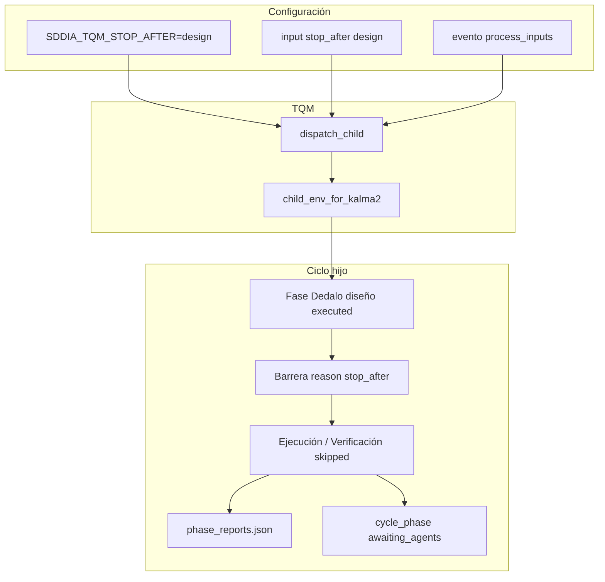

# Informe — `SDDIA_TQM_STOP_AFTER`

Documento de referencia operativa: qué es, por qué existe, cómo se configura y qué efectos tiene en el runtime Kalma2 / TQM.

## 1. Resumen ejecutivo

| Aspecto | Valor |
|---------|--------|
| **Nombre** | `SDDIA_TQM_STOP_AFTER` |
| **MVP soportado** | `design` (comparación case-insensitive) |
| **Default** | No definido → ciclo de vida completo (sin barrera contractual) |
| **Propósito** | Parar el orquestador **después** de la fase Dedalo de diseño, aunque su handoff sea `executed`, sin invocar Tekton ni fases posteriores |
| **No sustituye** | Veredicto `blocked` del agente, NLP en `task_text`, ni `SDDIA_TQM_FULL_CYCLE` |

## 2. Origen e historia

### 2.1 Incidente disparador (2026-08-30)

Ciclo Kalma2 `bug-fix` sobre keepalive de `email-watcher`:

| Identificador | Valor |
|---------------|--------|
| `execution_id` | `9dbcfea6-4df8-47ac-873a-cf9bce846929` |
| `correlation_id` | `17546079-3b13-4c21-9e9a-486ee3fec1a3` |
| PEC | `cycle_phase: failed` tras Tekton DNS |

El operador inyectó un **estímulo dual**: «detente tras plan/commit» y «forja PR en verde». El runtime no tenía halt contractual (fricción **F10-HALT-NOT-CONTRACT**). Dedalo declaró `Veredicto: blocked` pero el normalizador/report mintió `executed`; Tekton se inyectó y falló por `getaddrinfo ENOTFOUND api2.cursor.sh`.

SSOT del incidente: [`docs/audits/kalma2-forge-email-watcher-keepalive-halt-20260830.md`](kalma2-forge-email-watcher-keepalive-halt-20260830.md).

### 2.2 PBI y entrega

| Campo | Valor |
|--------|--------|
| **document_id** | `PBI-KAIZEN-KALMA2-AGENT-VERDICT-BARRIER` |
| **uuid** | `a9fe100f-f0e3-4871-83b2-295862650f5c` |
| **Ola** | **B** (junto con PEC honesto y `delivery_close: skipped_l2`) |
| **CA** | **CA-B1** |
| **Feature** | `docs/features/kalma2-agent-verdict-barrier/` |
| **Commit código** | `69fbd099` (2026-08-31) |
| **Evolución** | `35d4d91a-eba6-4740-a18f-5e5fcb7428a4` |
| **Laudo** | **L-HALT** en `spec.md` |

PBIs cercanos pero **no autores** del env: `PBI-FIX-FRACTURE-6c0db1296181` (bug forjado), `PBI-KALMA2-FULL-CYCLE-RUNTIME` (`527007fa`, semántica L2).

### 2.3 Motivación de diseño

Sustituir interpretación de lenguaje natural («detente», «después», «PR») por un **contrato estable** (env o campo JSON). El PBI prohíbe heurísticas NLP como parser de fases. El YAML de proceso **no** define este flag (preferencia documentada: env/TQM).

## 3. Semántica funcional

### 3.1 Condición de activación (executor)

En `executor.rs`, `stop_after_design()` lee el env del **proceso hijo**. La barrera se arma cuando:

1. `SDDIA_TQM_STOP_AFTER` equivale a `design`, y
2. La fase agente es una fase Dedalo de diseño con nombre **exacto**, y
3. El status de la fase es `executed`.

Fases válidas:

| Proceso | Nombre de fase |
|---------|----------------|
| `bug-fix` | `Diseño del fix` |
| `feature` | `Diseño de Blueprint` |
| `refactorization` | `Diseño de refactor` |

Efecto downstream: fases agente y VoC posteriores → `skipped`, `reason: stop_after`. Típicamente **Ejecución** (Tekton) no arranca.

### 3.2 Ciclo PEC (`cycle_phase`)

En `thermodynamic.rs`, `derive_cycle_phase` detecta algún report con `reason == "stop_after"` y clasifica el ciclo como **`awaiting_agents`**, no `completed` ni `failed` (salvo otro fallo causal real).

Esto distingue el halt contractual de:

- **`blocked`** del agente → barrera causal de fallo.
- **`failed`** de red/colapso → PEC `failed`.

### 3.3 Artefacto en disco

Al cerrar el bucle de fases, `executor.rs` persiste `{workspace_path}/phase_reports.json` (éxito, `stop_after`, `blocked` o DNS `awaiting_agents`).

### 3.4 Acople L2 (TQM)

Independiente pero frecuente en el mismo PBI: con `correlation_id` y sin `SDDIA_TQM_FULL_CYCLE=1`, TQM inyecta skips de archivo/DCC y declara `data.delivery_close: "skipped_l2"`. El halt en diseño **no** implica PR forjado; mencionar «PR» en `task_text` **no** activa full-cycle.

## 4. Configuración (dónde se define)

**No existe SSOT en fichero de instancia** (no está en `start-sddia.sh`, `.SddIA/project.md`, genoma `SddIA/process/` ni, en el checkout actual, `.SddIA/.dev/.env`).

### 4.1 Canales admitidos

```text
Prioridad efectiva en TQM (dispatch_child):
  1. input JSON  stop_after: "design"
  2. env del padre SDDIA_TQM_STOP_AFTER=design
     → child_env_for_kalma2 copia al hijo si el hijo aún no tiene el env
```

| Canal | Ejemplo |
|-------|---------|
| **Env shell / daemon** | `export SDDIA_TQM_STOP_AFTER=design` antes de `execute-process` o `sddia-run.sh` |
| **stdin TQM** | `{ "process": "feature", "task_text": "...", "stop_after": "design" }` |
| **Evento EDA** | Payload `process_inputs.stop_after` fusionado en `route_domain_core.rs` hacia TQM |

Referencia lab (AUT-61): `eda_subscriber_ecst_redb.rs` — payloads Kalma2/Aiúa con `"process_inputs": { "stop_after": "design" }`; algunos tests además fijan el env.

### 4.2 Qué no configura el flag

| Mecanismo | ¿Activa halt? |
|-----------|----------------|
| Texto en `task_text` / `raw_text` | No |
| YAML de fases del proceso | No |
| `SDDIA_TQM_FULL_CYCLE` | No (ciclo completo; camino opuesto a L2 parcial) |
| Linear / tracker | No |

## 5. Mapa de código

| Módulo | Responsabilidad |
|--------|-----------------|
| `executor.rs` | Lectura env, `is_dedalo_design_phase`, barrera `reason: stop_after`, `phase_reports.json` |
| `task_queue_manager.rs` | Resolución `stop_after` desde input/env; `child_env_for_kalma2`; `delivery_close: skipped_l2` |
| `thermodynamic.rs` | `derive_cycle_phase` → `awaiting_agents` si `stop_after` |
| `route_domain_core.rs` | Merge `process_inputs` del evento Kalma2/Aiúa |
| Tests | `barrier_sequence_stop_after_design_skips_tekton`, `derive_stop_after_is_awaiting_not_completed`, matriz ECST redb |

## 6. Flujo lógico



## 7. Uso operativo recomendado

| Escenario | Recomendación |
|-----------|----------------|
| Solo spec+plan (lab, diseño Dedalo) | `stop_after: "design"` en despacho TQM **o** env en el host del ciclo |
| Ciclo completo hasta PR/DCC | No definir el env; opcionalmente `SDDIA_TQM_FULL_CYCLE=1` si aplica L2 |
| EDA Kalma2/Aiúa | Incluir en payload: `"process_inputs": { "stop_after": "design" }` |
| Debugging | Inspeccionar `phase_reports.json` y PEC `cycle_phase` |

## 8. Límites y fuera de alcance (MVP)

- **`stop_after=commit`**: no implementado (sin oráculo post-fase commit en executor; Dedalo no tiene mandato de commit en role_brief estándar).
- No unifica semántica DNS agent-runtime con tokens F4c de DCC (jurisdicciones distintas en el mismo PBI kaizen).
- No reemplaza barrera por `Veredicto: blocked` (Ola A del mismo PBI).

## 9. Instancia actual (snapshot 2026-11-07)

En `.SddIA/.dev/.env` del workspace inspeccionado **no** figura `SDDIA_TQM_STOP_AFTER`. Los ciclos en producción local corren **sin** halt contractual salvo que el operador o el payload del evento lo establezcan explícitamente.

## 10. Referencias

1. [`docs/features/kalma2-agent-verdict-barrier/spec.md`](../features/kalma2-agent-verdict-barrier/spec.md) — laudo L-HALT.
2. [`docs/todos/done/[KAIZEN] Kalma2 agent-runtime — veredicto blocked, DNS y halt-after-phase (a9fe100f).md`](../todos/done/[KAIZEN]%20Kalma2%20agent-runtime%20—%20veredicto%20blocked,%20DNS%20y%20halt-after-phase%20(a9fe100f).md) — CA-B1, fricción F10.
3. [`SddIA/evolution/35d4d91a-eba6-4740-a18f-5e5fcb7428a4.md`](../../SddIA/evolution/35d4d91a-eba6-4740-a18f-5e5fcb7428a4.md) — registro evolutivo.
4. [`docs/features/route-domain-process-effect/implementation.md`](../features/route-domain-process-effect/implementation.md) — uso en lab ECST/catalog.

---

*Generado en sesión de clarificación operativa (Tekton). No sustituye laudo Dedalo ni `validacion.md` de features.*
