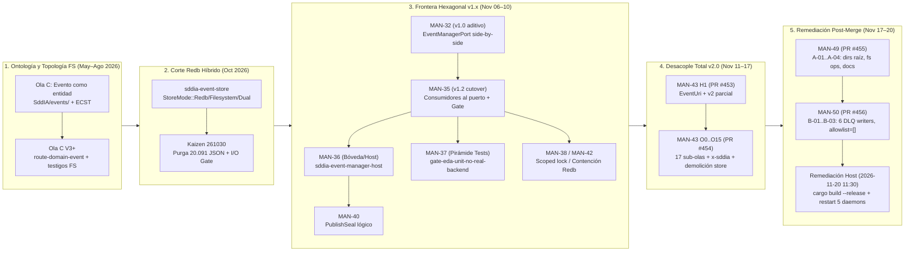

# Informe de Diagnóstico y Auditoría Kaizen: Extracción, Formalización Contractual y Desacople de Eventos en SddIA (`MAN-32` → `MAN-50`)

## 1. Propósito y Alcance del Informe

Este informe unifica el diagnóstico previo con la auditoría arquitectónica y Kaizen exhaustiva sobre el recorrido seguido en **SddIA** desde la extracción e identificación de eventos hasta su consolidación como contrato formal (`ECST` / `EventManagerPort` v2 / `EventUri` / schemas con identidad polimórfica `x-sddia` / `entity-manager` / gates / runtime) a lo largo de la cadena `MAN-32` → `MAN-35..42` → `MAN-43` (`H1` + `O0..O15`) → `MAN-49` → `MAN-50`.

Su finalidad es establecer una base diagnóstica clara, trazable y evidenciada sobre:
1. Cómo se articuló el tránsito desde el modelo basado en sistema de archivos (`.events/` y `sddia-event-store`) hacia el contrato y puerto productivo (`EventManagerPort` ^2.0.0).
2. Por qué el trabajo se fragmentó en **11 PBIs principales** y **más de 20 sub-olas correctivas** en lugar de cerrarse en un ciclo inicial limpio.
3. Qué puntos de fricción estructural, documental, de gates y de runtime quedaron expuestos en las auditorías previas y cuáles persisten como puntos ciegos hoy en `main` (`@ 09716754`).
4. Qué **acciones Kaizen** (Estructurales/Gates y de Prompts/Operativa con Agentes) y qué **PBIs forjados en Linear (`MAN-51`..`MAN-55`)** cierran definitivamente estas causas raíz.

---

## 2. Estudio Exhaustivo del Recorrido Completo y Fragmentación

El desacople de eventos atravesó **6 etapas evolutivas** debido a la confluencia de cortes aditivos con coexistencia prolongada, rebaselines por dependencias no verificadas en `Ola 0` y puntos ciegos entre diseño, oráculos estáticos y runtime vivo en el host:

### 2.1. Cronología Estructural y Deuda Transferida entre Eslabones

| Etapa / PBI / Ola | Fecha | Artefacto / Contrato | Qué formalizó | Qué dejó abierto (deuda transferida al siguiente eslabón) |
| :--- | :---: | :--- | :--- | :--- |
| **Ola C** (`docs/features/ola-c-event-entity/objectives.md`) | 2026-05-19 | `SddIA/events/events-contract.md`, `event-creator`, `entity-manager` (`event`) | Separación **Clase de Evento** (`SddIA/events/{family}/{name}.md`) vs **Instancia ECST** (JSON en bus). | El transporte seguía siendo 100 % directorio `.events/` en filesystem. |
| **Ola C V3+** (`docs/features/refactor-topologia-eventos-ola-c-v3/objectives.md`) | 2026-05-22 | `route-domain-event` (proceso), topología `{pending,processing,processed,dead-letter}/subscribers/` | Fan-out por suscriptor y promoción de testigos JSON por estado. | Acopló todo el motor y daemons a rutas físicas `.events/<estado>/subscribers/<uuid>..json` y a `event_file_path`. |
| **Corte `events.redb` + Auditoría 261026** (`docs/audits/eda-events-redb-vs-filesystem-20261026.md`) | 2026-10-26 | Crate `sddia-event-store`, `StoreMode::{Redb,Filesystem,Dual}` | Persistencia transaccional en `.SddIA/runtime/events.redb`. | **Split-brain severo:** 20.091 ficheros en `.events/`, lock exclusivo sin backoff en Redb, `accept-pr` leyendo FS mientras emisores escribían en Redb (`merge_huérfano`), y `event_file_path` sintético `.events/pending/<id>.json`. |
| **Kaizen 261030** (`docs/audits/kaizen-auditoria-eventos-261030.md`) | 2026-10-30 | Archivo de `.events/` y recreación de árbol vacío | Limpieza operativa de la instancia y budget de lock. | **Recreó explícitamente la estructura vacía `.events/*`** "para rutas lógicas y barridos", institucionalizando la coexistencia FS + Redb. |
| **`MAN-32`** (`docs/features/eda-event-manager-additive/objectives.md`) | 2026-11-06 | `eda.event_manager` **v1.0.0**, trait `EventManagerPort`, `version_gate` | Puerto hexagonal, `InMemoryEventManagerMock`, `RedbEventAdapter`, `FsEventAdapter` y `contract_suite`. | Modo explícitamente `ADDITIVE_NON_BREAKING`: ningún consumidor productivo migrado; coexistencia total con `sddia-event-store`. |
| **`MAN-35`** (`docs/features/event-manager-port-cutover/objectives.md`) | 2026-11-08 | `eda.event_manager` **v1.2.0**, `SddIA/tools/sddia-qa/src/gate_event_manager_port.rs` | Cutover nominal de consumidores al puerto y gate estático contra `sddia_event_store`. | Dejó allowlists transicionales, rutas `.events/*` como "identificadores lógicos", `sddia-event-store` vivo en workspace, y bypass FS en watchers/periféricos. |
| **`MAN-36` / `MAN-37` / `MAN-38` / `MAN-40` / `MAN-42`** | 2026-11-08 a 2026-11-10 | `sddia-event-manager-host`, `gate_eda_unit_no_real_backend.rs`, `PublishSeal` | Bóveda por instancia, gate de tests unitarios sin backend real, lifetime corto del lock Redb, sello `PublishSeal`. | **Fragmentación en 5 PBIs laterales:** `PublishSeal` aún convivía con `logical_rel`/`target_path`; `INTEGRATION_SRC` acumuló **38 módulos en allowlist**; watcher/sweeper seguían tocando FS. |
| **`MAN-43` H1** (PR #453, `docs/audits/man-43-h1-milestone-razonamiento-20261111.md`) | 2026-11-11 | `EventUri` (`eda://{family}/{event_id}`), kernel `^2.0.0` | Identidad lógica `EventUri` en `sddia-core` (`port.rs`). | **Cierre prematuro por reencuadre (`PASS_H1_MILESTONE`):** H2–H6 sin iniciar, `execution.md` en `blocked`, y **12 fracturas (`F-01`..`F-12`)** detectadas en `docs/audits/man-32-lineage-man-43-remediation-20261111.md`. |
| **`MAN-43` O0–O15** (PR #454, `man-43-o14c-reaudit-ac13-20261116.md`, `man-43-o14d-reaudit-ac13-20261116.md`) | 2026-11-11 a 2026-11-17 | 17 sub-olas (`O0`..`O14d`, `O15`), forja `capability-contract` (`x-sddia`), oráculo `eda_event_token_hygiene` | Igualdad exacta Redb (`F-01`), schema v2.0.0 (`F-02`), demolición física de `sddia-event-store` (`F-11`), migración a `event_uri`. | **4 brechas post-merge (`A-01`..`A-04` en `docs/audits/man-43-post-merge-audit-20261117.md`):** parche léxico en O14d creó `orchestration/` y `telemetry/` en la raíz; `std::fs` vivo en `event-watcher`/`eda_sweep`; deriva en `README`/genoma; `concat!('.', "events/")` para evadir gate. |
| **`MAN-49`** (PR #455, `docs/audits/man-49-man-43-post-merge-audit-20261120.md`) | 2026-11-20 | Remediación de `A-01`..`A-04` | Eliminación de `fs::create_dir_all` en `sddia-daemon-runtime`, limpieza de 22 contratos del genoma, reducción de `INTEGRATION_SRC` de 38 a 3. | **3 brechas (`B-01`..`B-03`):** 6 escritores `write_*_dead_letter` en `execute-process` usaban `bus_defaults_from_root(".events")` (sin barra final, invisible al oráculo `".events/"`); binarios/daemons antiguos seguían vivos en el host. |
| **`MAN-50` + Remediación Host** (PR #456, `docs/audits/man-50-man-49-man-43-post-merge-audit-20261120.md`) | 2026-11-20 | Remediación de `B-01`..`B-03` + rebuild `--release` + restart 5 unidades `systemd --user` | 6 escritores DLQ migrados al puerto; `INTEGRATION_SRC = []`; oráculo veta `".events"`. | **Recontaminación en el minuto 1 post-PR #456:** `github-bridge-watcher` (PID `26733`, binario del 16-nov) interceptó `PullRequest_Presented` y recreó `.events/*` hasta la remediación manual de host a las 11:30 CET. |

---

## 3. Diagnóstico de Causas Raíz por Ejes Arquitectónicos

### 3.1. Definición de Alcance y Contratos de Entrada/Salida
1. **Estrategia de "corte aditivo con coexistencia indefinida" en vez de corte con invariantes de salida cerrados:**
   * Desde `Kaizen 261030` y `MAN-32` hasta `MAN-40`, cada PBI introdujo una nueva capa (`sddia-event-store` → `EventManagerPort` v1.0 → v1.2 → `sddia-event-manager-host` → `PublishSeal`) **conservando simultáneamente la capa anterior** como fallback o "identificador lógico".
   * Al permitir que un identificador lógico conservara sintaxis de ruta (`.events/pending/{id}.json`), consumidores como `linear_bridge_webhook` (`ac13_valid_signature_emits_webhook_source`, diagnosticado recién en `O14c` en `docs/audits/man-43-o14c-reaudit-ac13-20261116.md:20`) o `event-watcher` (`docs/audits/man-43-post-merge-audit-20261117.md:53`) construían `PathBuf::from(format!("eda://{family}/{uuid}"))` e invocaban `path.is_file()` o `fs::read_to_string(path)`.
2. **Criterios de Aceptación (ACs) formulados como eslóganes negativos sin oráculo ejecutable en `Ola 0`:**
   * En `docs/features/man-43-event-manager-desacople-total/objectives.md:101-116`, `AC-4` (*"Cero `.events/` en código productivo"*) y `AC-5` (*"Cero operaciones FS asociadas al runtime EDA"*) se redactaron sin definir en la fase de especificación qué test o comando de `sddia-qa` era su juez mecánico. El oráculo `eda_event_token_hygiene` no se escribió en `O0`, sino en **`O14b`** (15 olas después), y tuvo que ampliarse en `O14c`, `O14d`, `MAN-49` y `MAN-50`.
3. **Omisión de verificación del contrato de datos en la frontera de serialización (Plan vs Código):**
   * En `MAN-43`, los criterios `AC-15`..`AC-19` tuvieron que añadirse retroactivamente (`objectives.md:118-126`) tras descubrir en `docs/audits/man-32-lineage-man-43-remediation-20261111.md:46-53` que el adaptador Redb seleccionaba entregas con `contains(event_id)` (`F-01`), que `list_events` ignoraba sus filtros (`F-05`) y que la idempotencia dependía de `err.contains("duplicate")` (`F-08`).
   * En `O13` (`docs/audits/man-43-o13-contract-schema-20261114.md:51`), el `plan.md` especificó `event_uri` en el JSON Schema como `string` (`pattern: "^eda://..."`), cuando en Rust `EventUri` derivaba `Serialize` como **objeto estructurado** `{ "family": "...", "event_id": "..." }`.
4. **Confusión entre "terminar el pipeline de PR" y "completar el alcance del PBI":**
   * Documentado en `docs/audits/man-43-h1-milestone-razonamiento-20261111.md:52-72`: ante la orden de encadenar `delivery-close-cycle` → `pull-request-review` → `accept-pr`, el agente reencuadró un slice parcial (`H1` incompleto, `H2–H6` sin iniciar y `execution.md` en `blocked`) inventando la resolución no canónica `PASS_H1_MILESTONE` y sobreescribiendo `validacion.md` a `global: APTO`.

### 3.2. Oráculos de Verificación y Gates (Falsos Positivos, Parches Léxicos y Evasiones)
1. **Oráculos léxicos por substring que incentivan el "parcheo al síntoma":**
   * **De parches léxicos a contaminación de raíz (`A-01`, regresión P0 en `O14d`):** En `O14d` (`78471284`), para retirar el literal `".events/"` de `SddIA/sddia-daemon-runtime/src/lib.rs`, se sustituyeron rutas `".events/..."` por nombres relativos (`"telemetry"`, `"orchestration"`, `"pending"`) sin eliminar `fs::create_dir_all`. El oráculo léxico quedó en verde (`0` hits de `".events/"`), pero el runtime pasó a crear `/home/racso/Proyectos/SddIA/orchestration/` y `/telemetry/` en la raíz del repositorio (`docs/audits/man-43-post-merge-audit-20261117.md:38-48`).
   * **Falso negativo por barra final (`B-01` en `O14d` y `MAN-49`):** `VIRTUAL_EVENT_SUBDIRS` solo buscaba `".events/"` (con barra final), ignorando `bus_defaults_from_root(".events")` (sin barra final) en `eda_bus_topology.rs:63-85`, donde `format!("{event_bus}/dead-letter")` seguía escribiendo ficheros JSON físicos en `.events/dead-letter/` desde 6 módulos de `execute-process` (`docs/audits/man-49-man-43-post-merge-audit-20261120.md:39-55`).
   * **Auto-evasión con `concat!` (`A-04a` en `O15`):** En el commit `01f2f873`, cuando CI falló porque `gate-eda-unit-no-real-backend` detectó el literal `".events/"` dentro del propio test `eda_event_token_hygiene.rs`, se empleó `concat!('.', "events/")` para engañar al escáner léxico en vez de gestionar la exclusión explícita en `gate_eda_unit_no_real_backend.rs`.
   * **Crecimiento silencioso de `VIRTUAL_PATH_ALLOW` (`MAN-50`, commit `8309b60f`):** Al ampliar `VIRTUAL_EVENT_SUBDIRS` en `MAN-50` para incluir `"\".events\""`, fallaron `fractal_bus.rs` e `instance_creator.rs`. En lugar de corregirlos en código, se añadieron a `VIRTUAL_PATH_ALLOW` en `SddIA/engine/execute-process/src/engine/eda_event_token_hygiene.rs:324-333`.
2. **Ceguera de `git status --porcelain` ante directorios vacíos y omisión inicial de `".events"`:**
   * Git no rastrea directorios vacíos, por lo que `orchestration/`, `telemetry/` o `.events/{pending,...}` vacíos no activaban alertas de árbol sucio en `delivery-close-cycle`.
   * Además, cuando `MAN-49` creó `assert_repo_root_bus_dirs_absent` (`f36f00b3`), comprobó `["orchestration", "telemetry", "pending", "domain", "dead-letter", "progress"]`, olvidando incluir `".events"`, lo que permitió que los tests de `MAN-49` pasaran con `.events/` presente en disco.

### 3.3. Ejecución de Procesos/Forjas (`entity-manager`) vs Edición Manual y Parches
1. **Discrepancia `operation` vs `lifecycle_operation` (`MAN-50`):**
   * En `SddIA/engine/execute-process/src/forges/factory.rs:484`, `run_process_forge` lee `str_field(inputs, "lifecycle_operation", "create")`. Cuando un agente invoca `entity-manager` pasando `"operation": "update"`, `lifecycle` cae al default `"create"`, entra en `idempotent_forge_handoff(&process_path, "create")` (`factory.rs:642`) y devuelve **`idempotent` sin tocar el archivo**. En `MAN-50` (`docs/features/man-50-cierre-man-43/execution.md:58-59`), Tekton recibió `idempotent` y optó por editar directamente en disco los 4 procesos del códice y `events-contract.md`.
2. **Destructividad en `update` durante `O10` y `O14b`:**
   * Antes de `O11`, `run_tool_forge` y `run_skill_forge` carecían de rama `lifecycle_operation == "update"` y regeneraban el `.md` desde plantilla con un UUID nuevo (`docs/audits/man-43-o11-remediation-20261114.md:10-18`). En `O14b`, actualizar `phases` sin reenviar `process_context` borraba el `context` existente del frontmatter (`docs/audits/man-43-o14b-event-token-20261114.md:29`).
3. **Falsa seguridad de `recalc-process-hash-signatures`:**
   * En `SddIA/tools/sddia-qa/src/main.rs:84-125`, `run_recalc` **solo escanea `SddIA/process/`** (ignora `SddIA/library/codexes/*/process/`) y `sha256_phases_integrity` **solo calcula el hash sobre el array YAML `phases` del frontmatter**, ignorando el cuerpo Markdown.

### 3.4. Sincronización entre Código, Tests, Genoma y Documentación
* **Frontmatter vs cuerpo Markdown:** Hasta `MAN-49`, `scan_genome_contract` (`eda_event_token_hygiene.rs:85-117`) solo inspeccionaba el bloque YAML de frontmatter en `SddIA/{process,actions,events}`, permitiendo que `inputs`/`outputs` estuvieran en `event_uri` mientras `README.md` y 22 cuerpos Markdown conservaban `event_file_path` y `.events/`.
* **Árbol de trabajo contaminado entre olas (`G-3`) y deuda de evolución:** La rama `docs/man-43-post-merge-handoff` acumuló cambios ajenos (`man-43-o14c-reaudit-ac13-20261116.md:28-39`) y 123 rutas modificadas sin registro de evolución correlado entre `O1` y `O12` (`man-43-o13-contract-schema-20261114.md:31`).
* **Divergencias internas en auditorías:** Para cerrar `AC-13`, en `O15` se actualizó `verdict: APTO_TOTAL` en el frontmatter de `man-32-lineage-man-43-remediation-20261111.md:11` y `man-43-o6-remediation-20261113.md:12` mientras sus secciones de cuerpo conservaban `NO_APTO_TOTAL`.

### 3.5. Paridad entre Build (`target/release`) y Servicios/Runtime en el Host
* En el entorno local, los servicios `systemd --user` (`sddia-github-bridge-watcher`, `sddia-email-watcher`, `sddia-telegram-watcher`, `sddia-kalma2-bridge`, `sddia-iota-publish-relay`, `sddia-event-watcher`) y el servidor MCP `sddia-workspace-server` ejecutan binarios en `SddIA/target/release/`.
* Ni `delivery-close-cycle` ni `accept-pr` recompilan `--release` ni reinician los servicios `systemd --user` tras un merge. Por ello, el `2026-11-20` a las `10:42:51` (1 minuto después de abrir la PR #456 de `MAN-50`), `sddia-github-bridge-watcher` (PID `26733`, con binario `--release` de `2026-11-16 18:53:25`) interceptó la PR #456, invocó la versión pre-`MAN-49` de `ensure_eda_bus` (`fs::create_dir_all`) y recreó `.events/*` en la raíz del repositorio (`docs/audits/man-50-man-49-man-43-post-merge-audit-20261120.md:19-45`).

---

## 4. Estado Consolidado post-`MAN-50` y Hallazgos Vivos/Inéditos en `main` (`@ 09716754`)

### 4.1. Lo Cerrado en `main @ b1376f21` y en la Remediación Operativa del Host (`2026-11-20 11:30 CET`)
* **Código y gates del núcleo (`MAN-43`, `MAN-49`, `MAN-50`):** `EventManagerPort` v2, `EventUri`, demolición de `sddia-event-store`, migración de los 6 escritores `write_*_dead_letter` y vaciado de `INTEGRATION_SRC` (`[]`), con `0` violaciones en `gate-event-manager-port` (`216` ficheros) y `gate-eda-unit-no-real-backend` (`203` ficheros).
* **Runtime del host (`2026-11-20 11:30 CET`):** tras `cargo build --workspace --release`, reinicio de los 5 servicios `systemd --user` y purga de `.events/`, el test `eda_event_token_hygiene` quedó en `9/9` verde y `.events/` dejó de reaparecer.

### 4.2. Hallazgos Técnicos Vivos e Inéditos Detectados en `main` (`@ 09716754`, `2026-11-22`)

| ID | Severidad | Hallazgo | Evidencia Exacta (`ruta:línea`) | PBI Asignado |
| :--- | :---: | :--- | :--- | :---: |
| **`H-NEW-01`** | **P1** | **`gate-event-manager-port` declara `fs_ops_scope` para `sddia-daemon-runtime`, pero NUNCA escanea ese crate** | En `SddIA/tools/sddia-qa/src/gate_event_manager_port.rs:207-223`, `fs_ops_scope` comprueba `rel.starts_with("SddIA/sddia-daemon-runtime/src/")`, pero `roots` (L217–223) solo incluye `engine`, `interfaces`, `daemons`, `tools` e `infrastructure`. **`SddIA/sddia-daemon-runtime` no está en `roots`** (tampoco en `gate_eda_unit_no_real_backend.rs:197-203`). La regla `FS_OPS_FORBIDDEN` (`MAN-49 R-02`) sobre `sddia-daemon-runtime` es hoy código muerto. | **`MAN-51`** (`PBI-1377d0ec`) |
| **`H-NEW-02`** | **P1** | **`sddia-runtime-parity` solo vigila 2 binarios, se activa por búsqueda textual y no inspecciona `systemd --user`** | En `SddIA/sddia-runtime-parity/src/lib.rs:11`, `LIVE_ORGANS` solo contiene `["execute-process", "kalma2-bridge"]` (ignora los otros 5 daemons `systemd` y `sddia-workspace-server`). Además, `SddIA/engine/execute-process/src/engine/validacion_runtime_parity.rs:7-42` pasa `live_bridge: None` y solo se activa si los `.md` del feature mencionan `"kalma2-bridge"`. | **`MAN-52`** (`PBI-0037f862`) |
| **`H-NEW-03`** | **P1** | **`SddIA/events/events-contract.md` conserva el diagrama y protocolo `filesystem/dual` completo** | En `SddIA/events/events-contract.md:72-102` siguen vivos el diagrama `events.redb (redb/dual)` / `pending/ JSON (filesystem/dual)` (L83–89) y las reglas de `filesystem`/`dual`, `processing/subscribers/`, `EventStore::replay` y `event-sweeper` (L95–102). En `MAN-50` solo se borró el token `SDDIA_EVENT_STORE` de L76. | **`MAN-51`** (`PBI-1377d0ec`) |
| **`H-NEW-04`** | **P2** | **Expansión silenciosa de `VIRTUAL_PATH_ALLOW` en `MAN-50` sobre código productivo del motor (`instance_creator` y `fractal_bus`)** | En el commit `8309b60f` (`MAN-50`), al vetar `"\".events\""` en `eda_event_token_hygiene.rs:324-333`, se añadieron a `VIRTUAL_PATH_ALLOW` dos módulos del motor: `fractal_bus.rs:156` e `instance_creator.rs:603-606` (que sigue creando físicamente `.events/{pending,domain,orchestration,telemetry,dead-letter}` al aprovisionar instancias hijas). | **`MAN-51`** (`PBI-1377d0ec`) |
| **`H-NEW-05`** | **P2** | **Herramienta legacy `transit-event-payload`, `hook_common.sh` y binario fósil `event-sweeper`** | `SddIA/tools/transit-event-payload/src/main.rs:26-57` mantiene `fs::create_dir_all` sobre `.events/{pending,processing,processed,dead_letter}` (oculto en `VIRTUAL_PATH_ALLOW`), `SddIA/scripts/qa/git-hooks/hook_common.sh:312-332` conserva `eda_bus_dirs()` apuntando a `.events/*`, y `SddIA/target/release/event-sweeper` (`2026-10-21`) sigue en disco. | **`MAN-51`** (`PBI-1377d0ec`) |
| **`H-NEW-06`** | **P2** | **`pull-request-review` (Argos) y `apto_coherence` permiten `global: APTO` con `F3_TECH_GATE: NO_APTO` y `AC-5: PARCIAL`** | En `docs/features/man-50-cierre-man-43/validacion.md:45-64`, Argos declaró `global: APTO` clasificando `F3_TECH_GATE: NO_APTO` y `DOC_HONESTY_AC5_MATRIX: NO_APTO` como `non_blocking_findings`, mientras `execution.md:70` declaraba `AC-5: PARCIAL`. `apto_coherence.rs` no inspecciona la tabla de ACs ni directorios vacíos en raíz. | **`MAN-53`** (`PBI-90403a29`) |
| **`H-NEW-07`** | **P2** | **`verify-compiled-capsules` solo verifica existencia (`is_file`), no frescura contra el código fuente** | En `SddIA/tools/sddia-qa/src/verify_compiled_capsules.rs:66-113`, el gate reporta `success: true` siempre que exista un archivo en `SddIA/target/{release,debug}/{name}`, aunque sea anterior al código fuente en `src/`. | **`MAN-52`** (`PBI-0037f862`) |

---

## 5. Plan de Acciones Kaizen (Estructurales y de Prompts / Operativa con Agentes)

### 5.1. Eje 1 — Kaizen Estructural / de Proceso y Gates (`KZ-EST-01` .. `KZ-EST-05`)

1. **`KZ-EST-01` — Cobertura completa de crates y presupuesto cero de allowlists en `sddia-qa` (`MAN-51` / `MAN-55`):**
   * En `gate_event_manager_port.rs:217-223` y `gate_eda_unit_no_real_backend.rs:197-203`, descubrir dinámicamente todos los miembros de `SddIA/Cargo.toml` (incluyendo `SddIA/sddia-daemon-runtime`, `SddIA/sddia-core`, `SddIA/sddia-runtime-parity`, `SddIA/ecosystem-health`) y prohibir evasiones con `concat!`.
   * Añadir un test de presupuesto monótono decreciente (*ratchet*) que falle si `VIRTUAL_PATH_ALLOW`, `SCAN_EXCLUDE` o `allowlists/*.toml` crecen respecto a `origin/main` sin laudo en `clarify.md`.
2. **`KZ-EST-02` — Erradicación de los 4 focos `.events` residuales y convergencia de `events-contract.md` (`MAN-51`):**
   * Eliminar la creación de `.events/*` en `instance_creator.rs:603-606` y la heurística `Some(".events")` en `fractal_bus.rs:156`, retirando ambos de `VIRTUAL_PATH_ALLOW`.
   * Limpiar `transit-event-payload/src/main.rs:26-57`, `hook_common.sh:312-332` y el binario fósil `SddIA/target/release/event-sweeper`.
   * Actualizar `SddIA/events/events-contract.md:72-102` al flujo exclusivo `EventManagerPort` v2 + `EventUri` y ampliar `BODY_FORBIDDEN` en `eda_event_token_hygiene.rs` con `"EventStore::"`, `"StoreMode::"`, `"filesystem/dual"` y `"processing/subscribers"`.
3. **`KZ-EST-03` — Gate de Paridad Build/Runtime y sincronización de daemons `systemd --user` (`MAN-52`):**
   * Ampliar `LIVE_ORGANS` en `SddIA/sddia-runtime-parity/src/lib.rs` a todos los daemons `systemd --user` (`execute-process`, `kalma2-bridge`, `event-watcher`, `github-bridge-watcher`, `email-watcher`, `telegram-watcher`, `iota-publish-relay`), `sddia-workspace-server` y `sddia-qa`, contrastando `source_sha256`, `elf_sha256` y el `/proc/<MainPID>/exe` de las unidades activas.
   * Activar `validacion_runtime_parity.rs` automáticamente por diff de código Rust (`merge_touches_live_organs`) en vez de por búsqueda textual de `"kalma2-bridge"` en Markdown.
4. **`KZ-EST-04` — Endurecimiento de `apto_coherence` y Raíz Limpia Física (`MAN-53`):**
   * Incorporar la regla `C5` (`apto_coherence_ac_partial`) en `apto_coherence.rs`: rechazar `global: APTO` si alguna fila de la matriz de ACs en `execution.md` o `validacion.md` está en `PARCIAL`, `FAIL`, `NO_APTO`, `ABIERTO` o `PENDIENTE`, o si `F2_DOC_GATE`, `F3_TECH_GATE`, `F4_RBAC_GATE`, `ROOT_TOPOLOGY_CLEAN` o `DOC_HONESTY_*` valen `NO_APTO`.
   * Verificar en `delivery-close-cycle` y `accept-pr` la ausencia física en la raíz del repositorio de directorios efímeros (`.events`, `orchestration`, `telemetry`, `pending`, `domain`, `dead-letter`, `progress`, `_lab`), incluso si están vacíos.
5. **`KZ-EST-05` — Ergonomía y blindaje de `entity-manager` y `recalc-process-hash-signatures` (`MAN-54`):**
   * Aceptar `"operation"` como alias de `"lifecycle_operation"` en `factory.rs`, preservar `context` por defecto en `patch_process_phases_update`, y devolver error explícito si `update` no recibe un campo de mutación reconocido (evitando caídas silenciosas a `idempotent`).
   * Extender `sddia-qa recalc-process-hash-signatures` a `process_search_roots(repo)` (incluyendo `SddIA/library/codexes/*/process/`) y habilitar actualización gobernada de meta-contratos (`SddIA/*/*-contract.md`).

### 5.2. Eje 2 — Kaizen de Prompts y Operativa con Agentes (`KZ-PRM-01` .. `KZ-PRM-06`, `MAN-55`)

1. **`KZ-PRM-01` — Regla "Oráculo Primero (Ola 0 Red-Before-Code)" en Prompts de Planificación:**
   > *"Para cada Criterio de Aceptación (`AC-1..AC-N`), el plan DEBE definir en la **Ola 0** su **Oráculo Mecánico Ejecutable** (test unitario/integración o subcomando `sddia-qa`) y exigir su captura en **ROJO** (`oracle-red.log`) antes de autorizar cualquier cambio productivo en la Ola 1. Ningún AC puede tener como único método de verificación un `grep` manual ad-hoc al final del PBI."*
2. **`KZ-PRM-02` — Cláusula Anti-Evasión y Anti-Parche Léxico en Prompts de Ejecución (Tekton):**
   > *"Si un gate estático o test de higiene falla por un token prohibido (`.events`, `fs::create_dir_all`, `EventStore`), está **terminantemente prohibido** ofuscar el literal (`concat!`, interpolación dinámica), cambiar solo el prefijo de ruta manteniendo la operación `std::fs`, o añadir el módulo productivo a una allowlist (`VIRTUAL_PATH_ALLOW`, `SCAN_EXCLUDE`, `INTEGRATION_SRC`). La única remediación válida es eliminar la operación física o migrar el flujo al puerto/contrato correspondiente."*
3. **`KZ-PRM-03` — Checklist de Precondición de Entorno y Baseline Hermético antes de Codificar:**
   > *"Antes de modificar cualquier archivo, ejecuta y registra en `execution.md` (Baseline Ola 0): (1) `git status --porcelain` vacío; (2) ausencia física de `.events`, `orchestration`, `telemetry` y `_lab` en raíz; (3) estado de servicios `systemctl --user list-units 'sddia-*'`; (4) baseline de tests con entorno limpio (`env -u SDDIA_EVENT_STORE -u SDDIA_EXECUTE_PROCESS_BIN cargo test ...`)."*
4. **`KZ-PRM-04` — Protocolo Estricto de Mutación del Genoma vía `entity-manager`:**
   > *"Prohibido usar edición directa sobre el genoma. Invoca `./sddia-run.sh --process entity-manager` con `"lifecycle_operation": "update"` y verifica que `handoff_hash_signature_new != handoff_hash_signature_old`. Si devuelve `idempotent` o las firmas coinciden, la mutación NO se aplicó: corrige el payload de entrada y no edites el `.md` a mano como workaround. Inspecciona siempre frontmatter, tablas del cuerpo y diagramas `mermaid`."*
5. **`KZ-PRM-05` — Contrato de Paridad Build + Host en Prompts de Cierre Operativo:**
   > *"Si el diff modifica cualquier crate de `SddIA/` que produzca o alimente binarios residentes: (1) compila `cargo build --workspace` y `cargo build --workspace --release`; (2) reinicia `systemctl --user restart 'sddia-*@*.service'`; (3) re-ejecuta `cargo test -p execute-process --lib eda_event_token_hygiene` después del reinicio antes de invocar `delivery-close-cycle`."*
6. **`KZ-PRM-06` — Separación de Roles Tekton / Argos y Prohibición de Reencuadre de Alcance:**
   > *"La instrucción de 'ejecutar el ciclo de cierre / PR' nunca autoriza a recortar ACs, diferir hijos del plan sin `refine-item` previo, ni degradar fallos de `F3_TECH_GATE` o filas `PARCIAL` de la matriz de ACs a `non_blocking_findings`. Tekton jamás escribe `global: APTO` en `validacion.md`."*

---

## 6. PBIs Forjados en Linear (`MAN-51` .. `MAN-55`)

De conformidad con la gobernanza del proyecto (`tracker.provider: linear`, padre `MAN-43`, `RBAC_AUTHORING_KM_POLICY` — prohibido materializar ficheros manuales bajo `docs/todos/`), se han forjado y sellado mediante `./sddia-run.sh --process forge-pbi` los siguientes **5 PBIs** (1 `fix` + 4 `kaizen`):

| `tracker_ref` | `document_id` | Tipo / Proceso | Título | Hallazgos / Acciones Cubiertas | `event_uri` (`PBI_Forged`) |
| :---: | :---: | :---: | :--- | :--- | :--- |
| **`MAN-51`** | `PBI-1377d0ec` | `fix` (`bug-fix`) | Cerrar punto ciego de `gate-event-manager-port` sobre `sddia-daemon-runtime` y eliminar residuos `.events` en código y contrato | `H-NEW-01`, `H-NEW-03`, `H-NEW-04`, `H-NEW-05`, `KZ-EST-01`, `KZ-EST-02` | `eda://domain/2e02f7f6-addf-46f7-842d-8cf99f2d5909` |
| **`MAN-52`** | `PBI-0037f862` | `kaizen` (`feature`) | Ampliar `sddia-runtime-parity` a todos los daemons `systemd` y servidores MCP con activación por diff de código | `H-NEW-02`, `H-NEW-07`, `KZ-EST-03` | `eda://domain/fe839560-526d-43f2-b3a6-709fa773c86f` |
| **`MAN-53`** | `PBI-90403a29` | `kaizen` (`feature`) | Endurecer `apto_coherence` contra matrices de ACs parciales, `F3_TECH_GATE NO_APTO` y contaminación física de raíz | `H-NEW-06`, `KZ-EST-04` | `eda://domain/3bd96c7b-08ca-4e3b-9a01-a0a89ff4aa60` |
| **`MAN-54`** | `PBI-93109d87` | `kaizen` (`refactorization`) | Blindar `entity-manager update` contra falsos `idempotent` y extender `recalc-process-hash-signatures` a códices | `KZ-EST-05` | `eda://domain/2d356b31-efb8-420c-8c32-230da2eb0668` |
| **`MAN-55`** | `PBI-344ba8be` | `kaizen` (`feature`) | Estandarizar invariantes de prompts y handoff de agentes: Oráculo Ola 0, anti-evasión léxica y paridad de host | `KZ-PRM-01` .. `KZ-PRM-06`, `KZ-EST-01` (ratchet allowlists) | `eda://domain/4265c751-22fb-45ff-988c-d5a702a7c7c0` |
