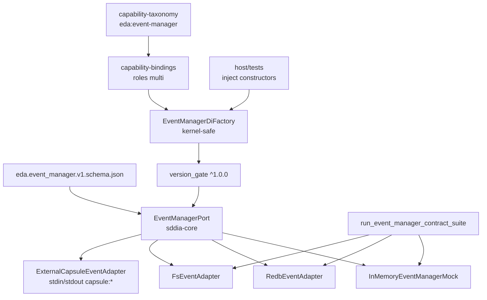

# Especificación técnica — eda-event-manager-additive

Entrada: `objectives.md` + `clarify.md` (laudos L-*) + semilla PBI-EDA-001.
Canal tracker: **MAN-32** (Linear). `audits/MAN-32.md` = auditoría LLM, **no** cuerpo del issue. SSOT = semilla + laudos.

## 0. Evidencia Genoma (revalidada 2026-11-06)

| Artefacto | Estado vivo | Implicación forja |
|-----------|-------------|-------------------|
| `capability-taxonomy.md` | **v1.0.9**, sin `eda:*` | Bump → `1.0.10` + alta `eda:event-manager` + hash |
| `capability-bindings.md` | **v1.7.0**, una fila/cap | Bump → `1.8.0` + **solo** fila nueva multi-rol |
| `capability-contracts/` | Sin `eda.event_manager*` | Crear `eda.event_manager.v1.schema.json` |
| `sddia-core/src/` | Solo `lib.rs` (reexport `sddia-io`) | Árbol nuevo `ports/event_manager/` |
| `infrastructure/adapters/` | 3 LanceDB activos; sin event_* | 3 crates + 3 fichas + censo |
| Camino caliente | Fuera de mutación | AC-1 / **L-NONBREAK** |

## 1. Contexto y decisión

Forjar **en paralelo** la capacidad **`eda:event-manager`** / contrato **`eda.event_manager` v1.0.0** sin tocar el camino caliente (`execute-process`, `event-watcher`, `sddia-event-store`).

| Vector | Laudo |
|--------|-------|
| Dominio | **L-DOMAIN** — aditivo `eda.event_manager`; **no** sustituye `eda.event_store` (ADR-EDA-002) |
| Taxonomía | **L-TAXON** — catalog `eda:event-manager`; contract `eda.event_manager`; schema `eda.event_manager.v1.schema.json` |
| Locus adapters | **L-LOCUS** — `SddIA/infrastructure/adapters/` (+ fichas/censo `adapters-contract`) |
| Host puerto | **L-PORT-HOST** — árbol nuevo en `sddia-core`; **sin** `redb` en el kernel |
| Binding | **L-BIND-ROLES** — bloque multi-rol aditivo; **prohibido** mutar filas vigentes |
| Factory | **L-FACTORY** — kernel-safe: constructores built-in inyectados; sin enlace `redb`/adapters en `sddia-core` |
| Provider kind | **L-PROVIDER-KIND** — built-ins = infrastructure-adapters; NFT-ready = slot `capsule:*` |
| Ops | **L-OPS** — siete operaciones v1.0.0 cerradas |
| Verificación | **L-VERIFY** — suite tripartita + SemVer + puente E2E + clippy |
| No-ruptura | **L-NONBREAK** — AC-1; sin cableado motor/centinela este ciclo |

## 2. Arquitectura objetivo



Plano vigente (`sddia-event-store` / watchers) permanece intacto. Convergencia ADR (`eda.event_store`, locus `SddIA/tools/`) = PBI hijo de cableado.

## 3. Contrato Genoma (Paso 1)

### 3.1 Schema

| Aspecto | Valor |
|---------|-------|
| Path | `SddIA/library/norms/capability-contracts/eda.event_manager.v1.schema.json` |
| Draft | JSON Schema **2020-12** (**L-SCHEMA-V** — filename versionado OK) |
| `$id` | `https://sddia.local/capability-contracts/eda.event_manager.v1.schema.json` |
| I/O | Sobre conforme a norma `capsule-json-io` (request/response JSON stdin/stdout del puente) |
| Request required | `operation`, `payload` |
| Response required | `success` (boolean), `exitCode` (integer); opcionales `message`, `result`, `error`, `meta` |

`operation` enum v1.0.0 (**L-OPS**):

| Operación | Payload mínimo (campos) | Semántica |
|-----------|-------------------------|-----------|
| `publish_ecst` | `event_id` (string), `ecst` (object), `trace_id?` | Persistir ECST en cola pending |
| `claim_pending` | `lease_owner` (string), `limit` (integer ≥1), `lease_ttl_ms?` | Reclamar lote con aislamiento (lease) |
| `record_delivery` | `event_id`, `delivery_id`, `status` (`ack`\|`nack`), `attempt?` | ACK **idempotente** / NACK |
| `move_to_dlq` | `event_id`, `reason` (string) | Mover a dead-letter |
| `replay_dlq` | `event_id` \| `all?: true` | Reinyectar DLQ → pending |
| `append_trace` | `trace_id`, `frame` (object) | Append progress-trace |
| `handshake_version` | `requested_range` (string, p.ej. `^1.0.0`) | Negociar SemVer contrato ↔ implementador |

`payload` polimórfico por `operation` (`oneOf` / `if-then` en schema). `additionalProperties` permitido en `meta`/`error` (paridad con contratos vigentes tipo `tracker.lifecycle`).

### 3.2 Taxonomía

Bump patch `capability-taxonomy.md`: `1.0.9` → `1.0.10`. Alta en `catalog` + tabla legible:

| Campo | Valor |
|-------|-------|
| id | `eda:event-manager` |
| contract | `eda.event_manager` |
| version | `1.0.0` |
| description | Gestión aditiva de ciclo de vida de eventos (publish/claim/delivery/DLQ/trace) vía EventManagerPort |

Recalcular `hash_signature` (SHA-256 del fichero **sin** la línea `hash_signature:`). Actualizar fila en `SddIA/library/norms/index.md` (`1.0.9` → `1.0.10`). Emitir cobertura EDA / `Domain_Entity_Updated` en T5 (norma mutada bajo `SddIA/`).

**Prohibido** registrar `eda.event_manager` (con puntos) como `catalog.id`.

### 3.3 Binding multi-rol

Bump `SddIA/core/capability-bindings.md`: `1.7.0` → `1.8.0`. **Una entrada nueva**; **cero** mutaciones a filas existentes.

```yaml
  - capability_id: "eda:event-manager"
    contract: "eda.event_manager"
    contract_version: "1.0.0"
    contract_schema: "eda.event_manager.v1.schema.json"
    provider: "adapter:redb-event-adapter"
    provider_version: ">=1.0.0"
    roles:
      default:
        provider: "adapter:redb-event-adapter"
        provider_version: ">=1.0.0"
      fallback:
        provider: "adapter:fs-event-adapter"
        provider_version: ">=1.0.0"
      test:
        provider: "mock:in-memory-event-manager"
        provider_version: ">=1.0.0"
      "capsule:*":
        provider: "adapter:external-capsule-event-adapter"
        provider_version: ">=1.0.0"
        resolution: "path|uri de binario/.wasm vía config de instancia"
```

Notas:

- Prefijos `adapter:` / `mock:` son **locales** a este bloque + `EventManagerDiFactory`.
- `di.binding.schema.json` (pattern `skill\|action\|tool`) **no se muta** este ciclo.
- Homologación provider-pattern ADR (`tool:` bajo `SddIA/tools/`) = fuera (**L-PROVIDER-KIND**).

## 4. Puerto Rust en Shared Kernel (Paso 1)

Árbol nuevo: `SddIA/sddia-core/src/ports/event_manager/`.

| Módulo | Contenido |
|--------|-----------|
| `mod.rs` | Reexports públicos |
| `contract.rs` | Tipos request/response alineados al schema; IDs/ECST tipados |
| `port.rs` | `pub trait EventManagerPort: Send + Sync` — métodos 1:1 a L-OPS |
| `error.rs` | `EventManagerError` incl. `ContractVersionMismatch` ↔ semilla `F-DI-CONTRACT-VERSION-MISMATCH` |
| `version_gate.rs` | Rango exigido (`^1.0.0`) vs `implements_contract.contract_version` |
| `memory_mock.rs` | `InMemoryEventManagerMock` + fault injection (fallo write, lease steal, ACK dup) |
| `event_manager_factory.rs` | **L-FACTORY** — ver §5.4 |

Reglas:

- `sddia-core` **no** depende de `redb` ni de crates de adapters.
- `lib.rs` declara `pub mod ports;` → `event_manager`.
- `version_gate`: acepta **minor/patch** bajo `^1.0.0`; **rechaza MAJOR** → `ContractVersionMismatch`.

```rust
pub trait EventManagerPort: Send + Sync {
    fn publish_ecst(&self, req: PublishEcstRequest) -> Result<PublishEcstResult, EventManagerError>;
    fn claim_pending(&self, req: ClaimPendingRequest) -> Result<ClaimPendingResult, EventManagerError>;
    fn record_delivery(&self, req: RecordDeliveryRequest) -> Result<(), EventManagerError>;
    fn move_to_dlq(&self, req: MoveToDlqRequest) -> Result<(), EventManagerError>;
    fn replay_dlq(&self, req: ReplayDlqRequest) -> Result<(), EventManagerError>;
    fn append_trace(&self, req: AppendTraceRequest) -> Result<(), EventManagerError>;
    fn handshake_version(&self, req: HandshakeVersionRequest) -> Result<HandshakeVersionResult, EventManagerError>;
}
```

(Tekton puede ajustar firmas idiomáticas Rust sin cambiar semántica ni nombres de operación.)

## 5. Adaptadores y puente (Paso 2)

Jurisdicción `adapters-contract.md` §1–2: cada built-in = `{name}.md` + `impl_dir` + fila `index.md` + miembro workspace Cargo. Status inicial `placeholder` → `active` al verde de suite.

### 5.1 RedbEventAdapter

| Campo | Valor |
|-------|-------|
| Ficha | `SddIA/infrastructure/adapters/redb-event-adapter.md` |
| `crate_name` | `sddia-infrastructure-redb-event` |
| `impl_dir` | `redb_event_adapter` |
| Dependencia | `redb` **solo** en este crate |
| Semántica | ACID: eventos, leases, entregas, DLQ; write-tx + commit por mutación |
| Manifiesto | dual-version: `capsule_version` + `implements_contract.contract_version: "1.0.0"` + `schema_uri` v1 |
| `port` (ficha) | `EventManagerPort` |

### 5.2 FsEventAdapter

| Campo | Valor |
|-------|-------|
| Ficha | `fs-event-adapter.md` |
| `crate_name` | `sddia-infrastructure-fs-event` |
| `impl_dir` | `fs_event_adapter` |
| Semántica | write-temp + rename atómico; árboles `pending/`, `claimed/`, `dlq/`, `traces/` |
| Manifiesto | dual-version (misma forma) |

### 5.3 ExternalCapsuleEventAdapter

| Campo | Valor |
|-------|-------|
| Ficha | `external-capsule-event-adapter.md` |
| `crate_name` | `sddia-infrastructure-external-capsule-event` |
| `impl_dir` | `external_capsule_event_adapter` |
| Semántica | Empaqueta JSON del contrato; ejecuta binario o `.wasm` por **stdin/stdout**; `handshake_version` previo a ops |
| Entorno hijo | `SDDIA_BYPASS_THERMO_TOLL=1` |
| NFT | **No** tokeniza/publica; solo puente + slot `capsule:*` |

### 5.4 EventManagerDiFactory (**L-FACTORY**)

Ubicación: `SddIA/sddia-core/src/ports/event_manager/event_manager_factory.rs`.

Flujo: **rol → binding → `version_gate` → `Arc<dyn EventManagerPort>`**.

Kernel-safe (innegociable):

- La factory **no** importa crates `redb_*` / `fs_*`.
- Constructores built-in se registran vía `Box<dyn Fn(...) -> Arc<dyn EventManagerPort> + Send + Sync>` (o mapa de builders) inyectado por host/tests.
- Rol `test` → `InMemoryEventManagerMock` (puede construirse in-kernel).
- Rol `capsule:*` → builder del `ExternalCapsuleEventAdapter` (inyectado; el crate adapter no es dep de `sddia-core`).

Built-ins: instancia in-process (sin peaje WASI por op). `capsule:*`: siempre vía puente externo.

## 6. Verificación (criterio principal — **L-VERIFY**)

### 6.1 Contract Test Suite

`run_event_manager_contract_suite(port: &dyn EventManagerPort)` sobre:

1. `InMemoryEventManagerMock`
2. `RedbEventAdapter` (tempdir)
3. `FsEventAdapter` (tempdir)

| Caso | Assert |
|------|--------|
| Lifecycle publish → claim | Evento reclamado una vez; aislamiento concurrente (segundo claim no duplica) |
| ACK idempotente | `record_delivery` ack repetido no corrompe estado |
| DLQ + replay | `move_to_dlq` → ausente pending; `replay_dlq` → reclamable |
| Traces | `append_trace` íntegro tras reopen (redb/fs) |

### 6.2 version_gate

| Input | Esperado |
|-------|----------|
| Implementador `1.0.x` / `1.y.z` bajo `^1.0.0` | OK |
| Implementador `2.0.0` vs `^1.0.0` | `ContractVersionMismatch` / `F-DI-CONTRACT-VERSION-MISMATCH` |

### 6.3 Puente E2E

Ejecutable dummy stdin/stdout (handshake + eco de una op) + `ExternalCapsuleEventAdapter` E2E en verde.

### 6.4 Calidad

`cargo clippy -- -D warnings` limpio en crates/módulos forjados. Tests preexistentes del workspace en verde (**AC-1**).

## 7. Criterios de aceptación

| ID | Criterio |
|----|----------|
| **AC-1** | Diff limpio de lógica activa en `execute-process`, `event-watcher`, `sddia-event-store`; tests preexistentes verdes |
| **AC-2** | Schema Draft 2020-12 + taxonomía `eda:event-manager` + binding multi-rol aditivo |
| **AC-3** | Contract suite 100% MemoryMock + Redb(tempdir) + Fs(tempdir) |
| **AC-4** | Test puente + SemVer `version_gate` verdes; clippy `-D warnings` en alcance forjado |

## 8. Touchpoints

| Path | Rol |
|------|-----|
| `SddIA/library/norms/capability-contracts/eda.event_manager.v1.schema.json` | Contrato S+ |
| `SddIA/library/norms/capability-taxonomy.md` | Alta catalog `1.0.10` |
| `SddIA/library/norms/index.md` | Versión norma |
| `SddIA/core/capability-bindings.md` | Binding multi-rol `1.8.0` |
| `SddIA/sddia-core/src/ports/event_manager/**` | Puerto, gate, mock, factory |
| `SddIA/sddia-core/src/lib.rs` | `pub mod ports` |
| `SddIA/infrastructure/adapters/redb_event_adapter/**` | Adapter ACID |
| `SddIA/infrastructure/adapters/fs_event_adapter/**` | Adapter FS |
| `SddIA/infrastructure/adapters/external_capsule_event_adapter/**` | Puente NFT-ready |
| `SddIA/infrastructure/adapters/{redb,fs,external-capsule}-event-adapter.md` | Fichas |
| `SddIA/infrastructure/adapters/index.md` | Censo (+3 filas) |
| `SddIA/Cargo.toml` | Miembros workspace |

## 9. Fuera de alcance

- Mutar lógica activa de `execute-process` / `event-watcher` / `sddia-event-store`.
- Cablear `EventStorePort` / plano ADR al motor o centinela.
- Migrar store productivo; dual-adapter espejo; hot-swap.
- Tokenizar/publicar cápsulas NFT reales.
- Reubicar adapters a `SddIA/tools/`.
- Mutar `di.binding.schema.json` pattern provider.
- Escribir TODOs bajo `docs/todos/` (Kaizen ≠ Dedalo/Tekton).

## 10. Remisiones

| Ítem | Destino |
|------|---------|
| Convergencia nombres/rutas ADR-EDA-002 | PBI hijo cableado |
| Extensión formal `di.binding.schema.json` multi-rol / `adapter:` | Hito DI posterior |
| Cuerpo Linear MAN-32 | No bloquea diseño; cierre vía `state_map` en delivery |
