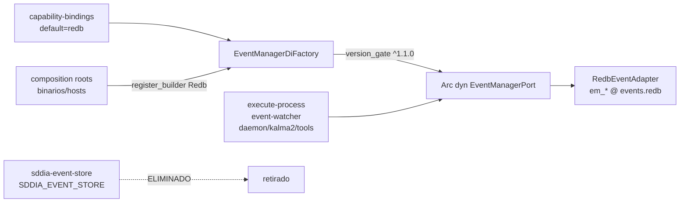

---

feature_name: eda-event-manager-redb-cutover
created: "2026-11-07"
updated: "2026-11-07"
process: refactorization
base: main
scope: "Cutover breaking del camino activo de eventos a eda.event_manager vía EventManagerDiFactory + adapter:redb-event-adapter"
branch_name: refactor/eda-event-manager-redb-cutover
persist_ref: docs/features/eda-event-manager-redb-cutover
pbi_ref: MAN-33
tracker_ref: MAN-33
historia_ref: MAN-32
document_id: PBI-e4403517
execution_mode: BREAKING_CUTOVER
capability_id: "eda:event-manager"
contract: "eda.event_manager"
contract_version_base: "1.0.0"
contract_version_target: "1.1.0"
productive_provider: "adapter:redb-event-adapter"
productive_role: default
agent: dedalo
phase: diseno-blueprint
version_spec: "1.0.0"
status: blueprint-ready
norm_ref: features-documentation-pattern@1.3.1
execution_id: "6b4f2856-aa17-4a58-b317-c97a6e6c9d49"
---
# Especificación técnica — eda-event-manager-redb-cutover

Entrada: `objectives.md` + `clarify.md` (laudos L-*) + semilla `.tmp/refactor-man-33.json` (`PBI-e4403517`).
Canal tracker: **MAN-33** (Linear outbound sin cuerpo). SSOT = semilla + laudos Mayeuta.
Padre: MAN-32 `docs/features/eda-event-manager-additive/` (`validacion.md` **APTO**).

## 0. Evidencia Genoma / runtime (revalidada 2026-11-07)

| Artefacto | Estado vivo | Implicación cutover |
|-----------|-------------|---------------------|
| Binding `eda:event-manager` | `capability-bindings.md` **v1.8.0**; `default` → `adapter:redb-event-adapter` | Consumir binding; runtime productivo **no** cablea `fallback`/`capsule:*` (**L-PROD**) |
| Puerto + factory | `SddIA/sddia-core/src/ports/event_manager/` (`EventManagerPort`, `EventManagerDiFactory`, `version_gate`) | Listos; falta wiring en composition roots |
| Redb adapter | `sddia-infrastructure-redb-event` **active**; tablas `em_*` | In-process (**L-INPROC**); **ningún** host productivo lo declara aún |
| Camino caliente | 9 dependientes directos de `sddia-event-store` | **L-CUTOVER** — este ciclo rompe el legado |
| Ruta Cúmulo | `.SddIA/runtime/events.redb` | **L-PATH** — misma ruta; esquema productivo = `em_*` |
| Esquema legacy | tablas `events`, `family_index`, `subscriber_delivery`, `dead_letter_index`, `dlt_audit_seals`, `progress_traces` | **Incompatible** con `em_*` — no hay dual-read (**L-SINGLE**) |

### 0.1 Inventario dependientes directos (**L-INVENTORY** ampliado)

| # | Crate | Path |
|---|-------|------|
| 1 | `execute-process` | `SddIA/engine/execute-process` |
| 2 | `event-watcher` | `SddIA/daemons/event-watcher` |
| 3 | `sddia-daemon-runtime` | `SddIA/sddia-daemon-runtime` |
| 4 | `sddia-eda-catalog` | `SddIA/sddia-eda-catalog` |
| 5 | `kalma2-bridge` | `SddIA/interfaces/kalma2-bridge` |
| 6 | `event-bus-audit` | `SddIA/tools/event-bus-audit` |
| 7 | `sddia-qa` | `SddIA/tools/sddia-qa` |
| 8 | `repo-retention-purger` | `SddIA/tools/repo-retention-purger` |
| 9 | `sddia-infrastructure-lancedb-thought` | `SddIA/infrastructure/adapters/lancedb_thought_repo` |

Cada fila: migrar a `Arc<dyn EventManagerPort>` **o** eliminar el uso. Tras inventario en cero → retirar miembro workspace `sddia-event-store`.

## 1. Contexto y decisión

Cutover **breaking** del camino activo al contrato **`eda.event_manager`**, rol **`default`**, proveedor **`adapter:redb-event-adapter`**, resuelto por **`EventManagerDiFactory` + `version_gate`**.

| Vector | Laudo |
|--------|-------|
| Misión | **L-MISSION** — un solo camino productivo |
| DI | **L-DI** — consumers tipados al puerto; builders Redb solo en composition roots |
| In-process | **L-INPROC** — no cápsula / no `capsule:*` en runtime productivo |
| Unicidad | **L-SINGLE** / **L-CLEAN** — sin shims, flags, dual, filesystem, rollback legacy |
| Gaps | **L-GAP** — evolucionar contrato/puerto **antes** de migrar consumidores que lo necesiten |
| Modelo | **L-MODEL** (este spec) — adoptar semántica EventManager (lease/claim), **no** portar la matriz `subscriber_delivery` 1:1 |
| Persistencia | **L-SCHEMA** (este spec) — solo tablas `em_*` productivas; legado drenado o descartado en frío |
| Config | **L-CONFIG** — provider-neutral; ruta Cúmulo; sin `SDDIA_EVENT_STORE` |
| Genoma | **L-GENOMA** — documentar arquitectura final única |
| Git | **L-GIT** — solo `skill:git-manager` |

## 2. Arquitectura objetivo

### 2.1 Composition roots (cableado DI)

Patrón canónico (repetible por binario; sin crate puente legacy):

1. Construir `EventManagerDiFactory`.
2. `register_role("default", BindingRole { provider: "adapter:redb-event-adapter", …, implements_contract_version: "1.1.0" })`.
3. `register_builder("adapter:redb-event-adapter", … RedbEventAdapter::open(cumulo_events_redb_path) …)`.
4. `let port = factory.resolve("default")?` → inyectar `Arc<dyn EventManagerPort>` aguas abajo.
5. **Prohibido** importar `RedbEventAdapter` / `sddia_infrastructure_redb_event` fuera de estos roots (y tests del adapter).

Roots obligatorios:

| Root | Notas |
|------|-------|
| `engine/execute-process` | Mayor densidad de publish/route |
| `daemons/event-watcher` | Drain: `claim_pending` → route → `record_delivery` / `move_to_dlq` |
| `interfaces/kalma2-bridge` | Publish + traces |
| `tools/event-bus-audit` | Observabilidad vía ops 1.1.0 |
| `tools/sddia-qa` | Smokes publish |
| `tools/repo-retention-purger` | `purge_event` / list DLQ |
| Hosts de `sddia-daemon-runtime` | La **lib** recibe el puerto inyectado; no abre Redb por su cuenta |
| Hosts de `sddia-eda-catalog` | Igual: DI desde el llamador |
| `lancedb_thought_repo` | Emitir pensamiento vía puerto (inyección desde host de tests/productivo) |

Helper interno opcional (mismo crate host o módulo `composition` local): `open_default_event_manager(path) -> Arc<dyn EventManagerPort>` — **no** revive factories del store.

### 2.2 Semántica de dominio (**L-MODEL**)

| Legacy (`sddia-event-store`) | Objetivo EventManager |
|-----------------------------|------------------------|
| Matriz `(event_id, subscriber_id)` + `Family` | Evento reclamable con **lease**; delivery por `delivery_id` ack/nack |
| `list_pending_deliveries` ad-hoc en watcher | `claim_pending(lease_owner, limit, ttl)` |
| `record_witness` / `set_delivery` | `record_delivery` |
| `dead_letter` + índice | `move_to_dlq` |
| `replay` | `replay_dlq` |
| `append_progress(correlation, seq)` | `append_trace(trace_id, frame)` — el llamador mapea correlation→trace_id |
| `publish_ecst` / `record_ecst` + FS dual | Solo `publish_ecst` al puerto |
| Colas filesystem productivas | **Eliminadas** del camino activo |

Watchers/handlers se reescriben al modelo lease; no se emula la matriz de suscriptores dentro del adapter (**eso sería shim**).

## 3. Evolución de contrato (**L-GAP**) — v1.0.0 → **v1.1.0**

### 3.1 Motivación

Ops v1.0.0 cubren el ciclo write/lifecycle. El inventario productivo **también** necesita lecturas/retención que hoy viven solo en el store. Conservar acceso legacy «mientras tanto» viola **L-GAP** / **L-SINGLE**.

### 3.2 Operaciones nuevas (MINOR, aditivas)

| Operación | Payload mínimo | Semántica |
|-----------|----------------|-----------|
| `get_event` | `event_id` | Lectura ECST pendiente (si existe) |
| `list_pending` | `limit?` | IDs/ECST pendientes **sin** claim (audit/QA) |
| `list_dlq` | `limit?` | Inventario DLQ |
| `list_traces` | `trace_id` | Frames de un trace (eleva `load_traces` del adapter al puerto) |
| `purge_event` | `event_id` | Borrado retención (pending/dlq/deliveries/traces asociados) |

`handshake_version` / `version_gate` pasan a rango **`^1.1.0`** (acepta 1.1.x; rechaza MAJOR).

### 3.3 Fuera del contrato EventManager (no reintroducir store)

| Capacidad legacy | Destino |
|------------------|--------|
| `seal_dlt` / `get_seal` / `copy_dlt_seal` | Permanecen en el plano DLT / tool IOTA existente; **no** bloquean cutover del bus. Si un host las usaba vía store, rewire al tool DLT o eliminar el acoplamiento en el mismo diff. |
| `list_family` / índices por `Family` | Sustituir por filtros en ECST / catálogo EDA (`sddia-eda-catalog`) sin tablas legacy |
| `SDDIA_EVENT_STORE` dual/filesystem | Eliminar gate y ramas |

### 3.4 Artefactos Genoma (bump)

| Artefacto | Cambio |
|-----------|--------|
| Schema | Nuevo `eda.event_manager.v1.schema.json` actualizado **o** fichero versionado coherente con norma vigente; enum ops + payloads 1.1.0; descripción contrato **1.1.0** |
| `capability-taxonomy.md` | `eda:event-manager` version → `1.1.0` + hash |
| `capability-bindings.md` | `contract_version: "1.1.0"` (misma fila; bump doc version norma bindings) |
| Puerto Rust | Métodos nuevos en `EventManagerPort` + tipos request/result |
| Mock + suite + 3 adapters | Implementar ops 1.1.0; suite ampliada |
| `RedbEventAdapter` | Persistencia `em_*` para lecturas/purge; manifiesto `implements_contract` **1.1.0** |

SemVer: **MINOR** — ops aditivas; firmas 1.0.0 intactas.

## 4. Persistencia y cutover de datos (**L-SCHEMA**)

### 4.1 Hecho

Mismo path `.SddIA/runtime/events.redb`, **dos esquemas coexistibles en fichero pero no en runtime**: legacy vs `em_*`. Abrir ambos como «compat» está **prohibido**.

### 4.2 Procedimiento de corte (orden fijo)

1. **Quiesce** — detener writers/watchers productivos del store legacy.
2. **Drain** (preferente) — vaciar pending/DLQ legacy con el stack viejo **antes** del merge, o aceptar **cold-cut** documentado: pending legacy no migrado se considera descartado (breaking explícito).
3. **Opcional one-shot** (mismo PR, borrado al cerrar): script/binario efímero que lee tablas legacy → `publish_ecst` / `append_trace` / `move_to_dlq` sobre `RedbEventAdapter` y termina. **No** queda como flag ni dual-path.
4. **Cut** — hosts solo abren `RedbEventAdapter::open(path)`; aseguran schema `em_*`.
5. **Retiro** — eliminar deps/`use` de `sddia-event-store`; quitar miembro workspace; borrar crate cuando el grafo esté limpio.

### 4.3 Lock / open budget

Portar a composition root (o al adapter) el presupuesto de reopen ante `DatabaseAlreadyOpen` hoy en `EventStore::open` (`SDDIA_EVENT_STORE_OPEN_BUDGET_MS` → renombrar a env provider-neutral p.ej. `SDDIA_EVENT_MANAGER_OPEN_BUDGET_MS` o constante Cúmulo). **Sin** reutilizar el nombre `SDDIA_EVENT_STORE*`.

## 5. Configuración (**L-CONFIG**)

| Antes | Después |
|-------|---------|
| `SDDIA_EVENT_STORE=redb\|dual\|filesystem` | **Eliminado** |
| Escrituras FS pending JSON productivas | **Eliminadas** |
| Ruta DB | Solo Cúmulo → `.SddIA/runtime/events.redb` |
| Provider | Fijo por binding rol `default` |

## 6. Limpieza (**L-CLEAN**)

En el alcance migrado, búsqueda residual en verde para:

- `sddia-event-store` / `sddia_event_store` / `EventStore::`
- `SDDIA_EVENT_STORE`
- imports de `redb_event_adapter` / `RedbEventAdapter` fuera de composition roots + tests adapter
- aperturas directas de tablas legacy / colas FS productivas
- factories/gate `StoreMode` / `writes_filesystem` / `writes_store`

Código muerto del store en el diff de cutover: **prohibido** dejarlo «por si acaso».

## 7. Verificación (**L-VERIFY** / AC)

| ID | Criterio |
|----|----------|
| **AC-1** | Runtime productivo: `resolve("default")` → Redb; `version_gate` ^1.1.0; consumers tipados a `Arc<dyn EventManagerPort>` |
| **AC-2** | Inventario §0.1 sin pendientes (migrado o eliminado); crate `sddia-event-store` fuera del grafo productivo |
| **AC-3** | Alcance limpio: residual search verde; sin dual/FS/shims/flags/rollback |
| **AC-4** | Tests: default=Redb; rol inválido → error cerrado; ausencia de `RedbEventAdapter` en módulos consumidor (fuera roots); contract suite 1.1.0 Memory+Redb+Fs; paridad funcional del camino migrado (publish→claim→ack/dlq→replay/trace) |
| **AC-5** | Compilación: sandbox aislado + debug + release en verde sobre alcance tocado |
| **AC-6** | Genoma/bindings/taxonomy/evolution coherentes con **único** camino final `default`→Redb v1.1.0 |

## 8. Touchpoints

| Path | Rol |
|------|-----|
| `SddIA/library/norms/capability-contracts/eda.event_manager.v1.schema.json` | Ops 1.1.0 |
| `SddIA/library/norms/capability-taxonomy.md` | version capa 1.1.0 |
| `SddIA/core/capability-bindings.md` | `contract_version` 1.1.0 |
| `SddIA/sddia-core/src/ports/event_manager/**` | Puerto, factory, mock, suite, gate |
| `SddIA/infrastructure/adapters/redb_event_adapter/**` | Ops 1.1.0 + open budget |
| `SddIA/infrastructure/adapters/fs_event_adapter/**` | Paridad contract suite (slot no productivo) |
| `SddIA/infrastructure/adapters/external_capsule_event_adapter/**` | Paridad puente (slot no productivo) |
| `SddIA/engine/execute-process/**` | Root DI + migración publish/route |
| `SddIA/daemons/event-watcher/**` | Root DI + drain lease |
| `SddIA/sddia-daemon-runtime/**` | Inyección puerto |
| `SddIA/sddia-eda-catalog/**` | Sin EventStore |
| `SddIA/interfaces/kalma2-bridge/**` | Root DI |
| `SddIA/tools/{event-bus-audit,sddia-qa,repo-retention-purger}/**` | Roots DI + ops 1.1.0 |
| `SddIA/infrastructure/adapters/lancedb_thought_repo/**` | Publish vía puerto |
| `SddIA/sddia-event-store/**` | Retiro final |
| `SddIA/Cargo.toml` | Quitar miembro store |

## 9. Fuera de alcance

- Puente productivo `capsule:*` / NFT real.
- Mantener fallback filesystem como camino activo.
- Compatibilidad, shims, feature-flags de store, ramas duales, rollback legacy.
- Re-forjar MAN-32 desde cero (solo evolución **L-GAP** 1.1.0).
- Semillas Kaizen en `docs/todos/`.
- Borrar filas binding `fallback`/`capsule:*` (pueden quedar como slots; runtime productivo no las usa).

## 10. Remisiones

| Ítem | Destino |
|------|---------|
| Contrato/puerto/adapters base | `docs/features/eda-event-manager-additive/` |
| Clarificaciones | `clarify.md` (L-*) |
| Blueprint Tekton | `plan.md` |
| Tracker | MAN-33 / Linear `state_map` en delivery |
