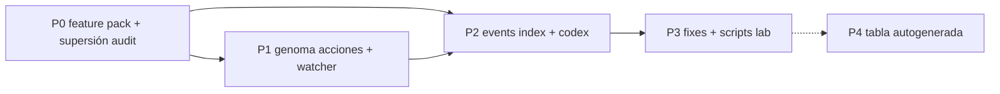

# Plan — Actualización documentación desactualizada (post gate I/O)

Origen: [`docs/audits/eda-doc-drift-eda-store-io-gate-261030.md`](../../audits/eda-doc-drift-eda-store-io-gate-261030.md).  
Alta de backlog: `tracker.provider=linear` → extender issue `eda-store-io-gate` o PBI hijo **documentación** vía `forge-pbi` / `refine-item`; prohibido materializar en `docs/todos/pending/`.

## Objetivo

PR **documental aparte** (después de que el diff I/O de `189dc7dd` / `ed9137a8` esté en la rama, no mezclado con más Rust) deja la documentación **operativa** alineada con `SDDIA_EVENT_STORE`, sin reescribir historia de PBIs `done/`.

`status: SUPERSEDED` en la auditoría 2026-10-26 solo cuando esta rama esté en `main`. Hasta entonces basta el banner ya presente.

## Ley de edición

| Zona | Vía |
|------|-----|
| `docs/features/`, `docs/audits/`, `docs/fixes/*/validacion.md` (solo addendum) | Edición directa en PR |
| `SddIA/actions/`, `SddIA/daemons/`, `SddIA/events/`, `SddIA/library/codexes/` | **`./sddia-run.sh --process entity-manager`** (forja); no `Write` IDE. Los procesos citados viven en `library/codexes/…/process/` (`process_domain_roots`), no hay duplicado en `SddIA/process/` para accept-pr / DCC. |
| `docs/todos/done/` | **No tocar** (archivo de programa) |

Texto canónico de runtime ECST: `SddIA/events/events-contract.md` §4. Las demás fichas **referencian** ese §; no duplican tablas de modos.

---

## P0 — Cierre auditorías y feature pack (≈0,5 h)

**Estado:** parcialmente hecho en working tree (sin commit obligatorio en este plan).

| ID | Entregable | Criterio |
|----|------------|----------|
| P0-1 | Commit docs ya alineados (`objectives*`, `plan*`, `spec-test-matrix`, `validacion`, kaizen nota) | Diff coherente con rama I/O |
| P0-2 | Banner en `eda-events-redb-vs-filesystem-20261026.md` | Hecho en working tree. `status: SUPERSEDED` **solo post-merge a `main`**. Addendum con matriz §5 opcional si el banner no basta en review. |
| P0-3 | Enlace bidireccional audit ↔ `plan-doc-drift-261030.md` | Frontmatter `related` |

**DoD P0:** lector nuevo no interpreta BUGs B/C de 20261026 como vigentes sin leer la nota de supersión.

---

## P1 — Genoma runtime (entity-manager) (≈1–2 h)

Una invocación `entity-manager` por ficha (acuse JSON y parar; sin polling). Los commits los agrupa el operador si la aduana lo permite.

| Entidad | Cambio documental | Evidencia código |
|---------|-------------------|------------------|
| `event-watcher` (daemon) | Descripción: `claim_store_pending` + `claim_store_fractal`; en `redb` no `read_dir` fractal como SSOT; `F-EDA-RESIDUAL-FILESYSTEM` / `F-EDA-RESIDUAL-FRACTAL`; side-channel latidos sin fila ECST | `SddIA/daemons/event-watcher/src/main.rs` |
| `emit-pr-presented-event` | Paso persistencia: delegar en `write_pending_event` / gate; `redb` → store + `target_path` lógico; `filesystem` → JSON | `actions.rs` |
| `emit-pr-audited-event` | Idem | idem |
| `emit-pr-resealed-event` | Idem | idem |
| `emit-pr-merged-event` | Paso 4 sigue `WRITE_FILE` a `{eda_bus.pending}` + `CREATE_DIR`; misma plantilla gate | `actions.rs` |
| `SddIA/actions/index.md` | Filas que dicen «emite en eda_bus.pending» sin modo store: una cláusula «ruta lógica; medio según §4» | índice acciones |

**Plantilla de párrafo (acciones):**

```markdown
### Persistencia

Según `SDDIA_EVENT_STORE` (`events-contract.md` §4): en `redb`/`dual` el ECST se registra en `.SddIA/runtime/events.redb` vía `write_pending_event` (sin fichero bajo `.events/pending/` en `redb` puro). En `filesystem`, JSON en `{eda_bus.pending}/<event_id>.json`. El `target_path` devuelto puede ser la ruta lógica `.events/pending/<event_id>.json` aunque el fichero no exista en `redb`.
```

**DoD P1:** en `emit-pr-{presented,audited,resealed,merged}-event.md` no queda un paso cuyo único medio sea `WRITE_FILE` / «Escribir JSON» sin citar `SDDIA_EVENT_STORE`. La plantilla **puede** mencionar `{eda_bus.pending}` como ruta lógica o modo `filesystem`.

---

## P2 — Codex procesos y índice eventos (entity-manager) (≈1 h)

| Entidad | Cambio |
|---------|--------|
| `SddIA/events/index.md` | Bullets runtime: SSOT `events.redb` default; path lógico pending/fractal; enlace §4 contract |
| Codex `accept-pr.md` | `target_path`: lógico; verificación `scan_presented_for_branch` consulta store si `writes_store` |
| Codex `delivery-close-cycle.md` | Intent Presented: emisión gated, no «solo JSON pending» |
| Codex `refine-item.md` | `event_path`: lógico o store según modo (refinar redacción mínima) |
| Codex `pull-request-review.md` | DIA-2 / Presented: alinear una línea a contract |

**DoD P2:** codex no contradice `events-contract.md` en modo default `redb`.

---

## P3 — Fixes históricos y scripts lab (≈0,5–1 h)

| ID | Artefacto | Acción |
|----|-----------|--------|
| P3-1 | `docs/fixes/eda-redb-lock/spec.md` § D3 | Prefijo «**Histórico (pre-CA4):**» + enlace a tests `redb_ca4_*` y `eda-store-io-gate` |
| P3-2 | Scripts ejecutables | Solo `SddIA/scripts/**/*.sh` (y qa empaquetado) que **escriben** `.events/pending`. No anotar cada mención en `docs/` (ruido histórico). Lista corta en `execution-doc-drift.md` + shebang/comentario `SDDIA_EVENT_STORE=filesystem` si el script es lab. |
| P3-3 | `eda-store-io-gate/plan.md` § Fase 4 | Marcar fila scripts como «P3-2 hecho» o enlace al inventario |

**DoD P3:** spec eda-redb-lock no lee como bug abierto en vitality; scripts lab identificables.

---

## P4 — Matriz documental (opcional, PR separado) (≈2–4 h)

No bloquea merge del PR I/O; cierra deuda TM-8 documental.

| ID | Entregable |
|----|------------|
| P4-1 | Script `docs/features/eda-store-io-gate/gen-test-matrix-table.sh` (o cápsula Python bajo `docs/…` **solo generador**) que cruza suscripciones + códice → Markdown |
| P4-2 | Sección fija en `spec-test-matrix.md` «Cobertura actual» generada + columna TM-8 |
| P4-3 | Tests TM-8 en Rust (producto) — **fuera** de este plan doc; referenciar en `plan-test-matrix.md` |

**DoD P4:** `spec-test-matrix.md` deja de mezclar «propuesta» y «hecho»; gaps PTC explícitos.

---

## Orden y dependencias



- **Mínimo del PR documental:** P0 (commit docs feature) + P1 + P2.
- **No** mezclar con más cambios Rust del gate. P3 en el mismo PR doc si el inventario de scripts cabe; si no, se queda fuera del DoD.
- SemVer: sin bump si el contrato de inputs no cambia; solo se aclara el medio de persistencia.

---

## Verificación

| Comando / revisión | Esperado |
|--------------------|----------|
| `rg 'solo escribe|write_json_atomic.*pending' SddIA/actions/ docs/features/eda-store-io-gate/` | Solo contexto histórico o ausente en genoma post-P1 |
| Lectura cruzada `events-contract.md` ↔ `events/index.md` ↔ codex DCC | Mismo default `redb` |
| `gate-evolution --range` si toca `SddIA/evolution/` | Solo si se registra hito doc en evolution |

---

## Definition of Done (documentación)

```text
Done = PR documental mergeado (separado del diff Rust del gate)
     + P0 (docs feature + banner 20261026) y P1 completos
     + P2 completos
     + validacion.md menciona plan-doc-drift y estado P*
```

`status: SUPERSEDED` de la auditoría 2026-10-26 queda para el merge de la rama I/O en `main`, no como gate de este PR doc.

Cierre tracker Linear: issue en `done`; **no** `pbi_archived` en fichero local (`provider: linear`).

## Revisión (2026-10-30)

| Hallazgo | Veredicto |
|----------|-----------|
| Forja vía `entity-manager` y no tocar `docs/todos/done/` | Correcto |
| Un solo PR con el código I/O | Rechazado: el diff Rust ya es grande; la forja dispara acuses EDA aparte |
| `SUPERSEDED` antes de `main` | Rechazado: el informe 2026-10-26 sigue siendo el snapshot de esa fecha; el banner basta hasta el merge |
| DoD `grep Escribir.*eda_bus` | Rechazado: la plantilla nueva también nombra esa ruta |
| P3 sobre todo `docs/` | Rechazado: alcance explosivo; acotado a scripts que escriben pending |
| `emit-pr-merged` «revisar si» | El paso 4 **sí** es `WRITE_FILE` exclusivo; entra en P1 fijo |
| Codex solo en `library/…/process/` | No hay par `SddIA/process/accept-pr.md`; una sola ficha por proceso |
| P4 / tests TM-8 | Sigue fuera del DoD documental |

## Riesgos

- **Doble verdad:** parches manuales en codex y genoma sin entity-manager → rechazo pre-commit / deuda. Respetar forja.
- **Scope creep:** reescribir 48 clases ECST — fuera; solo índice + contract + procesos que citan pending.
- **SemVer:** subir `version` en daemon/action si el frontmatter declara contrato nuevo (p. ej. inputs); si solo clarifica I/O existente, bump patch documentado en evolution opcional.
