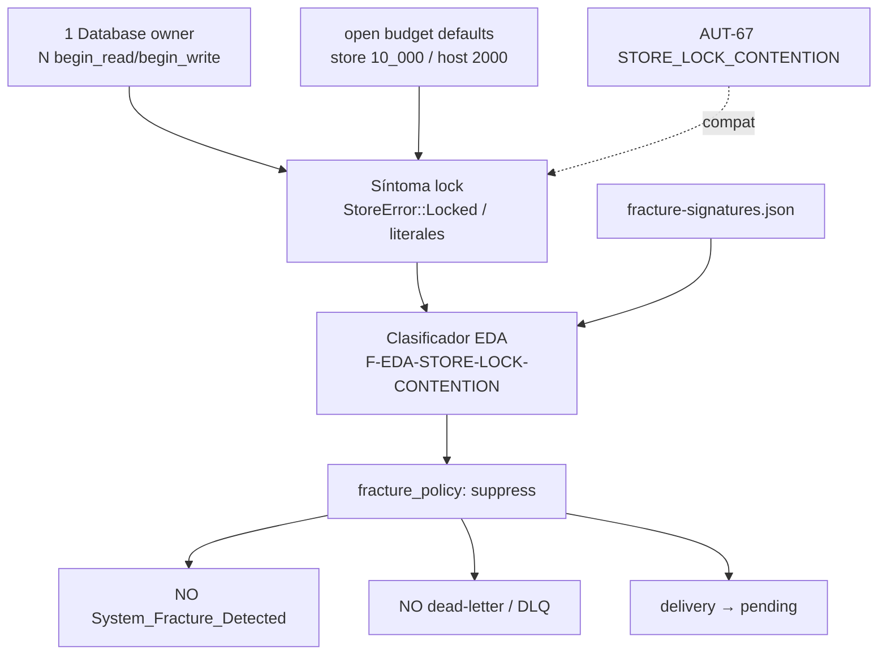

---

feature_name: eda-store-lock-contention
created: "2026-11-10"
updated: "2026-11-10"
process: feature
base: main
scope: "Firma F-EDA-STORE-LOCK-CONTENTION (fracture_policy suppress) + delivery pending; 1 Database + N tx sin reabrir MAN-38 ni subir presupuesto AUT-67"
branch_name: feat/eda-store-lock-contention
persist_ref: docs/features/eda-store-lock-contention
pbi_ref: MAN-42
parent_ref: MAN-38
historia_ref: MAN-35
related_refs: ["AUT-67", "AUT-16", "MAN-40"]
capability_id: "eda:event-manager"
contract: "eda.event_manager"
contract_version: "1.2.0"
fracture_signature: F-EDA-STORE-LOCK-CONTENTION
fracture_policy: suppress
delivery_on_contention: pending
agent: dedalo
phase: diseno-blueprint
version_spec: "1.0.0"
status: blueprint-ready
norm_ref: features-documentation-pattern@1.3.1
tracker_channel: ".SddIA/state/tracker-outbound/MAN-42.jsonl"
execution_id: "4ca3514c-eb8e-4940-ba87-c0c2c7b1b98b"
---
# Especificación técnica — eda-store-lock-contention

Entrada: `objectives.md` + `clarify.md` (laudos L-*) + semilla kaizen `process_fix` / canal **MAN-42** (historia **MAN-35**, padre técnico **MAN-38**).
Contrato `eda.event_manager` **1.2.0**, lifetime scoped MAN-38 y hook AUT-67 **inalterados** como diseño; este ciclo cierra el plano EDA/fractura/delivery ante contención de lock.
Cuerpo Linear MAN-42: **no materializado** en forge-pbi local; canal outbound + semilla + laudos bastan (**L-TRACKER**).
Pasada Dedalo `execution_id` **cd45182d-1075-43f1-89d5-f2fda26a09f5**: Diseño de Blueprint **v1.0.0**.

## 0. Evidencia viva (revalidada 2026-11-10)

| Artefacto | Estado vivo | Implicación forja |
|-----------|-------------|-------------------|
| `SddIA/sddia-event-store/src/error.rs` | `StoreError::Locked` + `Display` `StoreError::Locked: …` | Síntoma canónico (**L-SYMPTOM**) |
| `SddIA/sddia-event-store/src/lib.rs` | `DEFAULT_OPEN_BUDGET_MS = 10_000`; `is_lock_contention` → retry → `Err(Locked)` | Baseline presupuesto store (**L-NO-BUDGET**); no subir |
| `SddIA/sddia-event-manager-host/src/lib.rs` | `open_budget_ms` default **2000**; `with_productive_port`; `log_open_contention` | MAN-38 vivo; telemetría `open_contention` alinea KA-LOCK-4 |
| `SddIA/engine/execute-process/src/engine/eda_port.rs` | Wrappers → `with_productive_port`; `record_delivery_ack` / `move_to_dlq` genéricos | Sin rama Locked→suppress/pending aún |
| `SddIA/daemons/event-watcher/src/main.rs` | Claim/ACK scoped vía `with_productive_port` | Fallo open → return; **sin** firma suppress ni delivery policy explícita |
| `…/handlers/refine_item/run.rs` | `emit_store_lock_fracture` → `System_Fracture_Detected` + `friction_id: F-REFINE-ITEM-REDB-LOCK` | Emisor activo de ruido; **silenciar emisión** en T1; **no** reabrir sidechannel AUT-52 (**L-NON-GOALS**) |
| `…/handlers/forge_pbi.rs` | Lock en materialize → `ForgedEmit::Pending` | Contraste sano de delivery pending |
| `…/handlers/system_vitality.rs` | Probe topología: lock → `ok: true` / «store ocupado» | Contraste: no trata lock como fractura de topología |
| `SddIA/core/fracture-signatures.json` | Solo lock: `F-REFINE-ITEM-REDB-LOCK` (mayeuta/cumulo, **sin** suppress). **No** existe `F-EDA-STORE-LOCK-CONTENTION` | **T1** — registrar firma + `fracture_policy: suppress` |
| `…/core/fracture_signatures.rs` | `signature_matches_dcc_suppress` exige `consumers∋dcc_suppress` **y** `fracture_policy==suppress` | Patrón de catálogo; gate EDA aún no cableado |
| `…/engine/delivery_close.rs` | Suppress vivo solo en plano DCC (`emit_dcc_phase_fractures`) | T1 necesita gate análogo en emisores EDA/lock |
| `SddIA/scripts/qa/git-hooks/hook_common.sh` | `STORE_LOCK_CONTENTION` + retry hook (default 15s) | AUT-67 — **preservar** (**L-COMPAT-67**) |
| `SddIA/scripts/qa/test-aut-67-prepush-store-lock.sh` | Assert `DEFAULT_OPEN_BUDGET_MS = 10_000` | Guardián KA-LOCK-4 / L-NO-BUDGET |

## 1. Contexto y decisión

Tras MAN-38 (lifetime scoped) y AUT-67 (hook distingue contención), el plano EDA/fractura aún puede tratar `StoreError::Locked` / literales de lock como fractura sistémica o enrutar a DL. Eso regenera ruido Kaizen y enmascara contención transitoria como defecto ontológico.

| Vector | Laudo |
|--------|-------|
| Dominio | **L-DOMAIN** — contención = estado operativo transitorio |
| Síntoma | **L-SYMPTOM** — Locked / already open / cannot acquire / DatabaseAlreadyOpen |
| Firma | **L-SIGNATURE** — `F-EDA-STORE-LOCK-CONTENTION` |
| Política | **L-SUPPRESS** — `fracture_policy: suppress` |
| Fractura | **L-NOT-FRACTURE** — cero `System_Fracture_Detected` |
| DL | **L-NOT-DL** — cero dead-letter por lock |
| Delivery | **L-DELIVERY-PENDING** — queda/`pending` |
| Ownership | **L-ONE-DB-N-TX** — 1 Database + N tx |
| MAN-38 | **L-NO-REOPEN-38** |
| Budget | **L-NO-BUDGET** |
| Hook | **L-COMPAT-67** |
| Métricas | **L-METRICS** KA-LOCK-1..4 |
| No-goals | **L-NON-GOALS** |
| Proceso / git / genoma / tracker | **L-PROCESS** / **L-GIT** / **L-GENOME** / **L-TRACKER** |

## 2. Arquitectura objetivo



Reglas de capas:

1. **Síntoma** → clasificar como `F-EDA-STORE-LOCK-CONTENTION` (KA-LOCK-1).
2. **Política** → suppress: no materializar `System_Fracture_Detected`; no `move_to_dlq` / dead-letter por causa de contención (KA-LOCK-2/3).
3. **Delivery** → restaurar o conservar `pending` para reintento operativo (contraste: `forge_pbi::ForgedEmit::Pending`).
4. **Ownership** → un `redb::Database` por path; concurrencia vía transacciones; prohibido segundo `Database::create` concurrente (KA-LOCK-4).
5. **Presupuesto** → retry existente = escudo; defaults sin incremento.
6. **Sidechannel** `F-REFINE-ITEM-REDB-LOCK` → fuera de alcance (entrada mayeuta/cumulo puede permanecer; no reescribir diagnosis/proposal AUT-52).

## 3. T1 — Firma + suppress + delivery pending

### 3.1 Catálogo SSOT

Añadir en `SddIA/core/fracture-signatures.json` entrada canónica (forma alineada al patrón `dcc_suppress` + `fracture_policy`):

```json
{
  "id": "F-EDA-STORE-LOCK-CONTENTION",
  "consumers": ["dcc_suppress", "mayeuta"],
  "match": {
    "any": [
      "StoreError::Locked",
      "Database already open",
      "Cannot acquire lock",
      "STORE_LOCK_CONTENTION",
      "DatabaseAlreadyOpen"
    ]
  },
  "report_friction_ids": ["F-EDA-STORE-LOCK-CONTENTION"],
  "report_error_codes": ["STORE_LOCK_CONTENTION"],
  "fracture_policy": "suppress",
  "diagnosis": {
    "root_cause": "Contención de lock exclusivo redb (un Database owner); ruido operativo tras agotar presupuesto de open, no colapso sistémico.",
    "verdict": "process_fix",
    "proposal": "Clasificar y suppress; delivery pending; no System_Fracture_Detected ni DLQ; no subir open budgets; no reabrir MAN-38."
  }
}
```

- `catalog_contains_id("F-EDA-STORE-LOCK-CONTENTION")` debe ser true (O1 / KA-LOCK-1).
- **No** mutar diagnosis/proposal de `F-REFINE-ITEM-REDB-LOCK` (**L-NON-GOALS**).

### 3.2 Helper de clasificación (qué, no firma Rust exacta)

Helper compartido (crate execute-process y/o host, elección mínima Tekton) que:

| Entrada | Salida |
|---------|--------|
| Texto/`StoreError` con síntoma L-SYMPTOM | `true` + id firma `F-EDA-STORE-LOCK-CONTENTION` |
| Otro error | `false` |

Reutilizar literales ya vivos en `refine_item` / `forge_pbi` / store `is_lock_contention` / hook — **una** fuente de verdad de match para evitar drift.

### 3.3 Gate de emisión (anti-fractura / anti-DL)

| Touchpoint | Acción |
|------------|--------|
| Emisores que hoy materializan `System_Fracture_Detected` ante lock (mínimo: `refine_item::emit_store_lock_fracture`) | **Dejar de emitir** fractura; clasificar + suppress; no abrir PBI/Kaizen por este patrón |
| Rutas que puedan `move_to_dlq` / dead-letter por error de open/claim/ACK | Si causa = contención → **no** DL; delivery → `pending` |
| Watcher / eda_port claim-route-ACK | Ante Locked en open/op: no fractura; no DL; delivery afectada → `pending` (reintento) |
| `forge_pbi` Pending | **Conservar** como contraste |
| Plano DCC `delivery_close` | No reabrir; opcionalmente reconocer la nueva firma si reporta friction_id/error_code (compat) |

**Matiz refine-item:** se silencia la **emisión** de fractura por lock (CA-2). No se implementa sidechannel FS/`pending/{id}.json` ni se reescribe la firma `F-REFINE-ITEM-REDB-LOCK` (**L-NON-GOALS**).

### 3.4 Delivery pending

Semántica (**L-DELIVERY-PENDING**):

- Suscriptor/testigo afectado ante contención: estado **`pending`** (no `failed` terminal por lock).
- Patrón de referencia: `ForgedEmit::Pending` en `forge_pbi`.
- ACK/NACK lease: sin cambio de contrato ECST; solo política ante Locked.

## 4. T2 — Ownership 1 Database + N tx (sin reabrir MAN-38)

| Requisito | Detalle |
|-----------|---------|
| Invariante | Un owner `Database` por path de store; N txs (`begin_read`/`begin_write`) bajo ese owner |
| Prohibido | Segundo `Database::create` concurrente sobre el mismo fichero como remedio |
| MAN-38 | Conservar `with_productive_port` / scopes watcher claim-ACK; **cero** rediseño de `port-lifetime.md` |
| Presupuesto | No cambiar defaults `DEFAULT_OPEN_BUDGET_MS` (10_000) ni host `unwrap_or(2000)`; no subir env defaults como remedio |
| Telemetría | Alinear/usar `open_contention` existente + checks para KA-LOCK-4 |
| Hook AUT-67 | Sin reabrir defecto; compatibilidad de literales/código `STORE_LOCK_CONTENTION` |

Auditoría mínima (Tekton evidencia grep en execution):

- Callers productivos de `Database::create` / `EventStore::open` / `resolve_productive_port` que retengan ownership más allá de una op → solo documentar desviaciones ya justificadas en MAN-38; no introducir nuevas.
- Confirmar que paths calientes (host, watcher, eda_port) no abren un segundo handle concurrente «para superar» Locked.

## 5. T-close — Métricas KA-LOCK + validación

| ID | Evidencia esperada |
|----|--------------------|
| **KA-LOCK-1** | Test/lab o log: síntoma → id `F-EDA-STORE-LOCK-CONTENTION` (catálogo + clasificador) |
| **KA-LOCK-2** | Tras match: 0× `System_Fracture_Detected` atribuible a Locked |
| **KA-LOCK-3** | Tras match: 0× dead-letter cuya causa sea contención de lock |
| **KA-LOCK-4** | 1 DB + N tx; assert defaults presupuesto sin incremento (reuse test AUT-67 / host) |

`validacion.md` APTO solo con evidencia (Argos). Tekton no inventa APTO.

## 6. Criterios de aceptación (trazabilidad)

| ID | Criterio | Objetivos |
|----|----------|-----------|
| **CA-1** | Match Locked/already-open/cannot-acquire → firma `F-EDA-STORE-LOCK-CONTENTION` + `fracture_policy: suppress` | O1 |
| **CA-2** | Match **no** emite `System_Fracture_Detected` | O2 |
| **CA-3** | Match **no** escribe dead-letter/DLQ por contención | O3 |
| **CA-4** | Delivery afectada permanece/restaura `pending` | O4 |
| **CA-5** | Paths productivos: 1 Database + N tx; sin segundo `Database::create` concurrente | O5 |
| **CA-6** | No se reabre lifetime MAN-38 | O5 / invariantes |
| **CA-7** | No se suben defaults open budget store/host | O6 |
| **CA-8** | KA-LOCK-1..4 verificables en cierre | O7 |

## 7. Touchpoints (mapa de forja)

| Path | Tajo |
|------|------|
| `SddIA/core/fracture-signatures.json` | T1 catálogo |
| `SddIA/engine/execute-process/src/core/fracture_signatures.rs` (+ tests) | T1 match/suppress si hace falta API |
| Helper clasificación store-lock (execute-process y/o host) | T1 |
| `…/handlers/refine_item/run.rs` | T1 silenciar `emit_store_lock_fracture` |
| `…/handlers/forge_pbi.rs` | Contraste — no romper Pending |
| `…/engine/eda_port.rs` + adapter delivery/DLQ | T1 anti-DL + pending |
| `SddIA/daemons/event-watcher/src/main.rs` | T1 política Locked; T2 ownership check |
| `SddIA/sddia-event-manager-host/src/lib.rs` | T2 telemetría/`with_productive_port` — sin subir budget |
| `SddIA/sddia-event-store/src/lib.rs` | T2 baseline budget — sin incrementar |
| `SddIA/scripts/qa/git-hooks/hook_common.sh` | Compat AUT-67 — no reabrir |
| Tests unit/lab KA-LOCK-1..4 | T-close |
| `F-REFINE-ITEM-REDB-LOCK` entry / sidechannel AUT-52 | **No tocar** |

## 8. Fuera de alcance

- Doble `Database::create` concurrente como remedio.
- Sidechannel / reescritura de firma **`F-REFINE-ITEM-REDB-LOCK`** (AUT-52).
- Reabrir MAN-38 (lifetime), MAN-40 (sello lógico) o bóveda MAN-36.
- Subir defaults `SDDIA_EVENT_STORE_OPEN_BUDGET_MS` / `SDDIA_EVENT_MANAGER_OPEN_BUDGET_MS`.
- Cambiar EventManagerPort 1.2 o semántica ECST.
- Rehabilitar FS / `SDDIA_EVENT_STORE` productivo.
- Semillas Kaizen en `docs/todos/` desde Tekton/Argos.

## 9. Remisiones

| Ítem | Destino |
|------|---------|
| Padre técnico MAN-38 | `docs/fixes/man-38-redb-port-lock/` (+ `port-lifetime.md`) |
| AUT-67 | `docs/fixes/aut-67-prepush-store-lock/` |
| AUT-16 retry | `docs/fixes/eda-redb-lock` |
| Historia MAN-35 | `docs/features/event-manager-port-cutover/` |
| Catálogo firmas | `SddIA/core/fracture-signatures.json` |
| Canal Linear | `.SddIA/state/tracker-outbound/MAN-42.jsonl` |
| Clarificaciones | `clarify.md` laudos L-* |
| Objetivos | `objectives.md` O1…O8 / T1–T2 / T-close |
