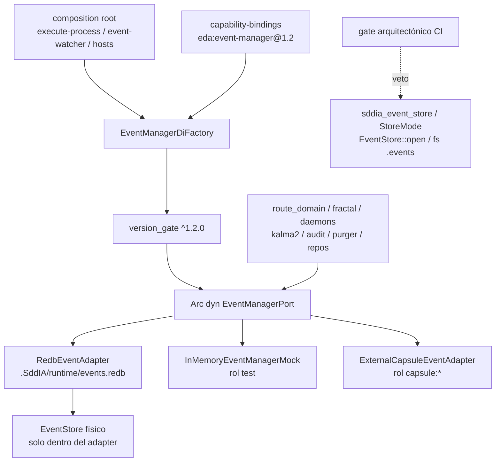

# Especificación técnica — event-manager-port-cutover

Entrada: `objectives.md` + `clarify.md` (laudos L-*) + semilla **PBI-176f9f2f** / canal **MAN-35** (padre **MAN-33**).
Predecesor absorbido: `eda-event-manager-additive` (MAN-32 / contrato v1.0.0) — este ciclo **extiende a 1.2.0** y **cablea** el motor.
Nota ids: sustituye diseño lab previo **MAN-101** / **PBI-f84fbfbc** para este `execution_id`.
Cuerpo Linear MAN-35: **no materializado** en `.SddIA/lab-linear-store.json` (`issues: {}`); canal outbound + semilla + laudos + AC bastan (**L-TRACKER** / D4.4 clarify).

## 0. Evidencia Genoma (revalidada 2026-11-08 — execution_id actual)

| Artefacto | Estado vivo | Implicación forja |
|-----------|-------------|-------------------|
| `capability-taxonomy.md` | **v1.0.10**, catalog `eda:event-manager` @ **1.0.0** | Bump taxonomía + fila catalog → contract **1.2.0** + hash |
| `capability-bindings.md` | **v1.8.0**, multi-rol con `fallback` → `fs-event-adapter` | Bump → **1.9.0**; `contract_version: 1.2.0`; **retirar fallback productivo FS** (**L-RETIRE** / **L-RUNTIME**) |
| `eda.event_manager.v1.schema.json` | Ops v1.0.0 (7 ops) | Extender enum/payloads **MINOR 1.2** en el mismo fichero `v1` |
| `sddia-core/.../event_manager/` | Trait 7 métodos; `CONTRACT_VERSION="1.0.0"`; `REQUIRED_CONTRACT_RANGE="^1.0.0"` | Ampliar trait + tipos; host exige **`^1.2.0`**; mock/suite/adapters alineados |
| `redb_event_adapter` | Active, implementa v1.0.0 | Implementar ops 1.2; runtime path canónico `.SddIA/runtime/events.redb` |
| `fs_event_adapter` | Active (fallback aditivo) | **Fuera de producción**; allowlist tests/migración solo (**L-RETIRE**) |
| `sddia-event-store` | `EventStore` + `StoreMode` + gate FS/dual | Solo detrás del adapter (o absorbido); **cero** en consumidores (**AC-1/2**) |
| Camino caliente | `route_domain_core`, `route_fractal_core`, `fractal_bus`, daemons, DLT, audit, purger, productores | Migración T3–T6; composition root T2 |
| Nota T0 prematura | `norma-redb-exclusiva.md` aún cita MAN-101 | T0 re-alineará frontmatter a **MAN-35** / **PBI-176f9f2f** |

## 1. Contexto y decisión

Cutover **total** (modo `BREAKING_CUTOVER`): `EventManagerPort` es la **única** frontera productiva para publicación, consulta, entregas, DLQ, progreso y sellos DLT. Runtime físico único: **`.SddIA/runtime/events.redb`**. Rutas **`.events/*`** = identificadores lógicos / nombres de tabla; **nunca** cola ni SSOT.

| Vector | Laudo |
|--------|-------|
| Dominio | **L-DOMAIN** — frontera = `EventManagerPort` / `eda:event-manager` |
| Runtime | **L-RUNTIME** — Redb exclusivo; prohibidos `filesystem` / `dual` |
| Paths | **L-LOGICAL-PATH** — `.events/*` lógicos; JSON conflictivo **no** prevalece |
| ECST | **L-ECST** — inmutable; entregas solo `subscriber_delivery` |
| Ops | **L-OPS-PORT** — DLQ/replay/purge/progreso/DLT solo vía puerto |
| Contrato | **L-CONTRACT-12** — extensión **1.2.0** provider-neutral |
| Composición | **L-COMPOSE** — host conoce adapter; consumidores ven `Arc<dyn EventManagerPort>` |
| Motor | **L-STRICT-CORE** — loader/`route_domain_core` por `event_id`; verify inline |
| Fractal | **L-FRACTAL** — ACK/NACK/DLQ/DLT del puerto |
| Productores | **L-PRODUCERS** — sin buses/DLQ paralelos |
| Audit/admin | **L-AUDIT-ADMIN** — audit contractual; purger sin open directo |
| No-evento FS | **L-NON-EVENT-FS** — proofs/config/estado local fuera del bus |
| Verify | **L-VERIFY** — suite + workspace tests + gate CI |
| Gate | **L-GATE** — veto arquitectónico |
| Git / genoma | **L-GIT** / **L-GENOME** |
| Tracker | **L-TRACKER** — Linear MAN-35; sin TODOs Dedalo/Tekton |

## 2. Arquitectura objetivo



Reglas de capas:

1. **Consumidor** → solo `EventManagerPort` (+ tipos de `contract.rs`).
2. **Host / composition root** → construye factory, registra builders, resuelve rol `default`/`test`/`capsule:*`.
3. **Adapter** → único conocimiento de path Redb, tablas y (si aplica) crate `sddia-event-store`.
4. **Prohibido** que consumidores abran `events.redb`, importen `sddia_event_store`, usen `StoreMode`, o hagan I/O ECST bajo `.events`.

## 3. Contrato Genoma 1.2 (**T1** / **L-CONTRACT-12**)

### 3.1 Schema (MINOR sobre `v1`)

| Aspecto | Valor |
|---------|-------|
| Path | `SddIA/library/norms/capability-contracts/eda.event_manager.v1.schema.json` |
| Draft | JSON Schema **2020-12** |
| `$id` | sin cambio de URI mayor (`…eda.event_manager.v1.schema.json`) |
| `contract_version` documentada | **1.2.0** (aditivo sobre 1.0.0; compatible SemVer `^1.0.0` para cápsulas viejas, host exige `^1.2.0`) |

Ops **retenidas** (1.0):

| Operación | Semántica |
|-----------|-----------|
| `publish_ecst` | Persistir ECST (pending deliveries) |
| `claim_pending` | Reclamar lote con lease |
| `record_delivery` | ACK/NACK → `subscriber_delivery` |
| `move_to_dlq` | Dead-letter |
| `replay_dlq` | Reinyectar DLQ |
| `append_trace` | Progress-trace append |
| `handshake_version` | Negociación SemVer |

Ops **nuevas** (1.2 — provider-neutral):

| Operación | Payload mínimo | Semántica |
|-----------|----------------|-----------|
| `get_event` | `event_id` | Carga ECST por id (motor estricto T3); `NotFound` si ausente |
| `list_events` | filtros opcionales (`family?`, `event_type?`, `since?`, `until?`) + `cursor?` + `limit` | Listado paginado; cursor opaco provider-neutral |
| `list_deliveries` | `event_id?`, `subscriber_id?`, `status?`, `cursor?`, `limit` | Consulta `subscriber_delivery` |
| `seal_dlt` | `event_id`, `tx_hash`, `digest`, `scope` | Persistir sello DLT (**L-OPS-PORT**) |
| `get_dlt_seal` | `event_id` | Lectura sello |
| `list_progress` | `trace_id` \| `correlation_id` | Lectura frames de progreso |
| `purge_event` | `event_id`, `reason?` | Purge administrativo histórico (**L-AUDIT-ADMIN**) |
| `verify_inline_ecst` | `event_id`, `ecst` | Compara inline vs store; rechazo si divergente/ausente (**L-STRICT-CORE** / **AC-4**) |

Notas de diseño:

- `verify_inline_ecst` preferido como **método de puerto** (adapters externos/NFT misma semántica); alternativa: helper en `sddia-core` sin I/O FS que combine `get_event` + igualdad canónica.
- Cursor: string opaco; adapters Redb pueden codificar `(created_at, event_id)` u offset interno — consumidores no interpretan el formato.
- `additionalProperties` permitido en `meta`/`error` (paridad contratos vigentes).

### 3.2 Puerto Rust

Árbol: `SddIA/sddia-core/src/ports/event_manager/`.

Cambios obligatorios:

- `CONTRACT_VERSION = "1.2.0"`.
- `REQUIRED_CONTRACT_RANGE = "^1.2.0"` (host cutover; cápsulas 1.0.x fallan handshake hasta actualizar — intencional).
- Ampliar `port.rs` + `contract.rs` + `memory_mock.rs` + `contract_suite.rs`.
- Factory: rol `default` → Redb; **no** registrar FS como fallback productivo; rol `test` → mock; `capsule:*` → puente.

```rust
// Métodos nuevos (además de los 7 de v1.0)
fn get_event(&self, req: GetEventRequest) -> Result<GetEventResult, EventManagerError>;
fn list_events(&self, req: ListEventsRequest) -> Result<ListEventsResult, EventManagerError>;
fn list_deliveries(&self, req: ListDeliveriesRequest) -> Result<ListDeliveriesResult, EventManagerError>;
fn seal_dlt(&self, req: SealDltRequest) -> Result<(), EventManagerError>;
fn get_dlt_seal(&self, req: GetDltSealRequest) -> Result<GetDltSealResult, EventManagerError>;
fn list_progress(&self, req: ListProgressRequest) -> Result<ListProgressResult, EventManagerError>;
fn purge_event(&self, req: PurgeEventRequest) -> Result<PurgeEventResult, EventManagerError>;
fn verify_inline_ecst(&self, req: VerifyInlineEcstRequest) -> Result<(), EventManagerError>;
```

(Tekton puede ajustar nombres idiomáticos sin cambiar `operation` del schema.)

### 3.3 Taxonomía y bindings

| Artefacto | Cambio |
|-----------|--------|
| `capability-taxonomy.md` | Patch bump (p.ej. `1.0.10`→`1.0.11`); catalog `eda:event-manager.version` → `1.2.0`; descripción cutover; hash + `norms/index.md` |
| `capability-bindings.md` | `1.8.0`→`1.9.0`; `contract_version: "1.2.0"`; roles: `default`=redb, `test`=mock, `capsule:*`=external; **eliminar o marcar `fallback` FS como non-prod / deprecated** |
| Mutación Genoma | Solo vía `entity-manager` + sello EDA (**L-GENOME**) |

## 4. Composition root único (**T2** / **L-COMPOSE**)

### 4.1 Locus

Un único módulo de arranque (o función compartida) que:

1. Lee binding `eda:event-manager`.
2. Registra builders (Redb path desde SSOT runtime; mock; external).
3. Resuelve `Arc<dyn EventManagerPort>`.
4. Inyecta el puerto en `execute-process`, `event-watcher` y hosts de daemons/tools que hoy abren store directo.

Candidatos de forja (elige Tekton **uno** canónico + reexports):

- `SddIA/engine/execute-process/src/engine/` (p.ej. nuevo `event_manager_host.rs` o extensión de bootstrap existente).
- Reuso desde `event-watcher` / bridges sin duplicar path Redb.

### 4.2 Path runtime SSOT

| Concepto | Valor |
|----------|-------|
| DB productiva | `.SddIA/runtime/events.redb` |
| Identificadores lógicos | tokens `.events/*` / nombres de tabla — **sin** `fs::` ECST |
| Env legacy | `SDDIA_EVENT_STORE`, `StoreMode::{Filesystem,Dual}` → **retirados** de consumidores (**T7**) |

### 4.3 Invariante DI

Ningún módulo bajo `engine/`, `daemons/`, `tools/` (excepto adapter crate) ni adapters LanceDB/productores conoce:

- tipo `EventStore`,
- path físico de Redb,
- tablas `events` / `subscriber_delivery` / etc.

## 5. Motor estricto (**T3** / **L-STRICT-CORE**)

Touchpoints principales:

| Módulo | Cambio |
|--------|--------|
| `ecst_input_loader.rs` | Carga por `event_id` vía puerto; sin precedencia de fichero JSON |
| `route_domain_core.rs` | Verify inline antes de efectos remotos; ACK/NACK/DLQ vía puerto; sin mutar `delivery_state` dentro del ECST; sin rename/barrido `.events` |
| `event_store_query.rs` | Reescribir a ops `get_event` / `list_*` o eliminar si queda muerto |
| `eda_bus.rs` / topología | Publicación/consulta solo puerto |

Reglas:

- Evento inline ausente o divergente → rechazo **antes** de side-effects (**AC-4**).
- `route-domain` / `route-fractal` **no** crean archivos `.events` (**AC-5**).

## 6. Bus fractal y daemons (**T4** / **L-FRACTAL**)

| Componente | Path / locus | Migración |
|------------|--------------|-----------|
| `route_fractal_core` | `engine/execute-process/src/engine/route_fractal_core.rs` | ACK/NACK/DLQ/DLT puerto |
| `fractal_bus` | `…/fractal_bus.rs` | Idem |
| `fractal` | `…/fractal.rs` | Sin FS ECST |
| heartbeat / vitality | daemons + cores relacionados | Entregas/progreso vía puerto |
| `memory_evolution_ingest_core` | engine | Publish/consulta puerto |
| `radamanto_batch_core` | engine | Sin open store |
| `telemetry_compliance_core` | engine | Sellos/consultas DLT vía puerto |
| `dlt_telemetry_anchor` | engine | `seal_dlt` / `get_dlt_seal` |
| `event-watcher` | `daemons/event-watcher` | Claim/delivery solo puerto |

## 7. Productores (**T5** / **L-PRODUCERS**)

| Productor | Locus típico | Acción |
|-----------|--------------|--------|
| kalma2-bridge | `daemons/kalma2-bridge*` / process | Publicar/consultar puerto; eliminar bus/DLQ paralelo |
| `lancedb_thought_repo` | `infrastructure/adapters/lancedb_thought_repo` | Sin EventStore directo |
| `instance-creator` | process / engine forges | DI puerto |
| Cerbero | `cerbero_*` en engine | Sin bypass store |
| output validator | `capability_di_output_validator.rs` | Sin inspeccionar backend |
| github-bridge-watcher | `daemons/github-bridge-watcher` | Publish vía puerto |

## 8. Auditoría y administración (**T6** / **L-AUDIT-ADMIN**)

| Tool / acción | Cambio |
|---------------|--------|
| `tools/event-bus-audit` | Solo operaciones contractuales del puerto (list/get/deliveries/progress/seals) |
| `tools/repo-retention-purger` + `purge_repo_retention` | **Prohibido** `EventStore::open`; purge histórico → `purge_event` (u op admin batch si se añade en forja sin romper 1.2) |
| Proofs / retención no-evento | Permanecen FS bajo SSOT separado (**L-NON-EVENT-FS**) |

## 9. Retirada legacy (**T7** / **L-RETIRE**)

| Ítem | Destino |
|------|---------|
| Dependencias productivas `sddia-event-store` | Solo crate adapter (o migración one-shot allowlist) |
| `StoreMode::Filesystem` / `Dual` | Eliminar de runtime productivo; tests solo si gate allowlist |
| `SDDIA_EVENT_STORE` | Retirar lecturas en consumidores |
| `fs_event_adapter` productivo | Retirar del rol `fallback` de bindings; opcional crate test-only |
| Docs README / Constitución / `cumulo.paths` / evolution | Convergencia cutover (**AC-9**) |

Residuos JSON bajo `.events/`: **no** cola; limpieza administrativa / fractura — Redb prevalece (**L-LOGICAL-PATH**).

## 10. Pruebas y aduana (**T8** / **L-VERIFY** / **L-GATE**)

### 10.1 Contract suite

`run_event_manager_contract_suite` ampliada:

1. `InMemoryEventManagerMock`
2. `RedbEventAdapter` (tempdir → fichero `events.redb` efímero)
3. `ExternalCapsuleEventAdapter` (dummy stdin/stdout) — **Fs deja de ser tercer pilar productivo**; si se mantiene fixture FS, solo bajo `#[cfg(test)]` allowlist

Casos nuevos 1.2: `list_events` cursor, `list_deliveries` filtro status, `seal_dlt`/`get_dlt_seal`, `list_progress`, `purge_event`, `verify_inline_ecst` (match / diverge / missing).

### 10.2 Gate arquitectónico CI

Veto (fuera de allowlist explícita adapter/migración/tests):

- `EventStore::open`
- `sddia_event_store` / `use sddia_event_store`
- `StoreMode::Filesystem`, `StoreMode::Dual`, `SDDIA_EVENT_STORE`
- open de `events.redb` fuera del adapter
- `std::fs::*` (create/rename/remove/read) sobre paths `.events` ECST

Medio: script/`sddia-qa` check o job CI dedicado; CA de CI → `PENDIENTE-CI` hasta `run_id` verde (norma features-documentation-pattern).

### 10.3 Calidad

- `cargo test --workspace` verde (**AC-8**).
- Clippy `-D warnings` en crates tocados.
- `validacion` global **APTO** solo tras invariantes (**AC-10**).

## 11. Criterios de aceptación (trazabilidad PBI)

| ID | Criterio |
|----|----------|
| **AC-1** | Cero uso productivo de `sddia_event_store` fuera del adapter o migración allowlist |
| **AC-2** | Cero `StoreMode::Filesystem`/`Dual` o `SDDIA_EVENT_STORE` en consumidores |
| **AC-3** | Cero I/O ECST bajo `.events` por consumidores |
| **AC-4** | Inline inexistente/divergente rechazado antes de efectos remotos |
| **AC-5** | `route-domain` / `route-fractal` sin crear archivos `.events` |
| **AC-6** | Kalma2, watchers, tools y repos vía puerto |
| **AC-7** | Contract suite Redb + mock + adapter externo |
| **AC-8** | `cargo test --workspace` + gate arquitectónico verdes |
| **AC-9** | README, Constitución, `cumulo.paths`, evolution convergen |
| **AC-10** | `validacion` APTO solo tras invariantes |

## 12. Touchpoints (mapa de forja)

| Path | Rol |
|------|-----|
| `SddIA/library/norms/capability-contracts/eda.event_manager.v1.schema.json` | Schema 1.2 |
| `SddIA/library/norms/capability-taxonomy.md` | Catalog 1.2.0 |
| `SddIA/library/norms/index.md` | Índice norma |
| `SddIA/core/capability-bindings.md` | Binding 1.9.0 sin fallback FS prod |
| `SddIA/sddia-core/src/ports/event_manager/**` | Trait, tipos, mock, suite, factory, gate |
| `SddIA/infrastructure/adapters/redb_event_adapter/**` | Adapter 1.2 + path runtime |
| `SddIA/infrastructure/adapters/external_capsule_event_adapter/**` | Ops 1.2 puente |
| `SddIA/infrastructure/adapters/fs_event_adapter/**` | Degradar / retirar prod |
| `SddIA/engine/execute-process/src/engine/route_domain_core.rs` | Motor estricto |
| `…/ecst_input_loader.rs`, `event_store_query.rs`, `eda_bus.rs`, `fractal_bus.rs`, `route_fractal_core.rs` | Cutover puerto |
| `…/dlt_telemetry_anchor.rs`, `telemetry_compliance_core.rs`, `radamanto_batch_core.rs`, `memory_evolution_ingest_core.rs` | T4 |
| `…/cerbero_*.rs`, `capability_di_output_validator.rs`, `purge_repo_retention.rs` | T5/T6 |
| `SddIA/daemons/event-watcher/**`, `github-bridge-watcher/**`, kalma2-bridge | T4/T5 |
| `SddIA/tools/event-bus-audit/**`, `repo-retention-purger/**` | T6 |
| `SddIA/sddia-event-store/**` | Contener tras adapter / retirar usos externos |
| Gate CI / `sddia-qa` / workflows `.github` | T8 |
| Docs README / Constitución / cumulo.paths / evolution | AC-9 |
| `docs/features/event-manager-port-cutover/norma-redb-exclusiva.md` | T0 — ids MAN-35 |

## 13. Fuera de alcance

- Reimplementar Redb store desde cero.
- Tokenizar/publicar cápsulas NFT reales.
- Migración masiva JSON históricos → Redb como cola.
- Cambiar modelo proofs/config/estado local no-evento.
- Semillas Kaizen en `docs/todos/` desde Tekton/Argos.
- Mantener dual-mode o filesystem como runtime productivo.

## 14. Remisiones

| Ítem | Destino |
|------|---------|
| Enabler aditivo MAN-32 | Absorbido; no se mantiene camino paralelo caliente |
| ADR-EDA-002 `eda.event_store` | Convergencia nominal: frontera productiva = `eda.event_manager` 1.2; plano ADR histórico no reabre filesystem dual |
| Padre MAN-33 | Auditoría bypass; lista cerrada T3–T6 |
| Canal Linear MAN-35 | `.SddIA/state/tracker-outbound/MAN-35.jsonl`; cierre vía `state_map` en delivery (provider linear) |
| Semilla | **PBI-176f9f2f** |
