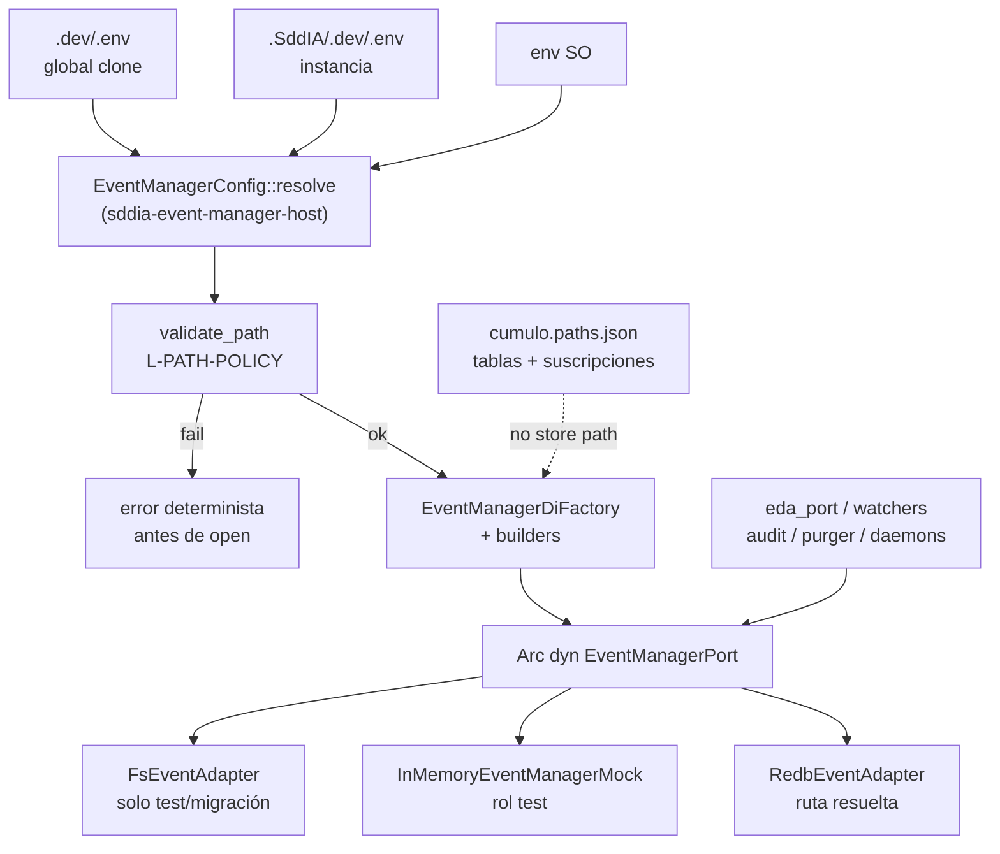

# Especificación técnica — man-36-event-manager-instance-config

Entrada: `objectives.md` + `clarify.md` (laudos L-*) + semilla **PBI-0604fb3c** / canal **MAN-36** (padre **MAN-35**).
Contrato `eda.event_manager` **1.2.0** e invariantes MAN-35 **inalterados**; este ciclo mueve solo la soberanía de **configuración física** del backend.
Cuerpo Linear MAN-36: **no materializado** en disco; canal outbound + semilla + laudos + AC bastan (**L-TRACKER**).
Pasada Dedalo `execution_id` **4fc6eadd-…**: revalidación post-Mayeuta → blueprint **v1.1.0** (evidencia viva alineada; delta residual CA-4 explícito).

## 0. Evidencia viva (revalidada 2026-11-09 — execution_id actual)

| Artefacto | Estado vivo | Implicación forja |
|-----------|-------------|-------------------|
| `SddIA/sddia-event-manager-host/src/config.rs` | `resolve_var` / `resolve_backend_config` / `validate_configured_path`; vars `SDDIA_EVENT_MANAGER_*`; precedencia SO>instancia>global; errores deterministas (`Empty`/`Traversal`/`EscapeRepo`/`FsNotAllowedInProd`) | **T0–T1 hechos** en árbol; no reabrir diseño de resolución |
| `SddIA/sddia-event-manager-host/src/lib.rs` | `productive_factory` / `resolve_productive_port` / `with_productive_port` desde config; `resolved_redb_path` + `productive_store_present` + `is_resolved_redb_path`; `resolve_fs_port` solo test/migración; **sin** `events_redb_path` público | Host = composition root soberano (**L-COMPOSE**) |
| `sddia-core/.../runtime_bridge.rs` | `PublishSeal.target_path` = token lógico `.events/{family}/{id}.json` | **T2 bridge OK** (**L-LOGICAL-EVENTS**) |
| `execute-process/.../eda_port.rs` | Ops productivas vía `with_productive_port`; **residuo CA-4:** `runtime_db_path` aún `pub` y, si `resolved_redb_path` falla, hace fallback a `repo.join(DEFAULT_REDB_REL)` | **Delta forja:** retirar API o devolver solo `Result` del host — **prohibido** reinventar default cableado en el consumidor |
| `SddIA/core/cumulo.paths.json` | **v1.12.0** — sin `event_bus` / `eda_*.store`; tablas/ids/suscripciones + `env_hierarchy` | **T3 hecho** (**L-CUMULO-LOGICAL** / **CA-3**) |
| `.dev/.env.example` | Bloque MAN-36 + precedencia; legacy `SDDIA_EVENT_STORE` marcado retirado | **T0 plantilla hecha** |
| `CONSTITUTION_CORE.md` §3.1 | Persistencia vía puerto; ubicación física = bóveda; Cúmulo lógico | **T4 Constitución hecha** (**CA-8** parcial) |
| Capacidad / contrato | `eda:event-manager` @ 1.2.0; sin bump de ops | Sin cambio de protocolo |
| Docs forja previas | `implementation.md` / `execution.md` (Tekton: T0–T5 narrados; cierre Argos pendiente) | Blueprint v1.1.0 orienta **cierre residual + verificación**, no reescritura ciega |

## 1. Contexto y decisión

Desacoplar **configuración física** (proveedor + rutas Redb/FS) del Core/Cúmulo. La instancia resuelve desde bóveda; el composition root valida y construye el adaptador; consumidores solo ven `EventManagerPort` 1.2.

| Vector | Laudo |
|--------|-------|
| Dominio | **L-DOMAIN** — frontera = `EventManagerPort` / `eda:event-manager` 1.2; sin cambiar ops |
| Bóveda | **L-VAULT** — `.SddIA/.dev/.env` soberana; `.dev/.env` defaults de clone |
| Precedencia | **L-PRECEDENCE** — SO > instancia > global (**CA-6**) |
| Variables | **L-VARS** — `SDDIA_EVENT_MANAGER_PROVIDER`, `SDDIA_EVENT_MANAGER_REDB_PATH`, `SDDIA_EVENT_MANAGER_FS_ROOT` |
| Composición | **L-COMPOSE** — solo host/adaptador conocen físico (**CA-4**) |
| Default Redb | **L-REDB-DEFAULT** — provider default `redb`; ruta default canónica bajo `repo_root` si no hay config — **decidida solo por el host** |
| FS | **L-FS-LIMIT** — solo test/migración; raíz solo del host (**CA-2**/**CA-7**) |
| Rutas | **L-PATH-POLICY** — relativas acotadas a `repo_root`; absolutas válidas; inválidas fallan antes de open (**CA-5**) |
| Cúmulo | **L-CUMULO-LOGICAL** — cero stores físicos Redb/`.events` storage (**CA-3**) |
| Token lógico | **L-LOGICAL-EVENTS** — `.events/{family}/{id}.json` = token, no fichero |
| Cápsulas | **L-NO-CAPSULE-ENV** — sin `.env` en cápsulas |
| Docs / verify | **L-DOCS** / **L-VERIFY** |
| Git / genoma / tracker | **L-GIT** / **L-GENOME** / **L-TRACKER** |

## 2. Arquitectura objetivo



Reglas de capas:

1. **Consumidor** → solo `EventManagerPort` (+ helpers provider-neutral **sin** PathBuf de store).
2. **Host** → carga precedencia, valida rutas, elige provider, abre adaptador.
3. **Adapter** → único conocimiento de path físico abierto.
4. **Cúmulo** → topología/identificadores lógicos ECST, contratos, suscripciones; **nunca** ruta de store.
5. **Prohibido** construir/asumir `.SddIA/runtime/events.redb` fuera del host (incluido fallback en `eda_port`); allowlist: tests del propio host + adaptador.

## 3. Contrato de configuración (**T0** / **L-VARS** / **L-PRECEDENCE**)

### 3.1 Variables (sin secretos en plantillas)

| Variable | Semántica | Default si ausente |
|----------|-----------|--------------------|
| `SDDIA_EVENT_MANAGER_PROVIDER` | `redb` \| `fs` (case-insensitive trim) | `redb` |
| `SDDIA_EVENT_MANAGER_REDB_PATH` | Relativa a `repo_root` o absoluta | `.SddIA/runtime/events.redb` (**solo host**) |
| `SDDIA_EVENT_MANAGER_FS_ROOT` | Raíz adaptador FS | *requerida* si provider/`resolve_fs_*`; ignorada en prod Redb |
| `SDDIA_EVENT_MANAGER_OPEN_BUDGET_MS` | Contención de lock | `2000` |

**Legacy:** `SDDIA_EVENT_STORE` / `filesystem`/`dual` **no** se rehabilitan (**L-NON-GOALS**).

### 3.2 Precedencia

1. Entorno del proceso (SO) → gana.
2. Else bóveda instancia `.SddIA/.dev/.env`.
3. Else bóveda global `.dev/.env`.
4. Else default §3.1.

Merge de ficheros: global → instancia; **no** pisar claves ya presentes en el entorno del proceso.

### 3.3 Plantillas

| Artefacto | Estado / regla |
|-----------|----------------|
| `.dev/.env.example` | Presente (MAN-36); mantener bloque + precedencia |
| Guía instancia | Override en `.SddIA/.dev/.env` sin tocar Cúmulo |
| **Prohibido** | `.env` bajo cápsulas (`skills/`, `tools/`, `daemons/`) |

## 4. Política de rutas (**L-PATH-POLICY** / **CA-5**)

| Caso | Regla |
|------|-------|
| Vacía / whitespace | **Error** antes de open |
| Relativa | Join `repo_root`; normalización; escape → **Error** |
| Absoluta | Permitida; sin segmentos `..`; **no** reescribir a relativa |
| Provider `redb` + path OK | Parents si hace falta; luego open |
| Provider `fs` | Solo rol `test`/`migration`/`test-fs`; **prohibido** en `resolve_productive_port` / rol `default` |

Errores estables: variable + causa (`empty`, `traversal`, `escapes repo_root`, `fs_not_allowed_in_prod`).

## 5. Composition root (**T1** / **L-COMPOSE**)

Árbol vivo: `SddIA/sddia-event-manager-host/` (`config.rs` + `lib.rs`).

API canónica (ya materializada; Tekton no renombra sin causa):

```text
EventManagerBackendConfig { provider, redb_path, fs_root }
resolve_backend_config / resolve_productive_backend_config / resolve_fs_backend_config
validate_configured_path
productive_factory / resolve_productive_port / with_productive_port
resolved_redb_path / productive_store_present / is_resolved_redb_path  # solo host
resolve_fs_port / resolve_role_port(test|migration|test-fs|default)
```

Invariante DI fuera de host+adapter:

- cero construcción de layout Redb por defecto,
- cero `RedbEventAdapter::open`,
- cero lectura de vars de bóveda para abrir store.

## 6. Desacoplo de consumidores (**T2** / **CA-4**) — delta residual

| Touchpoint | Estado | Acción restante |
|------------|--------|-----------------|
| `runtime_bridge` | Token lógico | Ninguna (mantener) |
| `eda_port::runtime_db_path` | **Residuo** | Eliminar export productivo **o** convertir a `Result<PathBuf, String>` que **solo** delegue `resolved_redb_path` **sin** `unwrap_or_else(|_| repo.join(DEFAULT_REDB_REL))`. Call sites: migrar a puerto / `productive_store_present` / `is_resolved_redb_path`. |
| watchers / audit / purger / daemons | Narrado como desacoplado en `implementation.md` | Re-grep forja: cero path builder / open `.redb` fuera allowlist |
| Gate | Pendiente cierre Argos | Veto a `events_redb_path`, fallback `DEFAULT_REDB_REL` fuera de `sddia-event-manager-host`, open Redb fuera host/adapter |

## 7. Cúmulo lógico-only (**T3** / **CA-3**)

Hecho en **v1.12.0**. Conservar: tablas ECST, suscripciones, `directories.events`, `eda_instance.*`, `env_hierarchy`. No reintroducir `event_bus` / `*.store` físicos.

## 8. Documentación (**T4** / **CA-8**)

| Artefacto | Estado |
|-----------|--------|
| `.dev/.env.example` | Hecho |
| `CONSTITUTION_CORE.md` §3.1 | Hecho |
| README / contratos EDA / gates | Verificar alineación residual; completar si drift |
| Genoma | Solo texto vía `entity-manager` si muta taxonomía; **sin** bump ops 1.2.0 |

## 9. Pruebas (**T5** / **L-VERIFY**)

Mantener contract suite MemoryMock / FS / Redb (MAN-35).

Host (ya incluye matriz en `config.rs` / `lib.rs` tests): precedencia, rutas, FS rechazado en prod, default sin vault, vault relativa, scoped open.

Cierre de verificación (Tekton/Argos):

| Check | Esperado |
|-------|----------|
| `cargo test -p sddia-event-manager-host` | Verde |
| Suites afectadas / gates `gate-event-manager-port`, `gate-eda-unit-no-real-backend` | Verde |
| Grep/allowlist CA-4 | Sin `runtime_db_path` con fallback cableado; sin `events_redb_path` |
| CA-1…CA-8 | Evidencia en `validacion.md` (no declarar APTO sin prueba) |

## 10. Criterios de aceptación (trazabilidad)

| ID | Criterio |
|----|----------|
| **CA-1** | Instancia ubica Redb vía bóveda (rel/abs válida) sin cambio de código ni `cumulo.paths.json` |
| **CA-2** | FS toma raíz solo del composition root; solo test/migración |
| **CA-3** | Cero stores físicos Redb/`.events/*` storage en `cumulo.paths.json` |
| **CA-4** | Cero consumidores productivos construyen/abren/asumen ruta Redb |
| **CA-5** | Inválidas (vacía, `..`) fallan antes de open; absolutas válidas OK |
| **CA-6** | Tests precedencia SO > instancia > global |
| **CA-7** | Redb default productivo; sin fallback FS productivo; sin regresión MAN-35 |
| **CA-8** | README, Constitución, docs de contrato + plantillas de bóveda |

## 11. Touchpoints (mapa de forja)

| Path | Rol |
|------|-----|
| `SddIA/sddia-event-manager-host/src/{config,lib}.rs` | Resolución ya viva; mantener/tests |
| `SddIA/engine/execute-process/src/engine/eda_port.rs` | **Delta CA-4** `runtime_db_path` |
| `SddIA/sddia-core/src/ports/event_manager/runtime_bridge.rs` | Token lógico (estable) |
| `SddIA/core/cumulo.paths.json` | v1.12.0 lógico (estable) |
| `.dev/.env.example` | Plantilla (estable) |
| `SddIA/CONSTITUTION_CORE.md` | CA-8 (estable) |
| README / contratos EDA / gates CI | Alineación residual |
| Daemons/tools consumidores | Re-verificación cero path |
| Tests host + contract suite | T5 |

## 12. Fuera de alcance

- Cambiar semántica ECST, tablas lógicas u ops EventManagerPort 1.2.
- Rehabilitar `SDDIA_EVENT_STORE` / dual / filesystem productivo.
- Secretos en Cúmulo, manifiestos o cápsulas.
- Pirámide tests EDA / harness mock (MAN-37).
- Semillas Kaizen en `docs/todos/` desde Tekton/Argos.

## 13. Remisiones

| Ítem | Destino |
|------|---------|
| Padre MAN-35 | `docs/features/event-manager-port-cutover/` |
| MAN-32 / MAN-33 | Puerto, adapters, DI |
| MAN-37 | Pirámide tests — paralelo |
| Canal Linear | `.SddIA/state/tracker-outbound/MAN-36.jsonl` |
| Semilla | **PBI-0604fb3c** / forge_key sellada |
| Clarificaciones | `clarify.md` laudos L-* |
| Objetivos | `objectives.md` O1…O8 / T0…T5 |
| Forja previa | `implementation.md` / `execution.md` |
