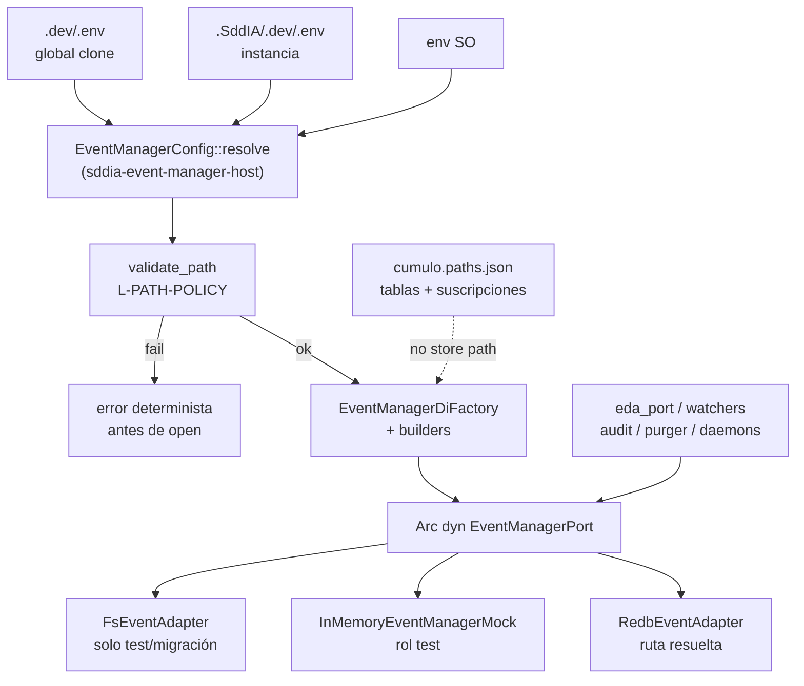

# Especificación técnica — man-36-event-manager-instance-config

Entrada: `objectives.md` + `clarify.md` (laudos L-*) + semilla **PBI-0604fb3c** / canal **MAN-36** (padre **MAN-35**).
Contrato `eda.event_manager` **1.2.0** e invariantes MAN-35 **inalterados**; este ciclo mueve solo la soberanía de **configuración física** del backend.
Cuerpo Linear MAN-36: **no materializado** en disco; canal outbound + semilla + laudos + AC bastan (**L-TRACKER**).
Pasada Dedalo: revalidación post-Mayeuta (`execution_id` actual) → blueprint **v1.0.1**.

## 0. Evidencia viva (revalidada 2026-11-09 — execution_id actual)

| Artefacto | Estado vivo | Implicación forja |
|-----------|-------------|-------------------|
| `SddIA/sddia-event-manager-host/src/lib.rs` | `events_redb_path(repo)` → `.SddIA/runtime/events.redb`; `productive_factory` abre esa ruta; lee `SDDIA_EVENT_MANAGER_OPEN_BUDGET_MS` | **T1:** resolver proveedor/ruta desde bóveda; validar antes de open |
| `sddia-core/.../runtime_bridge.rs` | Segunda copia de `events_redb_path`; `PublishSeal.target_path` = ruta física Redb | **T2:** retirar path físico del puente; sello sin disco |
| `execute-process/.../eda_port.rs` | `runtime_db_path` reexporta `events_redb_path` del core; consumidores productivos ya usan `with_productive_port` | **T2:** eliminar API productivos que asumen Redb path |
| `SddIA/core/cumulo.paths.json` v1.11.1 | `event_bus`, `eda_bus.store`, `eda_fractal.store` = `.SddIA/runtime/events.redb`; `env_hierarchy` ya declara `.dev/.env` / `.SddIA/.dev/.env` | **T3:** quitar stores físicos; conservar tablas/ids/suscripciones |
| `.dev/.env.example` | Documenta `SDDIA_EVENT_STORE` legacy (y comenta SSOT en Cúmulo) | **T0/T4:** migrar a `SDDIA_EVENT_MANAGER_*` |
| Capacidad / contrato | `eda:event-manager` @ 1.2.0; roles default/test/capsule:*; sin fallback FS prod | Sin bump de ops; solo docs de soberanía de config |
| Consumidores host | watchers/audit/daemons vía `with_productive_port` / `resolve_productive_port` | Ya no abren store directo; deben dejar de conocer path (**CA-4**) |

## 1. Contexto y decisión

Desacoplar **configuración física** (proveedor + rutas Redb/FS) del Core/Cúmulo. La instancia resuelve desde bóveda; el composition root valida y construye el adaptador; consumidores solo ven `EventManagerPort` 1.2.

| Vector | Laudo |
|--------|-------|
| Dominio | **L-DOMAIN** — frontera = `EventManagerPort` / `eda:event-manager` 1.2; sin cambiar ops |
| Bóveda | **L-VAULT** — `.SddIA/.dev/.env` soberana; `.dev/.env` defaults de clone |
| Precedencia | **L-PRECEDENCE** — SO > instancia > global (**CA-6**) |
| Variables | **L-VARS** — `SDDIA_EVENT_MANAGER_PROVIDER`, `SDDIA_EVENT_MANAGER_REDB_PATH`, `SDDIA_EVENT_MANAGER_FS_ROOT` |
| Composición | **L-COMPOSE** — solo host/adaptador conocen físico (**CA-4**) |
| Default Redb | **L-REDB-DEFAULT** — provider default `redb`; ruta default canónica bajo `repo_root` si no hay config |
| FS | **L-FS-LIMIT** — solo test/migración; raíz solo del host (**CA-2**/**CA-7**) |
| Rutas | **L-PATH-POLICY** — relativas acotadas a `repo_root`; absolutas válidas; inválidas fallan antes de open (**CA-5**) |
| Cúmulo | **L-CUMULO-LOGICAL** — cero stores físicos Redb/`.events` storage (**CA-3**) |
| Token lógico | **L-LOGICAL-EVENTS** — `.events/{family}/{id}.json` = token, no fichero |
| Cápsulas | **L-NO-CAPSULE-ENV** — sin `.env` en cápsulas |
| Docs / verify | **L-DOCS** / **L-VERIFY** |
| Git / genoma / tracker | **L-GIT** / **L-GENOME** / **L-TRACKER** |

## 2. Arquitectura objetivo



Reglas de capas:

1. **Consumidor** → solo `EventManagerPort` (+ helpers provider-neutral sin path de disco).
2. **Host** → carga precedencia, valida rutas, elige provider, abre adaptador.
3. **Adapter** → único conocimiento de path físico abierto.
4. **Cúmulo** → topología/identificadores lógicos ECST, contratos, suscripciones; **nunca** ruta de store.
5. **Prohibido** `events_redb_path` / open Redb / asumir `.SddIA/runtime/events.redb` fuera del host (salvo allowlist tests del propio host).

## 3. Contrato de configuración (**T0** / **L-VARS** / **L-PRECEDENCE**)

### 3.1 Variables (sin secretos en plantillas)

| Variable | Semántica | Default si ausente |
|----------|-----------|--------------------|
| `SDDIA_EVENT_MANAGER_PROVIDER` | `redb` \| `fs` (valores case-insensitive trim) | `redb` |
| `SDDIA_EVENT_MANAGER_REDB_PATH` | Ruta relativa a `repo_root` o absoluta | `.SddIA/runtime/events.redb` (decidido por host) |
| `SDDIA_EVENT_MANAGER_FS_ROOT` | Raíz del adaptador FS | *requerida* si provider=`fs`; ignorada en prod Redb |
| `SDDIA_EVENT_MANAGER_OPEN_BUDGET_MS` | Ya existe; retención de contención de lock | `2000` |

**Legacy:** `SDDIA_EVENT_STORE` / modos `filesystem`/`dual` **no** se rehabilitan. Plantillas y docs productivas retiran o marcan deprecado el legacy (**L-NON-GOALS**).

### 3.2 Precedencia de resolución

Para cada variable del contrato:

1. Si está definida en el entorno del proceso (SO / inyección runtime) → **gana**.
2. Else si aparece en bóveda de instancia `.SddIA/.dev/.env` → usa ese valor.
3. Else si aparece en bóveda global `.dev/.env` → usa ese valor.
4. Else → default de la tabla §3.1.

Carga de ficheros: el host (o un helper de vault **dentro del host**) puede leer las bóvedas **sin sobrescribir** claves ya presentes en el entorno del proceso. Orden de merge en ficheros: global → instancia; el entorno preexistente no se pisa.

### 3.3 Plantillas

| Artefacto | Cambio |
|-----------|--------|
| `.dev/.env.example` | Bloque Event Manager con las tres vars + precedencia; retirar docs productivas de `SDDIA_EVENT_STORE` |
| Guía instancia (README / sección bóveda) | Cómo fijar rutas en `.SddIA/.dev/.env` sin tocar Cúmulo |
| **Prohibido** | Crear `.env` bajo cápsulas (`skills/`, `tools/`, `daemons/` bins) |

## 4. Política de rutas (**L-PATH-POLICY** / **CA-5**)

Entrada: string de config + `repo_root: &Path`.

| Caso | Regla |
|------|-------|
| Vacía / solo whitespace | **Error** antes de open |
| Relativa | Join a `repo_root`; normalización lógica; si el resultado escapa de `repo_root` (segmentos `..` o prefix mismatch) → **Error** |
| Absoluta | Permitida; no vacía; **sin** segmentos `..`; **no** se reescribe a relativa |
| Provider `redb` + path OK | Crear parent dirs si hace falta; luego `RedbEventAdapter::open` |
| Provider `fs` | Solo si rol/contexto es `test` o migración explícita; raíz validada igual; **prohibido** en `resolve_productive_port` / rol `default` |

Errores: mensaje determinista (`EventManagerConfigError` o `String` estable) que nombre variable + causa (`empty`, `traversal`, `fs_not_allowed_in_prod`).

## 5. Composition root (**T1** / **L-COMPOSE**)

### 5.1 API host (orientativa — Tekton puede renombrar idiomáticamente)

Árbol: `SddIA/sddia-event-manager-host/`.

```text
EventManagerBackendConfig { provider, redb_path: PathBuf, fs_root: Option<PathBuf> }
resolve_backend_config(repo_root) -> Result<EventManagerBackendConfig, _>
validate_configured_path(repo_root, raw) -> Result<PathBuf, _>
productive_factory / resolve_productive_port / with_productive_port
  → usan resolve_backend_config + validate; provider productivo solo redb
```

- Sustituir `pub fn events_redb_path` **pública** por resolución interna (o marcar `#[doc(hidden)]` / eliminar export). **Ningún crate consumidor** debe importar path builder.
- Rol `test` → mock (sin path). Rol migración/test FS → builder FS con `SDDIA_EVENT_MANAGER_FS_ROOT` validada.
- Mantener `with_productive_port` (MAN-38 scoped open) usando la config resuelta.

### 5.2 Invariante DI

Fuera de `sddia-event-manager-host` y del crate adapter:

- cero construcción de `.SddIA/runtime/events.redb`,
- cero `RedbEventAdapter::open`,
- cero lectura de `SDDIA_EVENT_MANAGER_REDB_PATH` / `FS_ROOT` para abrir store.

## 6. Desacoplo de consumidores y puente (**T2** / **CA-4**)

| Touchpoint | Cambio |
|------------|--------|
| `runtime_bridge::events_redb_path` | **Eliminar** o dejar de exportar; helpers no rellenan path físico |
| `PublishSeal.target_path` | Dejar de apuntar a Redb: usar token lógico (`logical_rel`) o `PathBuf` vacío/documentado como no-disco; consumidores no abren ese campo |
| `eda_port::runtime_db_path` | Retirar API productiva o redirigir a error/`unimplemented` en prod; tests host-only |
| `event-watcher` / audit / purger / daemons | Siguen con `with_productive_port` / puerto; **sin** path |
| Grep/allowlist gate | Veto a `events_redb_path`, `runtime_db_path`, open `.redb` fuera host/adapter |

## 7. Cúmulo lógico-only (**T3** / **L-CUMULO-LOGICAL** / **CA-3**)

En `SddIA/core/cumulo.paths.json`:

| Acción | Claves |
|--------|--------|
| **Eliminar** | `event_bus` (store físico), `eda_bus.store`, `eda_fractal.store` |
| **Conservar** | Nombres de tabla (`events`, `subscriber_delivery`, …), `subscriptions` / telemetry / orchestration / domain subscription paths, `directories.events`, `eda_instance.*` (personalización/proofs — no store Redb), `env_hierarchy` |
| **Bump** | `version` del JSON Cúmulo (p.ej. `1.11.1` → `1.12.0`) + descripción: topología lógica sin store path |

Ajustar lectores que asuman `*.store` o `event_bus` como Redb (si existen aserciones/docs/gates). `is_filesystem_rel` + defaults `.events/*` ya toleran ausencia de store físico.

## 8. Documentación (**T4** / **CA-8** / **L-DOCS**)

| Artefacto | Mensaje |
|-----------|---------|
| README (Core / EDA) | Límite Core/instancia; vars; precedencia; Redb default |
| `CONSTITUTION_CORE.md` §3.1 | Persistencia vía puerto; **ubicación física** = bóveda de instancia (default histórico solo si no hay config) |
| Contratos EDA / evolution notes | Separar topología lógica vs config física |
| Gates / normas cutover | Alinear con veto de stores en Cúmulo |

Mutaciones Genoma (si toca taxonomía/bindings solo textuales): vía `entity-manager` (**L-GENOME**). **No** bump de `contract_version` 1.2.0 por este ciclo.

## 9. Pruebas (**T5** / **L-VERIFY** / **CA-6**)

Mantener contract suite MemoryMock / FS / Redb (MAN-35).

Añadir en host (tempdir / env isolation):

| Caso | Esperado |
|------|----------|
| Solo global define `REDB_PATH` | Usa global |
| Instancia override global | Usa instancia |
| SO override instancia+global | Usa SO |
| Relativa válida | Resuelve bajo `repo_root` |
| Relativa con `..` escape | Error pre-open |
| Absoluta válida fuera de repo | Acepta; abre ahí |
| Vacía | Error |
| Provider `fs` en `resolve_productive_port` | Error / rechazo |
| Provider `fs` + rol test + `FS_ROOT` | Adapter FS con esa raíz |
| Default sin vars | `.SddIA/runtime/events.redb` bajo temp `repo_root` |

`cargo test -p sddia-event-manager-host` (+ suites afectadas) verdes. Gate arquitectónico: patterns de path cableado / `events_redb_path` fuera allowlist → fail.

## 10. Criterios de aceptación (trazabilidad)

| ID | Criterio |
|----|----------|
| **CA-1** | Instancia ubica Redb vía bóveda (rel/abs válida) sin cambio de código ni `cumulo.paths.json` |
| **CA-2** | FS toma raíz solo del composition root; solo test/migración |
| **CA-3** | Cero stores físicos Redb/`.events/*` storage en `cumulo.paths.json` |
| **CA-4** | Cero consumidores productivos construyen/abren/asumen ruta Redb |
| **CA-5** | Inválidas (vacía, `..`) fallan antes de open; absolutas válidas OK |
| **CA-6** | Tests precedencia SO > instancia > global |
| **CA-7** | Redb default productivo; sin fallback FS productivo; sin regresión MAN-35 |
| **CA-8** | README, Constitución, docs de contrato + plantillas de bóveda |

## 11. Touchpoints (mapa de forja)

| Path | Rol |
|------|-----|
| `SddIA/sddia-event-manager-host/src/lib.rs` (+ módulos config si se parten) | Resolución, validación, factory |
| `SddIA/sddia-core/src/ports/event_manager/runtime_bridge.rs` | Quitar path físico / sello |
| `SddIA/engine/execute-process/src/engine/eda_port.rs` | Retirar `runtime_db_path` productivo |
| `SddIA/core/cumulo.paths.json` | L-CUMULO-LOGICAL |
| `.dev/.env.example` | Plantilla L-VARS |
| `SddIA/CONSTITUTION_CORE.md` | CA-8 |
| README / contratos EDA / gates CI | Docs + veto |
| `SddIA/daemons/event-watcher/**`, `tools/event-bus-audit/**`, purger | Verificar cero path |
| Tests host + contract suite | T5 |

## 12. Fuera de alcance

- Cambiar semántica ECST, tablas lógicas u ops EventManagerPort 1.2.
- Rehabilitar `SDDIA_EVENT_STORE` / dual / filesystem productivo.
- Secretos en Cúmulo, manifiestos o cápsulas.
- Pirámide tests EDA / harness mock (MAN-37).
- Semillas Kaizen en `docs/todos/` desde Tekton/Argos.

## 13. Remisiones

| Ítem | Destino |
|------|---------|
| Padre MAN-35 | `docs/features/event-manager-port-cutover/` — cutover 1.2 + Redb |
| MAN-32 / MAN-33 | Puerto, adapters, DI |
| MAN-37 | Pirámide tests — paralelo |
| Canal Linear | `.SddIA/state/tracker-outbound/MAN-36.jsonl` |
| Semilla | **PBI-0604fb3c** / forge_key sellada |
| Clarificaciones | `clarify.md` laudos L-* |
| Objetivos | `objectives.md` O1…O8 / T0…T5 |
