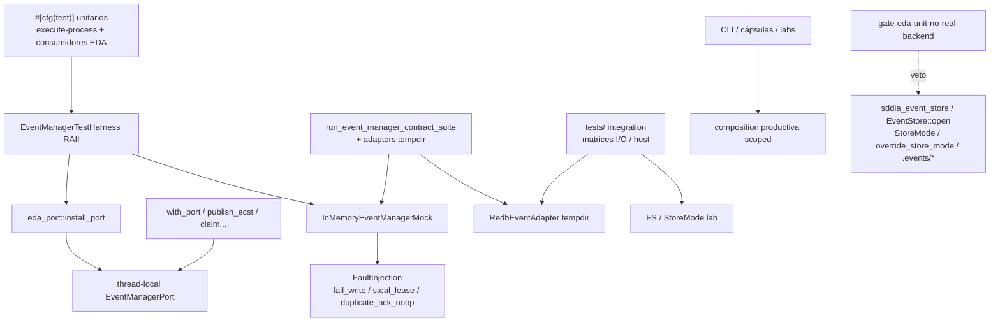

# Especificación técnica — man-37-eda-test-pyramid

Entrada: `objectives.md` + `clarify.md` (laudos L-*) + semilla **PBI-94396a84** / canal **MAN-37** (padre **MAN-35**).
Predecesor: `event-manager-port-cutover` (MAN-35) — puerto productivo ya canónico; este ciclo fija la **disciplina de tests**.
Cuerpo Linear MAN-37: **no materializado** en `.SddIA/lab-linear-store.json` (`issues: {}`); canal outbound + semilla + laudos + AC bastan (**L-TRACKER** / D4.1 clarify).

## 0. Evidencia viva (revalidada 2026-11-09 — execution_id actual)

| Artefacto | Estado vivo | Implicación forja |
|-----------|-------------|-------------------|
| `InMemoryEventManagerMock` | Existe en `sddia-core/.../memory_mock.rs` | Reutilizar; no reinventar |
| `FaultInjection` | `fail_write`, `steal_lease`, `duplicate_ack_noop` | Cubrir en unitarios (**L-FAULTS** / **AC-2**) |
| `EventManagerTestHarness` | **Ausente** | Forja **T0** |
| `eda_port::install_port` / `clear_port` | Thread-local mock en `execute-process` | Harness RAII debe instalar/restaurar vía este canal |
| `eda_port::test_lab` | `ParallelLabGuard`, `filesystem_eda`, `redb_eda` + `override_store_mode` | Residuo lab: **prohibido** en unitarios post-migración; reclasificar a integration |
| `eda_port_legacy.rs` | `#[cfg(test)]` puente StoreMode/FS | Solo allowlist integration/legacy paths; no unitarios consumidores |
| `run_event_manager_contract_suite` | Mock (+ peers adapters) | Capa **contract**; allowlist gate (**L-ALLOWLIST**) |
| Gate MAN-35 `gate_event_manager_port.rs` | Veto **productivo**; **omite** bloques `#[cfg(test)]` | MAN-37 añade gate **unitario** complementario (no sustituye MAN-35) |
| Unitarios con L-STRIP | Hits en `route_domain_core`, `eda_port`, handlers, `actions`, `tests/common`, matrices I/O, etc. | Inventario T1 → migrar/reclasificar T2–T3 |
| `EventManagerDiFactory::with_test_role_defaults` | Rol `test` → mock | Harness puede apoyarse; no wiring ad hoc disperso (**L-HARNESS**) |

## 1. Contexto y decisión

Pirámide de tests sobre `EventManagerPort` (**L-DOMAIN**):

| Capa | Qué prueba | Backend |
|------|------------|---------|
| **Unit** | Lógica de consumidor + contrato del puerto | Solo `InMemoryEventManagerMock` vía harness |
| **Contract** | Conformidad adapters / suite compartida | Mock + Redb/FS/external en tempdir allowlisted |
| **Integration** | Composition root / host / topología con I/O real efímero | Redb/FS/host efímeros |
| **E2E** | CLI, cápsulas, procesos de extremo a extremo | Aislados; sin mezclar en `#[cfg(test)]` unitarios |

| Vector | Laudo |
|--------|-------|
| Dominio test | **L-DOMAIN** |
| Harness RAII | **L-HARNESS** |
| Faults | **L-FAULTS** |
| Taxonomía | **L-TAXONOMY** |
| Strip legacy | **L-STRIP** |
| Allowlist | **L-ALLOWLIST** |
| Inventario | **L-INVENTORY** |
| Gate CI unit | **L-GATE** |
| Docs | **L-DOCS** |
| Git / genoma / tracker | **L-GIT** / **L-GENOME** / **L-TRACKER** |

## 2. Arquitectura objetivo



Reglas:

1. Todo unitario que toque eventos **debe** abrir con `EventManagerTestHarness` (Drop restaura).
2. Fallos de bus en unitarios **solo** vía `FaultInjection` del mock.
3. Redb, FS, host, CLI, cápsulas externas **prohibidos** en unitarios fuera de allowlist.
4. Gate MAN-35 (productivo) permanece; gate MAN-37 escanea **código de test unitario**.

## 3. EventManagerTestHarness (**T0** / **L-HARNESS**)

### 3.1 Locus canónico

| Opción | Path | Rol |
|--------|------|-----|
| **Canónico** | `SddIA/engine/execute-process/src/engine/eda_port.rs` (submódulo `test_harness` o hermano `event_manager_test_harness.rs`) | RAII sobre `install_port` / `clear_port` ya usados por el motor |
| Export | `pub use` desde `eda_port` / `engine` para tests del crate y reexports si otros crates del workspace comparten el lab |
| Core | `InMemoryEventManagerMock` + `FaultInjection` permanecen en `sddia-core` |

No duplicar un segundo thread-local. El harness es la **única** forma canónica de instalar el mock en unitarios.

### 3.2 API objetivo

```rust
/// RAII: instala InMemoryEventManagerMock como EventManagerPort; restaura en Drop.
pub struct EventManagerTestHarness {
    mock: Arc<InMemoryEventManagerMock>,
    // opcional: mutex lab si el crate aún serializa tests que tocan TLS global
}

impl EventManagerTestHarness {
    pub fn new() -> Self; // mock limpio + install_port
    pub fn with_faults(faults: FaultInjection) -> Self;
    pub fn mock(&self) -> Arc<InMemoryEventManagerMock>;
    pub fn port(&self) -> Arc<dyn EventManagerPort>;
    pub fn set_faults(&self, faults: FaultInjection);
}

impl Drop for EventManagerTestHarness {
    fn drop(&mut self); // clear_port (+ liberar mutex lab si aplica)
}
```

Invariantes:

- Al entrar: `clear_port` previo + `install_port(mock)`.
- Al salir: `clear_port`; **no** dejar `override_store_mode` activo (si el harness adquiere mutex lab, reset a `None`).
- Prohibido en unitarios: llamar `filesystem_eda` / `redb_eda` / `override_store_mode` junto al harness.

### 3.3 Guía de uso (mínima en T0; detalle T5)

```rust
#[test]
fn publish_fail_is_deterministic() {
    let h = EventManagerTestHarness::with_faults(FaultInjection {
        fail_write: true,
        ..Default::default()
    });
    // ejercitar consumidor / eda_port::publish_ecst → InjectedFault
    let _ = h.mock();
}
```

## 4. FaultInjection en unitarios (**T0/T2** / **L-FAULTS** / **AC-2**)

| Fault | Semántica mock | Aserción unitaria mínima |
|-------|----------------|--------------------------|
| `fail_write` | `publish_ecst` → `EventManagerError::InjectedFault` | Consumidor propaga/mapea error; sin I/O |
| `steal_lease` | Fuerza liberación de lease en `claim_pending` | Segundo claim / reintento ve evento; sin race FS |
| `duplicate_ack_noop` | ACK duplicado idempotente | Segundo `record_delivery(Ack)` no falla |

Extensiones de fault **solo** si el contrato lo exige y se documentan en este `persist_ref`.

## 5. Taxonomía (**L-TAXONOMY** / **L-DOCS** / **AC-7**)

| Capa | Ubicación típica | Permitido | Prohibido |
|------|------------------|-----------|-----------|
| **Unit** | `#[cfg(test)]` en `src/**` de consumidores; tests lib sin I/O store | Harness + mock + FaultInjection; asserts sobre puerto/lógica | `sddia_event_store`, `EventStore::open`, `StoreMode`, `override_store_mode`, inspección `.events/*`, open `events.redb`, CLI/cápsula real |
| **Contract** | `contract_suite.rs`; tests adapters | Suite + mock + Redb/FS/external tempdir | Mezclar asserts de lógica de negocio de consumidores |
| **Integration** | `execute-process/tests/**`, labs host | Redb/FS efímero, `test_lab::redb_eda`/`filesystem_eda`, matrices I/O | Contar como unitario ante el gate |
| **E2E** | labs CLI/cápsulas/workflows | Procesos reales aislados | Abrir store desde unitarios embebidos |

Documento canónico de taxonomía: sección en este `spec.md` + resumen operativo en `plan.md`; Tekton materializa referencia cruzada en README/norma solo si el tajo T5 lo exige sin abrir Genoma innecesariamente.

## 6. Inventario y migración (**T1–T3** / **L-INVENTORY** / **L-STRIP**)

### 6.1 Semilla de inventario (pre-T1; cerrar en T1)

Focos con evidencia L-STRIP / backend real en tests (lista **no exhaustiva** — T1 produce tabla machine-readable completa):

| Locus | Señales | Destino esperado |
|-------|---------|------------------|
| `engine/eda_port.rs` `test_lab` | `override_store_mode`, `filesystem_eda`, `redb_eda` | Integration helpers; unitarios → harness |
| `engine/eda_port_legacy.rs` | puente StoreMode en `#[cfg(test)]` | Allowlist integration / retirar de path unitario |
| `engine/route_domain_core.rs` `#[cfg(test)]` | `lab_filesystem_eda`, `.events/pending`, StoreMode | Migrar a mock **o** reclasificar integration |
| `engine/actions.rs`, `handlers/*` (vitality, heartbeat, tracker_*, …) | `EventStore::open`, `override_store_mode` | Idem |
| `engine/ecst_input_loader.rs`, `domain_mutation.rs`, `delivery_close.rs`, … | install/store touches | Harness |
| `execute-process/tests/common` + matrices (`eda_store_io_matrix_*`, `event_store_writers`, `eda_subscriber_*`, `memory_evolution_ingest`) | StoreMode / EventStore | **Integration** (allowlist) |
| `tools/sddia-qa/gate_event_manager_port.rs` | patrones forbidden | Extender / sibling gate unitario |
| `sddia-core` ports tests | mock/suite | Unit/contract OK |
| `sddia-event-manager-host` tests | Redb tempdir | Contract/integration allowlist |

### 6.2 Reglas de migración (T2)

Para cada unitario inventariado:

1. Envolver con `EventManagerTestHarness`.
2. Retirar: `sddia_event_store`, `EventStore::open`, `StoreMode`, `override_store_mode`, lectura/escritura bajo `.events/*`.
3. Sustituir asserts FS por asserts sobre mock (`traces_for`, publish/claim/delivery results) o errores `InjectedFault`.
4. Si el test **requiere** Redb/FS/host/CLI → mover a `tests/` integration o marcar allowlist + capa documentada (T3).

### 6.3 Reclasificación (T3)

| De | A |
|----|---|
| Unitario con matriz StoreMode | `tests/` integration |
| Suite adapters | contract (ya allowlisted) |
| Lab CLI/cápsula | e2e aislado |

## 7. Allowlist versionada (**L-ALLOWLIST**)

Fichero canónico (forja T4): p.ej. `SddIA/tools/sddia-qa/allowlists/eda-unit-backend.toml` (o constante en el gate) con entradas mínimas:

1. Crates/adapters bajo test contractual (`redb_event_adapter`, `fs_event_adapter` test-only, `external_capsule_event_adapter`).
2. `run_event_manager_contract_suite` y peers (`contract_suite.rs`, host contract tests).
3. Paths `**/tests/**` integration explícitos + `eda_port_legacy.rs` **solo** mientras exista puente lab (meta: reducir).
4. El propio gate (`gate_eda_unit_no_real_backend.rs` o nombre forja).

Cualquier otra aparición de patrones L-STRIP en código unitario = **fractura de gate**.

## 8. Gate CI (**T4** / **L-GATE** / **AC-6**)

### 8.1 Relación con MAN-35

| Gate | Escanea | Omite |
|------|---------|-------|
| `gate_event_manager_port` (MAN-35) | Código **productivo** | Bloques `#[cfg(test)]` / `#[test]` |
| **Nuevo** gate unitario (MAN-37) | Código **dentro** de `#[cfg(test)]` / `#[test]` / módulos unitarios en `src/**` | Paths allowlist integration/contract/e2e |

### 8.2 Patrones veto (unitarios no allowlisted)

- `sddia_event_store` / `use sddia_event_store`
- `EventStore::open`
- `StoreMode` / `override_store_mode`
- open / path `events.redb` fuera de allowlist
- I/O sobre `.events/` (create/read/rename/remove) en tests unitarios

### 8.3 Medio

- Módulo en `sddia-qa` + subcomando CLI (paridad MAN-35).
- Workflow CI / pre-commit que falle en violaciones.
- CA CI → `PENDIENTE-CI` hasta `run_id` verde si aplica norma documental.

## 9. Criterios de aceptación (trazabilidad)

| ID | Criterio |
|----|----------|
| **AC-1** | Todo unitario que use eventos pasa por `EventManagerTestHarness` → `InMemoryEventManagerMock` |
| **AC-2** | Unitarios demuestran `fail_write`, `steal_lease`, `duplicate_ack_noop` vía `FaultInjection` |
| **AC-3** | Cero `sddia_event_store` / `EventStore::open` / `StoreMode` / `override_store_mode` / inspección `.events/*` en unitarios fuera de allowlist |
| **AC-4** | Redb, FS, host, CLI y cápsulas externas solo en contract/integration/e2e |
| **AC-5** | Inventario T1 cerrado: migrados o reclasificados sin pendientes |
| **AC-6** | Gate CI falla ante backend real en unitarios no allowlisted |
| **AC-7** | Taxonomía unit/contract/integration/e2e documentada y referenciada |
| **AC-8** | `validacion` global APTO solo tras AC-1…AC-7 |

## 10. Touchpoints (mapa de forja)

| Path | Rol |
|------|-----|
| `SddIA/sddia-core/src/ports/event_manager/memory_mock.rs` | Mock + FaultInjection (sin cambio semántico obligatorio) |
| `SddIA/sddia-core/src/ports/event_manager/contract_suite.rs` | Contract layer; allowlist |
| `SddIA/engine/execute-process/src/engine/eda_port.rs` | `install_port` + **nuevo harness**; depurar `test_lab` de unitarios |
| `SddIA/engine/execute-process/src/engine/eda_port_legacy.rs` | Contener / allowlist |
| `SddIA/engine/execute-process/src/engine/route_domain_core.rs` + handlers / actions / … | Migración unitarios T2 |
| `SddIA/engine/execute-process/tests/**` | Integration matrices T3 |
| `SddIA/tools/sddia-qa/src/gate_event_manager_port.rs` | Referencia; **no** reemplazar |
| `SddIA/tools/sddia-qa/src/gate_eda_unit_*.rs` (nuevo) | Gate MAN-37 |
| Allowlist versionada bajo `sddia-qa` | T4 |
| `docs/features/man-37-eda-test-pyramid/*` | Spec/plan/taxonomía/validacion |
| Workflows `.github` / hooks | Cablear gate T4 |

## 11. Fuera de alcance

- Reabrir o revertir cutover productivo MAN-35.
- Reintroducir modos `filesystem`/`dual` o `sddia-event-store` en runtime productivo.
- Reimplementar RedbEventAdapter / store desde cero.
- Tokenizar o publicar cápsulas NFT.
- Migración masiva JSON históricos → Redb como cola.
- Semillas Kaizen en `docs/todos/` desde Tekton/Argos.

## 12. Remisiones

| Ítem | Destino |
|------|---------|
| Padre MAN-35 | Cutover puerto; gate productivo |
| Semilla | **PBI-94396a84** |
| Canal Linear | `.SddIA/state/tracker-outbound/MAN-37.jsonl` |
| Capacidad / contrato | `eda:event-manager` / `eda.event_manager` 1.2 |
| Clarificaciones | `clarify.md` L-* |
| Objetivos / AC | `objectives.md` O1–O8 / AC-1…AC-8 |
