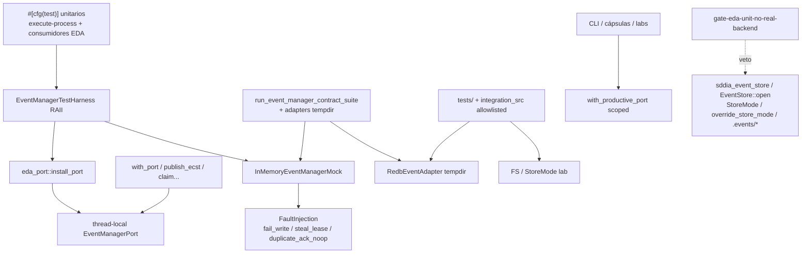

# Especificación técnica — man-37-eda-test-pyramid

Entrada: `objectives.md` + `clarify.md` (laudos L-*) + semilla **PBI-94396a84** / canal **MAN-37** (padre **MAN-35**).
Predecesor: `event-manager-port-cutover` (MAN-35) — puerto productivo canónico; este ciclo fija la **disciplina de tests**.
Composición productiva viva: apertura scoped vía `sddia_event_manager_host::with_productive_port` (MAN-38) — **fuera de alcance** reabrir; solo contexto.
Cuerpo Linear MAN-37: **no materializado** en lab-store (`issues: {}`); forge-pbi sellado solo metadatos; canal outbound + semilla + laudos + AC bastan (**L-TRACKER** / D4.1 clarify).

## 0. Evidencia viva (revalidada 2026-11-09 — execution_id `08a7564d-06ee-4558-8b37-9666572bcf00`)

| Artefacto | Estado vivo | Implicación forja |
|-----------|-------------|-------------------|
| `InMemoryEventManagerMock` | `SddIA/sddia-core/src/ports/event_manager/memory_mock.rs` | Reutilizar; no reinventar |
| `FaultInjection` | `fail_write`, `steal_lease`, `duplicate_ack_noop` (+ `set_faults` / `with_faults`) | Cubrir en unitarios (**L-FAULTS** / **AC-2**) |
| `EventManagerTestHarness` | **Presente** — `eda_port::test_harness` (+ `pub use` bajo `#[cfg(test)]`) | **T0 forjado**; Done exige **uso canónico** en unitarios EDA (**AC-1**) |
| Tests canónicos FaultInjection | `harness_fail_write_*`, `harness_steal_lease_*`, `harness_duplicate_ack_*` | **AC-2** base cubierta en harness |
| `eda_port::install_port` / `clear_port` | Thread-local mock; `with_port` prioriza mock | Harness RAII usa este canal; ad hoc deprecado |
| `scoped_tests` | Ya vía harness (`mock_stays_installed_across_ops`) | No reabrir wiring ad hoc |
| Productivo scoped | `with_productive_port` / `resolve_productive_port` (host) | No cache productivo en TLS; no-goal MAN-37 |
| `eda_port::test_lab` | `ParallelLabGuard`, `filesystem_eda`, `redb_eda` + `override_store_mode` | Residuo lab: **prohibido** en unitarios; solo integration allowlisted |
| `eda_port` `#[cfg(test)]` bridges | Ramas StoreMode → `eda_port_legacy` en `publish_ecst`/`record_ecst`/… | Unitarios no deben activar StoreMode (**L-STRIP**) |
| `eda_port_legacy.rs` | Puente StoreMode/FS en test | Allowlist integration/legacy |
| `run_event_manager_contract_suite` | Mock (+ peers adapters) | Capa **contract**; allowlist (**L-ALLOWLIST**) |
| Gate MAN-35 `gate_event_manager_port.rs` | Veto **productivo**; omite `#[cfg(test)]` / `#[test]` | Intactó; no debilitar |
| Gate unitario MAN-37 | **Presente** — `gate_eda_unit_no_real_backend.rs` + CLI `gate-eda-unit-no-real-backend` | **T4 forjado**; Done exige verde (**AC-6**) |
| Allowlist | `SddIA/tools/sddia-qa/allowlists/eda-unit-backend.toml` (+ hardcode espejo en gate) | **L-ALLOWLIST**; filas `integration_src` = reclasificación T3 documentada |
| Integration matrices | `execute-process/tests/` (`eda_store_io_matrix_*`, …) | Capa **integration** |
| Migración parcial T2 | `domain_mutation`, `ecst_input_loader`, `tracker_pbi_meta` tests → harness | Residual: filas `migrate`/`reclassify` en inventario |
| Handlers / actions | Varios bajo allowlist `integration_src` | Inventario T1 → cerrar sin `pending` (**AC-5**) |

**Delta vs spec v1.1.0:** §0 marcaba harness/gate **Ausentes**; working tree + `implementation.md` + `clarify.md` los confirman **Presentes**. Esta v1.2.0 sella diseño sobre evidencia actual: residual = disciplina de uso + inventario cerrado + verificación (**T1 residual / T2–T3 cierre / T5–T6**), no re-forja de T0/T4 desde cero.

## 1. Contexto y decisión

Pirámide de tests sobre `EventManagerPort` (**L-DOMAIN**):

| Capa | Qué prueba | Backend |
|------|------------|---------|
| **Unit** | Lógica de consumidor + contrato del puerto | Solo `InMemoryEventManagerMock` vía harness |
| **Contract** | Conformidad adapters / suite compartida | Mock + Redb/FS/external en tempdir allowlisted |
| **Integration** | Composition root / host / topología con I/O real efímero | Redb/FS/host efímeros (incl. `integration_src` allowlisted) |
| **E2E** | CLI, cápsulas, procesos de extremo a extremo | Aislados; sin mezclar en unitarios |

| Vector | Laudo |
|--------|-------|
| Dominio test | **L-DOMAIN** |
| Harness RAII | **L-HARNESS** |
| Faults | **L-FAULTS** |
| Taxonomía | **L-TAXONOMY** |
| Strip legacy | **L-STRIP** |
| Allowlist | **L-ALLOWLIST** |
| Inventario | **L-INVENTORY** |
| Gate CI unit | **L-GATE** |
| Docs | **L-DOCS** |
| Git / genoma / tracker | **L-GIT** / **L-GENOME** / **L-TRACKER** |

## 2. Arquitectura objetivo



Reglas:

1. Todo unitario que toque eventos **debe** abrir con `EventManagerTestHarness` (Drop restaura).
2. Fallos de bus en unitarios **solo** vía `FaultInjection` del mock.
3. Redb, FS, host, CLI, cápsulas externas **prohibidos** en unitarios fuera de allowlist.
4. Gate MAN-35 (productivo) permanece; gate MAN-37 escanea **código de test unitario**.
5. No activar `filesystem_eda` / `redb_eda` / `override_store_mode` en el mismo scope que el harness unitario.

## 3. EventManagerTestHarness (**T0** / **L-HARNESS**) — canónico vivo

### 3.1 Locus

| Ítem | Valor |
|------|-------|
| Path | `SddIA/engine/execute-process/src/engine/eda_port.rs` → `mod test_harness` |
| Export | `pub use test_harness::EventManagerTestHarness` bajo `#[cfg(test)]` |
| Core | `InMemoryEventManagerMock` + `FaultInjection` en `sddia-core` |

No duplicar un segundo thread-local. El harness es la **única** forma canónica de instalar el mock en unitarios.

### 3.2 API (sellada; no reabrir semántica)

```rust
pub struct EventManagerTestHarness { /* mock + ParallelLabGuard */ }

impl EventManagerTestHarness {
    pub fn new() -> Self;
    pub fn with_faults(faults: FaultInjection) -> Self;
    pub fn mock(&self) -> Arc<InMemoryEventManagerMock>;
    pub fn port(&self) -> Arc<dyn EventManagerPort>;
    pub fn set_faults(&self, faults: FaultInjection);
}

impl Drop for EventManagerTestHarness {
    fn drop(&mut self); // clear_port (+ Drop de ParallelLabGuard → clear_port + override_store_mode(None))
}
```

Invariantes:

- Al entrar: `ParallelLabGuard::acquire` (serializa TLS) + `install_port(mock)`.
- Al salir: `clear_port`; lab guard resetea `override_store_mode(None)`.
- Prohibido en unitarios: `filesystem_eda` / `redb_eda` / `override_store_mode` junto al harness.
- Guard **no** fija StoreMode Filesystem/Redb (solo serialización).

### 3.3 Guía de uso

```rust
#[test]
fn publish_fail_is_deterministic() {
    let h = EventManagerTestHarness::with_faults(FaultInjection {
        fail_write: true,
        ..Default::default()
    });
    // ejercitar consumidor / eda_port::publish_ecst → InjectedFault
    let _ = h.mock();
}
```

## 4. FaultInjection en unitarios (**L-FAULTS** / **AC-2**)

| Fault | Semántica mock (viva) | Aserción unitaria mínima |
|-------|------------------------|--------------------------|
| `fail_write` | `publish_ecst` → `EventManagerError::InjectedFault("fail_write")` | Cubierto en harness; consumidores migrados deben propagar/mapear |
| `steal_lease` | Fuerza liberación del primer claimed → pending | Cubierto en harness |
| `duplicate_ack_noop` | ACK duplicado idempotente | Cubierto en harness |

Extensiones de fault **solo** si el contrato lo exige y se documentan en este `persist_ref`.

## 5. Taxonomía (**L-TAXONOMY** / **L-DOCS** / **AC-7**)

| Capa | Ubicación típica | Permitido | Prohibido |
|------|------------------|-----------|-----------|
| **Unit** | `#[cfg(test)]` en `src/**` de consumidores; tests lib sin I/O store | Harness + mock + FaultInjection; asserts sobre puerto/lógica | `sddia_event_store`, `EventStore::open`, `StoreMode`, `override_store_mode`, inspección `.events/*`, open `events.redb`, CLI/cápsula real |
| **Contract** | `contract_suite.rs`; tests adapters | Suite + mock + Redb/FS/external tempdir | Mezclar asserts de lógica de negocio de consumidores |
| **Integration** | `execute-process/tests/**`, labs host, **y** paths `integration_src` allowlisted | Redb/FS efímero, `test_lab::redb_eda`/`filesystem_eda`, matrices I/O | Contar como unitario ante el gate |
| **E2E** | labs CLI/cápsulas/workflows; tools allowlisted | Procesos reales aislados | Abrir store desde unitarios embebidos no allowlisted |

Documento canónico de taxonomía: esta sección + resumen operativo en `plan.md` (**L-GENOME**: sin mutación Genoma por defecto).

## 6. Inventario y migración (**T1–T3** / **L-INVENTORY** / **L-STRIP**)

### 6.1 Inventario canónico (cerrar filas `pending` → cero)

Tabla machine-readable de trabajo (fuente: `execution.md` + allowlist viva). Estados al sellado de diseño:

| Path / foco | Decisión | Estado |
|-------------|----------|--------|
| `eda_port.rs` `test_harness` + faults canónicos | migrate (T0) | **done** |
| `eda_port.rs` `scoped_tests` | migrate → harness | **done** |
| `domain_mutation.rs`, `ecst_input_loader.rs`, `tracker_pbi_meta.rs` (tests) | migrate (T2) | **done** (parcial T2) |
| `eda_port.rs` `test_lab` (`filesystem_eda`/`redb_eda`) | reclassify integration helpers | **allowlisted** vía locus `eda_port.rs` |
| `eda_port_legacy.rs` | allowlist legacy | **allowlisted** |
| `route_domain_core`, `delivery_close`, `actions`, handlers EDA listados en `integration_src` | reclassify integration | **allowlisted** (capa documentada = reclasificado, **L-INVENTORY** D4.7) |
| Matrices `execute-process/tests/**` | reclassify/allowlist integration | **allowlisted** (`/tests/`) |
| `event-bus-audit`, `repo-retention-purger`, `kalma2-bridge`, `thought-graph-access` | reclassify e2e/tools | **allowlisted** (`integration_tools_prefixes`) |
| Unitarios consumidores EDA restantes sin harness ni allowlist | migrate \| reclassify \| allowlist | **cerrar en T1/T2/T3** — cero `pending` al Done |

### 6.2 Reglas de migración residual (T2)

Para cada unitario inventariado aún no migrado:

1. Envolver con `EventManagerTestHarness`.
2. Retirar: `sddia_event_store`, `EventStore::open`, `StoreMode`, `override_store_mode`, lectura/escritura bajo `.events/*`.
3. Sustituir asserts FS por asserts sobre mock o `InjectedFault`.
4. Si requiere Redb/FS/host/CLI → mover a `tests/` **o** allowlist + capa documentada (T3).

### 6.3 Reclasificación (T3)

| De | A |
|----|---|
| Unitario con matriz StoreMode / I/O | `tests/` integration **o** `integration_src` allowlisted |
| Suite adapters | contract (ya allowlisted) |
| Lab CLI/cápsula / tools src | e2e / `integration_tools_prefixes` |

Kaizen futuro: mover `integration_src` a `execute-process/tests/**` — **no** bloquea AC si allowlist + taxonomía cubren el caso (**clarify** D4.7).

## 7. Allowlist versionada (**L-ALLOWLIST**)

Fichero canónico vivo: `SddIA/tools/sddia-qa/allowlists/eda-unit-backend.toml`.

Espejo operativo en `gate_eda_unit_no_real_backend::path_allowlisted` (mantener paridad al tocar allowlist).

Entradas mínimas (cumplidas):

1. Adapters/store/host bajo test contractual (`path_prefixes`).
2. `contract_suite` + matrices I/O (`path_contains`).
3. `eda_port` / `eda_port_legacy` / gates (`path_suffixes`).
4. `integration_src` + `integration_tools_prefixes` (T3 documentado).

Cualquier otra aparición de patrones L-STRIP en código unitario no allowlisted = **fractura de gate**.

## 8. Gate CI (**T4** / **L-GATE** / **AC-6**) — canónico vivo

### 8.1 Relación con MAN-35

| Gate | Escanea | Omite |
|------|---------|-------|
| `gate_event_manager_port` (MAN-35) | Código **productivo** | Bloques `#[cfg(test)]` / `#[test]` |
| `gate_eda_unit_no_real_backend` (MAN-37) | Código **dentro** de regiones unitarias | Paths allowlist |

Diseño inverso al MAN-35: donde MAN-35 **salta** tests, MAN-37 **entra** en ellos.

### 8.2 Patrones veto (unitarios no allowlisted)

- `sddia_event_store` / `use sddia_event_store` / `sddia_event_store::`
- `EventStore::open`
- `StoreMode` / `override_store_mode`
- `events.redb`
- I/O sobre `.events/` / `.events\\`

### 8.3 Medio

- Módulo `SddIA/tools/sddia-qa/src/gate_eda_unit_no_real_backend.rs`.
- CLI: `sddia-qa gate-eda-unit-no-real-backend [--json]`.
- Workflow: paso en `.github/workflows/sddia-index-qa.yml` tras `gate-event-manager-port`.
- Tests del gate: fixture con `EventStore::open` → KO; allowlisted → skip collector.
- CA CI → `PENDIENTE-CI` hasta `run_id` verde si aplica norma documental; Done local exige gate verde.

## 9. Criterios de aceptación (trazabilidad)

| ID | Criterio | Nota de diseño |
|----|----------|----------------|
| **AC-1** | Todo unitario que use eventos pasa por `EventManagerTestHarness` → `InMemoryEventManagerMock` | Harness existe; residual = adopción completa |
| **AC-2** | Unitarios demuestran `fail_write`, `steal_lease`, `duplicate_ack_noop` vía `FaultInjection` | Tres canónicos en harness; consumidores migrados heredan |
| **AC-3** | Cero L-STRIP en unitarios fuera de allowlist | Gate + strip residual T2 |
| **AC-4** | Redb/FS/host/CLI/cápsulas solo contract/integration/e2e | Allowlist = frontera |
| **AC-5** | Inventario T1 cerrado sin pendientes | Filas allowlisted con capa = reclasificadas |
| **AC-6** | Gate CI falla ante backend real en unitarios no allowlisted | Gate presente; Done = verde |
| **AC-7** | Taxonomía documentada y referenciada | Esta §5 + plan/objectives/clarify |
| **AC-8** | `validacion` APTO solo tras AC-1…AC-7 | T6 |

## 10. Touchpoints (mapa de forja / residual)

| Path | Rol |
|------|-----|
| `SddIA/sddia-core/src/ports/event_manager/memory_mock.rs` | Mock + FaultInjection |
| `SddIA/sddia-core/src/ports/event_manager/contract_suite.rs` | Contract; allowlist |
| `SddIA/engine/execute-process/src/engine/eda_port.rs` | `install_port` + **harness vivo**; `test_lab` solo integration |
| `SddIA/engine/execute-process/src/engine/eda_port_legacy.rs` | Allowlist legacy |
| Handlers / actions / `domain_mutation` / … | Migración residual T2 o allowlist T3 |
| `SddIA/engine/execute-process/tests/**` | Integration matrices |
| `SddIA/tools/sddia-qa/src/gate_event_manager_port.rs` | MAN-35 — no reemplazar |
| `SddIA/tools/sddia-qa/src/gate_eda_unit_no_real_backend.rs` | Gate MAN-37 vivo |
| `SddIA/tools/sddia-qa/allowlists/eda-unit-backend.toml` | Allowlist versionada |
| `.github/workflows/sddia-index-qa.yml` | Cableado CI T4 |
| `docs/features/man-37-eda-test-pyramid/*` | Spec/plan/taxonomía/validacion |

## 11. Fuera de alcance

- Reabrir o revertir cutover productivo MAN-35 / composición scoped MAN-38.
- Reintroducir modos `filesystem`/`dual` o `sddia-event-store` en runtime productivo.
- Reimplementar RedbEventAdapter / store desde cero.
- Tokenizar o publicar cápsulas NFT.
- Migración masiva JSON históricos → Redb como cola.
- Semillas Kaizen en `docs/todos/` desde Tekton/Argos.
- Reescribir harness/gate desde cero (ya forjados; solo mantenimiento/paridad allowlist).

## 12. Remisiones

| Ítem | Destino |
|------|---------|
| Padre MAN-35 | Cutover puerto; gate productivo |
| Semilla | **PBI-94396a84** |
| Canal Linear | `.SddIA/state/tracker-outbound/MAN-37.jsonl` |
| Capacidad / contrato | `eda:event-manager` / `eda.event_manager` 1.2 |
| Clarificaciones | `clarify.md` L-* |
| Objetivos / AC | `objectives.md` O1–O8 / AC-1…AC-8 |
| Blueprint | `plan.md` T0…T6 (v1.2.0) |
| Forja parcial | `implementation.md` / `execution.md` |
