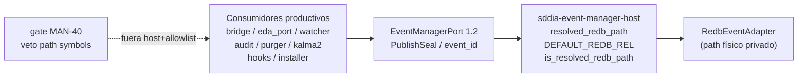

---

feature_name: man-40-eda-consumers-logical-seal
created: "2026-11-09"
updated: "2026-11-09"
process: feature
base: main
scope: "Consumidores EDA sellan materialización con PublishSeal/event_id; cero path Redb ni canal FS `.events/*` como SSOT fuera del host"
branch_name: feat/man-40-eda-consumers-logical-seal
persist_ref: docs/features/man-40-eda-consumers-logical-seal
pbi_ref: MAN-40
parent_ref: MAN-36
historia_ref: MAN-36
document_id: PBI-1b004e99
capability_id: "eda:event-manager"
contract: "eda.event_manager"
contract_version: "1.2.0"
agent: dedalo
phase: diseno-blueprint
version_spec: "1.0.0"
status: blueprint-ready
norm_ref: features-documentation-pattern@1.3.1
tracker_channel: ".SddIA/state/tracker-outbound/MAN-40.jsonl"
forge_key: "bd5f4db27f549584d61e515fe85571b8fb2d5f3279161d9aa982ff2851471498"
execution_id: "efb874c3-853e-425f-9aec-3e9a264b4103"
---
# Especificación técnica — man-40-eda-consumers-logical-seal

Entrada: `objectives.md` + `clarify.md` (laudos L-*) + semilla **PBI-1b004e99** / canal **MAN-40** (historia/padre **MAN-36**).
Contrato `eda.event_manager` **1.2.0** e invariantes MAN-35/MAN-36 (**bóveda / precedencia / vars**) **inalterados**; este ciclo cierra el residuo **CA-4** ampliado al canal FS/nombres cableados.
Cuerpo Linear MAN-40: **no materializado** en disco; canal outbound + semilla + laudos + AC bastan (**L-TRACKER**).
Pasada Dedalo `execution_id` **d5f40be9-1866-4813-a5b2-28a26faed56c**: Diseño de Blueprint **v1.0.0**.

## 0. Evidencia viva (revalidada 2026-11-09 — execution_id actual)

| Artefacto | Estado vivo | Implicación forja |
|-----------|-------------|-------------------|
| `SddIA/sddia-daemon-runtime/src/github_bridge.rs` | `materialize_to_bus` publica con `record_ecst_on_port` y **devuelve** `resolved_redb_path`; log `Materializado` imprime `.redb` | **T0** — sello lógico obligatorio |
| `…/execute-process/.../eda_bus_topology.rs` | `write_processing_witness` descarta JSON y retorna `eda_port::runtime_db_path`; `terminal_witness_exists` consulta puerto **y** OR con `witness_exists` FS | **T1** |
| `…/route_domain_core.rs` | `from_store` → `processing_header = runtime_db_path`; `is_runtime_db_event_path` acepta `file_name == "events.redb"` | **T1** + **T2** |
| `…/eda_port.rs` | `runtime_db_path` aún `pub` (delega host, sin fallback `DEFAULT_REDB_REL`); `path_is_resolved_redb` / `store_present` / `port_arc` siguen API de consumidor | **T1** — privatizar/retirar sello físico |
| `SddIA/sddia-event-store/src/gate.rs` | Layout cableado `.SddIA/runtime/events.redb`; modo `SDDIA_EVENT_STORE` | **T2** |
| `SddIA/tools/event-bus-audit/src/main.rs` | Núcleo vía `with_productive_port`; residual: ramifica / anomalías con `productive_store_present` / path | **T2** residual |
| `tools/repo-retention-purger` + `interfaces/kalma2-bridge/.../eda_productive.rs` | Modo productivo por `productive_store_present` (existencia de fichero) | **T2** (**L-NO-FILE-MODE**) |
| `SddIA/daemons/event-watcher/src/main.rs` | `run_watcher` `read_dir`/ruta fichero; `claim_store_fractal` stub vacío; cierre/`apply_route_outcome*` con `is_file`; `has_dead_letter_witnesses` FS | **T3** |
| Hooks / installer / limpieza | `clean-project-ephemeral.sh` + `sddia-installer.sh` leen `SDDIA_EVENT_STORE` / asumen `events.redb`; `hook_common.sh` nombra `events.redb` | **T4** |
| Lab `docs/features/eda-store-io-gate/_lab/forge-doc-drift-actions.py` | Contrato filesystem/dual + pending físico | **T4** (**L-LAB-DRIFT**) |
| Contraste sano | `linear_bridge::materialize_pending` → token `.events/pending/{event_id}.json`; writers fractal; `ecst_input_loader` | **No tocar** (**L-HEALTHY**) |
| Host `sddia-event-manager-host` | Dueño legítimo de `resolved_redb_path` / `DEFAULT_REDB_REL` / `is_resolved_redb_path` | Frontera estable (**L-HOST-ONLY**) |
| `tools/sddia-qa/.../gate_event_manager_port.rs` | Gate MAN-35 veta store legacy; **no** veta `resolved_redb_path` / `runtime_db_path` / `DEFAULT_REDB_REL` fuera host | **T5** — L-GATE ausente |

## 1. Contexto y decisión

Tras MAN-35 (cutover puerto 1.2) y MAN-36 (bóveda soberana), los consumidores productivos siguen tratando el path Redb resuelto y/o el canal `.events/*` en disco como sello, cabecera, default o señal de modo. El sello canónico de materialización es el token lógico **`PublishSeal`** (`.events/{family}/{id}.json`) o el **`event_id`**. Implementación y ruta física viven **solo** en `sddia-event-manager-host`.

| Vector | Laudo |
|--------|-------|
| Dominio | **L-DOMAIN** — frontera = `EventManagerPort` / `eda:event-manager` 1.2 |
| Residuo | **L-CA4-RESIDUE** — cierra sello + canal FS/nombres; no reabre bóveda |
| Sello | **L-LOGICAL-SEAL** — `PublishSeal` / `event_id` |
| Host | **L-HOST-ONLY** — único dueño de path/defaults físicos |
| Layout | **L-NO-LAYOUT-FALLBACK** — cero `.SddIA/runtime/events.redb` fuera host |
| Nombre | **L-NO-NAME-DETECT** — sin `file_name == events.redb` |
| Modo | **L-NO-FILE-MODE** — sin ramificar por existencia de fichero |
| Watcher | **L-WATCHER-PORT** — claim/orquestación por puerto |
| Terminal | **L-TERMINAL-PORT** — sin fallback `is_file` productivo |
| Scripts | **L-SCRIPTS** / **L-LAB-DRIFT** |
| Gate | **L-GATE** — veto símbolos fuera host+allowlist |
| Sano / no-goals | **L-HEALTHY** / **L-NON-GOALS** |
| Proceso / git / genoma / tracker | **L-PROCESS** / **L-GIT** / **L-GENOME** / **L-TRACKER** |

## 2. Arquitectura objetivo

Reglas de capas:

1. **Consumidor** → publica/consulta solo vía puerto; resultado observable = `PublishSeal` o `event_id` (nunca `PathBuf` al `.redb`).
2. **Host** → único dueño de resolución física, defaults de layout y detección de path de store.
3. **Watcher / topología** → claim, telemetría, dominio, orquestación y estado terminal por puerto; disco `.events/*` no es SSOT de cierre.
4. **Scripts/lab** → gobernanza documental/operativa con `SDDIA_EVENT_MANAGER_*`; sin `SDDIA_EVENT_STORE` ni asunción de nombre único.
5. **Gate** → veto mecánico a `resolved_redb_path`, `runtime_db_path`, `DEFAULT_REDB_REL` (y open/layout histórico) fuera de host + allowlist tests/legado.

## 3. Contrato de sello lógico (**T0** / **L-LOGICAL-SEAL**)

### 3.1 Forma canónica

| Campo | Semántica |
|-------|-----------|
| `PublishSeal` / token | Identificador lógico `.events/{family}/{id}.json` (contraste: `linear_bridge`) |
| `event_id` | Alternativa válida cuando el caller ya posee el id |
| Prohibido | Devolver/registrar `resolved_redb_path` / `PathBuf` al store como sello de éxito |

### 3.2 Touchpoint ancla

`github_bridge::materialize_to_bus`:

- Mantener publicación vía `with_productive_port` + `record_ecst_on_port`.
- Cambiar retorno/log: token lógico (p. ej. `.events/pending/{event_id}.json` o `event_id`), **no** `resolved_redb_path`.
- Firma: preferir `Result<Option<PathBuf>, _>` donde el `PathBuf` sea **token lógico**, o `Result<Option<String>, _>` con `event_id`/`PublishSeal` — Dedalo fija el *qué*; Tekton elige forma mínima sin romper callers.

### 3.3 Fuera del defecto

`write_fallback_dead_letter` (JSON de fallo del bridge) **permanece** — no es backend del puerto (**L-HEALTHY**).

## 4. Desacoplo eda_port / topología / route (**T1** / **L-HOST-ONLY** / **L-TERMINAL-PORT**)

| Touchpoint | Acción |
|------------|--------|
| `eda_port::runtime_db_path` | Deja de ser API/sello de consumidores (delete o crate-private). Sin reexportar path físico como contrato estable. |
| `path_is_resolved_redb` / `store_present` | Retirar de superficie productiva **o** redirigir a APIs host-only usadas solo donde el host es el caller legítimo; consumidores no ramifican modo. |
| `port_arc` | No patrón productivo; scoped `with_productive_port` / helpers provider-neutral. |
| `write_processing_witness` | Retorno = sello lógico / testigo vía puerto; **no** `runtime_db_path`. |
| `route_domain_core` `processing_header` | Cabecera lógica (`event_id` / token / marca from_store sin path Redb). |
| `terminal_witness_exists` | Solo estado terminal ECST vía puerto; **sin** OR a `witness_exists`/`is_file` en build productivo (`cfg(test)` permitido si hace falta). |

## 5. Fallbacks, detección y modo fichero (**T2**)

| Touchpoint | Acción |
|------------|--------|
| `is_runtime_db_event_path` | Solo API host (`is_resolved_redb_path` o equivalente); **prohibido** `file_name == "events.redb"`. |
| `sddia-event-store` `gate.rs` | Sin layout cableado productivo; sin gobernar con `SDDIA_EVENT_STORE` el store vivo. Allowlist tests/legado explícita. |
| `event-bus-audit` | Sin ramificar/anomalías por path físico como SSOT; sin fallback `DEFAULT_REDB_REL`. |
| purger / `kalma2-bridge/eda_productive.rs` | Sin `productive_store_present` como selector de modo; el host/bóveda decide. |

## 6. event-watcher por puerto (**T3** / **L-WATCHER-PORT**)

| Requisito | Detalle |
|-----------|---------|
| Pending | Claim por `EventManagerPort` (ya parcialmente vivo — conservar y extender). |
| Familias fractal | `claim_store_fractal` (y telemetría/dominio/orquestación) con equivalente real por puerto; stub vacío **prohibido**. |
| Cierre de tick | Sin `pending_path.is_file()` / `read_dir` de colas/testigos como SSOT. |
| Dead-letter witnesses | Sin `read_dir` FS como SSOT de presencia; puerto/ECST. |
| Telemetría claim | Sin etiqueta store `"redb"` como SSOT de backend. |

## 7. Scripts / installer / lab (**T4** / **L-SCRIPTS** / **L-LAB-DRIFT**)

| Artefacto | Acción |
|-----------|--------|
| `scripts/qa/git-hooks/hook_common.sh` | Retirar asunción operativa `events.redb` único; mensajes alineados a host. |
| `scripts/qa/clean-project-ephemeral.sh` | Sin leer `SDDIA_EVENT_STORE` como gobernanza; protección de store vía contrato host / vars `SDDIA_EVENT_MANAGER_*`. |
| `sddia-installer.sh` | Sin default `SDDIA_EVENT_STORE=redb` como gobernanza del productivo. |
| Lab `forge-doc-drift-actions.py` | Contrato puerto/sello lógico; sin pending físico dual/filesystem. |

## 8. Gate arquitectónico (**T5** / **L-GATE**)

Extender (o añadir) gate QA — punto de partida vivo: `gate_event_manager_port` — para vetar en código productivo **fuera** de `sddia-event-manager-host` + allowlist tests/legado:

- `resolved_redb_path`
- `runtime_db_path`
- `DEFAULT_REDB_REL`
- open/layout histórico `.SddIA/runtime/events.redb` construido por consumidores

**Allowlist:** host + tests/legado **explícitos**; cero consumidores productivos por comodidad.

## 9. Pruebas (**T6** / verificación)

| Check | Esperado |
|-------|----------|
| Bridge / materialización | Return/log sin path `.redb`; token/`event_id` presente |
| Witness / header / terminal | Sin path Redb; terminal sin FS productivo |
| Watcher | Claim familias por puerto; cierre sin `is_file`/`read_dir` SSOT |
| Grep/gate | CA-1…CA-7 mecánicos |
| Suites afectadas | `cargo test` paquetes tocados + gates EDA existentes |
| `validacion.md` | APTO solo con evidencia (Argos) |

## 10. Criterios de aceptación (trazabilidad)

| ID | Criterio | Objetivos |
|----|----------|-----------|
| **CA-1** | Ningún consumidor productivo devuelve ni registra path Redb como sello | O1 |
| **CA-2** | Cero fallback layout `.SddIA/runtime/events.redb` fuera del host | O2 |
| **CA-3** | Detección de path solo vía API host; sin `events.redb` por nombre | O3 |
| **CA-4** | Gate veta `resolved_redb_path` / `runtime_db_path` / `DEFAULT_REDB_REL` fuera host+allowlist | O7 |
| **CA-5** | `event-watcher` pending+familias por puerto; cierre sin `is_file`/`read_dir` SSOT | O4 |
| **CA-6** | `terminal_witness_exists` sin fallback fichero si puerto no marca terminal | O5 |
| **CA-7** | Hooks/installer/limpieza sin `SDDIA_EVENT_STORE` ni asunción `events.redb` único | O6 |

## 11. Touchpoints (mapa de forja)

| Path | Tajo |
|------|------|
| `SddIA/sddia-daemon-runtime/src/github_bridge.rs` | T0 |
| `SddIA/engine/execute-process/src/engine/eda_port.rs` | T1 |
| `SddIA/engine/execute-process/src/engine/eda_bus_topology.rs` | T1 |
| `SddIA/engine/execute-process/src/engine/route_domain_core.rs` | T1–T2 |
| `SddIA/sddia-event-store/src/gate.rs` | T2 |
| `SddIA/tools/event-bus-audit/src/main.rs` | T2 |
| `SddIA/tools/repo-retention-purger/src/{plan,slice_events}.rs` | T2 |
| `SddIA/interfaces/kalma2-bridge/src/eda_productive.rs` | T2 |
| `SddIA/daemons/event-watcher/src/main.rs` | T3 |
| `SddIA/scripts/qa/git-hooks/hook_common.sh` | T4 |
| `SddIA/scripts/qa/clean-project-ephemeral.sh` | T4 |
| `sddia-installer.sh` | T4 |
| `docs/features/eda-store-io-gate/_lab/forge-doc-drift-actions.py` | T4 |
| `SddIA/tools/sddia-qa/src/gate_event_manager_port.rs` (+ gate MAN-40 si separado) | T5 |
| Tests paquetes afectados | T6 |
| Host `sddia-event-manager-host` | Solo si API faltante para consumidores; **no** reabrir bóveda |
| Contraste `linear_bridge.rs` / writers fractal / `ecst_input_loader` | No tocar |

## 12. Fuera de alcance

- Reabrir configuración soberana, precedencia o plantillas de bóveda (MAN-36).
- Cambiar protocolo EventManagerPort 1.2 o semántica ECST.
- Rehabilitar `SDDIA_EVENT_STORE` / dual/filesystem productivo.
- Convertir dead-letter local del github_bridge en backend del puerto.
- Pirámide tests EDA completa (MAN-37), salvo gates/tests propios de este residuo.
- Semillas Kaizen en `docs/todos/` desde Tekton/Argos.

## 13. Remisiones

| Ítem | Destino |
|------|---------|
| Historia / padre MAN-36 | `docs/features/man-36-event-manager-instance-config/` |
| Cutover MAN-35 | `docs/features/event-manager-port-cutover/` |
| MAN-37 | Pirámide tests — paralelo |
| Canal Linear | `.SddIA/state/tracker-outbound/MAN-40.jsonl` |
| Semilla | **PBI-1b004e99** / forge_key sellada |
| Clarificaciones | `clarify.md` laudos L-* |
| Objetivos | `objectives.md` O1…O8 / T0…T6 |
