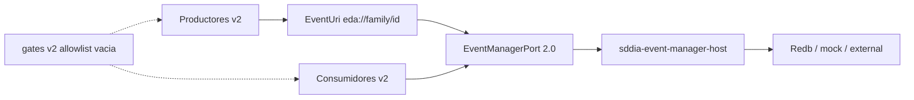

# Especificación técnica — man-43-event-manager-desacople-total

Entrada: `objectives.md` + `clarify.md` (laudos L-*) + semilla **PBI-0f4f0f5f** / canal **MAN-43** (historia/padre **MAN-40**).
Contrato objetivo `eda.event_manager` **2.0.0**; supersede token T0 `.events/...json` (**L-SUPERSEDE-T0**). No reabre bóveda/precedencia MAN-36.
Cuerpo Linear MAN-43: **no materializado** en disco; canal outbound + refine + laudos + AC bastan (**L-TRACKER**).
`forge_key` con `tracker_ref: MAN-43` bajo `.SddIA/state/forge-pbi/`: **ausente** — gate pre-forja de código (**L-FORGE**), no bloquea este blueprint.
Semilla **`continue tekton`** (**L-CONTINUE-TEKTON**): revalidar blueprint; **cero** cambio del *qué*; handoff a Ejecución en solo lectura.
Pasada Dedalo `execution_id` **3278ec5b-21ae-4fe0-af14-62a7e5ba0e07**: Diseño de Blueprint **v1.0.1** (reconfirmación sobre v1.0.0).

## 0. Evidencia viva (revalidada 2026-11-11 — continue-tekton)

| Artefacto | Estado vivo | Implicación forja |
|-----------|-------------|-------------------|
| Auditoría parental `docs/audits/desacople-event-manager-man-32-20261110.md` | **Ausente en disco** esta pasada MCP (**L-AUDIT-DISK**). Gap parental R1/R2/R3 permanece por refine + laudos + inventario residual | H6/Argos rematerializan evidencia antes de AC-13 → `APTO_TOTAL`; **no inventar APTO** |
| Anexo legacy `docs/audits/legacy-pending-events-eda-20261110.md` | **Ausente en disco** (**L-AUDIT-DISK**). Mapa F-1…F-6 / L-P* vigente vía refine + `clarify.md` + esta tabla | Mapa de tajos H2–H5; H6 recupera anexo si hace falta |
| Canal LLM `docs/audits/MAN-43.md` | Vivo (interacciones LLM; no sustituye auditorías de desacople) | Solo trazabilidad de proceso |
| `sddia-core/.../contract.rs` | `CONTRACT_VERSION = "1.2.0"`; `REQUIRED_CONTRACT_RANGE = "^1.2.0"` | H1 publica **2.0.0** / `^2.0.0` |
| `PublishSeal` en `runtime_bridge.rs` | Campos `logical_rel` + `target_path: PathBuf` + token `.events/{fam}/{id}.json` | Eliminar en v2; sustituir por `event_uri` |
| `EventManagerPort::list_deliveries` / `seal_dlt` / `get_dlt_seal` | Default stub `InvalidRequest` en trait | H1/H2 materializan ops reales antes de migrar consumidores (**L-6**) |
| `list_events` default | Solo reusa `list_pending` (filtros familia/estado insuficientes) | Ampliar consulta por familia/tipo/estado en v2 |
| `eda_port` / host | Path Redb e indicadores físicos aún en superficie de consumidores (inventario H0) | AC-8 + H4/H5 |
| `eda_port_legacy` / `sddia-event-store/` | Crate `sddia-event-store` vivo en workspace; legacy bajo cfg test | Demolición condicionada L-7 / AC-10 |
| Inventario residual F-1…F-6 / L-P* | actions doble write; Kalma2 fallback; workspace-server telemetría FS; github DL FS; sweeper; watcher dual | H2–H5 |
| Excepciones permanentes | `SddIA/events/`, `.SddIA/events/` | Fuera de alcance (**L-5** / **L-NON-GOALS**) |
| Host `sddia-event-manager-host` | Dueño legítimo path Redb / composition | Frontera estable; no reabrir MAN-36 |

## 1. Contexto y decisión

Tras MAN-35 (puerto 1.2), MAN-36 (bóveda) y MAN-40 (sello lógico T0), el runtime **aún** trata `.events/*` como descubrimiento, testigo, barrido o fallback, y expone path Redb vía `eda_port`. Este ciclo convierte **`EventManagerPort` v2** + **`EventUri`** en la **única** frontera productiva de existencia, identidad, estado, entrega, DLQ, progreso y purga.

| Vector | Laudo |
|--------|-------|
| Dominio | **L-DOMAIN** — frontera = `EventManagerPort` v2 / `eda:event-manager` |
| URI / familias | **L-1** — `eda://{domain\|telemetry\|orchestration}/{event_id}` |
| Identidad | **L-2** — `event_id` opaco; `EventUri` canónico |
| Contrato mayor | **L-3** — `eda.event_manager` 2.0.0; sin dualidad productiva v1/v2 |
| Cutover | **L-4** — atómico productores→puerto→consumidores; sin watcher huérfano |
| Cero `.events/` runtime | **L-5** — cero I/O/testigos/rutas-fichero/fallback |
| Estado íntegro | **L-6** — ops nuevas en v2 **antes** de migrar consumidores |
| Demolición store | **L-7** — condicionada |
| Hijos | **L-CHILDREN** — H1…H6 obligatorios |
| Supersede T0 | **L-SUPERSEDE-T0** — token `.events/...json` deja de ser canónico |
| Auditoría gap | **L-AUDIT-GAP** — cerrar R1/R2/R3 + F-* → `APTO_TOTAL` |
| Auditoría en disco | **L-AUDIT-DISK** — paths desacople/legacy ausentes; H6 rematerializa; no inventar APTO |
| Continue Tekton | **L-CONTINUE-TEKTON** — *qué* cerrado; blueprint solo-lectura para Ejecución |
| Proceso / git / genoma / tracker | **L-PROCESS** / **L-GIT** / **L-GENOME** / **L-TRACKER** |
| Forja | **L-FORGE** — precondiciones listadas en §3 |

## 2. Arquitectura objetivo

Reglas de capas:

1. **Identidad** = `EventUri` (parseo/serialización/validación canónica). Nunca path, nunca familia-estado (`pending`/`claimed`/…).
2. **Consumidor** → solo operaciones del puerto; cero `read_dir`/`is_file`/escritura bajo `.events/`.
3. **Host** → único dueño de layout físico Redb; consumidores sin `runtime_db_path`/`path_is_resolved_redb`.
4. **Watcher/sweeper** → claim, listado, cierre, purga y terminales **solo** por puerto; un despacho por evento/tick.
5. **Lab** → contract suite mock/Redb/cápsula externa; sin `sddia-event-store` ni `eda_port_legacy`.
6. **Docs** → Constitución/README/cumulo sin topología runtime `.events/`; genoma `SddIA/events/` intacto.

## 3. Precondiciones de forja (gates Dedalo → Tekton)

Antes de forjar código (y antes de sellar `forge_key` si el runtime lo exige):

| # | Precondición | Criterio |
|---|--------------|----------|
| P1 | Inventario consumidores v1 | Lista cerrada: motor (`eda_port`, topología, actions, route), daemons (watcher, sweep), bridges (kalma2, github, linear), tools (workspace-server, event-bus-audit, purger), tests/allowlists |
| P2 | Decisión contractual v2 aprobada | Este `spec.md` + `clarify.md` L-1…L-7; schema/bindings/taxonomía nombrados |
| P3 | Operaciones nuevas del puerto especificadas | §4.3 (gaps 1.2 → v2) cerradas en contrato **antes** de H3/H4 |
| P4 | Política purga/migración residuos `.events/` | Detectar → migrar a puerto si ECST vivo → `purge`/higiene FS ops; nunca reintroducir SSOT |
| P5 | Orden cutover sin doble vía | §8; runtime nunca con watcher sin fuente |
| P6 | Estrategia de pruebas por hijo | §9; AC mapeados a H1…H6 |

## 4. Contrato EventManager 2.0 + EventUri (H1)

### 4.1 EventUri

| Campo | Regla |
|-------|-------|
| Forma | `eda://{event_family}/{event_id}` |
| `event_family` | Enum `EventFamily`: solo `domain` / `telemetry` / `orchestration` |
| `event_id` | `String` no vacío, **opaco** (sin UUID obligatorio) |
| Tipo Rust | `EventUri { family: EventFamily, event_id: String }` |
| API | `parse`, `Display`/`to_string`, `validate`; rechazo de familias-estado y de strings vacíos |
| Prohibido | Usar `pending`/`claimed`/`processed`/`dead_letter` como familia URI |

### 4.2 PublishSeal v2

| Campo v1 (eliminar) | Sustituto v2 |
|---------------------|--------------|
| `logical_rel: String` | **eliminado** |
| `target_path: PathBuf` | **eliminado** |
| — | `event_uri: EventUri` (o serializado canónico) |
| `event_id: String` | Conservar o derivar de `event_uri.event_id` (una sola fuente de verdad) |

Ninguna API pública productiva contiene `logical_rel`, `target_path` o `event_file_path` (**AC-3**).

### 4.3 Operaciones del puerto — gaps 1.2 → v2 (L-6)

Conservar y endurecer: `publish_ecst`, `claim_pending`, `record_delivery` (ACK/NACK), `move_to_dlq`, `replay_dlq`, `append_trace`/`list_traces`/`list_progress`, `get_event`, `list_pending`, `list_dlq`, `purge_event`, `handshake_version`, `verify_inline_ecst`, `seal_dlt`/`get_dlt_seal`.

**Obligatorias reales en v2** (dejar de ser stub/default insuficiente):

| Op / capacidad | Semántica mínima |
|----------------|------------------|
| `list_deliveries` | Listado filtrable por `event_id` / `subscriber_id` / estado de entrega; cursor/limit |
| Consulta por familia/tipo/estado | `list_events` (o equivalente) con filtros reales: `EventFamily`, `event_type`, estado interno de cola (`pending`/`claimed`/`processed`/`dead_letter`) — estados **no** son familias URI |
| Barrido de terminales | API de listado/purga de eventos en estado terminal suficiente para sustituir sweeper FS |
| Entregas/testigos lógicos | Persistencia de processing/processed/DLQ-subscriber **detrás del puerto** (absorbe T1 FS) |
| `PublishEcstRequest` | Incluye o deriva `EventFamily` / `EventUri`; rechazo de familia inválida |

Suite contractual: mock + Redb + cápsula/adaptador externo; `version_gate` / handshake exige `^2.0.0`; consumidores v1 → rechazo explícito (**L-3**).

### 4.4 Artefactos de contrato Genoma

- Schema `eda.event_manager` **v2** (JSON Schema).
- Bindings / taxonomía / índices de capacidad alineados a `2.0.0`.
- Mutaciones de entidades Genoma **solo** vía `entity-manager` (**L-GENOME**).

## 5. Absorción de entregas y testigos (H2)

| Touchpoint | Acción |
|------------|--------|
| `eda_bus_topology` escrituras testigos | Sustituir `write_json_atomic` / cabeceras FS por ops de entrega/estado del puerto |
| `list_witnesses` / terminal | Solo puerto; sin OR a `is_file` |
| `fractal_bus` stamp delivery | ACK/NACK ya vía puerto → eliminar mutación fichero residual |
| github `write_fallback_dead_letter` | Preferir `move_to_dlq` / registro puerto (F-4) |
| Estados processing/processed/DLQ | Modelo interno del adapter; consultable vía `list_deliveries` / listados de estado |

Resultado: cero plano T1 FS en runtime (**AC-5**, **AC-7**).

## 6. Watcher y sweeper sin filesystem (H3)

| Touchpoint | Acción |
|------------|--------|
| `event-watcher` L-P1 | Eliminar bucle `read_dir(watch_dir)` / lote físico; solo `claim_pending` (+ fairness `list_pending` si aplica) |
| L-P2 | Cierre/DLQ sin `is_file`/`read_dir` de testigos |
| `eda_sweep` L-P3 / F-5 | Barrido orchestration/progress/pending solo por puerto |
| L-P4 / F-6 | Consultas de dominio vía `list_events` filtrado |
| Higiene L-H* | Tras cutover: purga vía `purge_event`; scripts ops limpian residuos **fuera** del SSOT |
| Doble despacho | Un evento no se enruta dos veces en el mismo tick |

Precondición dura: ops H1 (§4.3) suficientes **antes** de retirar FS (**L-6**).

## 7. Consumidores periféricos (H4)

| ID | Touchpoint | Acción |
|----|------------|--------|
| F-1 | `actions.rs` `emit_pr_presented` | Solo `publish_ecst` v2; eliminar `write_json_atomic` espejo |
| F-2 | Kalma2 bridge | Sin fallback `read_dir`/`is_file`/`read_json_file` si puerto no resuelve |
| F-3 | `sddia-workspace-server` telemetry | Sustituir `fs::write` por publicación puerto familia `telemetry` |
| F-4 | `github_bridge` DL fallback | Puerto DLQ; sin side-channel FS |
| AC-8 | `eda_port` + callers | Retirar `runtime_db_path` / `path_is_resolved_redb` de superficie de consumidores |

## 8. Cutover atómico (L-4)

1. **H1** — contrato v2 + suite + gate versión (rechazo v1).
2. **H2** — entregas/testigos detrás del puerto (fuente de estado suficiente).
3. **H3** — watcher/sweeper cortan FS en el mismo cutover en que dejan de necesitar espejos (no watcher sin fuente).
4. **H4** — periféricos sin fallback (puede solaparse tras H1; F-3 puede ir temprano).
5. **H5** — lab + demolición tras matrices verdes.
6. **H6** — docs/evolution/auditorías (incl. rematerializar evidencia si falta en disco — **L-AUDIT-DISK**).

**Corte final productivo:** productores v2 → puerto v2 → consumidores v2. **Prohibido** dualidad productiva v1/v2.

## 9. Laboratorio, demolición y gates (H5)

| Condición L-7 | Verificación |
|---------------|--------------|
| Cero deps Cargo a `sddia-event-store` | `Cargo.toml` workspace + crates |
| Matrices migradas al puerto / contract suite | Tests `eda_store_io_*`, `eda_subscriber_*`, `event_store_writers`, etc. |
| `eda_port_legacy` vacío/eliminado | Borrar módulo + ramas `cfg(test)` |
| Suite v2 mock/Redb/externo verde | `run_event_manager_contract_suite` + gates |
| Gate detecta reintroducciones | Allowlist legacy **vacía** (AC-11) |

Gates a extender/crear:

- Veto `.events/` en código productivo runtime (excepto genoma/instancia/docs no-runtime).
- Veto `logical_rel` / `target_path` / `event_file_path` / `runtime_db_path` / `path_is_resolved_redb` fuera host.
- Veto `sddia_event_store` / `EventStore::open` / `eda_port_legacy`.
- `version_gate` major 2.

Verificación global: `cargo test --workspace`, clippy, contract suite, gates (**AC-12**).

## 10. Convergencia documental (H6)

| Artefacto | Acción |
|-----------|--------|
| README / Constitución / contratos / procesos | Retirar `.events/` como topología runtime; describir `EventUri` + puerto v2 |
| `cumulo.paths.json` | Solo IDs/tablas/suscripciones lógicas; sin paths de cola runtime `.events/` |
| Auditorías parentales + legacy | **Rematerializar o recuperar** evidencia ausente (**L-AUDIT-DISK**); actualizar a **`APTO_TOTAL`** solo con evidencia (AC-13) |
| `SddIA/evolution/` | Registrar cutover 2.0.0 (AC-14) |
| Genoma `SddIA/events/` / `.SddIA/events/` | **No eliminar** |

## 11. Criterios de aceptación (trazabilidad)

| ID | Criterio | Hijo | Objetivos |
|----|----------|------|-----------|
| **AC-1** | Puerto v2 + `EventUri` + suite contractual completa | H1 | O1 |
| **AC-2** | `event_id` opaco; familia vía enum | H1 | O2 |
| **AC-3** | Cero `logical_rel`/`target_path`/`event_file_path` en API pública | H1 | O3 |
| **AC-4** | Cero `.events/` en código productivo | H3–H5 | O4 |
| **AC-5** | Cero ops FS del runtime EDA | H2–H4 | O4 |
| **AC-6** | Watcher/sweeper solo puerto | H3 | O5 |
| **AC-7** | Entregas/estado consultables por puerto | H2 | O6 |
| **AC-8** | Sin `runtime_db_path`/`path_is_resolved_redb` en consumidores | H4 | O7 |
| **AC-9** | Kalma2 / workspace-server / GitHub bridge sin fallback FS | H4 | O7 |
| **AC-10** | `sddia-event-store` + `eda_port_legacy` eliminados | H5 | O8 |
| **AC-11** | Allowlist legacy vacía | H5 | O8 |
| **AC-12** | Tests workspace + clippy + suite + gates verdes | H5 | O9 |
| **AC-13** | Auditorías → `APTO_TOTAL` (con evidencia materializada) | H6 | O10 |
| **AC-14** | Evolution + docs constitucionales convergentes | H6 | O10 |

## 12. Touchpoints (mapa de forja)

| Path / área | Hijo |
|-------------|------|
| `SddIA/sddia-core/src/ports/event_manager/{contract,port,runtime_bridge,version_gate,contract_suite,memory_mock}.rs` | H1 |
| Schema/bindings/taxonomía `eda.event_manager` v2 (+ entity-manager) | H1 |
| Adapters host/infrastructure (Redb/mock/external) | H1–H2 |
| `engine/eda_bus_topology.rs`, `fractal_bus.rs`, route terminal | H2 |
| `daemons/event-watcher`, `sddia-daemon-runtime/eda_sweep.rs` | H3 |
| `engine/actions.rs`, `interfaces/kalma2-bridge`, `tools/sddia-workspace-server/telemetry.rs`, `github_bridge.rs` | H4 |
| `engine/eda_port.rs` superficie path | H4 |
| `eda_port_legacy.rs`, `sddia-event-store/`, matrices tests, allowlists QA | H5 |
| `tools/sddia-qa` gates | H5 |
| README, Constitución, `cumulo.paths.json`, audits, `SddIA/evolution/` | H6 |
| Host bóveda MAN-36 | Solo si falta API; **no** reabrir precedencia |

## 13. Fuera de alcance

- Eliminar `SddIA/events/` o `.SddIA/events/`.
- Mutar `docs/todos/pending/`.
- Exponer Redb fuera del host.
- Compatibilidad productiva EventManager v1 / dualidad v1+v2.
- Imponer UUID a `event_id`.
- Semillas Kaizen en `docs/todos/` desde Tekton/Argos (solo `agent:cumulo` / `Kaizen_Alert_Required`).
- Reabrir bóveda/precedencia MAN-36.

## 14. Remisiones

| Ítem | Destino |
|------|---------|
| Padre / historia MAN-40 | `docs/features/man-40-eda-consumers-logical-seal/` |
| Bóveda MAN-36 | `docs/features/man-36-event-manager-instance-config/` |
| Cutover MAN-35 | `docs/features/event-manager-port-cutover/` |
| Auditoría parental (recuperar en H6) | `docs/audits/desacople-event-manager-man-32-20261110.md` |
| Inventario legacy FS (recuperar en H6) | `docs/audits/legacy-pending-events-eda-20261110.md` |
| Canal LLM | `docs/audits/MAN-43.md` |
| Canal Linear | `.SddIA/state/tracker-outbound/MAN-43.jsonl` |
| Semilla / refine | **PBI-0f4f0f5f** / workspace `c7976303-…` |
| Clarificaciones | `clarify.md` laudos L-* |
| Objetivos | `objectives.md` O1…O10 / AC-1…14 |
| Plan ejecutable | `plan.md` |
