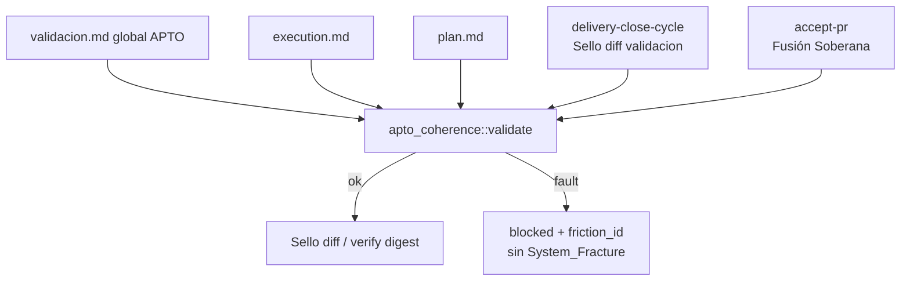

---


feature_name: man-44-rechazar-apto-incoherente
created: "2026-11-20"
updated: "2026-11-20"
process: feature
base: main
scope: "Aduana de coherencia documental: invalidar global APTO si execution blocked, plan con fases abiertas o resolución no canónica (KZ-1)"
branch_name: feat/man-44-rechazar-apto-incoherente
persist_ref: docs/features/man-44-rechazar-apto-incoherente
pbi_ref: MAN-44
parent_ref: MAN-43
historia_ref: MAN-43
document_id: PBI-8205539f
agent: dedalo
phase: diseno-blueprint
version_spec: "1.0.0"
status: blueprint-ready
audit_ref: docs/audits/man-43-h1-milestone-razonamiento-20261111.md
kaizen_ref: KZ-1
norm_ref: features-documentation-pattern@1.3.1
tracker_channel: ".SddIA/state/tracker-outbound/MAN-44.jsonl"
refine_workspace: ".SddIA/workspaces/refine-item/41124dbc-febe-4ad8-a955-4e58560423f5"
mayeuta_verdict: ok
execution_id: "a9098555-c861-40cc-8b13-c6871caf57e9"
---
# Especificación técnica — man-44-rechazar-apto-incoherente

Entrada: `objectives.md` + `clarify.md` (laudos **L-COHERENCE…L-RESOLUTION**) + semilla **PBI-8205539f** / canal **MAN-44** (padre **MAN-43**, kaizen **KZ-1**).
Dominio = **aduana de coherencia documental de cierre** sobre un único `persist_ref` (**L-DOMAIN**). No reabre EventManager ni L-1…L-7 de MAN-43 (**L-NON-GOALS**).

## 0. Evidencia viva (Dedalo 2026-11-20)

| Artefacto | Estado vivo | Implicación forja |
|-----------|-------------|-------------------|
| `objectives.md` / `clarify.md` | `mayeuta_verdict: ok`; ACs 1…5 cerrados | *Qué* estabilizado; no reabrir L-* |
| Auditoría KZ-1 | `docs/audits/man-43-h1-milestone-razonamiento-20261111.md` materializada | Contrafactual MAN-43 / PR #453 |
| `diff_seal::validacion_ready_for_seal` | Solo exige `global == APTO` | **Hueco:** no lee `execution.md` ni `plan.md` |
| `diff_seal::validate_for_accept_pr_merge` | Solo verifica digest de sello | **Hueco:** pre-fusión sin coherencia |
| DCC `capsule_diff_seal_validacion` | Bloquea con `validacion_not_apto` si no APTO | Insertar contraste **antes** de sellar |
| `accept-pr` «Fusión Soberana» | Llama `validate_for_accept_pr_merge` | Misma función compartida |
| Fricciones DCC sin fractura | `dcc_pre_pr_qa_block_suppresses_fracture` lista `validacion_not_apto`, … | Extender lista con friction_id MAN-44 |
| Norma `features-documentation-pattern` 1.3.1 | Campos canónicos de `validacion.md`; **no** enumera `resolution` | Documentar denylist / política (**D-RES**) |
| Caso causal | MAN-43: `execution.verdict: blocked` + `status: partial` + `resolution: PASS_H1_MILESTONE` + `global: APTO` | Fixtures KA-CLOSE-* |

## 1. Contexto y decisión

Hoy la aduana trata `global: APTO` como verdad suficiente para sello de diff y fusión. Eso permitió el epílogo MAN-43 con ejecución bloqueada, fases H2–H6 abiertas y resolución ad hoc.

| Vector | Laudo |
|--------|-------|
| Dominio | **L-DOMAIN** — contraste `validacion`↔`execution`↔`plan` del mismo `persist_ref` |
| Coherencia | **L-COHERENCE** — APTO inválido si falla el contraste |
| Blocked | **L-BLOCKED** |
| Fases abiertas | **L-OPEN-PHASES** |
| Resolución | **L-RESOLUTION** |
| Fricción | **L-FRICTION** — sin `System_Fracture_Detected` |
| Puertas | **L-MOMENTS** — pre-sello DCC + pre-fusión `accept-pr` |
| Contrafactual | **L-COUNTERFACTUAL** — métrica KA-CLOSE-4; no revert PR #453 |
| Git / tracker / verdad | **L-GIT** / **L-TRACKER** / **L-TRUTH** |

### Laudos Dedalo (diseño)

| ID | Decisión |
|----|----------|
| **D-MODULE** | Módulo compartido nuevo `apto_coherence` bajo `execute-process` (crate motor). Una sola API usada por DCC y `accept-pr`. Prohibido duplicar reglas en dos handlers. |
| **D-API** | `validate_apto_coherence(repo, persist_ref) -> Result<(), CoherenceFault>` donde `CoherenceFault { friction_id, message, reasons[] }`. |
| **D-TRIGGER** | Solo si `{persist_ref}/validacion.md` declara `global: APTO` (case-insensitive). Si no hay APTO, no-op (el sello ya exige APTO por otra vía). |
| **D-PRE-SEAL** | En `capsule_diff_seal_validacion`, **después** de resolver `persist_ref` y **antes** de `compute_diff_seal` / `apply_diff_seal_to_validacion`: invocar `validate_apto_coherence`. Fallo → `status: blocked` + friction_id MAN-44 (no `validacion_not_apto` genérico). |
| **D-PRE-MERGE** | En `validate_for_accept_pr_merge`, para cada `persist_ref` bajo chequeo que exija sello CI / tenga `global: APTO`: invocar la misma API **antes** de `verify_diff_seal_at_head`. Fallo → `Err` que aborta «Fusión Soberana» (`verdict: abortado`, sin merge). |
| **D-UNIT** | Unidad de contraste = un `persist_ref`. Prohibido leer atestaciones / validaciones de otros árboles. |
| **D-FRICTION-IDS** | Tres ids canónicos (snake_case, paridad DCC): `apto_coherence_execution_blocked`, `apto_coherence_open_phases`, `apto_coherence_resolution`. Primer fallo gana; opcional `reasons[]` agrega el resto. |
| **D-NO-FRACTURE** | Extender `dcc_pre_pr_qa_block_suppresses_fracture` (y análogo accept-pr si emite fractura) para incluir los tres friction_id. **Prohibido** `System_Fracture_Detected` por esta causa. |
| **D-LAB** | `SDDIA_LAB_SKIP_APTO_COHERENCE=1` omite el contraste (solo lab). No usar en CI productivo. |
| **D-RES** | Denylist de elevación: `PASS_H1_MILESTONE`; cualquier `resolution` que coincida con `PASS_*_MILESTONE`; frontmatter elevador `h2_h6_deferred: true`; `milestone` ≈ `H*-only` / `H*-only`. Esos tokens **nunca** sostienen APTO. Parche documental mínimo en `features-documentation-pattern` (§ resoluciones): declarar que tokens de hito / diferimiento **no** son canónicos para elevar `global`. |
| **D-NORM-BUMP** | Bump menor de la norma (p. ej. 1.3.1 → 1.3.2) **solo** si Tekton materializa el párrafo de resoluciones; si el ciclo se limita a denylist en código + nota en `spec`, documentar drift y cerrar con Argos. Preferencia: parche norma en la misma ola que el motor. |

## 2. Arquitectura objetivo



Reglas de capa:

1. **Contraste** es puro sobre frontmatter (+ heurística de fases en cuerpo de `plan.md` / evidencia en `execution.md`).
2. **Sello de diff** no se aplica si el contraste falla.
3. **Merge soberano** no corre si el contraste falla.
4. **Fricción** es accionable (`operator_hint` + `friction_id`); cero fractura sistémica.

## 3. Contrato de contraste

### 3.1 Lectura de artefactos

| Path | Obligatorio si APTO |
|------|---------------------|
| `{persist_ref}/validacion.md` | Sí |
| `{persist_ref}/execution.md` | Sí — ausencia con APTO ⇒ `apto_coherence_execution_blocked` (no hay evidencia de cierre) |
| `{persist_ref}/plan.md` | Sí si declara fases/hijos; si ausente y no hay fases inferibles, C3 no aplica (solo C2/C4) |

Usar el mismo parser de frontmatter que `diff_seal` / `load_frontmatter_yaml`.

### 3.2 Regla C2 — ejecución no cerrada (**L-BLOCKED** / KA-CLOSE-1)

`global: APTO` es inválido si `execution.md` cumple **cualquiera**:

| Campo | Valores que invalidan |
|-------|------------------------|
| `verdict` | `blocked`, `NO_APTO`, `no_apto`, `fail`, `failed` (case-insensitive) |
| `status` | `partial`, `blocked`, `in_progress`, `open` |

Equivalencia documentada: `verdict: blocked` ∧ `status: partial` (caso MAN-43) ⇒ fallo C2.

`friction_id`: `apto_coherence_execution_blocked`.

### 3.3 Regla C3 — fases/hijos abiertos (**L-OPEN-PHASES** / KA-CLOSE-2)

**Declaración de fases** (unión):

1. Frontmatter de `plan.md`: claves `phases`, `children`, `hijos` (lista de strings o mapas con `id`/`name`/`status`).
2. Cuerpo: encabezados que matchean `^(H\d+[A-Z]?|Ola\s*\d+)` tras `#+`.

**Evidencia de cierre** de una fase `id` (cualquiera basta):

1. En `execution.md` frontmatter: `items_applied` / `phases_closed` / `closed_phases` contiene `id`.
2. Mapa `phases.<id>.status` ∈ {`closed`,`done`,`forged`,`complete`,`apto`}.
3. Bloque en cuerpo de `execution.md` que marque explícitamente `id` como cerrado/forjado (línea con `id` + token `closed|done|forged|APTO`).

**Abierto** si la fase está declarada y **no** tiene evidencia de cierre, **o** su status en plan es `open`/`pending`/`blocked`/`deferred`.

Si existe ≥1 fase abierta ⇒ `friction_id: apto_coherence_open_phases`.

«Cierre» ≠ CI verde ni rewrite manual de `validacion.md` (**clarify**).

### 3.4 Regla C4 — resolución no canónica (**L-RESOLUTION** / KA-CLOSE-3)

Con `global: APTO`, invalidar si:

| Señal | Ejemplo |
|-------|---------|
| `resolution` denylist | `PASS_H1_MILESTONE` |
| `resolution` ≈ `PASS_*_MILESTONE` | Cualquier hito disfrazado |
| `h2_h6_deferred: true` (u homologable `*_deferred: true` sobre hijos del plan) | Diferir alcance en FM |
| `milestone` elevador | `H1-only`, `H2-only`, … |

`friction_id`: `apto_coherence_resolution`.

**Nota:** resoluciones de proceso Argos (p. ej. `PASS_F5_VERDICT`) **no** autorizan saltarse C2/C3. Si C2/C3 pasan y la resolución no está en denylist, C4 no bloquea. La denylist es la aduana anti-hito.

### 3.5 Envelope de rechazo

```json
{
  "status": "blocked",
  "friction_id": "apto_coherence_execution_blocked",
  "message": "global APTO incoherente con execution.verdict=blocked",
  "operator_hint": "Corregir execution/plan o bajar global a NO_APTO antes del sello/fusión",
  "persist_ref": "docs/features/…",
  "reasons": ["execution_blocked"]
}
```

Accept-pr: mapear a error de fase que produce `verdict: abortado` / no fusiona (paridad KA-CLOSE-1).

## 4. Touchpoints (mapa de forja)

| Path / área | Mutación |
|-------------|----------|
| `SddIA/engine/execute-process/src/engine/apto_coherence.rs` (**nuevo**) | API + parsing + tests unitarios KA-CLOSE-* |
| `…/engine/mod.rs` | `mod apto_coherence` |
| `…/engine/diff_seal.rs` | Opcional: thin-wrap; preferir llamada explícita desde DCC/accept |
| `…/engine/delivery_close.rs` | `capsule_diff_seal_validacion` + suppress fracture |
| `…/engine/accept_pr.rs` | Cadena pre-merge vía `validate_for_accept_pr_merge` o llamada directa |
| `SddIA/library/codexes/…/process/delivery-close-cycle.md` | Nota de fase «Sello diff»: contraste coherencia; bump hash |
| `SddIA/library/codexes/…/process/accept-pr.md` | Nota pre-fusión; bump hash |
| `SddIA/library/norms/features-documentation-pattern.md` | § resoluciones no elevan APTO (**D-NORM-BUMP**) |
| Fixtures bajo `docs/features/man-44-rechazar-apto-incoherente/_fixtures/` o `docs/_fixtures/ka-close-*` | KA-CLOSE-1…3 |
| Contrafactual KA-CLOSE-4 | Nota en `execution.md` / anexo corto bajo persist_ref (no revert histórico) |

**Prohibido:** `phase_terminal.rs` umbrales Radamanto; `docs/todos/` desde Tekton/Argos; tocar MAN-45/46.

## 5. Fixtures y aceptación

| ID | Fixture | Esperado |
|----|---------|----------|
| **KA-CLOSE-1** / **AC-1** | `execution.verdict: blocked` + `validacion.global: APTO` | `accept-pr` aborta; friction `apto_coherence_execution_blocked` |
| **KA-CLOSE-2** / **AC-2** | Plan con fase abierta + APTO | Pre-sello y/o pre-fusión `blocked`; sin `System_Fracture_Detected` |
| **KA-CLOSE-3** / **AC-3** | `resolution: PASS_H1_MILESTONE` + APTO | No sella / no fusiona; friction `apto_coherence_resolution` |
| **KA-CLOSE-4** / **AC-4** | Contrafactual documentado vs auditoría KZ-1 | Texto: con regla activa el epílogo MAN-43 no habría mergeado |
| **AC-5** | Misma API en DCC pre-sello y accept-pr pre-fusión | Tests de integración o unitarios que cubran ambos call sites |

Tests preferentes: `cargo test -p execute-process --lib` filtro `apto_coherence` / `ka_close_`.

## 6. RBAC / delegación

| Cápsula | Contexto |
|---------|----------|
| Motor nativo DCC / accept-pr | `ecosystem-evolution` / `filesystem-ops` / `source-control` (ya del proceso) |
| `skill:git-manager` | Solo commits de sello existentes; coherencia **no** escribe git |
| `agent:argos` | Verificación posterior; no define la regla |

Sin nuevas cápsulas indexadas. Sin `delegates_to` de agente en la fase de sello (handler nativo).

## 7. Fuera de alcance

- KZ-2 / **MAN-45** (PPR vinculante / `qa-attestation`).
- KZ-3 / **MAN-46** (hito ≠ Done padre).
- KZ-4 (completar H1 restante / H2–H6 MAN-43).
- Revertir merge PR #453.
- Semillas Kaizen bajo `docs/todos/`.

## 8. Remisiones

| Ítem | Destino |
|------|---------|
| Objetivos / ACs | `objectives.md` |
| Clarificaciones | `clarify.md` |
| Auditoría KZ-1 | `docs/audits/man-43-h1-milestone-razonamiento-20261111.md` |
| Padre | `docs/features/man-43-event-manager-desacople-total/` |
| Refine | `.SddIA/workspaces/refine-item/41124dbc-febe-4ad8-a955-4e58560423f5/` |
| Plan ejecutable | `plan.md` |
| Canal Linear | `.SddIA/state/tracker-outbound/MAN-44.jsonl` |
