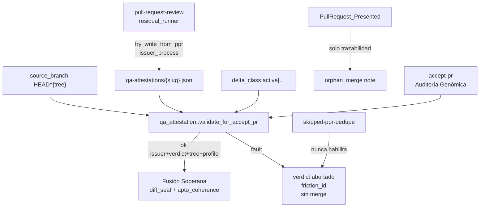

# Especificación técnica — man-45-accept-pr-ppr-tree-sha

Entrada: `objectives.md` + `clarify.md` (laudos **L-ATTEST…L-DEDUPE**) + semilla **PBI-75d12fd0** / canal **MAN-45** (padre **MAN-43**, kaizen **KZ-2**).
Dominio = **aduana pre-fusión de `accept-pr`**: veredicto PPR vinculante vía atestación `qa-attestation/1.0` coherente con el árbol que se fusiona (**L-DOMAIN**). No reabre EventManager ni L-1…L-7 de MAN-43 (**L-NON-GOALS**).

## 0. Evidencia viva (Dedalo 2026-11-20)

| Artefacto | Estado vivo | Implicación forja |
|-----------|-------------|-------------------|
| `objectives.md` / `clarify.md` | `mayeuta_verdict: ok`; ACs 1…5 / KA-PPR-1…5 | *Qué* estabilizado; no reabrir L-* |
| Auditoría KZ-2 | `docs/audits/man-43-h1-milestone-razonamiento-20261111.md` materializada | Contrafactual MAN-43 / PR #453 |
| `accept_pr` «Auditoría Genómica» | Exige `source_branch`; camino normal = `scan_presented_for_branch` (`PullRequest_Presented`); ausencia ⇒ `orphan_merge` warning, **fase Ok** | **Hueco:** Presented ≠ veredicto; no aborta |
| `validate_for_accept_pr` | Solo se consulta si `merge_already_done` y en hit opcional; fallo **no** aborta | **Hueco:** no es puerta bloqueante |
| `validate_for_accept_pr` → `validate_attestation_file(..., None)` | `delta_class: None` | **Hueco:** `docs-only` + delta `active` no se rechaza en accept-pr |
| `try_write_from_ppr` | Emite JSON `qa-attestation/1.0` sin campo de emisor | **Hueco:** JSON forjado a mano indistinguible |
| `route_domain_core` dedupe | Hit ⇒ `skipped-ppr-dedupe` (exit 0) sin escribir atestación | **Hueco:** dedupe contado como QA verde operacionalmente |
| «Fusión Soberana» | `diff_seal::validate_for_accept_pr_merge` (+ `apto_coherence` MAN-44) | Sin `qa-attestation` |
| DCC Gate pre-PR QA | `validate_attestation_for_branch_head` sí bloquea push | Paridad de intención; **no** sustituye aduana de merge |
| Fixtures KA-PPR-* | Aún no materializados | Forja + tests |

## 1. Contexto y decisión

Hoy `accept-pr` acredita presentación del PR, no el veredicto técnico pleno sobre el `tree_sha` a fusionar. Eso permitió el epílogo MAN-43 con PPR `blocked`/detached, atestación `docs-only` o JSON `full` fuera de `try_write_from_ppr`, y dedupe contado como paso de calidad.

| Vector | Laudo |
|--------|-------|
| Dominio | **L-DOMAIN** — aduana pre-fusión `accept-pr` |
| Atestación | **L-ATTEST** — exige `qa-attestation/1.0` `verdict: aprobado` |
| Emisor | **L-EMITTER** — solo `pull-request-review` |
| Árbol | **L-TREE** — `tree_sha` atestación = árbol de la rama |
| Perfil | **L-PROFILE** — delta `active` ⇒ `qa_profile: full` |
| Dedupe | **L-DEDUPE** — `skipped-ppr-dedupe` ≠ aprobación |
| Genómica | **L-GENOMIC** — leer atestación; no basta Presented |
| Aborto | **L-ABORT** — sin condiciones ⇒ `abortado` |
| Contrafactual | **L-COUNTERFACTUAL** — métrica KA-PPR-5; no revert #453 |
| Git / tracker / verdad | **L-GIT** / **L-TRACKER** / **L-TRUTH** |

### Laudos Dedalo (diseño)

| ID | Decisión |
|----|----------|
| **D-GATE** | Puerta bloqueante en «Auditoría Genómica» **antes** de «Fusión Soberana»: invocar validación de atestación; fallo ⇒ `verdict: abortado`, sin merge. `PullRequest_Presented` permanece solo para trazabilidad/`orphan_merge`, **nunca** habilita fusión. |
| **D-API** | Endurecer `qa_attestation::validate_for_accept_pr` (y helpers) como única API de aduana PPR para accept-pr. Firma efectiva: resolver `expected_tree_sha` del **HEAD de `source_branch`** (pre-merge) o `merge_source_tree_sha` (solo si `merge_already_done`); resolver `delta_class` desde inputs/state/perfil de delta; validar archivo; mapear error → friction_id. |
| **D-TREE-PRE** | Pre-merge: `expected_tree_sha = tree_sha_for_commit(source_branch_head)`. **Prohibido** usar `HEAD^2^{tree}` antes del merge (HEAD es `main`). Post-merge (`merge_already_done`): conservar `merge_source_tree_sha`. |
| **D-DELTA** | Si `delta_class == "active"` (o equivalente canónico del régimen de delta), pasar `Some("active")` a `validate_attestation_value` para activar el rechazo `docs-only`. Si no se puede resolver y el régimen exige fail-closed, tratar como `active`. |
| **D-EMITTER** | Extender el JSON emitido por `try_write_from_ppr` con `issuer_process: "pull-request-review"` (constante). `validate_attestation_value` **exige** ese campo exacto. Ausencia o valor distinto ⇒ rechazo (`qa_attestation_issuer_invalid`). Escritura directa / JSON forjado sin ese sello de emisor **no** habilita merge. |
| **D-EMITTER-LINEAGE** | Defensa en profundidad opcional en la misma ola si el store de proofs lo permite: contrastar `execution_id` de la atestación con un proof/residual de proceso `pull-request-review` (p. ej. workspace/report). Si no hay proof store consultable de forma estable, documentar en `execution.md` y cerrar con **D-EMITTER** solo; no inventar lineage. |
| **D-DEDUPE** | Ningún camino de accept-pr trata `skipped-ppr-dedupe` (evento, exit code, proof de lock) como atestación ni como bypass. Fixture KA-PPR-4: solo dedupe ⇒ aborto. |
| **D-FRICTION-IDS** | Ids canónicos (snake_case): `qa_attestation_required` (ausente/no aprobado), `qa_attestation_tree_mismatch`, `qa_attestation_profile_blocked` (docs-only+active / perfil no elegible), `qa_attestation_issuer_invalid`, `qa_attestation_dedupe_not_approval` (si el input intenta acreditar solo dedupe). Primer fallo gana. |
| **D-NO-FRACTURE** | Esta aduana **no** emite `System_Fracture_Detected`. Solo `abortado` + friction_id + `operator_hint`. |
| **D-LAB** | `SDDIA_LAB_SKIP_PPR_ATTESTATION_ACCEPT=1` omite la puerta (solo lab). Prohibido en CI productivo. |
| **D-CODEX** | Actualizar `accept-pr.md` fase «Auditoría Genómica»: exigir atestación PPR vinculante; bump `hash_signature`. |
| **D-COMPAT** | Atestaciones históricas sin `issuer_process` **no** habilitan merge tras el corte (fail-closed). Re-emitir vía PPR (`try_write_from_ppr`) o lab skip explícito. |

## 2. Arquitectura objetivo



Reglas de capa:

1. **Emisión** canónica solo vía `try_write_from_ppr` (cadena PPR).
2. **Validación** fail-closed en Auditoría Genómica antes de mutar `main`.
3. **Presented** y **dedupe** no son veredicto.
4. **Fusión Soberana** asume aduana PPR ya verde (no sustituye el gate).

## 3. Contrato de atestación (aduana)

### 3.1 Artefacto

Path: `{eda_proofs}/qa-attestations/{branch_slug}.json` (existente).

Campos exigidos para habilitar merge (schema `qa-attestation/1.0`):

| Campo | Regla |
|-------|-------|
| `schema` | `qa-attestation/1.0` |
| `verdict` | `aprobado` |
| `tree_sha` | Igual a `expected_tree_sha` (**L-TREE** / **D-TREE-PRE**) |
| `qa_profile` | `full` si delta `active`; `docs-only` rechazado con active (**L-PROFILE**) |
| `execution_id` | No vacío (UUID del proceso PPR) |
| `issuer_process` | Exactamente `pull-request-review` (**D-EMITTER**) |
| `issued_at` / `ttl_secs` | TTL vigente (paridad actual) |

### 3.2 Regla C1 / KA-PPR-1 — sin atestación aprobada (**L-ATTEST**)

Ausencia de archivo, schema inválido, o `verdict != aprobado` ⇒ aborto.
`friction_id`: `qa_attestation_required`.

### 3.3 Regla C2 / KA-PPR-2 — emisor y perfil (**L-EMITTER** / **L-PROFILE**)

| Caso | friction_id |
|------|-------------|
| Sin `issuer_process` o ≠ `pull-request-review` | `qa_attestation_issuer_invalid` |
| Delta `active` + `qa_profile: docs-only` | `qa_attestation_profile_blocked` |
| JSON `full` forjado (sin emisor canónico) | `qa_attestation_issuer_invalid` |

### 3.4 Regla C3 / KA-PPR-3 — árbol divergente (**L-TREE**)

`tree_sha` atestación ≠ `expected_tree_sha` ⇒ `qa_attestation_tree_mismatch`.

### 3.5 Regla C4 / KA-PPR-4 — dedupe (**L-DEDUPE**)

Si el único «crédito» disponible es `skipped-ppr-dedupe` (sin atestación válida) ⇒ aborto.
`friction_id`: `qa_attestation_dedupe_not_approval` (o `qa_attestation_required` si no hay intento explícito de acreditar dedupe).

### 3.6 Envelope de rechazo

```json
{
  "status": "abortado",
  "friction_id": "qa_attestation_required",
  "message": "accept-pr exige qa-attestation/1.0 aprobado del tree_sha a fusionar",
  "operator_hint": "Ejecutar pull-request-review hasta aprobado; no reescribir JSON a mano ni usar docs-only con delta active",
  "source_branch": "feat/…",
  "expected_tree_sha": "…",
  "reasons": ["missing_or_unapproved_attestation"]
}
```

## 4. Touchpoints (mapa de forja)

| Path / área | Mutación |
|-------------|----------|
| `SddIA/engine/execute-process/src/engine/qa_attestation.rs` | `issuer_process` en `try_write_from_ppr`; exigir en `validate_attestation_value`; `validate_for_accept_pr` con tree pre-merge + `delta_class`; friction mapping; tests `ka_ppr_*` |
| `…/engine/accept_pr.rs` | Auditoría Genómica: llamar validación **bloqueante**; Presented solo trazabilidad; honor lab skip |
| `…/engine/residual_runner.rs` | Sin cambio de contrato si ya llama `try_write_from_ppr`; verificar que el nuevo campo se materializa |
| `…/engine/route_domain_core.rs` | Sin convertir dedupe en aprobación; comentario/test de no-bypass si aplica |
| `SddIA/library/codexes/…/process/accept-pr.md` | Nota fase Auditoría Genómica + refresh `hash_signature` |
| Fixtures `docs/features/man-45-accept-pr-ppr-tree-sha/_fixtures/ka-ppr-{1..4}/` | JSON/ramos mínimos para unit/integration |
| Contrafactual KA-PPR-5 | Anexo corto bajo persist_ref (citar auditoría KZ-2; no revert #453) |

**Prohibido:** debilitar DCC pre-PR; tocar MAN-44/46; `docs/todos/` desde Tekton/Argos; revert histórico PR #453.

## 5. Fixtures y aceptación

| ID | Fixture | Esperado |
|----|---------|----------|
| **KA-PPR-1** / **AC-1** | Sin atestación `aprobado` del `tree_sha` | `accept-pr` `abortado`; `qa_attestation_required` |
| **KA-PPR-2** / **AC-2** | Delta `active` + `docs-only` **o** JSON `full` sin `issuer_process` | Aborta; profile/issuer |
| **KA-PPR-3** / **AC-3** | `tree_sha` divergente | Aborta; `qa_attestation_tree_mismatch` |
| **KA-PPR-4** / **AC-4** | Solo `skipped-ppr-dedupe` | No fusiona |
| **KA-PPR-5** / **AC-5** | Contrafactual documentado vs KZ-2 | Texto: con regla activa MAN-43 no habría pasado la aduana |

Tests preferentes: `cargo test -p execute-process --lib` filtro `qa_attestation` / `ka_ppr_` / fase accept-pr.

## 6. RBAC / delegación

| Cápsula | Contexto |
|---------|----------|
| Motor nativo accept-pr / qa_attestation | `pr-lifecycle` / `filesystem-ops` / `source-control` (ya del proceso) |
| Emisión | Solo cadena `pull-request-review` → `residual_runner` → `try_write_from_ppr` |
| `skill:git-manager` | Tree SHA vía porcelain existente; aduana **no** escribe git |
| `agent:argos` | Verificación posterior del feature; no redefine la regla de merge |

Sin nuevas cápsulas indexadas.

## 7. Fuera de alcance

- KZ-1 / **MAN-44** (coherencia APTO ↔ execution/plan).
- KZ-3 / **MAN-46** (hito ≠ Done padre).
- KZ-4 (completar resto H1 / H2–H6 MAN-43).
- Revertir merge PR #453.
- Semillas Kaizen bajo `docs/todos/`.

## 8. Remisiones

| Ítem | Destino |
|------|---------|
| Objetivos / ACs | `objectives.md` |
| Clarificaciones | `clarify.md` |
| Auditoría KZ-2 | `docs/audits/man-43-h1-milestone-razonamiento-20261111.md` |
| Padre | `docs/features/man-43-event-manager-desacople-total/` |
| Refine | `.SddIA/workspaces/refine-item/2f723b31-7289-4392-a8e7-43348c05e83c/` |
| Plan ejecutable | `plan.md` |
| Canal Linear | `.SddIA/state/tracker-outbound/MAN-45.jsonl` |
| Hermano coherencia | `docs/features/man-44-rechazar-apto-incoherente/` (no tocar) |
