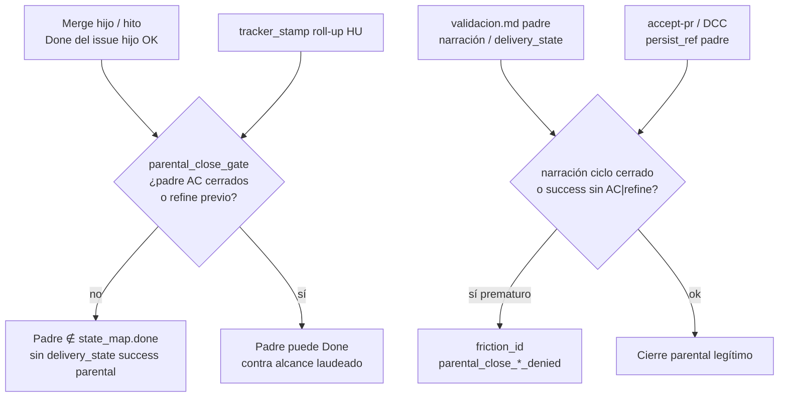

---


feature_name: man-46-hito-no-cierra-padre
created: "2026-11-21"
updated: "2026-11-21"
process: feature
base: main
scope: "Norma de cierre parental: un hito de plan no cierra el PBI padre ni el tracker (KZ-3)"
branch_name: feat/man-46-hito-no-cierra-padre
persist_ref: docs/features/man-46-hito-no-cierra-padre
pbi_ref: MAN-46
parent_ref: MAN-43
historia_ref: MAN-43
document_id: PBI-74cd5db0
agent: dedalo
phase: diseno-blueprint
version_spec: "1.0.0"
status: blueprint-ready
audit_ref: docs/audits/man-43-h1-milestone-razonamiento-20261111.md
kaizen_ref: KZ-3
norm_ref: features-documentation-pattern@1.3.2
tracker_channel: ".SddIA/state/tracker-outbound/MAN-46.jsonl"
refine_workspace: ".SddIA/workspaces/refine-item/0fbe6552-7538-4827-b3d4-ffcba4d702f0"
mayeuta_verdict: ok
execution_id: "6db0b201-9b34-4fe7-9b7c-ca7757e8e84f"
---
# Especificación técnica — man-46-hito-no-cierra-padre

Entrada: `objectives.md` + `clarify.md` (laudos **L-SUCCESS…L-SCOPE-CUT**) + semilla **PBI-74cd5db0** / canal **MAN-46** (padre **MAN-43**, kaizen **KZ-3**).
Dominio = **norma de cierre parental vs hito**: un hito de plan no constituye Done del PBI padre ni del tracker (**L-DOMAIN**). No reabre EventManager ni L-1…L-7 de MAN-43; no absorbe KZ-1/KZ-2 (**L-NON-GOALS**).

## 0. Evidencia viva (Dedalo 2026-11-21)

| Artefacto | Estado vivo | Implicación forja |
|-----------|-------------|-------------------|
| `objectives.md` / `clarify.md` | `mayeuta_verdict: ok`; ACs 1…4 / KA-MILE-1…4 | *Qué* estabilizado; no reabrir L-* |
| Auditoría KZ-3 | `docs/audits/man-43-h1-milestone-razonamiento-20261111.md` materializada | Contrafactual MAN-43 / PR #453 |
| Refine | `.SddIA/workspaces/refine-item/0fbe6552-7538-4827-b3d4-ffcba4d702f0/` (`verdict: refined`) | Semilla DoR kaizen vinculante |
| `tracker_stamp::maybe_complete_hu_when_children_done` | Si todos los hijos activos están `done`/`cancelled` y ≥1 `done` ⇒ marca **padre HU** a `done` | **Hueco P0:** roll-up parental sin chequear AC/laudo del padre |
| `lifecycle_phase_action` `ReviewCiGreen` | Mapea a `COLUMN_DONE` (accept-pr post-CI) | Cierra el **issue del ciclo** del `persist_ref` en curso; no distingue padre vs hijo hito |
| `delivery_state: success` | Escrito en `validacion.md` (PPR/Argos); códex `pull-request-review`; **sin** gate Rust vs AC de `objectives.md` | **Hueco P1:** éxito parental no exige AC verdes ni refine sellado previo |
| `apto_coherence` (MAN-44) | Rechaza elevar `global: APTO` con tokens `H*-only` / `*_deferred` / `PASS_*_MILESTONE` | Cubre elevación APTO; **no** cubre narración «ciclo cerrado», `delivery_state: success` parental ni Done tracker |
| Aduana PPR (MAN-45) | `qa-attestation` pre-fusión | Hermano; **no tocar** |
| Norma / códex `feature.md` | Done linear = `state_map.done` + `validacion` APTO; `accept-pr` → Done | Incentiva Done del issue del ciclo sin matiz hito≠padre |
| Fixtures KA-MILE-* | Aún no materializados | Forja + tests |

## 1. Contexto y decisión

En el cierre de MAN-43, «cerrar el ciclo» se interpretó como Done del PBI/tracker: vocabulario de hito + `delivery_state: success` parental, sin refine de reducción de alcance, y narración de ciclo cerrado con AC abiertos. El roll-up HU y el lifecycle Done del ciclo refuerzan el mismo agujero.

| Vector | Laudo |
|--------|-------|
| Dominio | **L-DOMAIN** — norma cierre parental vs hito |
| Éxito feature | **L-SUCCESS** — AC verdes del mismo `persist_ref` **o** refine sellado previo |
| Hito = hijo | **L-CHILD** — `historia_ref` = padre; éxito hijo ≠ Done padre |
| Padre fuera de Done | **L-PARENT-DONE** — padre ∉ `state_map.done` con AC/alcance abiertos |
| Narración | **L-NARRATIVE** — prohibido «ciclo cerrado» parental con AC abiertos; tokens hito no elevan éxito |
| Recorte alcance | **L-SCOPE-CUT** — refine sellado previo; no rewrite `validacion` en la misma pasada |
| Contrafactual | **L-COUNTERFACTUAL** — métrica KA-MILE-4; no revert #453 |
| Git / tracker / verdad | **L-GIT** / **L-TRACKER** / **L-TRUTH** |

### Laudos Dedalo (diseño)

| ID | Decisión |
|----|----------|
| **D-MODULE** | Módulo compartido nuevo `parental_close_gate` (o nombre equivalente) bajo `execute-process`. Una API usada por (a) roll-up / stamp Done parental y (b) aduana de `delivery_state: success` / narración sobre el **persist_ref padre**. Prohibido duplicar reglas en handlers sueltos. |
| **D-API** | `assert_parental_close_allowed(repo, parent_ref_or_persist, evidence) -> Result<(), ParentalCloseFault>` con `friction_id`, `message`, `reasons[]`, `operator_hint`. |
| **D-UNIT** | Unidad de cierre = `persist_ref` cuyas AC / laudo de alcance se evalúan (**L-SUCCESS**). El hijo se cierra contra **su** `persist_ref`; el padre solo contra el suyo. |
| **D-ROLLUP** | Condicionar `maybe_complete_hu_when_children_done`: **prohibido** promover el padre a `done` si el padre tiene AC abiertos del alcance vigente **y** no existe refine sellado de reducción de alcance **anterior** al evento de stamp. Si todos los hijos están done pero el padre sigue con AC abiertos sin laudo → **no** roll-up; friction opcional/log + padre permanece fuera de Done (**L-PARENT-DONE** / **AC-1**). |
| **D-LIFECYCLE** | `ReviewCiGreen` / accept-pr Done aplica al **issue del ciclo del `persist_ref` que se fusiona** (el hijo). **Prohibido** que ese camino mueva el padre a `state_map.done` por transacción colateral. Si hoy hay side-effect parental, cortarlo o exigir `assert_parental_close_allowed`. |
| **D-SUCCESS-GATE** | Antes de aceptar / sellar `delivery_state: success` sobre un `persist_ref` feature: exigir (a) AC de `objectives.md` verdes (evidencia en `validacion`/`execution` contrastable) **o** (b) evidencia de refine sellado de reducción de alcance con timestamp/event_id **anterior** al merge. Fallo ⇒ no success parental; friction_id `parental_close_success_denied`. |
| **D-NARRATIVE** | Detectar narración de cierre parental prematuro en `validacion.md` del **padre**: tokens/frases canónicas «ciclo cerrado» / «ciclo … cerrado» / homologables + presencia de AC abiertos (o ausencia de laudo). También: `delivery_state: success` + tokens elevadores de hito (`milestone: H*-only`, `*_deferred: true`) **sin** refine previo ⇒ rechazo. **No** duplicar C4 de `apto_coherence` (MAN-44 ya niega APTO por esos tokens); esta capa niega **éxito/Done/narración de cierre** aunque alguien baje `global` y reescriba cuerpo. friction_id: `parental_close_narrative_denied`. |
| **D-REFINE-PRIOR** | Evidencia de refine sellado: proof/workspace refine del **padre** con veredicto refined + laudo explícito de reducción de alcance (campo/frontmatter o sello tracker) con `occurred_at`/`sealed_at` **<** instante del merge/stamp. Rewrite de `validacion.md` en la misma pasada del push **no** cuenta (**L-SCOPE-CUT** / **AC-3**). Si el detector de refine no es estable en disco, fallar cerrado y documentar en `execution.md` (**L-TRUTH**); no inventar lineage. |
| **D-FRICTION-IDS** | Ids canónicos: `parental_close_rollup_denied`, `parental_close_success_denied`, `parental_close_narrative_denied`, `parental_close_scope_cut_denied`. Primer fallo gana. |
| **D-NO-FRACTURE** | Esta norma **no** emite `System_Fracture_Detected`. Solo blocked/abortado + friction_id + hint. |
| **D-LAB** | `SDDIA_LAB_SKIP_PARENTAL_CLOSE_GATE=1` omite la puerta (solo lab). Prohibido en CI productivo. |
| **D-OVERLAP-44** | Reutilizar denylist de tokens hito ya en `apto_coherence` solo por lectura compartida o helper; **no** reabrir ni debilitar MAN-44. MAN-46 añade capa parental (Done / success / narración), no sustituye C2–C4. |
| **D-CODEX-NORM** | Parche mínimo: `feature.md` (§ cierre) — hito hijo ≠ Done padre; `delivery_state: success` exige AC|refine; bump `hash_signature`. Norma `features-documentation-pattern`: párrafo «hito ≠ Done del padre / tracker» si aún no está; bump menor solo si Tekton materializa el párrafo. |
| **D-COUNTERFACTUAL** | Anexo KA-MILE-4 bajo persist_ref: con regla activa, merge H1 MAN-43 no habría cerrado padre/tracker; no revert #453. |

## 2. Arquitectura objetivo



Reglas de capa:

1. **Hijo** puede cerrar su propio ciclo (Done + success de **su** `persist_ref`) sin arrastrar al padre.
2. **Padre** solo cierra con AC verdes del alcance vigente **o** refine sellado previo.
3. **Tokens de hito/diferimiento** no habilitan éxito parental ni Done del tracker.
4. **Roll-up HU** deja de ser «todos los hijos done ⇒ padre done» cuando el padre es PBI con AC/alcance abiertos.

## 3. Contrato de aduana parental

### 3.1 Entradas

| Input | Uso |
|-------|-----|
| `parent_issue_ref` / `historia_ref` | Identidad del padre en tracker |
| `{parent_persist_ref}/objectives.md` | AC vigentes |
| `{parent_persist_ref}/validacion.md` | Narración, `delivery_state`, tokens hito |
| `{parent_persist_ref}/execution.md` | Evidencia de cierre de AC/fases (reutilizar heurísticas MAN-44 donde ayuden) |
| Refine sellado del padre | Prueba de reducción de alcance previa (**D-REFINE-PRIOR**) |
| Evento stamp / merge | Instantánea temporal para «previo al merge» |

### 3.2 Regla C1 / KA-MILE-1 — hijo mergea, padre con AC abiertos (**L-CHILD** / **L-PARENT-DONE**)

Fixture: hijo merge OK; padre con ≥1 AC abierto; sin refine de reducción.

Esperado:

- Padre **no** pasa a `state_map.done` (ni vía roll-up ni vía side-effect accept-pr).
- **No** se admite `delivery_state: success` del feature **padre**.
- friction_id (si se intenta cierre): `parental_close_rollup_denied` y/o `parental_close_success_denied`.

### 3.3 Regla C2 / KA-MILE-2 — narración hito sin refine (**L-NARRATIVE**)

Fixture: `milestone: H1-only` / `h2_h6_deferred: true` (o equivalente) + narración «ciclo cerrado» (o `delivery_state: success`) en `validacion.md` del padre **sin** refine sellado.

Esperado: rechazo; no habilita éxito parental. friction_id: `parental_close_narrative_denied` (o `parental_close_success_denied` si el vector es solo el campo success).

Nota: MAN-44 ya bloquea APTO por esos tokens; el fixture debe demostrar el rechazo **aunque** el escenario no pase por elevación APTO (p. ej. cuerpo narrativo + success).

### 3.4 Regla C3 / KA-MILE-3 — refine sellado previo (**L-SCOPE-CUT** / **L-SUCCESS**)

Fixture: refine sellado de reducción de alcance **anterior** al merge; alcance laudeado recortado.

Esperado: `delivery_state: success` del padre **solo** contra el alcance laudeado. Rewrite ad hoc de `validacion.md` en la misma pasada del push **sin** refine previo ⇒ `parental_close_scope_cut_denied`.

### 3.5 Regla C4 / KA-MILE-4 — contrafactual KZ-3 (**L-COUNTERFACTUAL**)

Documento bajo persist_ref: con esta regla activa, el merge H1 de MAN-43 **no** habría cerrado el PBI padre ni el tracker bajo las condiciones de la auditoría KZ-3. Sin revert del merge histórico.

### 3.6 Envelope de rechazo

```json
{
  "status": "blocked",
  "friction_id": "parental_close_rollup_denied",
  "message": "hito/hijo no cierra el PBI padre ni el tracker mientras haya AC abiertos sin refine de reducción",
  "operator_hint": "Cerrar AC del persist_ref padre o sellar refine de reducción de alcance antes del Done/success parental; no narrar ciclo cerrado en el padre",
  "parent_ref": "MAN-…",
  "child_ref": "MAN-…",
  "reasons": ["parent_acs_open", "no_prior_scope_refine"]
}
```

Accept-pr / stamp: mapear a aborto o no-op de roll-up según call site (sin merge parental; sin Done parental).

## 4. Touchpoints (mapa de forja)

| Path / área | Mutación |
|-------------|----------|
| `SddIA/engine/execute-process/src/engine/parental_close_gate.rs` (**nuevo**) | API + reglas C1–C3 + tests `ka_mile_*` |
| `…/engine/mod.rs` | `mod parental_close_gate` |
| `…/engine/handlers/tracker_stamp.rs` | Condicionar `maybe_complete_hu_when_children_done` / `stamp_done_with_hu_roll_up` (**D-ROLLUP**) |
| `…/engine/lifecycle_phase_action.rs` / `accept_pr.rs` | Asegurar Done solo del issue del ciclo; sin side-effect parental (**D-LIFECYCLE**) |
| `…/engine/delivery_close.rs` y/o writer de `validacion` / PPR | Gate `delivery_state: success` + narración sobre persist_ref padre (**D-SUCCESS-GATE** / **D-NARRATIVE**) |
| `…/engine/apto_coherence.rs` | Solo helper compartido de tokens si hace falta; **no** cambiar semántica MAN-44 |
| `SddIA/library/codexes/…/process/feature.md` | Nota cierre: hito ≠ Done padre; refresh hash |
| `SddIA/library/norms/features-documentation-pattern.md` | Párrafo hito≠Done padre (**D-CODEX-NORM**) si aplica |
| Fixtures `docs/features/man-46-hito-no-cierra-padre/_fixtures/ka-mile-{1,2,3}/` | Stubs padre/hijo / validacion / refine |
| Contrafactual KA-MILE-4 | Anexo corto bajo persist_ref |

**Prohibido:** tocar lógica de producto EventManager; debilitar MAN-44/45; `docs/todos/` desde Tekton/Argos; revert histórico PR #453; completar KZ-4.

## 5. Fixtures y aceptación

| ID | Fixture | Esperado |
|----|---------|----------|
| **KA-MILE-1** / **AC-1** | Hijo merge OK + padre AC abiertos | Padre ≠ `state_map.done`; sin `delivery_state: success` parental |
| **KA-MILE-2** / **AC-2** | `H1-only` / `*_deferred` + narración cierre sin refine | Rechazo narrativo / success parental |
| **KA-MILE-3** / **AC-3** | Refine sellado previo vs rewrite misma pasada | Success solo con laudo previo; rewrite ad hoc denegado |
| **KA-MILE-4** / **AC-4** | Contrafactual vs auditoría KZ-3 | Texto: merge H1 no habría cerrado padre/tracker |

Tests preferentes: `cargo test -p execute-process --lib` filtro `parental_close` / `ka_mile_`.

## 6. RBAC / delegación

| Cápsula | Contexto |
|---------|----------|
| Motor nativo stamp / accept-pr / DCC | Contextos ya del proceso (`filesystem-ops` / `source-control` / tracker) |
| `skill:git-manager` | Solo porcelain existente; el gate **no** escribe git |
| `agent:argos` | Verificación posterior del feature; no redefine la norma |
| KM / `docs/todos/` | Solo `agent:cumulo` o `Kaizen_Alert_Required` |

Sin nuevas cápsulas indexadas.

## 7. Fuera de alcance

- KZ-1 / **MAN-44** (coherencia APTO ↔ execution/plan).
- KZ-2 / **MAN-45** (PPR vinculante / `qa-attestation`).
- KZ-4 (completar resto H1 y H2–H6 de MAN-43).
- Reabrir L-1…L-7 / *qué* de producto EventManager de MAN-43.
- Revertir merge PR #453.
- Semillas Kaizen bajo `docs/todos/`.

## 8. Remisiones

| Ítem | Destino |
|------|---------|
| Objetivos / ACs | `objectives.md` |
| Clarificaciones | `clarify.md` |
| Auditoría KZ-3 | `docs/audits/man-43-h1-milestone-razonamiento-20261111.md` |
| Padre causal | `docs/features/man-43-event-manager-desacople-total/` |
| Refine | `.SddIA/workspaces/refine-item/0fbe6552-7538-4827-b3d4-ffcba4d702f0/` |
| Plan ejecutable | `plan.md` |
| Canal Linear | `.SddIA/state/tracker-outbound/MAN-46.jsonl` |
| Hermano coherencia | `docs/features/man-44-rechazar-apto-incoherente/` (no tocar) |
| Hermano PPR | `docs/features/man-45-accept-pr-ppr-tree-sha/` (no tocar) |
