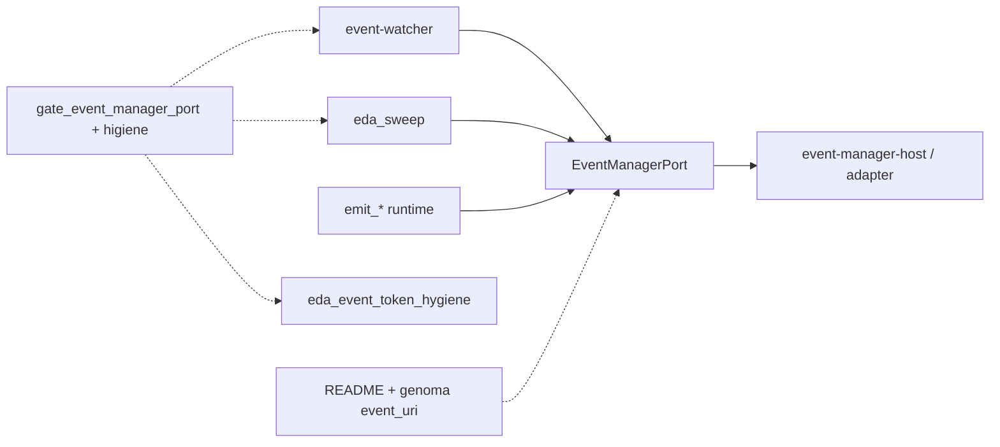

# Especificación técnica — man-49-remediacion-man-43

Entrada: `objectives.md` + `clarify.md` (laudos **R-01..R-04**) + PBI canónico **PBI-7e574af7** / canal **MAN-49** (padre **MAN-43**).
Fuente vinculante: `docs/audits/man-43-post-merge-audit-20261117.md` — **`CUMPLIMIENTO PARCIAL — NO APTO_TOTAL`** (14/19; hallazgos **A-01..A-04**).
Este ciclo **no** reabre L-1..L-7 / H1..H6 de MAN-43 salvo el cierre de brechas A-01..A-04 (**L-SUPERSEDE-SCOPE**).
No añade capacidades nuevas a `EventManagerPort` (**L-DOMAIN**).

## 0. Evidencia viva (Dedalo 2026-11-20)

| Artefacto | Estado vivo | Implicación forja |
|-----------|-------------|-------------------|
| Auditoría `docs/audits/man-43-post-merge-audit-20261117.md` | Materializada (aún untracked en git) | Fuente A-01..A-04 + plan de fix |
| `clarify.md` / `objectives.md` | `mayeuta_verdict: ok`; `open_questions: []` | *Qué* cerrado; blueprint solo acota *cómo* |
| Refine `verdict.json` | `refined` | DoR listo; canónico **PBI-7e574af7** |
| Canal Linear | `.SddIA/state/tracker-outbound/MAN-49.jsonl` vivo | Sin ficheros nuevos en `docs/todos/` |
| `lib.rs` `ensure_fractal_dirs` / `ensure_bus_dirs` | `fs::create_dir_all` activo; defaults `repo.join("telemetry"\|"orchestration"\|…)` | **R-01** |
| `eda_bus.rs` `ensure_event_bus_topology` | `create_dir_all` sobre pending/processing/… | **R-01** |
| `eda_bus_topology.rs` `ensure_event_bus_topology` | `create_dir_all` (auditoría lo cita como `ensure_dirs`) | **R-01** |
| Raíz `orchestration/` + `telemetry/` | **Existen vacíos** en `/home/racso/Proyectos/SddIA/` | Residuos A-01 a borrar (**R-01**) |
| `event-watcher` | `prune_routed_ok`=`read_dir`; `is_file`/`read_to_string` sobre `PathBuf` de `eda://…` | **R-02** |
| `eda_sweep.rs` | Helpers FS vivos (`safe_remove_path`, `ensure_state_header`, `maybe_purge_processing_header`); `move_fractal_to_dead_letter` (`#[cfg(test)]`) | **R-02** |
| `gate_event_manager_port` | Solo literales store/legacy; **no** prohíbe ops FS de R-02 | Ampliar gate |
| `eda_event_token_hygiene.rs:278` | `concat!('.', "events/")` | **R-04** — restaurar literal + allowlist honesta |
| `path_allowlisted` | **No** incluye `eda_event_token_hygiene.rs` | Añadir entrada |
| `eda-unit-backend.toml` `integration_src` | **34** entradas (auditoría citaba 38; delta histórico OK) | Vaciar a `[]` (**R-04**) |
| Genoma A-03 (22 paths) | 19 presentes; **3 ausentes**: `actions/emit-{domain,orchestration,telemetry}-event.md` | Inventario delta §3.3 |

## 1. Contexto y decisión

MAN-43 (PR #454 @ `ea20bd5`) dejó el desacople a `EventManagerPort` **parcialmente** cumplido. La causa raíz (auditoría §3) fue parcheo léxico (renombrar `.events/` → dirs en raíz) en vez de poda semántica de `create_dir_all`; gates oraculares incompletos; atajo `concat!`; colapso Tekton/Argos en el sello.

| Vector | Laudo |
|--------|-------|
| Dominio | **L-DOMAIN** — frontera = `EventManagerPort` / `EventUri`; sin ops nuevas |
| Remediación | **R-01..R-04** ↔ **A-01..A-04** |
| Scope parental | **L-SUPERSEDE-SCOPE** — no reabrir L-1..L-7 / H1..H6 |
| Genoma | **L-GENOME** — mutaciones solo `entity-manager` |
| Sello | **L-ARGOS-SEAL** — `APTO_TOTAL` solo Argos |
| Git / verdad / tracker | **L-GIT** / **L-TRUTH** / **L-TRACKER** |
| Docs canónicos | **L-DOC-CANON** — PBI-7e574af7; ACs estrictos del prompt feature |

## 2. Arquitectura objetivo (post-remediación)

Invariantes de capa:

1. **Ningún** flujo de runtime/daemon/CLI ejecuta `fs::create_dir_all` (ni equivalentes) sobre topología de bus en la raíz del repo.
2. Watcher y sweep resuelven existencia/contenido **solo** con `get_event` / `list_pending` (y ops de entrega del puerto ya existentes); cero `PathBuf` construido desde URI `eda://` para I/O FS.
3. Documentación productiva y genoma hablan `event_uri` / `EventManagerPort`; genoma `SddIA/events/` y `.SddIA/events/` **permanecen**.
4. Gates son honestos: sin `concat!` de evasión; `INTEGRATION_SRC = []`; higiene allowlisteada explícitamente donde el literal `.events/` es el oráculo.

## 3. Diseño por laudo

### 3.1 R-01 — Erradicar creación de directorios (A-01 / AC-1)

| Touchpoint | Decisión de diseño |
|------------|-------------------|
| `sddia-daemon-runtime/src/lib.rs` — `ensure_fractal_dirs`, `ensure_bus_dirs` | Convertir a **no-op** (`Ok(())`) **o** eliminar llamadas en `emit_raw_execution_finished`, `sweep_once_port`, `run_watcher` y cualquier otro call site. Preferencia Dedalo: **no-op + deprecar**, para no romper firmas públicas de crate en este ciclo. |
| `eda_bus.rs` — `ensure_event_bus_topology` | Idem: no `create_dir_all`; retornar paths calculados sin materializar FS, o eliminar call sites productivos. |
| `execute-process/.../eda_bus_topology.rs` — `ensure_event_bus_topology` | Eliminar `fs::create_dir_all` del flujo productivo. Si tests unitarios necesitan dirs, acotar a `tempdir` **explícito** dentro del test (no raíz de repo). |
| Defaults `BusTopology` (`repo.join("telemetry")` etc.) | Pueden permanecer como valores legacy **mientras** nadie materialice esos paths. No reintroducir `.events/` en strings productivos (higiene). Objetivo = cero efecto colateral FS, no reescribir toda la estructura de paths en este PBI. |
| Residuos raíz | Borrar directorios vacíos `orchestration/`, `telemetry/` (y `pending/`, `domain/`, `dead-letter/`, `progress/` si aparecen) del workspace piloto **antes** del sello. |
| Regresión | En `eda_event_token_hygiene`: aserción de que la raíz del repo **no** contiene esos nombres de dir de topología tras el escaneo / harness acotado; opcionalmente scan estático de `create_dir_all` en call sites de bus si el gate R-02 no lo cubre todo. |

**Hecho cuando:** AC-1 verde; raíz limpia tras suite.

### 3.2 R-02 — Watcher/sweep solo puerto (A-02 / AC-2)

| Touchpoint | Decisión de diseño |
|------------|-------------------|
| `event-watcher` `prune_routed_ok` | Sustituir `fs::read_dir` por retención vía puerto: para cada entrada de `book.routed_ok`, `port.get_event(&uri)` (o `list_pending` + set) — retener solo URIs existentes. |
| `fractal_side_effect_committed` / `watcher_skip_reason` / `apply_route_outcome_fractal` | Firma: `event_uri: &EventUri` + `&dyn EventManagerPort` (no `path: &Path`). Leer envelope con `get_event`; **prohibido** `PathBuf::from("eda://…")` + `is_file` / `read_to_string`. |
| `eda_sweep.rs` | Eliminar helpers FS muertos/productivos: `safe_remove_path`, `ensure_state_header`, `maybe_purge_processing_header`, y fallback FS de `move_fractal_to_dead_letter` (incl. `#[cfg(test)]` que use `create_dir_all`/`rename` sobre bus). Ciclo de vida = `fail_delivery` / `ack_delivery` / ops ya del puerto. |
| `gate_event_manager_port` | Ampliar oráculo: en `SddIA/daemons/event-watcher/src/**` y `SddIA/sddia-daemon-runtime/src/eda_*.rs` (y `lib.rs` si aplica) prohibir literales/invocaciones `fs::read_dir`, `fs::create_dir_all`, `fs::remove_file`, `fs::rename`. |

**Hecho cuando:** AC-2 verde; gate FS ampliado sin violaciones.

### 3.3 R-03 — Convergencia documental / genoma (A-03 / AC-3)

| Artefacto | Acción |
|-----------|--------|
| `README.md` (líneas citadas ~36, 80, 110, 114, 243, 250) | Reemplazar `event_file_path` / `.events/` por `event_uri` (`eda://{family}/{event_id}`) y `EventManagerPort`. |
| `.antigravity/rules/tekton-fire-and-forget.md` | Alinear mención `.events/` → modelo URI/puerto. |
| 22 contratos genoma (lista auditoría) | `execute-process --process entity-manager` (`operation: update`) — **solo** vía proceso; cero edición manual de genoma. |
| `scan_genome_contract` | Escanear **cuerpo completo** de `SddIA/**/*.md` + `README.md` (no solo claves YAML frontmatter) buscando `.events/` y `event_file_path`. |

#### Inventario delta genoma (evidencia 2026-11-20)

| # | Path auditoría | Disco |
|---|--------------|-------|
| 1–14, 18–22 | process/events/daemons/norms/tools citados | **Presentes** |
| 15–17 | `SddIA/actions/emit-{domain,orchestration,telemetry}-event.md` | **AUSENTES** |

**Decisión Dedalo (D-GENOME-DELTA):** Tekton, en oleada R-03, debe (1) escáner de tokens legacy sobre los 19 presentes + README + regla; (2) localizar sustitutos vivos bajo `SddIA/actions/emit-*.md` que aún contengan `.events/`/`SDDIA_EVENT_STORE`/`event_file_path` y actualizarlos vía `entity-manager`; (3) si un path de la auditoría no existe y no hay sustituto con token legacy, documentar en `execution.md` como **N/A — entidad ya retirada** sin recrear ficheros fantasma. El contador «22» de la auditoría es el inventario histórico; el oráculo de cierre es **cero tokens legacy** en el universo `SddIA/**/*.md` + `README.md`.

**Hecho cuando:** AC-3 verde.

### 3.4 R-04 — Gobernanza de gates y sello (A-04 / AC-4 / AC-5)

| Touchpoint | Decisión de diseño |
|------------|-------------------|
| `eda_event_token_hygiene.rs` | Restaurar literal `".events/"` (quitar `concat!`). |
| `gate_eda_unit_no_real_backend.rs` `path_allowlisted` | Añadir `SddIA/engine/execute-process/src/engine/eda_event_token_hygiene.rs` (junto a gates que legítimamente contienen el token). |
| `eda-unit-backend.toml` + const `INTEGRATION_SRC` | Vaciar a `entries`/`integration_src = []` **y** sincronizar el array Rust del gate. Estrategia: reclasificar tests que requieren backend real → crates `tests/` / integration (ya omitidos por `path_contains`), o inyectar `EventManagerMemoryAdapter` para que dejen de tocar backend real. **Prohibido** dejar allowlist no vacía al cierre. |
| Sello | Tekton **no** escribe `APTO_TOTAL` en `validacion.md` / auditorías parentales. Argos emite dictamen tras `pull-request-review`. |
| Verificación | `cargo test --workspace -- --test-threads=1`; `cargo clippy --workspace -- -D warnings`; `sddia-index-integrity --verify`. |

**Riesgo R-04 (documentado, no bloqueo de blueprint):** vaciar 34 entradas `integration_src` puede exigir oleada de migración de tests. Si un módulo no puede migrarse en este ciclo sin reabrir MAN-37, Tekton marca **blocked** con evidencia — **no** inventar verde (**L-TRUTH**).

## 4. Criterios de aceptación (ciclo MAN-49)

| ID | Criterio | Laudo | Verificación |
|----|----------|-------|--------------|
| **AC-1** | Cero dirs `orchestration/`, `telemetry/`, `pending/`, `domain/`, `dead-letter/`, `progress/` en raíz tras tests/daemons/CLI; regresión higiene | R-01 | Suite + assert higiene + inspección raíz |
| **AC-2** | Watcher + sweep solo puerto; gate prohíbe FS listado | R-02 | `gate-event-manager-port` + review código |
| **AC-3** | README + regla + genoma vía entity-manager; scan completo | R-03 | Higiene + entity-manager logs |
| **AC-4** | Sin `concat!` evasión; `path_allowlisted`; `INTEGRATION_SRC=[]` | R-04 | Diff + gate unit |
| **AC-5** | Suite + clippy + index-integrity verdes; **`APTO_TOTAL` por Argos** | R-04 + cierre | CI local + PPR Argos |

Trazabilidad parental: cerrar brechas de ACs MAN-43 **AC-3, AC-5, AC-6, AC-11, AC-13, AC-14** hasta **19/19** en reauditoría Argos.

## 5. Touchpoints (mapa de forja)

| Path | Laudo |
|------|-------|
| `SddIA/sddia-daemon-runtime/src/lib.rs` | R-01 |
| `SddIA/sddia-daemon-runtime/src/eda_bus.rs` | R-01 |
| `SddIA/engine/execute-process/src/engine/eda_bus_topology.rs` | R-01 |
| Residuos raíz `orchestration/`, `telemetry/`, … | R-01 |
| `SddIA/daemons/event-watcher/src/main.rs` | R-02 |
| `SddIA/sddia-daemon-runtime/src/eda_sweep.rs` | R-02 |
| `SddIA/tools/sddia-qa/src/gate_event_manager_port.rs` | R-02 |
| `README.md`, `.antigravity/rules/tekton-fire-and-forget.md` | R-03 |
| Genoma `SddIA/{process,events,actions,daemons,norms,tools}/**` vía entity-manager | R-03 |
| `.../eda_event_token_hygiene.rs` | R-01 (assert) + R-03 (scan) + R-04 |
| `.../gate_eda_unit_no_real_backend.rs` | R-04 |
| `SddIA/tools/sddia-qa/allowlists/eda-unit-backend.toml` | R-04 |
| `docs/features/man-49-remediacion-man-43/validacion.md` (sello Argos) | AC-5 |
| Reauditoría `docs/audits/man-43-post-merge-audit-*.md` | Argos |

## 6. Fuera de alcance

- Reabrir diseño EventManager / H1..H6 / L-1..L-7 de MAN-43 más allá de A-01..A-04.
- Nuevas operaciones del puerto.
- Eliminar `SddIA/events/` o `.SddIA/events/`.
- Semillas Kaizen bajo `docs/todos/` desde Tekton/Argos/Dedalo (solo `agent:cumulo` / `Kaizen_Alert_Required`).
- Auto-sello `APTO_TOTAL` por Tekton.

## 7. Remisiones

| Ítem | Destino |
|------|---------|
| Padre MAN-43 | `docs/features/man-43-event-manager-desacople-total/` |
| Auditoría post-merge | `docs/audits/man-43-post-merge-audit-20261117.md` |
| Clarificaciones | `clarify.md` |
| Objetivos | `objectives.md` |
| Plan ejecutable | `plan.md` |
| Canal Linear | `.SddIA/state/tracker-outbound/MAN-49.jsonl` |
| Refine | `.SddIA/workspaces/refine-item/2e407038-fe9a-4bc6-8fd4-ca4cc19355f2/` |
