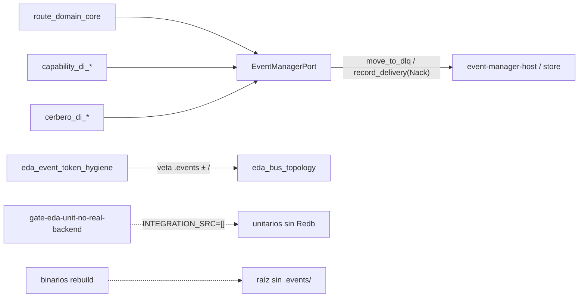

---

feature_name: man-50-cierre-man-43
created: "2026-11-20"
updated: "2026-11-20"
process: feature
base: main
scope: "Cierre brechas residuales B-01..B-03 post-merge MAN-49/MAN-43 hasta APTO Argos"
branch_name: feat/man-50-cierre-man-43
persist_ref: docs/features/man-50-cierre-man-43
pbi_ref: MAN-50
parent_ref: MAN-43
related_ref: MAN-49
historia_ref: MAN-43
document_id: PBI-91b7ec84
document_uuid: "91b7ec84-a164-48ce-ba51-40e872ef3be1"
capability_id: "eda:event-manager"
contract: "eda.event_manager"
agent: dedalo
phase: diseno-blueprint
version_spec: "1.0.0"
status: blueprint-ready
audit_ref: docs/audits/man-49-man-43-post-merge-audit-20261120.md
parent_commit: ee17d9537a1b567505049bb1a2bf3245c7560d39
related_pr: 455
norm_ref: features-documentation-pattern@1.3.1
tracker_channel: ".SddIA/state/tracker-outbound/MAN-50.jsonl"
execution_id: "ad89137d-966b-4076-8d75-e299e3f3b137"
---
# Especificación técnica — man-50-cierre-man-43

Entrada: `objectives.md` + `clarify.md` (laudos **R-01..R-03b**) + PBI canónico **PBI-91b7ec84** / canal **MAN-50** (padre **MAN-43**, relacionado **MAN-49** / PR #455).
Fuente vinculante: `docs/audits/man-49-man-43-post-merge-audit-20261120.md` — `main` @ `ee17d953` — hallazgos residuales **B-01..B-03**.
Este ciclo **no** reabre el *qué* de MAN-43 / MAN-49 salvo el cierre de esas brechas (**L-SUPERSEDE-SCOPE**).
No añade capacidades nuevas a `EventManagerPort` (**L-DOMAIN**).

## 0. Evidencia viva (Dedalo 2026-11-20)

| Artefacto | Estado vivo | Implicación forja |
|-----------|-------------|-------------------|
| Auditoría `docs/audits/man-49-man-43-post-merge-audit-20261120.md` | Materializada (untracked) | Fuente B-01..B-03 + plan de fix |
| `clarify.md` / `objectives.md` | `mayeuta_verdict: ok`; laudos cerrados | *Qué* cerrado; blueprint solo acota *cómo* |
| Canal Linear | `.SddIA/state/tracker-outbound/MAN-50.jsonl` | Sin ficheros nuevos en `docs/todos/` |
| `eda_bus_topology.rs:63-88` | `bus_defaults_from_root(".events")` vivo como default | **R-01** |
| `eda_bus_topology.rs:206-214` | `write_json_atomic` = `create_dir_all` + `write` + `rename` | **R-01** |
| 6 writers DLQ | `route_domain_core`, `capability_di_{gate,resolver,output_validator}`, `cerbero_di_{rbac,envelope}` invocan `write_json_atomic` sobre `dead_letter*` | **R-01** |
| `eda_event_token_hygiene` | `VIRTUAL_EVENT_SUBDIRS = [".events/"]`; `assert_repo_root_bus_dirs_absent` **sin** `".events"` | Ampliar veto ± barra + aserción raíz |
| `eda-unit-backend.toml` `integration_src` | **3** entradas (`route_domain_core`, `system_vitality`, `daemon_heartbeat`) | **R-03a** → `[]` |
| `gate_eda_unit_no_real_backend.rs` `INTEGRATION_SRC` | Misma ternaria | Sync a `&[]` |
| `EventManagerPort` | Ya expone `move_to_dlq` + `record_delivery` (sin ops nuevas) | API de remediación DLQ |
| `execute-process/tests/` | Lab integración ya existe (`eda_store_io_*`, …) | Destino migración Redb |
| `events-contract.md` §4 | Menciona `SDDIA_EVENT_STORE` + modos filesystem/dual | **R-03b** |
| `git_status` MCP | Untracked: auditoría + `docs/features/man-50-cierre-man-43/` | Branch feature aún sin commits de forja |

## 1. Contexto y decisión

MAN-49 (PR #455) cerró A-01..A-04 en ~90%, pero dejó residuales: I/O físico DLQ vía literal `".events"` (sin barra, eludiendo higiene O14d), binarios stale que regeneran `.events/`, allowlist unitaria con 3 entradas Redb, y tokens documentales secundarios.

| Vector | Laudo |
|--------|-------|
| Dominio | **L-DOMAIN** — frontera = `EventManagerPort` / `EventUri`; sin ops nuevas |
| Remediación | **R-01..R-03b** ↔ **B-01..B-03** |
| Scope parental | **L-SUPERSEDE-SCOPE** — no reabrir H1..H6 / A-01..A-04 |
| Genoma | **L-GENOME** — mutaciones solo `entity-manager` |
| Sello | **L-ARGOS-SEAL** — `APTO` solo Argos |
| Git / verdad / tracker | **L-GIT** / **L-TRUTH** / **L-TRACKER** |
| Docs canónicos | **L-DOC-CANON** — PBI-91b7ec84; auditoría `20261120` |
| Aduana | **L-MCP-ADUANA** — artefactos feature solo MCP |

## 2. Arquitectura objetivo (post-remediación)

Invariantes de capa:

1. **Ningún** escritor productivo de dead-letter ejecuta `write_json_atomic` / `fs::write` hacia `.events/dead-letter/` (ni variante sin barra).
2. DLQ de padre = `EventManagerPort::move_to_dlq(MoveToDlqRequest { event_id, reason })`; DLQ por suscriptor / fallo de entrega = `record_delivery` con `DeliveryStatus::Nack` (y metadata de subscriber) — **sin** nuevas ops del puerto.
3. Higiene léxica veta `".events"` **y** `".events/"` en código productivo (excluyendo oráculos/gates allowlisteados).
4. Raíz del repo: `.events/` ausente; `assert_repo_root_bus_dirs_absent` lo cubre junto a los dirs MAN-49.
5. Árbol unitario: `integration_src = []` / `INTEGRATION_SRC = &[]`; Redb solo en `execute-process/tests/**` (u otras capas ya allowlisteadas por `/tests/`).
6. Documentación citada en AC-4: cero `.events/` / `SDDIA_EVENT_STORE`; genoma vía `entity-manager`.

## 3. Diseño por laudo

### 3.1 R-01 — DLQ solo puerto (B-01 / AC-1)

#### D-DLQ-API (elección Dedalo — pregunta Mayeuta #5)

| Caso | Op puerto | Motivo |
|------|-----------|--------|
| Fallo de evento padre / fallback router | `move_to_dlq` | Mueve a cola DLQ del store; `MoveToDlqRequest` ya tipado |
| Fallo de entrega por suscriptor (DI/Cerbero) | `record_delivery` + `DeliveryStatus::Nack` | SSOT por suscriptor sin testigo FS |
| Payload de diagnóstico | Incluir `reason` / campos ya en request; **no** volcar JSON a `.events/dead-letter/*.json` | Cumple «sin I/O físico» |

No existe `fail_delivery` en el trait 2.0.0; **no inventar** método nuevo (**L-DOMAIN**). Si un call site hoy escribe cabecera padre + testigo subscriber, mapear a la pareja `move_to_dlq` + `record_delivery(Nack)` según el semántica actual del helper.

#### Touchpoints

| Touchpoint | Decisión de diseño |
|------------|-------------------|
| `write_dead_letter_fallback` (`route_domain_core`) | Sustituir `write_json_atomic` → resolución de puerto (`eda_port` / harness productivo) + `move_to_dlq` / `record_delivery` |
| `write_di_dead_letter` / `write_resolve_dead_letter` / `write_output_dead_letter` | Idem vía puerto; conservar firma pública solo si callers internos lo requieren, pero cuerpo sin FS |
| `write_rbac_dead_letter` / `write_envelope_dead_letter` | Idem |
| `bus_defaults_from_root(".events")` | **Eliminar** el literal. Default sin `EVENT_BUS_PATH` / config FS: topología con paths **vacíos o marcadores no-FS** que fallen cerrado si alguien intenta `resolve_bus_path`+write; preferencia: dejar de usar topología FS para DLQ y obtener bus solo cuando `is_filesystem_rel` lo exija explícitamente desde env/config **sin** fallback `".events"` |
| `write_json_atomic` | Tras migrar los 6 writers: inventario de callers. Si solo DLQ → **eliminar** función. Si queda uso legítimo no-`.events` (tests) → `#[cfg(test)]` o mover a módulo test. **Prohibido** uso productivo sobre dead-letter |
| `eda_event_token_hygiene` | Ampliar `VIRTUAL_EVENT_SUBDIRS` (o patrón equivalente) a `".events"` y `".events/"` (y variante Windows si aplica). Allowlist de oráculos/gates se mantiene; **no** permitir `eda_bus_topology.rs` en allowlist para el literal |
| Tests unitarios de los 6 módulos | Ajustar a `EventManagerMemoryAdapter` / harness; asertar `list_dlq` / deliveries Nack en lugar de ficheros bajo `.events/` |

**Hecho cuando:** AC-1 verde; `rg`/higiene sin `".events"` productivo; cero JSON nuevos en `.events/dead-letter/` tras smoke DI/Cerbero.

### 3.2 R-02 — Paridad binaria + raíz limpia (B-02 / AC-2)

| Touchpoint | Decisión de diseño |
|------------|-------------------|
| Rebuild | `cargo build` + `cargo build --release` para `-p sddia-workspace-server -p event-watcher -p execute-process` |
| `.events/` en raíz | Eliminar árbol histórico del workspace piloto **después** de rebuild (evitar que binarios stale lo regeneren). Reinicio operativo de daemons = verificación de higiene (fuera del laudo de código, documentar en `execution.md`) |
| `assert_repo_root_bus_dirs_absent` | Añadir `".events"` (nombre de dir) a la lista junto a `orchestration`, `telemetry`, … |
| Test higiene | `eda_event_token_hygiene_repo_root_no_bus_topology_dirs` debe fallar si reaparece `.events/` |

**Hecho cuando:** AC-2 verde; raíz limpia post-suite.

### 3.3 R-03a — Allowlist unitaria vacía (B-03a / AC-3)

| Touchpoint | Decisión de diseño |
|------------|-------------------|
| Tests Redb en `route_domain_core.rs` / `system_vitality.rs` / `daemon_heartbeat.rs` | Extraer módulos `#[cfg(test)]` que abren store real → `SddIA/engine/execute-process/tests/` (p. ej. `route_domain_core_redb.rs`, `system_vitality_redb.rs`, `daemon_heartbeat_redb.rs`) reutilizando `common`/fixtures existentes |
| Helpers privados | Exponer vía `pub(crate)` / módulo `#[cfg(test)]` compartido **o** duplicar mínimo en tests de integración; preferir `pub(crate)` acotado para no reabrir API pública |
| `eda_port::test_lab` | Si el lab solo compila bajo `cfg(test)` del crate, los integration tests del mismo crate ya lo ven; no hace falta feature nueva del puerto |
| `eda-unit-backend.toml` | `integration_src = []` |
| `gate_eda_unit_no_real_backend.rs` | `const INTEGRATION_SRC: &[&str] = &[]` |
| Gate | `gate-eda-unit-no-real-backend` en verde (**L-TRUTH**: si un test unitario residual aún toca Redb, migrar o marcar blocked — no rellenar allowlist) |

**Hecho cuando:** AC-3 verde.

### 3.4 R-03b — Convergencia documental residual (B-03b / AC-4)

| Artefacto | Acción |
|-----------|--------|
| `.antigravity/rules/[ARQUITECTURA] constitution_core.md` (y cualquier `*.md` bajo `.antigravity/rules/` con hit) | Sustituir `.events/` por modelo `EventUri` / `EventManagerPort` / `.SddIA/runtime/events.redb` según contexto |
| `SddIA/events/events-contract.md` | Eliminar/reescribir mención a `SDDIA_EVENT_STORE` y modos filesystem/dual como SSOT operativo; alinear a puerto 2.0 + store instancia. **Vía entity-manager** (entidad contract indexada) |
| Códex `process/{accept-pr,delivery-close-cycle,pull-request-review,refine-item}.md` | Cero `SDDIA_EVENT_STORE` / `.events/` — **solo** `execute-process --process entity-manager` |
| `docs/audits/man-43-o6-remediation-20261113.md` | Alinear cuerpo inconsistente APTO/NO_APTO (L24/L63 vs frontmatter) sin reescribir historia: nota de remediación O6 coherente con dictamen vigente |
| Oráculo | Escaneo explícito de paths AC-4; higiene existente puede no cubrir `.antigravity/rules` ni nota de auditoría — Tekton verifica con evidencia en `execution.md` |

**D-DOC-CONTRACT:** al limpiar `events-contract.md`, no eliminar `SddIA/events/` ni `.SddIA/events/` (**L-NON-GOALS**). Distinguir genoma de clases vs instancia runtime.

**Hecho cuando:** AC-4 verde.

## 4. Criterios de aceptación (ciclo MAN-50)

| ID | Criterio | Laudo | Verificación |
|----|----------|-------|--------------|
| **AC-1** | 6 writers solo puerto; sin `bus_defaults_from_root(".events")`; higiene veta `.events` ± `/` | R-01 | Diff + higiene + smoke sin DLQ FS |
| **AC-2** | 3 crates rebuild debug+release; `.events/` ausente; assert raíz | R-02 | Build + test higiene + inspección raíz |
| **AC-3** | `integration_src=[]` + `INTEGRATION_SRC=&[]`; gate unit verde | R-03a | TOML+Rust + `gate-eda-unit-no-real-backend` |
| **AC-4** | Cero `.events/` / `SDDIA_EVENT_STORE` en rules/contract/códex citados; O6 alineada; genoma vía entity-manager | R-03b | Escaneo + logs entity-manager |
| **AC-5** | `cargo test --workspace -- --test-threads=1`; `cargo clippy --workspace -- -D warnings`; `sddia-qa verify-process-integrity`; gates QA verdes; **`APTO` por Argos** | Cierre | Suite + PPR Argos |

## 5. Touchpoints (mapa de forja)

| Path | Laudo |
|------|-------|
| `SddIA/engine/execute-process/src/engine/eda_bus_topology.rs` | R-01 |
| `SddIA/engine/execute-process/src/engine/route_domain_core.rs` | R-01 + R-03a |
| `SddIA/engine/execute-process/src/engine/capability_di_gate.rs` | R-01 |
| `SddIA/engine/execute-process/src/engine/capability_di_resolver.rs` | R-01 |
| `SddIA/engine/execute-process/src/engine/capability_di_output_validator.rs` | R-01 |
| `SddIA/engine/execute-process/src/engine/cerbero_di_rbac.rs` | R-01 |
| `SddIA/engine/execute-process/src/engine/cerbero_di_envelope.rs` | R-01 |
| `SddIA/engine/execute-process/src/engine/eda_event_token_hygiene.rs` | R-01 + R-02 |
| `SddIA/engine/execute-process/src/engine/handlers/system_vitality.rs` | R-03a |
| `SddIA/engine/execute-process/src/engine/handlers/daemon_heartbeat.rs` | R-03a |
| `SddIA/engine/execute-process/tests/**` (nuevos módulos Redb) | R-03a |
| `SddIA/tools/sddia-qa/allowlists/eda-unit-backend.toml` | R-03a |
| `SddIA/tools/sddia-qa/src/gate_eda_unit_no_real_backend.rs` | R-03a |
| Binarios `sddia-workspace-server`, `event-watcher`, `execute-process` | R-02 |
| Raíz `.events/` (purga) | R-02 |
| `.antigravity/rules/*.md` | R-03b |
| `SddIA/events/events-contract.md` (entity-manager) | R-03b |
| Códex process ×4 (entity-manager) | R-03b |
| `docs/audits/man-43-o6-remediation-20261113.md` | R-03b |
| `docs/features/man-50-cierre-man-43/validacion.md` (sello Argos) | AC-5 |

## 6. Fuera de alcance

- Reabrir diseño EventManager / H1..H6 / A-01..A-04 más allá de B-01..B-03.
- Nuevas operaciones del puerto (`fail_delivery` u otras).
- Eliminar `SddIA/events/` o `.SddIA/events/`.
- Semillas Kaizen bajo `docs/todos/` desde Tekton/Argos/Dedalo (solo `agent:cumulo` / `Kaizen_Alert_Required`).
- Auto-sello `APTO` por Tekton.

## 7. Remisiones

| Ítem | Destino |
|------|---------|
| Padre MAN-43 | `docs/features/man-43-event-manager-desacople-total/` |
| Relacionado MAN-49 | `docs/features/man-49-remediacion-man-43/` |
| Auditoría post-merge | `docs/audits/man-49-man-43-post-merge-audit-20261120.md` |
| Clarificaciones | `clarify.md` |
| Objetivos | `objectives.md` |
| Plan ejecutable | `plan.md` |
| Canal Linear | `.SddIA/state/tracker-outbound/MAN-50.jsonl` |
| Contrato puerto | `SddIA/sddia-core/src/ports/event_manager/port.rs` |
