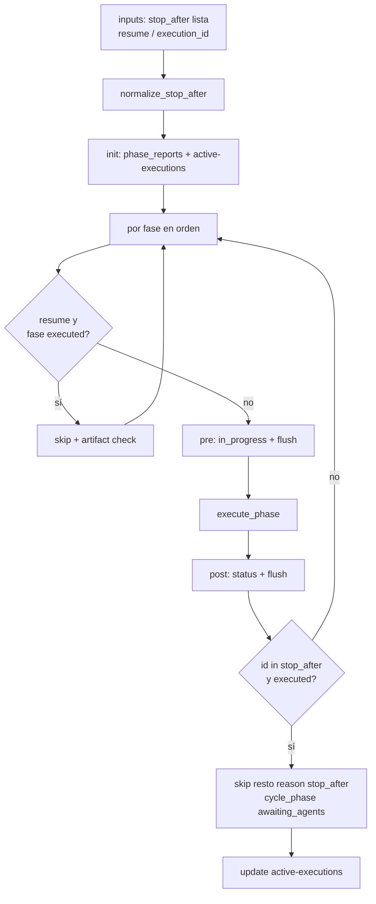

# Especificación técnica — process-stop-after-and-execution-registry

Entrada: `objectives.md` + `clarify.md` (laudos **L-PHASE-ID…L-WI**) + semilla **PBI-PROCESS-STOP-AFTER-AND-EXECUTION-REGISTRY** / tracker **MAN-34**.
Dominio = **parada contractual por `phase_id`**, **write-ahead de ejecución** y **reanudación determinista**. No reabre L-* Mayeuta. Preserva barrera `reason: stop_after` → `cycle_phase: awaiting_agents` del antecedente `kalma2-agent-verdict-barrier`; **erradica** el *cómo* env+literales ES.

## 0. Evidencia viva (Dedalo 2026-11-21)

| Artefacto | Estado vivo | Implicación forja |
|-----------|-------------|-------------------|
| `objectives.md` / `clarify.md` | `mayeuta_verdict: ok`; ACs KA-STOP-1…8 | *Qué* estabilizado; no reabrir L-* |
| `executor.rs` | `stop_after_design()` lee `SDDIA_TQM_STOP_AFTER`; `is_dedalo_design_phase()` literales ES | **Hueco P0:** parada no contractual |
| `task_queue_manager.rs` | `stop_after` como **string**; `child_env_for_kalma2` inyecta env | Contaminación padre→hijo |
| `thermodynamic.rs` | `reason == "stop_after"` ⇒ `awaiting_agents` | **Preservar** (L-THERMO) |
| `phase_reports.json` | Solo al cierre de `run_generic` | Sin write-ahead pre/post |
| `active-executions.json` | **Ausente** | Gap total L-INDEX |
| `Work_Initiated` | Emisión en Fase 1 (`workspace_init`); Tekton solo propaga sello | Ajustar a entry `agent:tekton` (L-WI) |
| Catálogo delivery | `feature`/`bug-fix`/`refactorization` sin `phases[].id` | Migración genómica vía entity-manager |
| `process-contract.md` v1.4.0 | Sin `id` por fase; sin `stop_after` lista / `resume` | Bump contrato + integrity |
| Antecedente barrera | `docs/features/kalma2-agent-verdict-barrier/` | Sustituir mecanismo; conservar reason/cycle_phase |

## 1. Contexto y decisión

| Vector | Laudo |
|--------|-------|
| Unidad de parada/resume | **L-PHASE-ID** — solo `phases[].id` (`snake_case` inmutable) |
| Input stop | **L-STOP-LIST** — `stop_after: list<string>` default `[]` |
| Deser legacy | **L-LEGACY-DESER** — string → lista de un elemento |
| Universalidad | **L-UNIVERSAL** — cualquier proceso del catálogo |
| Sin env | **L-NO-ENV** / **L-ERADICATE** |
| Resume | **L-RESUME** — skip `executed`; relanzar incompletas; barrera consumida no bloquea |
| Write-ahead + índice | **L-WRITEAHEAD** / **L-INDEX** / **L-RUNTIME-LOCUS** |
| Termodinámica | **L-THERMO** — preservar `stop_after`→`awaiting_agents` |
| Work_Initiated | **L-WI** — solo primera entrada efectiva `agent:tekton` |
| Genoma | **L-GENOME** — entity-manager / DA-2 |

### Laudos Dedalo (diseño)

| ID | Decisión |
|----|----------|
| **D-PHASE-ID** | Toda fase declara `id` (`snake_case`) junto a `name`/`intent`. El motor indexa por `id`. `name` queda solo para humanos/prompts. |
| **D-IDS-DELIVERY** | IDs canónicos delivery (inmutables post-adopción): ver §2.1. Valor legacy string `design` tras deser = id `design`. |
| **D-CONTRACT** | `process-contract` bump menor (≥1.5.0): (a) `phases[].id` obligatorio; (b) inputs base opcionales `stop_after: list<string>` (default `[]`) y `resume: bool` (default `false`); (c) `execution_id` ya inyectado por runtime permanece. Mutación vía **entity-manager**. |
| **D-INTEGRITY** | `verify-process-integrity` exige `id` único por proceso, `snake_case`, no vacío; falla si falta en cualquier fase del catálogo. |
| **D-STOP-EVAL** | Tras fase con `status: executed`, si `phase.id` ∈ `stop_after`: marcar restantes `skipped` (`reason: stop_after`, `prior_status: executed`); no ejecutar más fases; `derive_cycle_phase` → `awaiting_agents`. |
| **D-MULTI-STOP** | Lista puede tener varios ids; cada id actúa como punto de parada si esa fase se completa en la corrida actual. En resume, ids ya consumidos (fase `executed` + posteriores skipped por esa barrera) no re-disparan barrera hasta nueva entrada del operador con lista distinta. |
| **D-NO-ENV** | Eliminar `SDDIA_TQM_STOP_AFTER`, `stop_after_design`, `is_dedalo_design_phase`, inyección en `child_env_for_kalma2`. TQM/CLI leen `stop_after` solo de inputs (lista o string normalizado). |
| **D-DESER** | Helper `normalize_stop_after(Value) -> Vec<String>`: `Null`→`[]`; `String`→`[s]` trim; `Array`→strings; otro → error de inputs. |
| **D-WRITEAHEAD** | API `persist_phase_reports_atomic(workspace_path, reports)`: write temp + rename. Hitos: **init** (skeleton); **pre-fase** (`in_progress`); **post-fase** (`executed`/`blocked`/`failed`/`skipped`); **barrera-cierre**. |
| **D-INDEX** | `.SddIA/state/active-executions.json`: mapa `execution_id` → `{ process_name, workspace_path, persist_ref?, status, updated_at, stop_after? }`. Upsert en mismos hitos. **Nunca** bajo `persist_ref`. |
| **D-RESUME** | `resume: true` + `execution_id` (o resolución por índice + `persist_ref`): cargar `phase_reports.json`; fases `executed` → skip (verificar artefactos obligatorios si aplica); `in_progress`/`failed`/`blocked` → relanzar; tras frontera `stop_after` consumida, la siguiente fase pendiente se ejecuta (barrera no rebloquea). |
| **D-ARTIFACT-CHECK** | En resume hacia `execution` tras `design` executed: exigir `spec.md` y, si aplica, `plan.md` bajo `persist_ref`. Fallo → `blocked` con friction_id `resume_design_artifacts_missing`. |
| **D-WI** | Quitar emisión `Work_Initiated` del cierre Fase 1 delivery. Emitir **una vez** al entrar en primera fase efectiva cuyo `delegates_to` incluya `agent:tekton` y no esté skipped. Stop en `design` ⇒ sin WI. |
| **D-THERMO** | No cambiar prioridad de `derive_cycle_phase` salvo confirmar tests con reason `stop_after`. |
| **D-GENOME** | Mutación de `process-contract.md` y `**/process/*.md` vía entity-manager; refresh `hash_signature`; EDA coverage si aplica. |
| **D-SUPERSEDE** | Informe `INFORME-SDDIA-TQM-STOP-AFTER` superseded por este `persist_ref`. |
| **D-TESTS** | Suite: parada múltiple; deser string→lista; resume mid-phase; resume post-stop_after; grep-negativo legacy; locus runtime fuera de `docs/`. |

## 2. Arquitectura objetivo



### 2.1 IDs canónicos delivery

| Proceso | `name` (humano) | `id` |
|---------|-----------------|------|
| **feature** | Inicialización de Espacio de Trabajo | `workspace_init` |
| | Estabilización de Requisitos | `stabilization` |
| | Diseño de Blueprint | `design` |
| | Ejecución | `execution` |
| | Verificación | `verification` |
| | Cierre documental en rama | `doc_closure` |
| | Cierre de entrega | `delivery_close` |
| **bug-fix** | Inicialización… | `workspace_init` |
| | Diseño del fix | `design` |
| | Ejecución / Verificación / cierres | `execution` / `verification` / `doc_closure` / `delivery_close` |
| **refactorization** | Inicialización… | `workspace_init` |
| | Estabilización de alcance | `stabilization` |
| | Diseño de refactor | `design` |
| | Ejecución… | igual que feature |

Resto del catálogo: asignar `id` estable por semántica (no por `name` ES); Tekton inventaria y aplica vía entity-manager.

### 2.2 Locus de estado

| Artefacto | Ruta |
|-----------|------|
| Registro de fases | `{workspace_path}/phase_reports.json` |
| Índice activo | `.SddIA/state/active-executions.json` |
| Expediente | `persist_ref` — solo `.md` de fase; **prohibido** JSON runtime |

## 3. Contratos de comportamiento

### 3.1 Parada (KA-STOP-3)

```text
after phase P with status executed:
  if P.id in stop_after:
    for each subsequent phase Q:
      Q.status = skipped
      Q.reason = stop_after
      Q.prior_status = executed
    flush phase_reports + active-executions
    cycle_phase = awaiting_agents
    aggregate terminal success = true (neutro PEC; L-THERMO)
```

### 3.2 Resume (KA-STOP-5 / KA-STOP-6)

```text
if resume:
  load phase_reports for execution_id
  for each phase in order:
    if executed → skip (artifact gate if required)
    if in_progress|failed|blocked → restart from here
    if skipped(stop_after) before consumed frontier → keep skipped
  after consumed stop_after frontier:
    do NOT re-apply barrier; run next pending phase
```

### 3.3 Work_Initiated (KA-STOP-7)

```text
on entering first effective tekton phase (not skipped):
  emit Work_Initiated once (fail-soft)
stop_after design without reaching execution → no Work_Initiated
```

### 3.4 Índice `active-executions.json`

Schema mínimo:

```json
{
  "version": 1,
  "executions": {
    "<execution_id>": {
      "process_name": "feature",
      "workspace_path": ".SddIA/workspaces/feature/<id>/",
      "persist_ref": "docs/features/...",
      "status": "running|awaiting_agents|completed|failed",
      "stop_after": ["design"],
      "updated_at": "ISO-8601"
    }
  }
}
```

Escritura atómica (temp+rename). Lectura en resume si no se pasa `workspace_path` explícito.

### 3.5 Envelope de fricción resume

```json
{
  "status": "blocked",
  "friction_id": "resume_design_artifacts_missing",
  "message": "resume tras design executed sin spec.md (y plan.md si aplica)",
  "operator_hint": "Materializar artefactos de diseño bajo persist_ref o no usar resume"
}
```

## 4. Touchpoints (mapa de forja)

| Path / área | Mutación |
|-------------|----------|
| `SddIA/process/process-contract.md` | Exigir `phases[].id`; documentar inputs `stop_after`/`resume`; bump versión contrato |
| Catálogo `**/process/*.md` (delivery + resto) | Añadir `id` por fase; ajustar § ignición AUT-65 / L-WI en delivery; entity-manager + hash |
| `executor.rs` | Evaluar stop por `id`; write-ahead; resume; borrar `stop_after_design` / `is_dedalo_design_phase` |
| `task_queue_manager.rs` | Lista + deser; **sin** inyección `SDDIA_TQM_STOP_AFTER` |
| `thermodynamic.rs` | Tests de preservación; sin cambio semántico |
| `workspace_init.rs` | Dejar de emitir WI en Fase 1 delivery; init skeleton `phase_reports` si aplica |
| Módulo nuevo p.ej. `execution_registry.rs` | Persist atómico reports + índice active-executions |
| `verify_process_integrity.rs` | Validar `id` snake_case único |
| `resolver.rs` / inputs | `stop_after`/`resume` defaultables |
| Tests `execute-process` | KA-STOP-2…8 |

**Prohibido:** NLP de nombres de fase; JSON runtime bajo `docs/`; redefinir PEC más allá de L-THERMO; semillas en `docs/todos/` desde Tekton/Argos; forja directa de genoma sin entity-manager.

## 5. Fixtures y aceptación

| ID | Fixture | Esperado |
|----|---------|----------|
| **KA-STOP-1** / AC-1 | Contrato + catálogo con `id` | `verify-process-integrity` verde |
| **KA-STOP-2** / AC-2 | Grep fuente `execute-process` | Cero `SDDIA_TQM_STOP_AFTER` / `is_dedalo_design_phase` |
| **KA-STOP-3** / AC-3 | `stop_after: ["design"]` (u otro id) | Stop tras executed; skipped + `awaiting_agents` |
| **KA-STOP-4** / AC-4 | Ejecución instrumentada | reports init/pre/post; índice actualizado; nada bajo `persist_ref` |
| **KA-STOP-5** / AC-5 | Stop design + resume | Salta executed; artifact check; arranca `execution` |
| **KA-STOP-6** / AC-6 | Fases 1–2 executed, 3 failed | Resume desde 3 |
| **KA-STOP-7** / AC-7 | Stop design vs entry tekton | WI solo en tekton |
| **KA-STOP-8** / AC-8 | `cargo build --release` + `cargo test` | Verde + tests lista/legacy/resume |

## 6. RBAC / delegación

| Cápsula | Contexto |
|---------|----------|
| `execute-process` nativo | Orquestación stop/resume/registry |
| `entity-manager` / DA-2 | Mutación genoma process/contract |
| `skill:git-manager` | Solo porcelain; registry no escribe git |
| `agent:tekton` / `agent:argos` | Forja y verificación posteriores |
| KM / `docs/todos/` | Solo `agent:cumulo` o `Kaizen_Alert_Required` |

Sin nuevas cápsulas indexadas obligatorias; módulo registry vive dentro de `execute-process`.

## 7. Fuera de alcance

- Rediseño de agentes Mayeuta/Dedalo/Tekton/Argos.
- Cambio de semántica termodinámica distinto de preservar `awaiting_agents` + `reason: stop_after`.
- Contaminar expedientes documentales con estado runtime.
- NLP / heurísticas sobre nombres humanos de fase.
- Semillas Kaizen bajo `docs/todos/` desde Tekton/Argos/Mayeuta.

## 8. Remisiones

| Ítem | Destino |
|------|---------|
| Objetivos / ACs | `objectives.md` |
| Clarificaciones | `clarify.md` |
| Antecedente barrera | `docs/features/kalma2-agent-verdict-barrier/` |
| Contrato | `SddIA/process/process-contract.md` |
| Norma documental | `SddIA/library/norms/features-documentation-pattern.md` |
| Plan ejecutable | `plan.md` |
| Tracker | MAN-34 |
