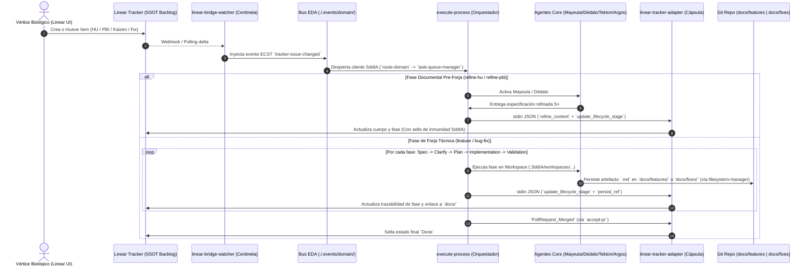

# [ARQUITECTURA] HU-SDDIA-LINEAR-DOC-LIFECYCLE: Gobernanza del Ciclo de Vida Documental en la Cápsula Linear y Desacople del Repositorio

---
**Identificador:** `HU-SDDIA-LINEAR-DOC-LIFECYCLE-001`  
**Estatus:** `Pendiente / Teórico` (Fase de Especificación Inicial)[cite: 1, 16]  
**Fecha de Emisión:** `2026-10-22`  
**Autor:** `Vértice Biológico (Racso) & Tormentosa`[cite: 1, 14]  
**Referencias Normativas:**
- `SddIA/norms/capsule-json-io.md` (Contrato estricto de E/S por JSON en cápsulas)[cite: 20, 28, 36]
- `SddIA/library/norms/features-documentation-pattern.md` (Patrón de artefactos de forja en carpetas de tarea)[cite: 20, 36]
- `SddIA/library/norms/todos-jurisdiction.md` (Jurisdicción sobre ítems de backlog y tareas)[cite: 36]
- `SddIA/core/cumulo.paths.json` (SSOT de rutas canónicas del ecosistema)[cite: 28, 36]
- `SddIA/tools/linear-tracker-adapter.md` (Contrato de la cápsula adaptadora de Linear)[cite: 36]
---

## 1. Matriz de Indexación Tridimensional

* **Naturaleza:** Refactorización Arquitectónica / Desacoplamiento de Dominio Documental y Orquestación Reactiva (EDA)[cite: 4, 28].
* **Entorno:** Ecosistema `SddIA Core` — Cápsula `SddIA/tools/linear-tracker-adapter`, Motor `SddIA/engine/execute-process`, Centinela `SddIA/daemons/linear-bridge-watcher` y Procesos del Códice de Ingeniería de Software[cite: 36].
* **Entropía Asimilada:** Destilado de la simbiosis directa (`Racso - Tormentosa`) tras detectar fricción por acoplamiento entre archivos Markdown de gestión en Git y la sincronización de estados en el orquestador[cite: 19, 36].

---

## 2. Descripción General y Alcance Funcional

* **Como:** Arquitecto del Ecosistema SddIA (Vértice Biológico) y Orquestador de Agentes del Core (`Mayeuta`, `Dédalo`, `Tekton`, `Argos`, `Cúmulo`)[cite: 28].
* **Quiero:** Refactorizar la cápsula `linear-tracker-adapter` para que asuma la gestión integral del ciclo de vida de la documentación de gestión (**Historias de Usuario, PBIs, Kaizen y Fixes**) directamente en Linear, manteniendo los artefactos técnicos generados durante la forja en sus rutas canónicas del repositorio (`docs/features/` y `docs/fixes/`)[cite: 20, 28, 36].
* **Para:** Desacoplar la información documental y el estado del backlog respecto al código fuente del repositorio, erradicando la necesidad de versionar o mover tickets en Git y habilitando que la creación o transición de un ítem en Linear despierte de forma reactiva y autónoma a un cliente SddIA para ejecutar su ciclo de trabajo[cite: 9, 28, 36].

### Reglas de Negocio y Jurisdicción Documental (Ley de Jurisdicción Dividida)

1. **SSOT de Intención y Gestión (Linear):**
   * Toda entidad de gestión previa o transversal al código (**Historia de Usuario [HU], PBI, Kaizen y Fix**) tiene como Única Fuente de Verdad (SSOT) el tracker **Linear**, gestionado exclusivamente a través de la cápsula `linear-tracker-adapter` (con soporte de estado local en `.SddIA/` mediante `lab_state.rs` para ejecuciones de laboratorio o contingencia offline)[cite: 31, 36].
   * Se elimina la obligación de persistir, estampar o desplazar archivos Markdown de backlog en el árbol de código versionado (ej. `docs/todos/pending/` a `docs/todos/done/`) como parte de los Pull Requests de producto[cite: 19].

2. **SSOT de Ingeniería y Forja (`docs/features` y `docs/fixes`):**
   * Los artefactos generados durante el proceso de forja (`objectives.md`, `spec.md`, `clarify.md`, `plan.md`, `implementation.md`, `execution.md`, `validacion.md`) siguen viviendo innegociablemente en el repositorio bajo las rutas gobernadas por `Cúmulo` (`paths.featurePath` y `paths.fixPath` vía `persist_ref`)[cite: 20, 28].
   * La cápsula de Linear no almacena ni reemplaza estos ficheros técnicos, sino que vincula la referencia `persist_ref` (y el PR asociado) dentro de los metadatos del ítem en Linear[cite: 28, 36].

3. **Actualización Progresiva por Fase del Ciclo de Vida:**
   * Cada vez que un ítem avanza en su ciclo de vida documental —desde su concepción (`Draft` $\rightarrow$ `HU Refined` $\rightarrow$ `PBI Forged/Refined`) hasta las fases de forja (`Spec` $\rightarrow$ `Clarify` $\rightarrow$ `Plan` $\rightarrow$ `Implementation` $\rightarrow$ `Validation` $\rightarrow$ `PR Presented` $\rightarrow$ `Done`)—, el proceso activo invoca a `linear-tracker-adapter` para actualizar el estado, etiquetas, cuerpo o trazabilidad del ítem en Linear[cite: 20, 28, 36].
   * **Protección contra Ramas Huérfanas:** El avance por las fases técnicas de la forja (`spec` a `validacion`) actualiza el sub-estado o registro de progreso del ítem en Linear manteniendo el ticket en curso (*In Progress / In Review*), reservando la transición al estado final *Done* exclusivamente para la confirmación empírica de `PullRequest_Merged`[cite: 28, 31, 36].

4. **Adelgazamiento del Orquestador (`execute-process`):**
   * La lógica de construcción de plantillas Markdown de tickets, estampado de cabeceras y reconciliación de estados que hoy reside dispersa en `SddIA/engine/execute-process/src/engine/tracker_*.rs` se transfiere hacia el dominio interno de la cápsula `linear-tracker-adapter`, dejando en el orquestador únicamente el despacho por contrato `capsule-json-io.md` y el Peaje Termodinámico[cite: 6, 28, 36].

5. **Preparación para el Despertar Reactivo del Cliente SddIA:**
   * La cápsula estandariza las marcas de autoría/estampado SddIA en cada mutación hacia Linear para que el centinela `linear-bridge-watcher` discrimine entre actualizaciones propias del motor (ignorándolas por Táctica de Inmunidad) y estímulos externos creados por el humano, los cuales emitirán `tracker-issue-changed` al bus `./.events/domain/` para despertar a SddIA cliente[cite: 28, 31, 36].

---

## 3. Separación de Responsabilidades (Vértice Biológico vs. Sistema)

### A. Tareas bajo Jurisdicción del Vértice Biológico (Prerrequisitos Manuales)
* **Configuración de Estados y Etiquetas en Linear:** Verificar o definir en el workspace de Linear del proyecto los estados canónicos del flujo y las etiquetas tipadas (`HU`, `PBI`, `Kaizen`, `Fix`) junto con las marcas de trazabilidad de fase si aún no existen en el entorno real (Filtro de Materialización)[cite: 1, 16].
* **Credenciales en Bóveda de Instancia:** Asegurar en `.SddIA/.dev/.env` la presencia de las claves de API y secreto de webhook de Linear bajo la Jerarquía de Bóvedas, sin exponerlas jamás a los agentes LLM ni al control de versiones[cite: 28, 31].

### B. Comportamiento Automatizado del Sistema (SddIA Core + Cápsula)
* **Cápsula `linear-tracker-adapter`:** Exponer operaciones semánticas por `stdin/stdout` JSON (`create_item`, `update_lifecycle_stage`, `refine_content`, `link_forge_artifacts`, `transition_status`, `query_backlog`) validando esquemas de entrada para `HU`, `PBI`, `Kaizen` y `Fix`[cite: 20, 28, 36].
* **Acciones de Fractura y Kaizen:** Redirigir `materialize-fracture-pbi`, `materialize-ci-chronic-failure-pbi` y `materialize-kaizen-alert-doc` para que invoquen a la cápsula de Linear en lugar de ensuciar el árbol Git local, delegando cualquier fallo de red en la cola de contingencia (`emit-tracker-sync-failed` / `tracker-sync-replay`)[cite: 36].
* **Procesos de Refinamiento y Forja:** Conectar los hitos de salida de `refine-hu`, `refine-pbi`, `feature`, `bug-fix`, `refactorization`, `delivery-close-cycle` y `accept-pr` con la cápsula para reflejar en tiempo real el paso de cada fase[cite: 36].

---

## 4. Coreografía y Normativas de Gobernanza S+ Grade

### Diagrama de Secuencia del Ciclo de Vida Desacoplado

### Reglas de Gobernanza S+ Grade Aplicables
* **Ceguera Espacial y Aislamiento de Capas:** Los agentes (`Mayeuta`, `Dédalo`, `Tekton`, `Argos`) jamás interactúan con la API de Linear ni conocen sus endpoints; emiten intenciones a través de Acciones que el Orquestador enruta hacia la cápsula tras superar el Peaje RBAC de `Cerbero`[cite: 2, 28, 32].
* **Contrato Hermético (`capsule-json-io.md`):** Toda respuesta de `linear-tracker-adapter` mantiene la estructura `{"success": bool, "exitCode": int, "feedback": string, "result": object}`, garantizando cero `panic!` en `stdout` y emitiendo recibos para el Peaje Termodinámico[cite: 19, 20, 28].
* **Táctica de Inmunidad Anti-Bucle:** El centinela `linear-bridge-watcher` y el enrutador `route-domain` descartan de forma determinista cualquier webhook originado por mutaciones firmadas por la propia cápsula `linear-tracker-adapter`[cite: 28, 31, 36].

---

## 5. Criterios de Aceptación (Formato Gherkin)

### Escenario 1: Gestión de tipologías documentales (HU, PBI, Kaizen, Fix) en la cápsula
* **Dado** que un proceso del Core solicita crear o actualizar un ítem de tipo `HU`, `PBI`, `Kaizen` o `Fix` mediante un payload JSON válido[cite: 20, 36],
* **Cuando** el orquestador invoca la cápsula `linear-tracker-adapter`[cite: 28, 36],
* **Entonces** la cápsula estructura el documento según la plantilla de su tipología, ejecuta la mutación en Linear (o en `lab_state` si opera en modo laboratorio) y devuelve un sobre JSON con `success: true` sin crear ni modificar archivos de backlog en el árbol Git del repositorio[cite: 20, 36].

### Escenario 2: Sincronización progresiva durante el ciclo de vida de la forja (`docs/features` y `docs/fixes`)
* **Dado** un PBI o Fix activo cuyo proceso de forja (`feature` o `bug-fix`) avanza por las fases `spec`, `clarify`, `plan`, `implementation` y `validacion`[cite: 19, 20, 36],
* **Cuando** el agente responsable deposita y valida cada artefacto `.md` en `docs/features/<tarea>/` o `docs/fixes/<tarea>/`[cite: 20, 28],
* **Entonces** el proceso invoca a `linear-tracker-adapter` para actualizar en Linear la fase alcanzada y la referencia `persist_ref`, manteniendo los documentos técnicos de ingeniería en el repositorio y el estado de gestión sincronizado en Linear[cite: 20, 28, 36].

### Escenario 3: Cierre desacoplado al fusionar el Pull Request
* **Dado** un proceso en fase de entrega cuyo Pull Request es auditado y fusionado (`PullRequest_Merged`)[cite: 28, 31, 36],
* **Cuando** se ejecuta el cierre del ciclo (`accept-pr` / `delivery-close-cycle`)[cite: 28, 36],
* **Entonces** `linear-tracker-adapter` transiciona el ítem a estado `Done` en Linear sin requerir el movimiento de ningún archivo Markdown hacia carpetas `docs/todos/done/` en el repositorio[cite: 19, 36].

### Escenario 4: Inmunidad contra bucles reactivos y despertar por estímulo externo
* **Dado** que el centinela `linear-bridge-watcher` monitoriza cambios en Linear[cite: 36],
* **Cuando** la cápsula `linear-tracker-adapter` actualiza un ítem con el sello de autoría de SddIA, el centinela ignora el eco para evitar bucles infinitos; pero **cuando** el Vértice Biológico crea o transiciona manualmente una HU/PBI a un estado disparador,
* **Entonces** el centinela emite `tracker-issue-changed` en `./.events/domain/` para que SddIA cliente tome la tarea de forma autónoma[cite: 28, 36].

---

## 6. Propuesta de Desglose en PBIs (Regla de $\le 3$ Archivos Adyacentes por PBI)

1. **PBI-1: Expansión de Contrato y Dominio Interno en `linear-tracker-adapter`**
   * **Objetivo:** Dotar a la cápsula de las operaciones de ciclo de vida documental (`HU`, `PBI`, `Kaizen`, `Fix`), plantillas por tipo, trazabilidad de fases de forja (`persist_ref`) y sello de inmunidad.
   * **Archivos:** `SddIA/tools/linear-tracker-adapter.md`, `SddIA/tools/linear-tracker-adapter/src/main.rs`, `SddIA/tools/linear-tracker-adapter/src/lab_state.rs`[cite: 36].

2. **PBI-2: Extracción y Poda de Lógica Documental de Tracker en `execute-process`**
   * **Objetivo:** Eliminar del orquestador la lógica acoplada de manipulación y estampado de Markdown de tickets, delegando por completo en llamadas a la cápsula.
   * **Archivos:** `SddIA/engine/execute-process/src/engine/tracker_pbi_meta.rs`, `SddIA/engine/execute-process/src/engine/tracker_markdown_apply.rs`, `SddIA/engine/execute-process/src/engine/tracker_stamp.rs`[cite: 36].

3. **PBI-3: Refactorización de Handlers de Sincronización en el Motor**
   * **Objetivo:** Alinear los handlers de procesos de tracker con la nueva interfaz JSON de la cápsula y el mecanismo *Fail-Soft* de replay en `.SddIA/`.
   * **Archivos:** `SddIA/engine/execute-process/src/engine/handlers/tracker_linear_markdown_sync.rs`, `SddIA/engine/execute-process/src/engine/handlers/tracker_markdown_apply.rs`, `SddIA/engine/execute-process/src/engine/handlers/tracker_sync_replay.rs`[cite: 36].

4. **PBI-4: Desacople del Cierre Documental en Delivery y Done Gate**
   * **Objetivo:** Sustituir la exigencia de mover archivos físicos en el repositorio al cerrar un PR por la transición de estado en Linear vía cápsula.
   * **Archivos:** `SddIA/engine/execute-process/src/engine/done_gate.rs`, `SddIA/engine/execute-process/src/engine/delivery_close.rs`, `SddIA/library/norms/todos-jurisdiction.md`[cite: 36].

5. **PBI-5: Redirección de Acciones de Fractura y Alertas Kaizen hacia Linear**
   * **Objetivo:** Hacer que las fracturas sistémicas y alertas Kaizen se materialicen como ítems gestionados por la cápsula de Linear en lugar de archivos en el árbol de código.
   * **Archivos:** `SddIA/actions/materialize-fracture-pbi.md`, `SddIA/actions/materialize-kaizen-alert-doc.md`, `SddIA/engine/execute-process/src/engine/materialize_fracture_pbi.rs`[cite: 36].

6. **PBI-6: Filtro de Inmunidad y Disparo Autónomo en `linear-bridge-watcher`**
   * **Objetivo:** Asegurar que el centinela filtre las actualizaciones firmadas por SddIA y emita `tracker-issue-changed` ante nuevas historias o cambios de estado manuales para despertar al cliente.
   * **Archivos:** `SddIA/sddia-daemon-runtime/src/linear_bridge.rs`, `SddIA/sddia-daemon-runtime/src/linear_bridge_webhook.rs`, `SddIA/events/domain/tracker-issue-changed.md`[cite: 36].
