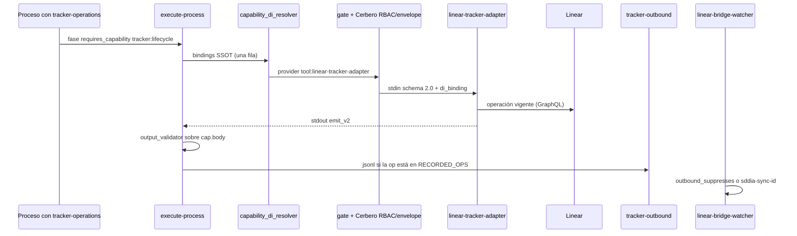

# [ARQUITECTURA] HU-SDDIA-TRACKER-LIFECYCLE-DI: Puerto `tracker:lifecycle` y ciclo de gestión sobre el tracker de instancia

**Identificador:** `HU-SDDIA-TRACKER-LIFECYCLE-DI-003`  
**Estatus:** `Pendiente`  
**Fecha:** `2026-10-22`  
**Sustituye:** `HU-SDDIA-CAPABILITY-DI-TRACKER-002` y `HU-SDDIA-LINEAR-DOC-LIFECYCLE-001` (retiradas; contenían citas `[cite:…]`, ids y rutas inexistentes).  
**Autor:** Vértice Biológico (Racso) / refinamiento Tekton contra el árbol vigente.

**Contratos que esta historia no puede contradecir:**

- `SddIA/library/norms/capability-taxonomy.md` v1.0.8 — catálogo `dominio:verbo`; un id ausente es entropía semántica.
- `SddIA/core/capability-bindings.md` v1.6.0 — una fila por `capability_id`. Clave Cúmulo `capability_di.bindings`.
- `SddIA/norms/capsule-json-io.md` schema 2.0.
- `SddIA/library/codexes/codex-software-engineering/contracts/project-config-contract.md` v1.3.0.
- `SddIA/library/norms/features-documentation-pattern.md` v1.3.0 y `SddIA/library/norms/todos-jurisdiction.md` v1.1.0.
- `SddIA/core/cumulo.paths.json` — `paths.featurePath`, `paths.fixPath`, `paths.todos`, `env_hierarchy`.

---

## 1. Baseline verificado

Hechos del árbol. Una implementación que los ignore rehace las dos historias retiradas.

| Afirmación de las HU retiradas | Hecho |
|---|---|
| Capacidad `tracker.lifecycle` | No está en el catálogo. El id válido sería `tracker:lifecycle` y el contrato `tracker.lifecycle` (`{contract}.schema.json`). |
| El cliente elige el adaptador en `.SddIA/project.md` y `capability_di_resolver` lo lee | El resolver lee solo `SddIA/core/capability-bindings.md`. El manifiesto `{project_root}/.SddIA/project.md` tiene un objeto `tracker` aparte, parseado por `project_binding.rs`. `tracker.provider` admite únicamente `linear`. |
| Adaptadores `fs-tracker-adapter` y `github-tracker-adapter` | No existen. `tool:github-raw-fetcher` provee `asset:fetch`, otro contrato. |
| El resolver inyecta `.SddIA/.dev/.env` en la cápsula | No. Inyecta el objeto `di_binding`. La bóveda es `env_hierarchy` (`.dev/.env`, luego `.SddIA/.dev/.env`) más `env_ref` del manifiesto. La cápsula lee `LINEAR_API_TOKEN` y `SDDIA_LINEAR_API_URL`. |
| Orden «resolver → RBAC → cápsula» y fallo «fail-soft» del validador | Orden real: `resolve → fase efectiva → capability_di_gate → cerbero_rbac → cerbero_envelope → inject → capability_di_output_validator`. El validador recibe el stdout completo (`cap.body` en `phase_capsules::try_invoke_delegates`). Desajuste → fase `failed` y dead-letter `CONTRACT_OUTPUT_SCHEMA_MISMATCH`. El fail-soft de red del tracker es otro mecanismo: `Tracker_Sync_Failed` + proceso `tracker-sync-replay`. |
| Operaciones `create_item`, `update_lifecycle_stage`, `refine_content`, `link_forge_artifacts`, `transition_status`, `query_backlog` | La cápsula expone `fetch_issue`, `list_issues`, `update_issue_state`, `create_issue`, `create_comment`, `update_issue_description`. |
| Estados `Draft → HU Refined → Spec → … → Done` dentro de Linear | `tracker.state_map` solo tiene claves `backlog`, `todo`, `in_progress`, `in_review`, `done`, `cancelled`. Las fases de forja son ficheros: `objectives.md`, `spec.md`, `clarify.md`, `plan.md`, `implementation.md`, `execution.md`, `validacion.md`. |
| Etiquetas solo HU, PBI, Kaizen, Fix | El contrato también define `deuda`, `spike` y `editable` (`sddia-editable`). |
| `lab_state.rs` como contingencia offline de producción | Es mock de laboratorio (`SDDIA_LAB_MOCK_OUTBOUND`, `SDDIA_LAB_MOCK_LINEAR_URL`). |
| Sello de autoría dentro de Linear que el watcher interpreta | Anti-eco ya implementado: registro `.SddIA/state/tracker-outbound/{issue}.jsonl` (ops `create_issue`, `update_issue_state`, `create_comment`) y comentario con `sddia-sync-id`. Ventana `SDDIA_TRACKER_OUTBOUND_ECHO_WINDOW_SECS` (default 300 s) en `sddia-daemon-runtime/src/linear_bridge.rs`. `update_issue_description` no se registra. |
| `Tracker_Issue_Changed` despierta el ciclo de trabajo del cliente | El suscriptor único en `event-domain-subscriptions.json` es `tracker-markdown-apply` (réplica Linear → markdown). No enruta a `refine-hu` ni a `task-queue-manager`. |
| Dejar de versionar el backlog y cerrar solo en Linear | Hoy no es así. Default `done_gate: git` (sin `tracker`, el motor lo fuerza). Con `linear`, `tracker-markdown-apply` copia el issue a `docs/todos/done/`. Las fracturas nacen en `pending/` y `todos-jurisdiction` v1.1.0 prohíbe reimplementar `materialize-fracture-pbi`. El delta que sustituye estas tres reglas está en §3.7. |
| `feature` / `bug-fix` invocan la cápsula en cada fase | Esos procesos no llevan contexto `tracker-operations`. La tool sí. Cerbero bloquea el cruce. El sello hacia Linear vive en procesos con ese contexto (`tracker-stamp`, `refine-hu`, `forge-pbi`, `tracker-sync-replay`, `tracker-backlog-query`, `tracker-linear-markdown-sync`). |
| Rutas `engine/tracker_markdown_apply.rs` y `engine/tracker_stamp.rs` | Esos ficheros están en `engine/handlers/`. En la raíz del engine sí están `tracker_pbi_meta.rs`, `tracker_outbound.rs`, `tracker_operations_gate.rs`, `done_gate.rs`. |
| Cápsula WASI | Desviación declarada en `linear-tracker-adapter.md`: binario nativo (`ureq`). |
| Envelope reducido a `success`, `exitCode`, `feedback`, `result` | `emit_v2` emite `meta`, `success`, `exitCode`, `message`, `result`. `feedback` es opcional en la norma, no el campo que la cápsula rellena hoy. |

Acoplamiento que esta historia barre: todo despacho que nombra el literal `linear-tracker-adapter`. La resolución DI no intercepta esas llamadas: solo actúa cuando la fase declara `requires_capability` y el delegado pasa por `try_invoke_delegates`. Inventario de despacho (árbol vigente):

| Sitio | Fichero |
|---|---|
| Proceso | `SddIA/process/tracker-stamp.md` |
| Proceso | `SddIA/process/refine-hu.md` |
| Proceso | `SddIA/library/codexes/codex-software-engineering/process/forge-pbi.md` |
| Proceso | `SddIA/process/tracker-backlog-query.md` |
| Índice | `SddIA/process/index.md` (fila `tracker-backlog-query`) |
| Proceso | `SddIA/process/tracker-sync-replay.md` |
| Proceso | `SddIA/process/tracker-linear-markdown-sync.md` |
| Handler | `handlers/tracker_stamp.rs`, `handlers/refine.rs`, `handlers/forge_pbi.rs`, `handlers/tracker_backlog_query.rs`, `handlers/tracker_sync_replay.rs`, `handlers/tracker_linear_markdown_sync.rs`, `handlers/tracker_markdown_apply.rs` |
| Motor | `done_gate.rs` (`fetch_issue` vía `invoke_tool_for_process`) |
| Motor | `tracker_outbound.rs` (`const TOOL`) |
| Motor | `tracker_operations_gate.rs` (`LINEAR_TRACKER_TOOL`) y `capsules.rs` (compara el nombre antes de `gate_linear_tracker_operation`) |
| Daemon | `SddIA/daemons/linear-bridge-watcher/src/main.rs` (`resolve_adapter_bin` une `SddIA/target/{profile}/linear-tracker-adapter`) |

`tracker-markdown-apply.md` no nombra la tool: su fase delega en `skill:git-manager`. El literal está solo en el handler.

Identidad del proveedor, que esta historia conserva: `SddIA/tools/linear-tracker-adapter.md`, el crate (`ENTITY_ID`, target cargo), `SddIA/tools/index.md`, el valor `provider` de la fila en `capability-bindings.md`, el ejemplo de cápsula en `SddIA/norms/execution-contexts.md` §2.10, y los registros ya escritos en `SddIA/evolution/`. Esos textos nombran el artefacto; no son un despacho.

---

## 2. Historia

**Como** arquitecto de la librería SddIA,  
**quiero** que el ciclo de vida de un ítem de gestión se pida como capacidad `tracker:lifecycle`, que el sumidero sea `file` o `linear` según el manifiesto, y que cada despacho deje de incrustar el literal `linear-tracker-adapter`,  
**para** que un proyecto sin tracker siga en fichero, un proyecto Linear no genere `docs/todos/pending` ni `docs/todos/done`, y el estado de gestión no se confunda con los artefactos de forja.

Los artefactos de forja siguen en `paths.featurePath` (`docs/features`) y `paths.fixPath` (`docs/fixes`), o en `docs_layout` del manifiesto si la instancia los reubica. La cápsula no los almacena. Guarda la referencia `persist_ref` en el issue (descripción o comentario), con las operaciones que ya existen.

---

## 3. Reglas del corte

1. **Alta taxonómica antes de uso.** Registrar `tracker:lifecycle` / contrato `tracker.lifecycle` / versión `1.0.0` en el catálogo y una sola fila en `capability-bindings.md`. Esa fila apunta a `tool:linear-tracker-adapter`, que declara `provides` con la misma forma que `telegram-gateway` (`id`, `contract`, `version`). El resolver solo la usa cuando el provider efectivo es `linear`. Con `file` no hay `di_binding` ni cápsula. Sin fila en el catálogo, `requires_capability` falla el filtro A.

2. **Sumidero único por manifiesto.** `tracker.provider` admite `file` o `linear`. Objeto `tracker` ausente, o `provider` ausente, equivale a `file`. No hay cápsula `fs-tracker-adapter`: `file` es la escritura ya existente en `paths.todos.pending` y `paths.todos.done` (o `docs_layout` del manifiesto). `linear` es `tool:linear-tracker-adapter`, y solo entonces el resolver inyecta `di_binding`. Un mismo ítem no se escribe en los dos sumideros. `done_gate: both` deja de ser legal: el provider ya elige el cierre. `done_gate` se deriva (`file` → cierre en `done/`; `linear` → cierre en `state_map.done`) y un valor que contradiga al provider invalida el manifiesto.

3. **Operaciones cerradas.** El contrato semántico de esta entrega mapea 1:1 a las seis operaciones vigentes. No se añaden verbos. Correspondencia de intención:

   | Intención | Operación vigente |
   |---|---|
   | Alta de HU, PBI, fix, kaizen, deuda o spike | `create_issue` (`labels` según `tracker.labels`, `state_name` según `state_map`) |
   | Cambio de estado de workflow | `update_issue_state` |
   | Traza de fase de forja y `persist_ref` | `create_comment` o `update_issue_description` |
   | Lectura / backlog | `fetch_issue`, `list_issues` |

4. **Fase de forja ≠ estado Linear.** Avanzar `spec` → `validacion` no mueve el issue a `done`. El workflow permanece en una clave de `state_map` (`in_progress` o `in_review`). La transición a `done` queda reservada al cierre de §3.7: fichero en `done/` si el provider es `file`; issue en `state_map.done` si es `linear`. `cancelled` sigue siendo clave del mapa.

5. **RBAC intacto.** `feature`, `bug-fix` y `refactorization` no ganan contexto `tracker-operations` ni una fase `tool:`. La traza de fase la ejecuta un proceso que ya tiene ese contexto (`tracker-stamp` o un proceso hermano forjado igual). Los agentes no llaman a la API de Linear.

6. **Anti-eco existente, no un sello nuevo.** Si la traza usa `update_issue_description`, esa operación entra en `RECORDED_OPS` de `tracker_outbound.rs`. Si no, el watcher emitirá `Tracker_Issue_Changed` y `tracker-markdown-apply` replicará el eco. No se rediseña `linear_bridge.rs` en este corte.

7. **Tres normas, un sumidero.** Esta historia enmienda `project-config-contract`, `features-documentation-pattern` y `todos-jurisdiction`. Los ficheros históricos ya versionados no se borran. Lo que cambia es la generación nueva.

   1. **`project-config-contract` (bump desde 1.3.0).** `tracker.provider`: `file` \| `linear`. Default `file` cuando no hay objeto `tracker` o no hay `provider`. Hoy el motor hace lo contrario: sin tracker fuerza `done_gate: git` y, si hay tracker, solo admite `provider: linear`. `done_gate: both` sale del enum. Con `linear`, `team_key` y `state_map` siguen siendo obligatorios como ahora. Con `file`, el objeto puede omitirse.

   2. **`features-documentation-pattern`.** `validacion.md` con `global: APTO` sigue en la rama del PR. El cierre documental se parte:
      - `file` (default): `pbi_archived: true` y el PBI presente en `docs/todos/done/` en esa rama. Los artefactos de forja siguen en `docs/features/` o `docs/fixes/`.
      - `linear`: el issue está en `state_map.done`. No se crea ni se mueve un fichero en `docs/todos/pending/` ni en `docs/todos/done/`. `pbi_archived` no exige ese path. La forja en `docs/features/` y `docs/fixes/` no cambia.
      La copia de `.cursor/rules/task-closure-documental.mdc` se alinea con este texto. Si queda la definición antigua, el operador seguirá exigiendo el fichero en `done/` también en Linear.

   3. **`todos-jurisdiction`.** `pending/` y `done/` son la cola despachable solo con provider `file`. Con `linear` el task-queue-manager no exige un path bajo esos prefijos: el ancla es el `tracker_ref`. La prohibición de reimplementar `fracture_pbi` / `materialize-fracture-pbi` / `enrich-fracture-pbi-kaizen` se sustituye por esta: esas acciones siguen siendo las únicas canónicas y eligen sumidero según el provider efectivo. Con `file` escriben en `pending/` como hoy. Con `linear` llaman `create_issue` y no crean el Markdown. Lo mismo para `materialize-kaizen-alert-doc` y `materialize-ci-chronic-failure-pbi`. `tracker-markdown-apply` deja de volcar un issue Linear a esos buckets.

   **Manifiestos que han de quedar en `linear`.** No heredan el default `file`.
   - Core-self: `.SddIA/project.md` del repositorio SddIA ya declara `provider: linear`, `team_key: OSC` y `done_gate: linear`. Se mantiene `provider: linear`. El `done_gate` explícito sobra en cuanto el provider lo deriva; no se cambia a `file`.
   - Paciente 0: instancia documentada en `/home/racso/Proyectos/SddIA_AP` (kaizen de redeploy). Ese checkout no está en este workspace y no hay ficha en `.SddIA/projects/`. La historia obliga a que su `.SddIA/project.md` declare `provider: linear` con `team_key` y `state_map`. No se afirma el contenido actual del fichero.

8. **Schema de salida contra el stdout real.** `tracker.lifecycle.schema.json` valida `cap.body` tal como lo emite `emit_v2`. Copiar `doc.closure.schema.json` (`exitCode` + `data`) rechazaría la cápsula actual. `additionalProperties` permitido. Desajuste = dead-letter, no éxito silencioso.

9. **Secretos.** Prohibidos en el manifiesto (`project-config-contract`). Token solo en la bóveda. El Core no embebe `LINEAR_*`.

10. **Genoma.** Taxonomía, bindings, schema, tool, procesos y handlers se mutan bajo topología `docs/features/` + `entity-manager` + registro en `SddIA/evolution/`. Esta historia no autoriza edición directa.

11. **Barrido cerrado de despachos.** Tras los PBI §7, el literal `linear-tracker-adapter` no aparece como argumento de `invoke_tool_for_process`, como `delegates_to: tool:…`, como constante de gate (`LINEAR_TRACKER_TOOL`, `TOOL`) ni como path de binario en el watcher. El nombre se lee de la fila `provider` (`tool:linear-tracker-adapter` → artefacto). `capsules.rs` aplica `gate_linear_tracker_operation` cuando el `tool_name` coincide con ese provider resuelto, no con una constante propia. El watcher resuelve el binario desde el tool de esa fila (`SddIA/target/{profile}/{name}`). Permanecen los literales de identidad listados en §1. `execution-contexts.md` §2.10 nombra la capacidad y conserva el proveedor vigente como ejemplo. Los registros de `SddIA/evolution/` no se reescriben.

---

## 4. Fuera de este corte

- Proveedor distinto de `file` y `linear`.
- Cápsula nueva que envuelva `docs/todos/`. El sumidero `file` son los escritores que ya existen.
- Borrar el histórico ya versionado bajo `docs/todos/pending/` y `docs/todos/done/`.
- Cambiar el suscriptor de `Tracker_Issue_Changed` para despertar forja autónoma. Con `linear` ese suscriptor deja de escribir Markdown; no pasa a lanzar `refine-hu`.
- Reescribir el watcher o sustituir la ventana anti-eco.
- Pasar `linear-tracker-adapter` a WASI.
- Inventario de fases `Draft / HU Refined / PBI Forged` como workflow de Linear.

---

## 5. Coreografía

La forja (`feature`, `bug-fix`, `refactorization`) escribe el `.md` de fase en `docs/features/` o `docs/fixes/` vía `fs:persist` (`skill:filesystem-manager`). No aparece en este diagrama. Si debe informar al tracker, emite una señal de dominio que consume `tracker-stamp` (o el proceso hermano), que sí está en el diagrama.

Estímulo humano en Linear: el watcher, si no hay eco, emite `Tracker_Issue_Changed`. Hoy eso solo dispara `tracker-markdown-apply`.

---

## 6. Criterios de aceptación

### Escenario 1 — Resolución ciega del proveedor canónico

**Dado** el catálogo con `tracker:lifecycle` y la fila de `capability-bindings.md` hacia `tool:linear-tracker-adapter`,  
**cuando** una fase con contexto `tracker-operations` declara `requires_capability: tracker:lifecycle` y el manifiesto tiene `tracker.provider: linear`,  
**entonces** el runtime inyecta `di_binding` (`capability_id`, `contract`, `provider`, `provider_ref`, `resolved_version`, `binding_ssot`) y la cápsula ejecuta una de las seis operaciones vigentes. El proceso no contiene el literal del proveedor.

### Escenario 2 — Default `file`

**Dado** un manifiesto sin objeto `tracker`, o con `tracker` sin `provider`,  
**cuando** se materializa un PBI, una fractura o un cierre de forja,  
**entonces** el motor trata el provider como `file`, escribe en `docs/todos/pending/` o mueve a `docs/todos/done/`, y no llama a `linear-tracker-adapter`.

### Escenario 3 — Traza de forja sin cerrar el issue

**Dado** un issue en `state_map.in_progress` y un artefacto nuevo bajo `docs/features/<tarea>/` o `docs/fixes/<tarea>/`,  
**cuando** el proceso con contexto `tracker-operations` informa la fase,  
**entonces** el issue conserva la clave de workflow y gana un comentario o una descripción con `persist_ref`. No transiciona a `done`. Si la operación fue `update_issue_description`, el registro outbound existe y el watcher no emite `Tracker_Issue_Changed` dentro de la ventana.

### Escenario 4 — Salida fuera de contrato

**Dado** un stdout que no cumple `tracker.lifecycle.schema.json`,  
**cuando** `capability_di_output_validator` audita `cap.body`,  
**entonces** la fase termina `failed` con `CONTRACT_OUTPUT_SCHEMA_MISMATCH` y dead-letter. El bus no recibe un éxito.

### Escenario 5 — Cierre según provider

**Dado** provider efectivo `file`,  
**cuando** se cierra la forja,  
**entonces** `validacion.md` está en `APTO` y el PBI está en `docs/todos/done/` en la rama.  
**Dado** provider `linear`,  
**cuando** el issue está en `state_map.done`,  
**entonces** `validacion.md` está en `APTO` y no aparece un fichero nuevo en `docs/todos/pending/` ni en `docs/todos/done/`. `tracker-markdown-apply` no lo crea.

### Escenario 6 — Barrido de despachos

**Dado** el inventario de despacho de §1,  
**cuando** terminan los PBI 3 y 5–12,  
**entonces** ninguno de esos ficheros contiene el literal `linear-tracker-adapter`. `done_gate.rs` y `handlers/tracker_markdown_apply.rs` siguen llamando `fetch_issue` (y el resto de operaciones vigentes) con el nombre salido del binding cuando el provider efectivo es `linear`. Sin objeto `tracker`, `refine-hu` y `forge-pbi` usan el sumidero `file` (§3.7) y no llaman a la cápsula. El watcher, con provider `linear`, arranca el binario del provider resuelto; con `file` no arranca. En `SddIA/process/`, `SddIA/library/codexes/`, `SddIA/engine/` y `SddIA/daemons/` el literal solo puede quedar en la lista de identidad de §1. En `SddIA/norms/` solo queda el ejemplo de §2.10.

### Escenario 7 — Core-self y Paciente 0 en Linear

**Dado** `.SddIA/project.md` del repositorio SddIA con `provider: linear`,  
**cuando** Cúmulo materializa una fractura o un PBI nuevo,  
**entonces** el alta es un `create_issue` y el árbol no gana un fichero bajo `docs/todos/pending/` ni `docs/todos/done/`.  
**Dado** el manifiesto de Paciente 0 en `/home/racso/Proyectos/SddIA_AP/.SddIA/project.md`,  
**cuando** se valida contra el contrato bumpeado,  
**entonces** `tracker.provider` es `linear` y el manifiesto no hereda el default `file`.

---

## 7. Desglose

Los PBI 01–04 están cerrados, uno por ordinal. Los ordinales 05–20 son tareas de un solo PBI: `PBI-ARQUITECTURA-TRACKER-LIFECYCLE-05` (`docs/todos/pending/[ARQUITECTURA] HU-003 PBI-05 — tracker lifecycle.md`). Mutación de genoma solo dentro de una feature, vía `entity-manager`.

1. **Contrato de la capacidad.** Alta de id, fila de binding y schema alineado a `emit_v2`.  
   `SddIA/library/norms/capability-taxonomy.md`  
   `SddIA/core/capability-bindings.md`  
   `SddIA/library/norms/capability-contracts/tracker.lifecycle.schema.json`

2. **Proveedor canónico.** Declarar `provides` y quitar `const TOOL`. El anti-eco registra por el provider resuelto. Si la traza usa `update_issue_description`, esa operación entra en `RECORDED_OPS`. Sin operaciones nuevas.  
   `SddIA/tools/linear-tracker-adapter.md`  
   `SddIA/engine/execute-process/src/engine/tracker_outbound.rs`

3. **Sello.** `tracker-stamp` pasa a `requires_capability: tracker:lifecycle`. El handler resuelve el proveedor desde el binding.  
   `SddIA/process/tracker-stamp.md`  
   `SddIA/engine/execute-process/src/engine/handlers/tracker_stamp.rs`

4. **Traza de `persist_ref` por señal, no por fase de `feature`.** El proceso del PBI 3 (o uno hermano con el mismo contexto) escribe comentario o descripción al recibir la señal de fase. No se toca el contexto de `feature` / `bug-fix` / `refactorization`. Ficheros a fijar en el `spec.md` de la feature tras localizar el emisor de la señal; techo de tres ficheros en ese spec.

5. **Alta de HU.**  
   `SddIA/process/refine-hu.md`  
   `SddIA/engine/execute-process/src/engine/handlers/refine.rs`

6. **Alta de PBI.**  
   `SddIA/library/codexes/codex-software-engineering/process/forge-pbi.md`  
   `SddIA/engine/execute-process/src/engine/handlers/forge_pbi.rs`

7. **Backlog.** La fila del índice deja de citar la tool y cita la capacidad.  
   `SddIA/process/tracker-backlog-query.md`  
   `SddIA/engine/execute-process/src/engine/handlers/tracker_backlog_query.rs`  
   `SddIA/process/index.md`

8. **Replay.**  
   `SddIA/process/tracker-sync-replay.md`  
   `SddIA/engine/execute-process/src/engine/handlers/tracker_sync_replay.rs`

9. **Volcado markdown → Linear.**  
   `SddIA/process/tracker-linear-markdown-sync.md`  
   `SddIA/engine/execute-process/src/engine/handlers/tracker_linear_markdown_sync.rs`

10. **Cierre y réplica.** Con provider `linear`, `done_gate` comprueba el issue y no pide fichero; `tracker-markdown-apply` no escribe en `pending/` ni `done/`; el archivado de `phase_capsules` tampoco. Con `file`, el PBI se mueve a `done/`.  
    `SddIA/engine/execute-process/src/engine/done_gate.rs`  
    `SddIA/engine/execute-process/src/engine/handlers/tracker_markdown_apply.rs`  
    `SddIA/engine/execute-process/src/engine/phase_capsules.rs`

11. **Peaje por provider resuelto.** `capsules.rs` deja de comparar contra `LINEAR_TRACKER_TOOL`. La norma del contexto nombra `tracker:lifecycle` y mantiene el proveedor vigente como ejemplo. El peaje no corre en provider `file`.  
    `SddIA/engine/execute-process/src/engine/tracker_operations_gate.rs`  
    `SddIA/engine/execute-process/src/engine/capsules.rs`  
    `SddIA/norms/execution-contexts.md`

12. **Binario del watcher.** `resolve_adapter_bin` usa el `name` del tool resuelto por la fila de binding. Con provider `file` el watcher no arranca.  
    `SddIA/daemons/linear-bridge-watcher/src/main.rs`

13. **Las tres normas.** Default `file`, enum `file` \| `linear`, cierre partido, cola `pending`/`done` solo en `file`, acciones de fractura canónicas con sumidero según provider.  
    `SddIA/library/codexes/codex-software-engineering/contracts/project-config-contract.md`  
    `SddIA/library/norms/features-documentation-pattern.md`  
    `SddIA/library/norms/todos-jurisdiction.md`

14. **Parser del manifiesto.** `project_binding.rs` admite `file`, default `file` si falta `tracker` o `provider`, rechaza `done_gate: both` y un `done_gate` que contradiga al provider.  
    `SddIA/engine/execute-process/src/engine/project_binding.rs`

15. **Copia operativa del cierre.** Misma definición que el PBI 13, para que la regla del operador no exija `docs/todos/done/` en Linear.  
    `.cursor/rules/task-closure-documental.mdc`

16. **Fractura.** Con `file`, Markdown en `pending/`. Con `linear`, `create_issue` y ningún fichero nuevo en esos buckets.  
    `SddIA/actions/materialize-fracture-pbi.md`  
    `SddIA/engine/execute-process/src/engine/materialize_fracture_pbi.rs`

17. **Enriquecido Kaizen de la fractura.** Mismo sumidero que el PBI 16: edita el fichero o el issue, no los dos.  
    `SddIA/actions/enrich-fracture-pbi-kaizen.md`  
    `SddIA/engine/execute-process/src/engine/enrich_fracture_pbi_kaizen.rs`

18. **Alerta Kaizen.**  
    `SddIA/actions/materialize-kaizen-alert-doc.md`  
    `SddIA/engine/execute-process/src/engine/materialize_kaizen_alert_doc.rs`

19. **Fallo crónico de CI.**  
    `SddIA/actions/materialize-ci-chronic-failure-pbi.md`  
    `SddIA/engine/execute-process/src/engine/materialize_ci_chronic_failure_pbi.rs`

20. **Manifiestos Linear explícitos.** Core-self conserva `provider: linear` en `.SddIA/project.md`. Paciente 0 queda declarado en `/home/racso/Proyectos/SddIA_AP/.SddIA/project.md` (checkout fuera de este workspace). Ninguno de los dos hereda el default `file`.  
    `.SddIA/project.md`

Las tareas T05, T06 y T16–T19, cuando el provider efectivo es `linear`, no crean ficheros en `docs/todos/pending/` ni `docs/todos/done/`. Con `file`, sí. `historias/` no es ese bucket: esta historia no lo vacía. El barrido T05–T12 espera la fila de binding del PBI 01. Ninguna tarea abre `tracker-operations` en `feature`, `bug-fix` o `refactorization`.
