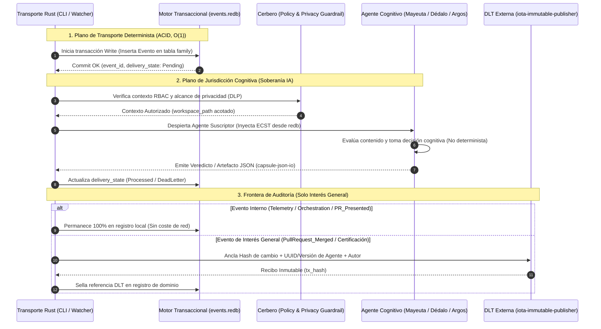

# [ARQUITECTURA] HU-SDDIA-EDA-REDB-001: Evolución del Bus de Eventos a Redb, Jurisdicción Cognitiva y Estandarización del Marco SddIA

- **Identificador:** `HU-SDDIA-EDA-REDB-001`
- **Estatus:** `Pendiente / Teórico`
- **Fecha de Emisión:** `2026-10-16`
- **Autor:** `Vértice Biológico (Racso) & Tormentosa`
- **Referencias Normativas:** `SddIA/CONSTITUTION_CORE.md`, `SddIA/core/cumulo.paths.json`, `SddIA/events/events-contract.md`, `SddIA/norms/capsule-json-io.md`, `SddIA/norms/pull-request-orchestration.md`

---

## 1. Matriz de Indexación Tridimensional

- **Naturaleza:** Refactorización de Infraestructura EDA, Gobernanza Cognitiva de IA y Saneamiento Documental.
- **Entorno:** `SddIA Core` (Workspace Rust / Crate de Persistencia `redb` / Contratos de Agentes y Eventos / Capa de Auditoría DLT IOTA).
- **Entropía Asimilada:** Destilado de la simbiosis directa tras someter la arquitectura de SddIA al Protocolo de Acero, separando la alegoría filosófica de la eficiencia técnica para consolidar un motor universal de interacciones automáticas de IA.

---

## 2. Descripción General y Alcance Funcional

**Como** Arquitecto de Gobernanza del ecosistema SddIA,  
**Quiero** migrar el bus de eventos basado en archivos JSON sueltos (`.events/`) hacia un motor transaccional embebido en Rust puro (**`redb`**), delimitar la frontera entre el transporte determinista y la jurisdicción cognitiva de los agentes, estandarizar el vocabulario de arquitectura cognitiva y restringir el sellado en DLT (IOTA) exclusivamente a hitos auditables de interés general (como la consolidación de un PR),  
**Para** eliminar los cuellos de botella de E/S en disco y demonios limpiadores (`event-sweeper`), garantizar que las decisiones de negocio y manejo de anomalías recaigan siempre sobre entidades de IA bajo políticas estrictas de seguridad/privacidad/responsabilidad, y facilitar la adopción y auditoría externa de la Librería SddIA tanto en código como en su documentación viva.

### Pilares de Ajuste Arquitectónico

1. **Soberanía Cognitiva vs. Transporte Determinista (*Control Plane* vs. *Data Plane*):**
   - Los binarios e infraestructura en Rust (`execute-process`, `event-watcher`) operan exclusivamente como **Plano de Transporte (Data Plane)**: validan esquemas, verifican permisos estáticos (RBAC) y garantizan la entrega transaccional en `redb` sin tomar decisiones de dominio.
   - La **Jurisdicción de Decisión (Control Plane)** recae innegociablemente sobre los Agentes cognitivos. Ante ambigüedades, excepciones de negocio o enrutamientos semánticos complejos, el transporte despierta al Agente titular para que evalúe el contexto bajo sus políticas de responsabilidad.
2. **Sustitución del Bus de Ficheros por `redb` (Rust Embedded Database):**
   - Se erradica el antipatrón *Filesystem as a Queue* (`.events/telemetry/`, `.events/orchestration/`, `.events/domain/`, `pending/`, `processed/`, `dead-letter/`).
   - Se implementa una base de datos transaccional ACID en Rust puro mediante el crate **`redb`** alojada en `.SddIA/runtime/events.redb` (ignorada en Git).
   - Se definen tablas tipadas por familia (`telemetry_events`, `orchestration_events`, `domain_events`) y estado de entrega (`delivery_state`), eliminando condiciones de carrera en *fan-out* y suprimiendo la necesidad del proceso `event-sweeper`.
3. **Políticas de Privacidad, Seguridad y Responsabilidad (*Zero-Trust Context*):**
   - El aislamiento de contexto actúa como mecanismo de **Prevención de Fuga de Datos (DLP)** y **Mínimo Privilegio (PoLP)**: ningún agente o modelo externo recibe datos fuera del `workspace_path` y del alcance autorizado por `Cerbero`.
4. **Doble Capa Semántica (Vocabulario de Arquitectura Cognitiva):**
   - Se mantiene la identidad estructural cognitiva de los nodos (`Mayeuta`, `Dédalo`, `Cerbero`, `Tekton`, `Argos`, `Radamanto`, `Cúmulo`), pero se incorpora en todos los contratos y documentación su **Descriptor Técnico Estándar** libre de jerga dramática o metafísica para garantizar legibilidad industrial y *compliance*.
5. **Frontera de Auditoría en DLT (Interno vs. Interés General):**
   - **Excluidos de DLT (100% Local en `events.redb`):** Telemetría de ejecución (`Raw_Execution_Finished`), eventos de orquestación interna y pruebas locales.
   - **Incluidos en DLT (IOTA Rebased):** Hechos externos de interés general y *compliance* que certifican **quién** (UUID y versión del Agente + autorizador) y **qué** (hash criptográfico del cambio) altera el estado productivo, específicamente `PullRequest_Merged` (aceptación de cambios) y `System_Immunity_Certified` (certificación pública de activos).

---

## 3. Separación de Responsabilidades (Vértice Biológico vs. Sistema)

### Tareas del Vértice Biológico (Prerrequisitos / Validación)
1. **Aprobación de Topología SSOT:** Autorizar la baja de las rutas de carpetas `.events/*` y `event-sweeper` en `SddIA/core/cumulo.paths.json` a favor del archivo único `.SddIA/runtime/events.redb`.
2. **Credenciales de Auditoría Externa (Opcional en local, requerido en CI/Release):** Mantener en `.SddIA/.dev/.env` las variables `IOTA_WALLET_SECRET` e `IOTA_ANCHOR_PACKAGE_ID` exclusivamente para los flujos de cierre de PR (`PullRequest_Merged`) y certificación.

### Responsabilidades del Sistema (SddIA Core)
1. Gestionar de forma transaccional y concurrente la lectura/escritura de eventos en `events.redb` mediante un nuevo crate compartido (`SddIA/crates/sddia-redb-bus` o integrado en `sddia-io`).
2. Exponer subcomandos en el CLI nativo para inspeccionar el estado del bus (`query-events`, `inspect-dead-letter`) dado que ya no serán archivos JSON legibles a simple vista en el explorador de archivos.
3. Actualizar sincronizadamente el código fuente, los contratos del genoma y la documentación viva del repositorio.

---

## 4. Coreografía y Flujo Operativo (Mermaid)



---

## 5. Impacto en Ficheros y Documentación Viva (Mapa de Mutación)

### A. Cambios en Código e Infraestructura (Ficheros)
| Ruta / Componente | Acción Técnica |
| :--- | :--- |
| `SddIA/Cargo.toml` y crate `sddia-event-store` | Añadir dependencia `redb` y definir esquemas de tablas (`telemetry`, `orchestration`, `domain`, `subscriptions_state`). |
| `SddIA/daemons/event-watcher/` | Refactorizar para escuchar notificaciones o hacer *polling* ligero sobre tablas `redb` en lugar de escanear directorios `.events/pending/`. |
| `SddIA/scripts/daemons/event-sweeper.py` | **Deprecación y eliminación física.** Las transacciones ACID y el borrado por clave en `redb` hacen obsoleto el barrido de archivos huérfanos. |
| `.gitignore` | Sustituir reglas de carpetas `.events/` dispersas por la exclusión de `.SddIA/runtime/*.redb` y `.SddIA/runtime/*.lock`. |

### B. Cambios en Genoma y Documentación Viva (Contratos y Markdown)
| Documento | Ajuste Documental y Semántico |
| :--- | :--- |
| `SddIA/core/cumulo.paths.json` | Actualizar claves `eda_fractal` y `eda_bus` para apuntar a `.SddIA/runtime/events.redb` y sus tablas lógicas. |
| `README.md` | 1. Actualizar sección **Eventos: genoma, runtime e instancia** reemplazando rutas `/.events/` por el motor `redb`.<br>2. Eliminar `event-sweeper` de los diagramas.<br>3. Incorporar la tabla de **Doble Capa Semántica** (Nombres del Panteón + Descriptores Técnicos de Arquitectura Cognitiva).<br>4. Explicitar la frontera de DLT (local vs. `PullRequest_Merged`). |
| `SddIA/CONSTITUTION_CORE.md` | Refinar el vocabulario eliminando metáforas biológicas/dramáticas e institucionalizando los 4 pilares operativos: Seguridad (RBAC), Privacidad (DLP por workspace), Responsabilidad (Jurisdicción Cognitiva) y Auditoría (Redb local + DLT en entregas). |
| `SddIA/events/events-contract.md` y `SddIA/events/index.md` | Añadir atributo booleano o enum `dlt_audit_scope: "local_only" | "external_public_interest"` en el contrato YAML de eventos, marcando `PullRequest_Merged` y `System_Immunity_Certified` como `external_public_interest`. |
| `SddIA/agents/*.md` y `SddIA/agents/index.md` | Añadir en el frontmatter YAML de cada agente el campo `cognitive_role_descriptor` (ej. `Cerbero`: *"Policy, Privacy & RBAC Guardrail"*; `Mayeuta`: *"Intent & Requirements Clarifier"*). |
| `SddIA/norms/pull-request-orchestration.md` | Documentar que la aceptación de un PR (`PullRequest_Merged`) es el disparador obligatorio de auditoría externa que vincula el hash del cambio con los UUIDs de los agentes intervinientes. |

---

## 6. Gobernanza S+ Grade y Criterios de Aceptación (Gherkin)

### Reglas de Gobernanza Aplicables
- **Cuarteto de Oráculos:** Compilación limpia en Rust (`cargo check --workspace`), tests unitarios de concurrencia sobre `redb` (`cargo test`), validación de paridad documental con `Cúmulo` y cero regresiones en el contrato `capsule-json-io.md`.
- **Ley de Genoma Protegido (DA-2):** Toda modificación sobre `SddIA/events/*`, `SddIA/agents/*` y `SddIA/norms/*` debe mantener la integridad de sus UUIDs v4 e índices `index.md`.

### Escenarios de Aceptación (Gherkin)

```gherkin
Funcionalidad: Bus de Eventos Transaccional en Redb y Gobernanza Cognitiva

  Escenario 1: Escritura y Fan-Out concurrente en Redb sin archivos en disco
    Dado que el motor SddIA ejecuta una acción que emite un evento de telemetría u orquestación
    Cuando el plano de transporte registra el evento
    Entonces se persiste mediante una transacción ACID en ".SddIA/runtime/events.redb"
    Y no se crea ningún archivo ".json" suelto en el árbol de directorios del repositorio
    Y múltiples suscriptores pueden actualizar su "delivery_state" concurrentemente sin bloqueos ni corrupción.

  Escenario 2: Preservación de la Jurisdicción Cognitiva frente al transporte determinista
    Dado un evento de dominio con una anomalía o requerimiento de decisión semántica
    Cuando el demonio "event-watcher" o el orquestador detecta el registro en "redb"
    Entonces el binario Rust se limita a verificar el esquema y el peaje RBAC con Cerbero
    Y delega el juicio de resolución despertando al Agente cognitivo correspondiente sin aplicar lógica de negocio cableada.

  Escenario 3: Frontera de Auditoría DLT exclusiva para hitos de interés general
    Dado el flujo completo de ciclo de vida de un cambio en el repositorio
    Cuando se emiten eventos internos como "Raw_Execution_Finished" o "PullRequest_Presented"
    Entonces estos quedan registrados únicamente en la base de datos local "events.redb" sin invocar la red IOTA
    Pero cuando se consolida el evento externo "PullRequest_Merged"
    Entonces el sistema invoca "iota-immutable-publisher" registrando el hash del PR, la versión/UUID de los agentes participantes y el autorizador.

  Escenario 4: Paridad entre Código y Documentación Viva con Vocabulario Cognitivo Estándar
    Dado el repositorio actualizado tras la migración a "redb"
    Cuando el auditor Argos verifica la coherencia documental
    Entonces "README.md", "cumulo.paths.json" y "events-contract.md" reflejan la arquitectura "redb" sin referencias activas a "event-sweeper"
    Y todos los contratos de agentes incluyen su descriptor técnico de arquitectura cognitiva libre de ambigüedad metafísica.
```

---

## 7. Desglose Propuesto en PBIs (Regla de <= 3 Archivos Adyacentes)

1. **`PBI-1 [INFRA]: Crate sddia-redb-bus y Esquema Transaccional de Eventos`**
   - *Alcance:* Creación del crate en Rust con `redb`, definición de tablas (`telemetry`, `orchestration`, `domain`), funciones CRUD ACID y tests de concurrencia.
   - *Archivos:* `SddIA/Cargo.toml`, `SddIA/crates/sddia-redb-bus/Cargo.toml`, `SddIA/crates/sddia-redb-bus/src/lib.rs`.
2. **`PBI-2 [CORE]: Integración de Redb en Orquestador/Watcher y Retirada de event-sweeper`**
   - *Alcance:* Conectar `execute-process` y `event-watcher` al crate `sddia-redb-bus`, añadir comando CLI de consulta de eventos y eliminar `event-sweeper`.
   - *Archivos:* `SddIA/daemons/event-watcher/src/main.rs`, `SddIA/scripts/qa/execute_process_capsules.py` (o crate orquestador Rust), `.gitignore`.
3. **`PBI-3 [DLT-GOV]: Frontera de Auditoría Externa en Eventos de Dominio`**
   - *Alcance:* Ajustar el contrato de eventos y las suscripciones para que solo `PullRequest_Merged` y `System_Immunity_Certified` disparen el sellado en IOTA.
   - *Archivos:* `SddIA/events/events-contract.md`, `SddIA/core/event-domain-subscriptions.json`, `SddIA/norms/pull-request-orchestration.md`.
4. **`PBI-4 [DOC-ONT]: Actualización de SSOT, README y Descriptores de Arquitectura Cognitiva`**
   - *Alcance:* Actualizar topología en `cumulo.paths.json`, documentar la arquitectura `redb` y tabla de descriptores cognitivos en `README.md` y `CONSTITUTION_CORE.md`.
   - *Archivos:* `SddIA/core/cumulo.paths.json`, `README.md`, `SddIA/CONSTITUTION_CORE.md`.
