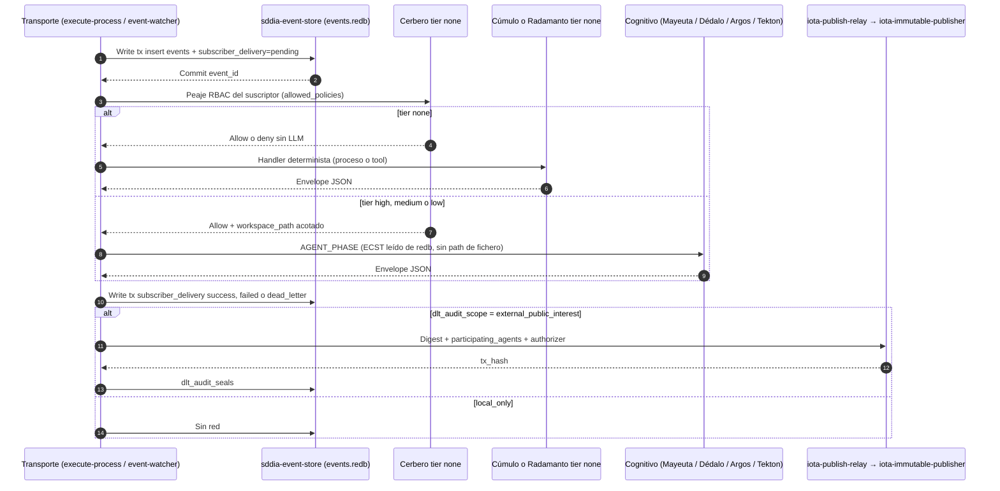

# [ARQUITECTURA] HU-SDDIA-EDA-REDB-001: Evolución del Bus de Eventos a Redb, Jurisdicción Cognitiva y Estandarización del Marco SddIA

**Versión:** 1.1.2 (estado de los siete PBI, 2026-10-21). El contrato de §1–§7 sigue siendo el de 1.1.0.  
**Proceso candidato:** `feature`  
**Línea base:** bus dual en disco (`.events/` vía `eda_bus` + `eda_fractal`). Cero coincidencias de `redb` en el repo.

## 0. Filtro A — correcciones sobre v1.0.0

| # | Afirmación v1.0.0 | Realidad verificada | Efecto |
| :--- | :--- | :--- | :--- |
| H1 | `SddIA/scripts/daemons/event-sweeper.py` se elimina | No existe. Centinela Rust `SddIA/daemons/event-sweeper/` (ficha `event-sweeper.md`, UUID `3eafa012-2b71-47e5-b47e-467b59a3fd52`), launchers `event-sweeper.sh` / `.bat`, unidad `sddia-event-sweeper@.service`. `REQUIRED_DAEMONS=(event-watcher event-sweeper)` en `start-sddia.sh`. El bucle además invoca `daemon-heartbeat-audit --inputs '{"sweep":true}'` (~30 s) y `system-vitality-probe` (default 300 s). | La baja del sweeper exige **transferir** esas dos sondas a `event-watcher` antes de tocar índices, `eda-coverage.json` y el arranque. |
| H2 | Crate `SddIA/crates/sddia-redb-bus` **o** `sddia-event-store` | No hay directorio `SddIA/crates/`. Members del workspace: `sddia-io`, `sddia-core`, `sddia-daemon-runtime`, `user-preference-core`, `infrastructure/adapters/*`, `engine/*`, `daemons/*`, `tools/*`, `interfaces/*`. | Un solo nombre: crate compartido `SddIA/sddia-event-store` (miembro nuevo de `SddIA/Cargo.toml`), consumido por `execute-process` y `sddia-daemon-runtime`. No es adaptador hexagonal de LanceDB. |
| H3 | El bus es una cola de ficheros que leen watcher y sweeper | Coexisten **dos** topologías en `cumulo.paths.json`: `eda_bus` (`pending`, `processing` + `subscribers`, `processed` + `subscribers`, `dead-letter`) y `eda_fractal` (`telemetry`, `orchestration`, `domain`, `progress`, `dead-letter` con `delivery_state` mutado in-place). Lectores extra: `event-bus-audit`, `sddia-qa` (`eda_e2e_lab.rs`), `kalma2-bridge` (SSE sobre `.events/progress/{correlation_id}`, domain, orchestration, telemetry), ingest de `Daemon_Heartbeat` en `start-sddia.sh`, emisores en `sddia-daemon-runtime`. Side-channel de vitalidad: `.SddIA/daemons/state/heartbeats/` (fuera del fan-out). | El esquema `redb` unifica testigos V3+ y el mapa fractal. `progress` y el side-channel de heartbeats tienen laudo propio (§3). |
| H4 | DLT solo en `PullRequest_Merged` y `System_Immunity_Certified`; variables `IOTA_WALLET_SECRET` e `IOTA_ANCHOR_PACKAGE_ID` | `iota-immutable-publisher` está suscrito a **18** eventos de dominio (14 vía `cumulo`, 4 vía `radamanto`). El publisher exige `IOTA_WALLET_SECRET` y, en producción, `IOTA_PUBLISH_RELAY_URL` (centinela `iota-publish-relay`) o simulación `SDDIA_LAB_SIMULATE_IOTA` / `SDDIA_LAB_MOCK_IOTA_URL`. `IOTA_ANCHOR_PACKAGE_ID` no aparece en el tool. `dlt_telemetry_anchor.rs` persiste prueba local de `Domain_Entity_Telemetry_Captured` en `.SddIA/proofs/dlt-telemetry/`. Paridad tabla Markdown ↔ JSON: `verify_domain_subscription_parity.rs`. | La frontera DLT es una **baja explícita de 16 suscriptores**, no un comentario. El ancla pública de gobernanza de activos se pliega al sello de `PullRequest_Merged` (§5). |
| H5 | Todo suscriptor «evalúa y decide de forma no determinista» | `agents-contract` v1.1.0: `llm_profile.tier`. Cognitivos: `mayeuta`/`dedalo` `high`, `argos` `medium` (solo síntesis; L-ARGOS-SYNTHESIS), `tekton` `low`. Deterministas `none` (prohibido spawn LLM): `cerbero`, `cumulo`, `radamanto`. Catálogo: 7 filas en `SddIA/agents/index.md`. | Tres planos, no dos (§2). Cerbero sigue siendo peaje RBAC, no juez cognitivo. |
| H6 | `CONSTITUTION_CORE.md` se reescribe «sin metáforas» | Parámetro de restricción (`.cursorrules` §7). §3.1 cita `.events/`, `pending/` y `subscribers/`. Invariantes vigentes: Filtros C, A, B; Protocolo de Acero; Cicatriz Rúnica; jurisdicción de la Aiúa (`paths.directories.conscience` / `aiua_core.md`), que **no** es uno de los 7 agentes. | Se añade la doble capa semántica. No se derogan filtros ni se rebautiza la Aiúa como agente de catálogo. |
| H7 | 4 PBI de ≤3 ficheros, incluyendo `execute_process_capsules.py` y `SddIA/crates/` | Esos paths no existen. La superficie real cruza orquestador, runtime de daemons, puente Kalma2, QA, arranque y genoma (DA-2: `entity-manager` para `events/`, `agents/`, `norms/`, `daemons/`). | Siete PBI por crate y por frontera, no por cuota de ficheros (§8). |

## 1. Historia

**Como** arquitecto de gobernanza del Core SddIA,  
**quiero** sustituir la cola de ficheros `.events/` por un store embebido ACID (`redb`), separar transporte ciego, guardrails deterministas y jurisdicción cognitiva, y restringir el anclaje IOTA a hitos de interés público,  
**para** eliminar carreras de fan-out y el barrido de huérfanos sin apagar las sondas de vitalidad, sin atribuir juicio LLM a Cerbero/Cúmulo/Radamanto, y sin anclar en DLT estímulos que deben permanecer en la instancia.

## 2. Tres planos

| Plano | Quién | Qué hace | Qué tiene prohibido |
| :--- | :--- | :--- | :--- |
| Transporte (data plane) | `sddia-event-store`, `execute-process`, `event-watcher` | Validar ECST, insertar, fan-out transaccional, testigo por suscriptor, dead-letter, replay | Decidir negocio, invocar LLM, interpretar normas |
| Guardrails (`tier: none`) | Cerbero (RBAC en `cerbero_di_rbac.rs`), Cúmulo (topología SSOT), Radamanto (umbrales) | Política exacta ya escrita en genoma o en código determinista | Spawn de `SDDIA_AGENT_RUNTIME_COMMAND` |
| Control cognitivo | Mayeuta `high`, Dédalo `high`, Argos `medium` (síntesis post-evidencia), Tekton `low` (forja según spec) | Ambigüedad, diseño, triaje, Kaizen/Kintsugi, ejecución táctica | Argos no sustituye linters/tests (L-ARGOS-SYNTHESIS). Tekton no decide arquitectura |

**Zero-Trust de contexto:** el payload inyectado a un agente cognitivo queda acotado al `workspace_path` y a las `allowed_policies` que Cerbero ya autorizó. PoLP y DLP son ese acotamiento, no un filtro nuevo.

## 3. Motor `redb`

### 3.1 Ubicación

| Pieza | Valor |
| :--- | :--- |
| Crate | `SddIA/sddia-event-store` (`crate_name`: `sddia-event-store`) |
| Workspace | alta en `members` de `SddIA/Cargo.toml` |
| Fichero | `.SddIA/runtime/events.redb` (gitignored, junto con `*.redb` y lock de `redb`) |
| Concurrencia | `redb`: N lectores, **una** transacción de escritura a la vez. El fan-out deja de ser N escrituras sobre el mismo JSON; cada testigo es un commit de la clave `(event_id, subscriber_id)`. No es lock-free. |
| Cutover | `SDDIA_EVENT_STORE=filesystem\|dual\|redb`. Default `filesystem` hasta CA del PBI 07. `dual` escribe store y fichero; lee del store si la clave existe. |

### 3.2 Tablas

| Tabla | Clave | Valor | Sustituye |
| :--- | :--- | :--- | :--- |
| `events` | `event_id` (UUID) | ECST canónico + `family` (`telemetry`\|`orchestration`\|`domain`) + `event_type` + `created_at` | Padre `.events/**/{id}.json` |
| `family_index` | `(family, created_at, event_id)` | vacío | Listados por carpeta |
| `subscriber_delivery` | `(event_id, subscriber_id)` | `pending`\|`success`\|`failed`\|`skipped` + witness JSON | Testigos `{id}.{sub}.json` **y** mapa `delivery_state` fractal |
| `dead_letter_index` | `event_id` | causa + `failed_subscriber_id` | `.events/dead-letter/` |
| `dlt_audit_seals` | `event_id` | `tx_hash`, digest, `scope` | Recibo hoy mezclado en el JSON / proofs |
| `progress_traces` | `(correlation_id, seq)` | frame JSON de fase | `.events/progress/{correlation_id}/*` que hoy lee `kalma2-bridge` (`/api/progress/stream`) |

Suscripciones **siguen** en JSON de genoma (`event-domain-subscriptions.json`, `event-telemetry-subscriptions.json`, `event-orchestration-subscriptions.json`). `redb` no es SSOT de suscriptores.

### 3.3 Lo que no entra en el fan-out

- **Heartbeats de centinela (Vía C):** `.SddIA/daemons/state/heartbeats/{daemon}.json` permanece en disco. `start-sddia.sh` deja de escanear `.events/telemetry/*.json` buscando `Daemon_Heartbeat` para el gate de arranque; lee el side-channel.
- **Proofs de instancia:** `eda_instance.proofs` (`.SddIA/proofs`, incluidos `dlt-telemetry`, `qa-attestations`, `pec-correlation`) no se mudan a `redb`.
- **Genoma de eventos:** `SddIA/events/` y `eda_instance.customization` (`.SddIA/events`) no son cola runtime.

### 3.4 Sondas que hoy viven en el sweeper

Antes de borrar `event-sweeper`:

1. `daemon-heartbeat-audit` con `{"sweep":true}` pasa al tick de `event-watcher`.
2. `system-vitality-probe` pasa al mismo tick (periodo `SDDIA_VITALITY_PROBE_SECONDS`, default 300). `probe_bus_topology` hoy exige que existan las hojas directorio de `eda_fractal`; con store `redb` valida el fichero `events.redb` y las claves de suscripciones, no carpetas.
3. `start-sddia.sh`: sacar `event-sweeper` de `REQUIRED_DAEMONS`, del sello de cápsulas y de `sddia-event-sweeper@.service`. Baja de ficha e `index.md` / `eda-coverage.json` vía `entity-manager` (`daemon-creator`), no a mano.

### 3.5 CLI

Subcomandos del binario de orquestación (no un binario nuevo): `query-events`, `inspect-dead-letter`, `replay-dead-letter`. Salida JSON por stdout (`capsule-json-io`).

## 4. Coreografía

## 5. Frontera DLT

Enum nuevo en `events-contract` (bump vía `entity-manager`): `dlt_audit_scope: local_only | external_public_interest`. Default de eventos no listados: `local_only`.

**Se mantienen** (scope `external_public_interest`):

| Evento | Suscriptor que se conserva | Enriquecimiento |
| :--- | :--- | :--- |
| `PullRequest_Merged` | `cumulo` / `tool:iota-immutable-publisher` | Payload OPTIONAL `participating_agents[]` (`uuid`, `name`, `version`, `role`) y `authorizer`. El digest puede incluir la raíz de los `Domain_Entity_*` del mismo `correlation_id` ya persistidos en `events`. |
| `System_Immunity_Certified` | `radamanto` / `tool:iota-immutable-publisher` | Sin cambio de payload REQUIRED |

**Pasan a `local_only`** (baja del suscriptor `iota-immutable-publisher`; el resto de suscriptores de cada clave no se toca):

| Evento | Agente del ancla que se retira |
| :--- | :--- |
| `PullRequest_Presented` | cumulo |
| `Domain_Entity_Created` | cumulo |
| `Domain_Entity_Updated` | cumulo |
| `Domain_Entity_Deleted` | cumulo |
| `Domain_Entity_Telemetry_Captured` | cumulo |
| `Domain_Entity_Degraded` | radamanto |
| `Domain_Entity_Restored` | radamanto |
| `Domain_Entity_Deprecated` | radamanto |
| `TelegramMessage_Received` | cumulo |
| `Manual_Task_Requested` | cumulo |
| `Kalma2_Process_Requested` | cumulo |
| `Kaizen_Idea_Captured` | cumulo |
| `Thought_Persisted` | cumulo |
| `Vector_Memory_Indexed` | cumulo |
| `Instance_Deployed` | cumulo |
| `Instance_Torn_Down` | cumulo |

`Domain_Entity_Telemetry_Captured` sigue escribiendo proof local en `.SddIA/proofs/dlt-telemetry/` (`dlt_telemetry_anchor.rs`). Deja de llamar a IOTA. `verify_domain_subscription_parity` debe quedar en verde tras el bump de cada `{evento}.md`.

Transporte IOTA sin rediseño: `IOTA_WALLET_SECRET` + `IOTA_PUBLISH_RELAY_URL` (o simulación de lab). No se introduce `IOTA_ANCHOR_PACKAGE_ID`.

## 6. Doble capa semántica

Campo nuevo opcional `cognitive_role_descriptor` (texto industrial, una línea). Exige `agents-contract` **1.1.0 → 1.2.0** y bump de los siete `{name}.md` vía `entity-manager`. No altera `uuid`, `allowed_policies` ni `llm_profile.tier`.

| Entidad | Tier vigente | Descriptor |
| :--- | :--- | :--- |
| Cerbero | `none` | Peaje RBAC determinista |
| Cúmulo | `none` | SSOT de topología e índices |
| Radamanto | `none` | Actuario de umbrales sobre telemetría |
| Argos | `medium` | Juez de artefactos; síntesis solo tras evidencia de cápsulas |
| Tekton | `low` | Ejecución táctica según especificación |
| Dédalo | `high` | Diseño de especificación y blueprint de proceso |
| Mayeuta | `high` | Estabilización de requisitos y auditoría Kaizen de fracturas |
| Aiúa | fuera del catálogo de agentes | Jurisdicción ética constitucional (`aiua_core.md`) |

`CONSTITUTION_CORE.md` §3.1 sustituye la frase de bus en ficheros por store `redb` + testigo `subscriber_delivery`, y conserva Filtros C, A, B, Protocolo de Acero y Cicatriz Rúnica. `README.md` (sección de eventos, diagrama de centinelas, frontera DLT) se alinea en el mismo PR documental. `cumulo.paths.json`: `eda_bus` y `eda_fractal` pasan a apuntar al fichero `events.redb` y a nombres de tabla; las claves `*_subscriptions` no cambian de ruta.

## 7. Criterios de aceptación

| ID | Criterio | Verificación |
| :--- | :--- | :--- |
| AC-1 | Con `SDDIA_EVENT_STORE=redb`, un ECST de dominio persiste en `events` y no crea `.json` bajo `.events/`. | Test `sddia-event-store` + `route-domain-event`. |
| AC-2 | Dos suscriptores del mismo `event_id` cierran `subscriber_delivery` sin perder el testigo del otro. | Test de transacciones secuenciales sobre una sola write-tx de `redb`. |
| AC-3 | `SDDIA_EVENT_STORE=filesystem` deja la suite EDA actual en verde (`eda_e2e_lab`, paridad de suscripciones). | Regresión. |
| AC-4 | Suscriptor `tier: none` no spawnea runtime LLM. Suscriptor `high`/`medium`/`low` recibe ECST desde `redb` y `workspace_path` acotado. | Test de dispatch. |
| AC-5 | `Raw_Execution_Finished`, `PullRequest_Presented` y los 16 eventos de la tabla §5 no llaman a IOTA. `PullRequest_Merged` y `System_Immunity_Certified` sí, con `tx_hash` en `dlt_audit_seals`. | Test publisher mock + `SDDIA_LAB_SIMULATE_IOTA`. |
| AC-6 | `PullRequest_Merged` acepta `participating_agents` y `authorizer` como OPTIONAL. Ausentes → ancla igual que hoy (fail-open de enriquecimiento, no de ancla). | Test de schema ECST. |
| AC-7 | `daemon-heartbeat-audit` sweep y `system-vitality-probe` corren con `event-sweeper` ausente del proceso. | Test de tick de `event-watcher`. |
| AC-8 | SSE `/api/progress/stream` emite frames leídos de `progress_traces`. | Test `kalma2-bridge`. |
| AC-9 | `query-events`, `inspect-dead-letter`, `replay-dead-letter` devuelven envelope JSON. Replay mueve la clave de `dead_letter_index` a `pending` lógico. | Test CLI. |
| AC-10 | Paridad Markdown ↔ `event-domain-subscriptions.json` en verde. Cero `iota-immutable-publisher` fuera de las dos claves de §5. | `sddia-qa` paridad. |
| AC-11 | `cognitive_role_descriptor` presente en los 7 agentes; `llm_profile.tier` intacto; `agents-contract` 1.2.0. Constitución conserva los tres filtros. | `rg` + frontmatter. |
| AC-12 | Cutover `redb`: `.gitignore` ignora `.SddIA/runtime/*.redb`; `event-sweeper` fuera de `REQUIRED_DAEMONS` y del catálogo de daemons; `probe_bus_topology` no exige directorios `eda_fractal`. | Arranque lab + sonda. |

## 8. PBI

Genoma (`events/`, `agents/`, `norms/`, `daemons/`) solo vía `execute-process` → `entity-manager`. Un PR por PBI. Orden: 01 bloquea 02; 02 bloquea 03, 04 y 05; 06 va en paralelo; 07 cierra cuando 03, 04, 05 y 06 están mergeados.

Los siete están implementados. 01–06 están mergeados y viven en `docs/todos/done/`. 07 está archivado en `docs/todos/done/` en `feat/eda-redb-07-cutover` y presentado; el merge no está sellado. Esta HU sigue en `pending`.

| Orden | PBI | Artefacto | AC | Estado | PR |
| ---: | :--- | :--- | :--- | :--- | :--- |
| 01 | `PBI-EDA-REDB-01-STORE` | `docs/todos/done/[ARQUITECTURA] EDA Redb 01 — Store transaccional sddia-event-store.md` | AC-2 | mergeado | https://github.com/racso80es/SddIA/pull/353 |
| 02 | `PBI-EDA-REDB-02-WRITERS` | `docs/todos/done/[ARQUITECTURA] EDA Redb 02 — Escritores del bus según SDDIA_EVENT_STORE.md` | AC-1, AC-3 | mergeado | https://github.com/racso80es/SddIA/pull/354 |
| 03 | `PBI-EDA-REDB-03-WATCHER-VITALITY` | `docs/todos/done/[ARQUITECTURA] EDA Redb 03 — Watcher y sondas de vitalidad.md` | AC-4, AC-7 | mergeado | https://github.com/racso80es/SddIA/pull/355 |
| 04 | `PBI-EDA-REDB-04-READERS` | `docs/todos/done/[ARQUITECTURA] EDA Redb 04 — Lectores, SSE y CLI de inspección.md` | AC-8, AC-9 | mergeado | https://github.com/racso80es/SddIA/pull/356 |
| 05 | `PBI-EDA-REDB-05-DLT-FRONTIER` | `docs/todos/done/[ARQUITECTURA] EDA Redb 05 — Frontera de auditoría DLT.md` | AC-5, AC-6, AC-10 | mergeado | https://github.com/racso80es/SddIA/pull/357 |
| 06 | `PBI-EDA-REDB-06-SEMANTIC-LAYER` | `docs/todos/done/[ARQUITECTURA] EDA Redb 06 — Doble capa semántica.md` | AC-11 | mergeado | https://github.com/racso80es/SddIA/pull/358 |
| 07 | `PBI-EDA-REDB-07-CUTOVER` | `docs/todos/done/[ARQUITECTURA] EDA Redb 07 — Cutover a redb y baja de event-sweeper.md` | AC-12 | presentado | https://github.com/racso80es/SddIA/pull/359 |

## 9. Fuera de alcance

- Sustituir LanceDB (`vector_store`, preferencias, thoughts, evolution).
- Mover proofs (`.SddIA/proofs`) o heartbeats de centinela al fichero `redb`.
- Rediseñar `iota-publish-relay` o la cápsula `iota-immutable-publisher` más allá de dejar de invocarla en los 16 eventos.
- Autenticación multiusuario.
- Derogar Filtros C, A, B, Protocolo de Acero o Cicatriz Rúnica.
- Mutación manual de genoma.

## 10. Laudos

| ID | Laudo |
| :--- | :--- |
| L-REDB-01 | Store = crate `SddIA/sddia-event-store`. Prohibido `SddIA/crates/`. |
| L-REDB-02 | Cutover por `SDDIA_EVENT_STORE`; prohibido big-bang que apague el bus de ficheros en el PBI 01. |
| L-REDB-03 | Write-tx única de `redb`. El beneficio es ACID por clave de testigo, no escritura paralela. |
| L-REDB-04 | Heartbeats Vía C y proofs quedan en disco. |
| L-REDB-05 | `progress_traces` sustituye `.events/progress/` porque `kalma2-bridge` depende de esos frames. |
| L-REDB-06 | Sondas del sweeper se mudan a `event-watcher` antes de la baja del daemon. |
| L-REDB-07 | DLT externo = solo `PullRequest_Merged` y `System_Immunity_Certified`. Los otros 16 anclajes IOTA actuales bajan. Gobernanza de activos queda en `events` y puede entrar al digest del merge. |
| L-REDB-08 | Jurisdicción cognitiva no cubre `tier: none`. Tres planos (§2). |
| L-REDB-09 | Doble capa = campo `cognitive_role_descriptor` + párrafo constitucional. No reescribe la identidad ni los filtros. |

<!-- refined:mayeuta -->
