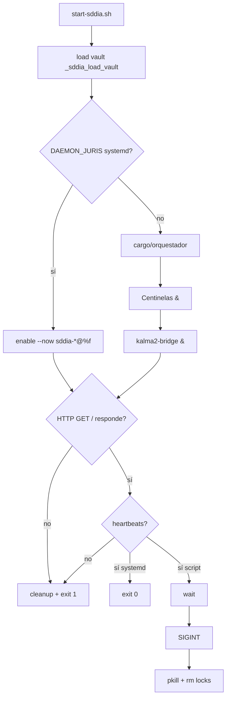

# Ignición del ecosistema SddIA (`start-sddia.sh`)

Script de arranque unificado del nodo local: levanta los **Centinelas** (Sistema Nervioso EDA), el centinela **email-watcher** (si IMAP configurado) y el puente **Kalma2** (binario Rust `kalma2-bridge`). Vive en la raíz del repositorio como artefacto de **instancia**.

**v1.4.3:** la lista release de ignición incluye `linear-tracker-adapter` (cápsula `tracker:lifecycle` / `materialize-fracture-pbi`); testigo `.sha256` junto a orquestador y bridge.

**v1.4.2:** ignición Core-self = un único `cargo build --release` (lista fija de paquetes) en `SddIA/target`; sin segundo build debug. Cargo decide recompilar por huella; ignición repetida sin cambios de fuente suele terminar en `Finished` al instante. Orquestador y centinelas alineados a release (F-DEP-07 salvo debug lab más nuevo que release).

**v1.4.1:** `ExecStart=%f/SddIA/…` (molde user universal; no path de host). Cleanup lab: PID de lock de `$REPO_ROOT`, cero `pkill -x`.

**v1.4.0:** jurisdicción `SDDIA_DAEMON_JURISDICTION` (`systemd`|`script`). Default `systemd` si el bus `--user` responde. Unidades `sddia-{daemon}@%f` (fábrica `sddia-daemon@.service.template`). El script hace `enable --now` y **sale**; no retiene hijos del bus/WUI. WARN Linger / `XDG_RUNTIME_DIR`. Fallback `script` = spawn `&` + `wait` (lab sin systemd user).

**v1.3.0:** perfil `SDDIA_RUNTIME_PROFILE` (`consumer`|`engineering`); Filtro C excluye `github-bridge-watcher` en consumidor; R-07 omite spawn de `email-watcher`/`telegram-watcher` si `SDDIA_SENSORIAL_JURISDICTION=systemd` o unidad user `sddia-email-watcher@*` activa.

**v1.2.2:** integra `email-watcher` como centinela opcional condicionado a `SDDIA_EMAIL_IMAP_HOST` en bóveda (`.SddIA/.dev/.env` prevalece sobre `.dev/.env`).

**v1.2.1:** ignición compila en `SddIA/target` (`CARGO_TARGET_DIR` explícito) y exporta `SDDIA_EXECUTE_PROCESS_BIN`. Evita ELF stale de caché sandbox / `target` ajeno.

## Objetivo

| Componente | Rol | Ruta de arranque |
|------------|-----|------------------|
| **Servicios de Red** | Puente local hacia IOTA Rebased (Relay) | `.SddIA/services/iota-publish-relay/server.mjs` (Node.js) |
| **Centinelas obligatorios** | Bus EDA sobre `events.redb` | `SddIA/scripts/daemons/event-watcher.sh` |
| **Centinelas opcionales** | Telegram y GitHub bridge | `SddIA/scripts/daemons/telegram-watcher.sh`, `github-bridge-watcher.sh` |
| **Centinela sensorial (condicional)** | Correo IMAP read-only → `Email_Received` | `SddIA/scripts/daemons/email-watcher.sh` si `SDDIA_EMAIL_IMAP_HOST` está en bóveda |
| **Kalma2** | UI + `POST /api/interact` | `SddIA/target/release/kalma2-bridge` (fallback debug si falta release) |

## Separación genoma / instancia

- **Genoma** (`SddIA/`): centinelas, orquestador `execute-process`, crate `kalma2-bridge` en `SddIA/interfaces/kalma2-bridge/`.
- **Instancia** (`.SddIA/`): locks, estado y logs de demonios (`.SddIA/daemons/{status,state,logs}`).
- **Bundle UI** (`interfaces/kalma2/`): estáticos servidos por el bridge.

SSOT de rutas: `SddIA/core/cumulo.paths.json`.

## Secuencia de ignición



1. Ancla `REPO_ROOT` y carga bóveda (`_sddia_load_vault`) para que `kalma2-bridge`/`mayeuta-llm` hereden `SDDIA_LLM_*`.
2. Un `cargo build --release` (centinelas, bridge, orquestador, `linear-tracker-adapter`, `sddia-qa`, …) con `CARGO_TARGET_DIR=$REPO/SddIA/target`; `--seal-capsules` perfil release; exporta `SDDIA_EXECUTE_PROCESS_BIN` (F-DEP-07).
3. Lanza centinelas vía `SddIA/scripts/daemons/<name>.sh`.
4. Si `SDDIA_EMAIL_IMAP_HOST` está definido tras `_sddia_load_vault`, lanza `email-watcher` (fallo no bloquea ignición; emite `[WARN]`).
5. Resuelve y arranca `kalma2-bridge` nativo ELF (`SDDIA_KALMA2_BRIDGE_BIN` o `SddIA/target/release/`, luego debug).
6. Health check HTTP en `http://127.0.0.1:8765/`.
7. Gate: `daemon-heartbeat-audit` confirma latidos frescos de obligatorios (`missed_cycles < 3`).
8. `wait` hasta señal de terminación; cleanup elimina locks en `.SddIA/daemons/status/` (incl. `email-watcher.lock`).

## Uso

```bash
./start-sddia.sh
```

La ignición compila lo necesario en release. Atajo lab (sin pasar por el script):

```bash
cd SddIA && CARGO_TARGET_DIR=target cargo build --release -p execute-process -p event-watcher -p kalma2-bridge
```

Variables de entorno:

| Variable | Default | Efecto |
|----------|---------|--------|
| `SDDIA_DAEMON_JURISDICTION` | auto (`systemd` si bus user; si no `script`) | Fuerza supervisor systemd o spawn de consola |
| `SDDIA_CLIENT_PORT` | `8765` | Puerto HTTP Kalma2 |
| `SDDIA_CLIENT_TIMEOUT_SECONDS` | `120` | Timeout subproceso orquestador |
| `SDDIA_KALMA2_BRIDGE_BIN` | autodetect | Override binario bridge |
| `SDDIA_EXECUTE_PROCESS_BIN` | autodetect | Override orquestador (bridge) |
| `SDDIA_REPO_ROOT` | autodetect | Raíz repo (bridge) |
| `SDDIA_EMAIL_IMAP_HOST` | — | Si presente en bóveda, arranca `email-watcher` |
| `SDDIA_EMAIL_INITIAL_LOOKBACK_DAYS` | `60` | Primer sondeo IMAP: ventana `SINCE` (no `ALL`) |
| `SDDIA_EMAIL_MAX_UIDS_PER_POLL` | `50` | Tope por sondeo; UNSEEN prioritario |

**Cambio de cuenta IMAP:** al editar `SDDIA_EMAIL_IMAP_USER` o `SDDIA_EMAIL_IMAP_HOST` en bóveda y reiniciar el centinela, `email-watcher` detecta el cambio de identidad (`imap_identity_sha256` en state) y hace bootstrap automático (no hace falta resetear `last_uid` a mano). Cambiar solo `SDDIA_EMAIL_IMAP_SECRET` (misma cuenta) **no** resetea el watermark.

## Apagado limpio

- `kill` jobs en background.
- `pkill -x` centinelas + `kalma2-bridge` + `email-watcher` (si estaba activo).
- Elimina `{daemons_instance.status}/{name}.lock` de los cuatro centinelas base y `email-watcher.lock` (contrato CEN-01; evita PIDs muertos residuales).

## Requisitos previos

- Bundle UI en `interfaces/kalma2/`.
- `protoc` en PATH (LanceDB / `execute-process`; la ignición lo exige).
- `curl` para health check y `file` para validar ejecutables ELF nativos.

## Garantía de ejecución nativa

- El centinela obligatorio `event-watcher` debe iniciar como ELF nativo; su fallo cancela la ignición antes de lanzar Kalma2.
- Los centinelas opcionales no alteran la condición de éxito de los obligatorios.
- El arranque muestra la ruta del ELF resuelto. Centinelas y bridge: `release` y luego `debug` (`_sddia_resolve_daemon_binary`). Orquestador: F-DEP-07 (`release` salvo debug estrictamente más nuevo).
- `SDDIA_KALMA2_BRIDGE_BIN` y `SDDIA_EXECUTE_PROCESS_BIN` solo admiten binarios ELF ejecutables; un script Python u otro wrapper es rechazado explícitamente.

## Diagnóstico

| Síntoma | Acción |
|---------|--------|
| `kalma2-bridge no encontrado` | `cd SddIA && CARGO_TARGET_DIR=target cargo build --release -p kalma2-bridge` |
| `orquestador no encontrado` (POST) | `cd SddIA && CARGO_TARGET_DIR=target cargo build --release -p execute-process` |
| Centinela no arranca | `.SddIA/daemons/logs/<name>.log` |
| `Error IOTA: Connection refused (os error 111)` | Revisar `.SddIA/services/iota-publish-relay/relay.log` |

## Verificación rápida

```bash
pgrep -x event-watcher
pgrep -x kalma2-bridge
curl -sf -o /dev/null -w '%{http_code}\n' http://127.0.0.1:8765/
curl -sf -XPOST http://127.0.0.1:8765/api/interact -H 'Content-Type: application/json' -d '{"prompt":"hola"}'
```

## Referencias

- Feature bridge Rust: `docs/features/kalma2-bridge-rust/`
- Kalma2 UI: `interfaces/kalma2/README.MD`
- Proceso motor: `SddIA/process/kalma2-interact.md`
- CLI orquestador: `./sddia-run.sh --process kalma2-interact --inputs '{"prompt":"..."}'`
